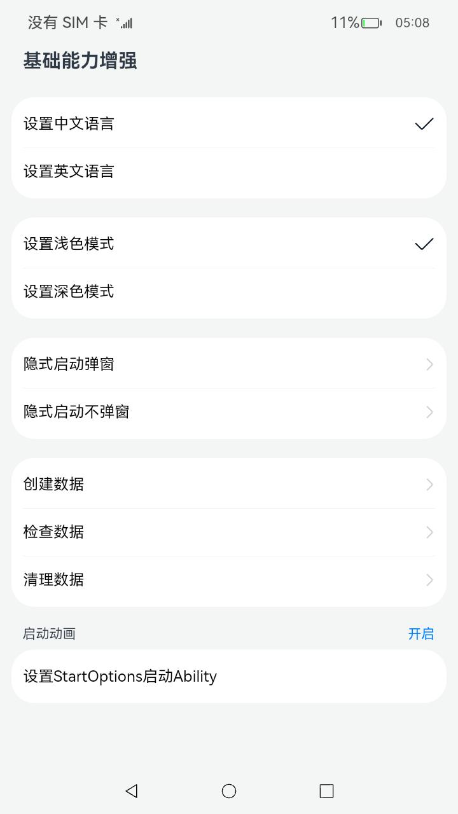
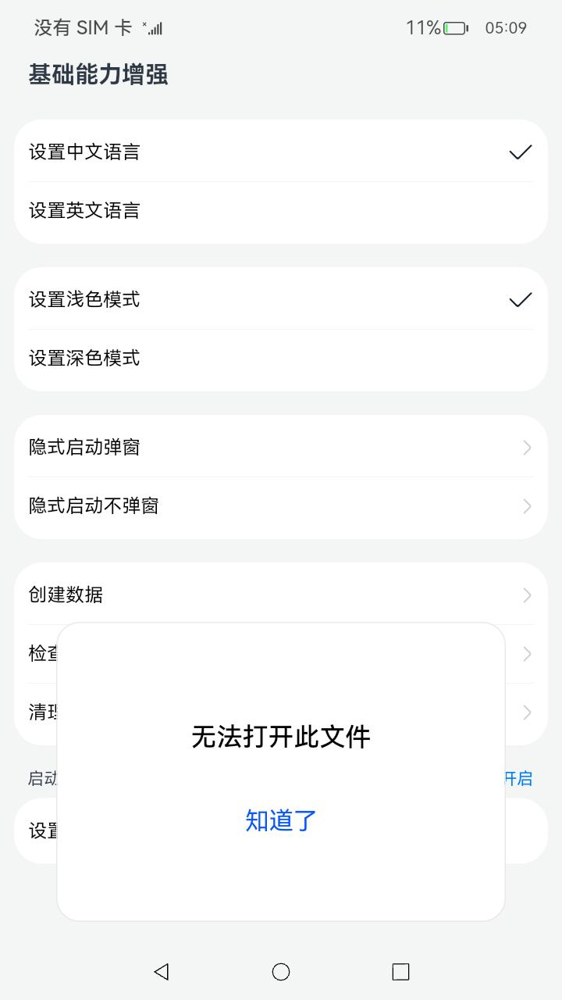
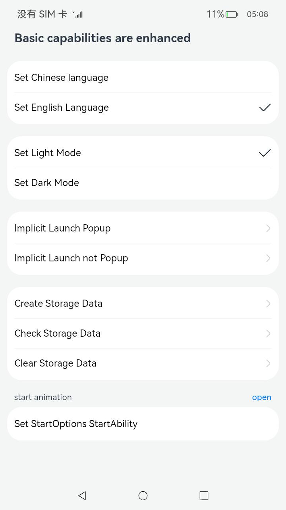
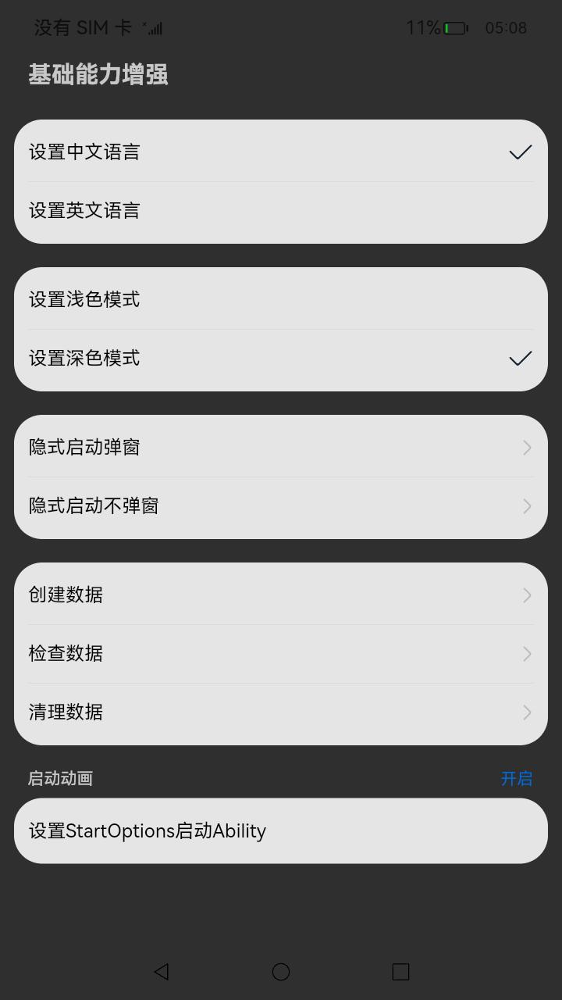

# Basic Capability Enhancement

### Introduction

This sample demonstrates the following features using the [ApplicationContext](https://gitcode.com/openharmony/docs/blob/master/en/application-dev/reference/apis-ability-kit/js-apis-inner-application-applicationContext.md), [ohos.ability.wantConstant](https://gitcode.com/openharmony/docs/blob/master/en/application-dev/reference/apis-ability-kit/js-apis-ability-wantConstant.md), and [ohos.app.ability.StartOptions](https://gitcode.com/openharmony/docs/blob/master/en/application-dev/reference/apis-ability-kit/js-apis-app-ability-startOptions.md) APIs:

1. Customizing system environment parameters.
2. Triggering the prompt dialog only when the number of implicit starts is 0 by adding a flag.
3. Clearing application data.
4. Supporting initial position, initial size, and animation parameters when starting an Ability.

### Preview

|                            Main Page                            |                         Implicit Start Dialog                         |                      English Switch Page                      |                    Dark Mode Switch Page                    |
| :----------------------------------------------------------: | :----------------------------------------------------------: | :--------------------------------------------------: | :--------------------------------------------------: |
|  |  |  |  |

### Usage

1. **Language switching**: Tap **Switch to English**, and the page switches to English. The title "基础能力增强" changes to "Basic capabilities are enhanced". Tap **Switch to Chinese**, and the page switches back to Chinese.

2. **Dark mode switching**: Tap **Switch to Dark Mode**, and the page switches to dark mode with a Toast message "切换成功". Tap **Switch to Light Mode**, and the page switches to light mode with a Toast message "切换成功".

3. **Implicit start dialog**: Tap **Implicit Start Dialog** to show the dialog. Tap **Implicit Start Without Dialog** to show a Toast message "隐式启动不弹窗" without a dialog (RK only).

4. **Clear data**: Tap **Create Data** to create a cache file. Tap **Check Data** to query the cache file. Tap **Clear Data** to clear the cache file and exit the application automatically. After restarting the application manually, tap **Check Data** to show that no cache file is found.

5. **StartOptions configuration**: Tap **StartOptions Configuration** to start NewAbility. Return to the main page, enable **Start Animation**, and tap **StartOptions Configuration** again to start NewAbility with animation.

### Project Directory

```
entry/src/main/ets/
|---entryability
|   |---EntryAbility.ets                  // Entry Ability
|   |---NewAbility.ets                    // Target Ability for StartOptions demonstration
|---pages
|   |---Index.ets                         // Main page
```

### Implementation

* Basic capability enhancement is implemented in [Index.ets](entry/src/main/ets/pages/Index.ets).
  * Language switching: Uses `ApplicationContext.setLocale` to switch the application language.
  * Dark mode switching: Uses `ApplicationContext.setColorMode` to switch the color mode.
  * Implicit start dialog: Uses `StartOptions` with the flag to control whether to show the dialog when no matching Ability is found.
  * Clear data: Uses `ApplicationContext.clearUpApplicationData` to clear application data.
  * StartOptions: Uses `StartOptions` to set the initial position, initial size, and animation flag when starting an Ability.

### Test

Automated test cases are located in `entry/src/ohosTest/ets/test`. For test design, manual cases, and real-device constraints, see [ohosTest.md](ohosTest.md).

### Permissions

None.

### Dependencies

None.

### Constraints and Limitations

1. This sample can run only on standard-system devices and has been verified on an RK3568 board.
2. This sample uses the Stage model and supports API 26 SDK (26.0.0). The `compileSdkVersion`, `targetSdkVersion`, and `compatibleSdkVersion` are all 26.0.0.
3. DevEco Studio 26.0.0 Release or later is required to compile and run this sample.

### Download

```shell
git init
git config core.sparsecheckout true
echo code/BasicFeature/Ability/AbilityFeature/ > .git/info/sparse-checkout
git remote add origin https://gitcode.com/openharmony/applications_app_samples.git
git pull origin master
```
