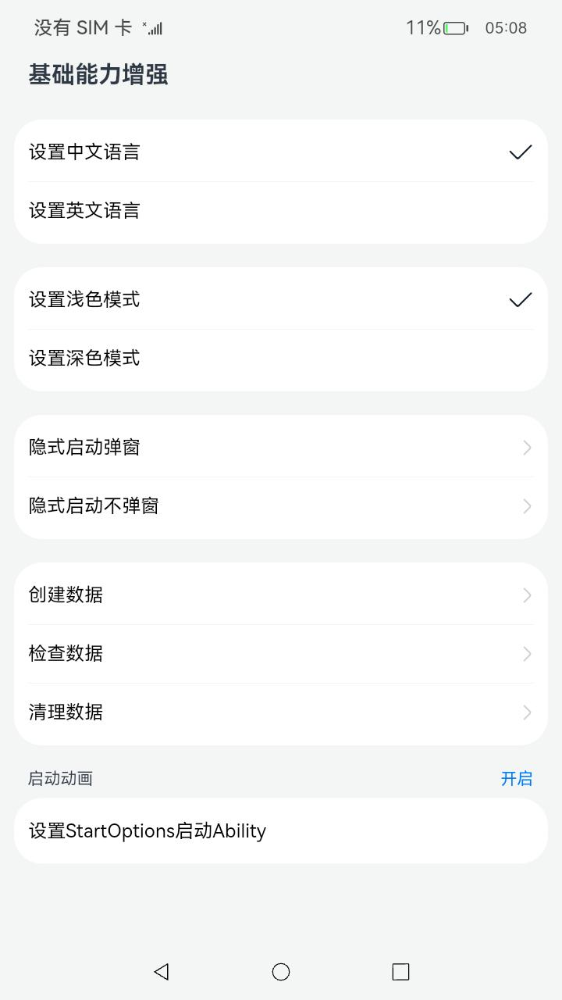
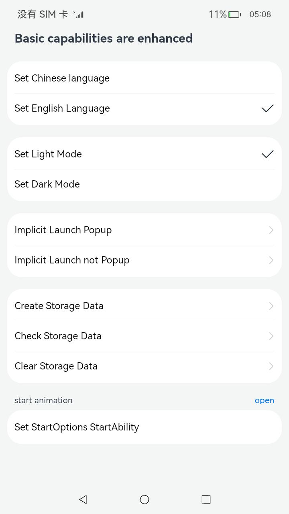
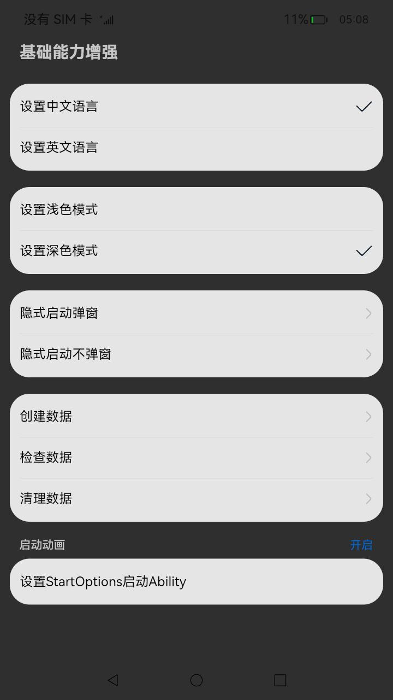

# 基础能力增强

### 介绍

本示例使用   [ApplicationContext](https://gitcode.com/openharmony/docs/blob/master/zh-cn/application-dev/reference/apis-ability-kit/js-apis-inner-application-applicationContext.md) ,[ohos.ability.wantConstant](https://gitcode.com/openharmony/docs/blob/master/zh-cn/application-dev/reference/apis-ability-kit/js-apis-ability-wantConstant.md) ,[ohos.app.ability.StartOptions](https://gitcode.com/openharmony/docs/blob/master/zh-cn/application-dev/reference/apis-ability-kit/js-apis-app-ability-startOptions.md)等接口实现了以下功能：

1. 支持应用定制系统环境参数；

2. 支持隐式启动个数为0时才触发提示弹框--增加了一个flag；

3. 支持应用清理自己的数据；

4. Ability启动参数支持传递初始位置/初始大小/是否携带动效；

### 效果预览

|                            主页面                            |                         隐式启动弹窗                         |                      英文切换页                      |                    深色模式切换页                    |
| :----------------------------------------------------------: | :----------------------------------------------------------: | :--------------------------------------------------: | :--------------------------------------------------: |
|  |  |  |  |

使用说明

1.应用切换语言的能力；

点击'切换英文语言'的ListItem，当前页面切换为英文，标题'基础能力增强'切换成'Basic capabilities are enhanced'
,点击'切换中文语言'的ListItem，当前页面切换为中文，标题'Basic capabilities are enhanced'切换成'基础能力增强'；

2.应用切换颜色模式的能力

点击'切换深色模式'的ListItem，当前页面颜色切换为深色，弹出Toast提示'切换成功'，点击'切换浅色模式'
的ListItem，当前页面颜色切换为浅色，弹出Toast提示'切换成功'；

3.应用隐式启动个数为0时，才触发提示弹框的特性

点击'隐式启动弹窗'的ListItem，弹出弹窗，弹窗标题为'未找到文件'，点击'隐式启动不弹窗'
的ListItem，弹出Toast提示'隐式启动不弹窗'，且无弹窗（仅支持rk）；

4.应用清理自己的数据的能力

点击'创建数据'的ListItem，弹出Toast提示创建'缓存文件成功'，点击'检查数据'的ListItem，弹出Toast提示创建'查询到缓存文件'
，点击'清除数据'的ListItem，应用清理缓存文件后自动退出。手动重新启动应用后，点击'检查数据'的ListItem，弹出Toast提示创建'未找到缓存文件'；

5.应用可以设置启动参数启动Ability能力

点击'StartOptions配置'的ListItem，应用启动NewAbility。返回主界面后，点击'启动动画'的Toggle，再点击'
StartOptions配置'的ListItem，应用启动NewAbility；

### 工程目录

```
entry/src/main/ets/
|---characteroperation
|   |---CharacterOperation.ets          // 语言/色彩模式/沙箱文件/清理数据的封装
|---common
|   |---AppConstants.ets                // 语言、文件名、Toast 时长等常量
|   |---MenuIds.ets                     // 首页列表项与 New 页返回按钮的组件 id
|---entryability
|   |---EntryAbility.ets				// 首页的Ability
|---model
|   |---LaunchIntent.ets                // Want/StartOptions 构造与格式化
|   |---StoragePath.ets                 // 五类沙箱目录的路径模型与读写
|---newability
|   |---NewAbility.ets					// 被启动的UIAbility(验证新接口启动使用)
|---pages
|   |---Index.ets						// 首页
|   |---New.ets							// 被启动UIAbility的展示页
|---util
|   |---Logger.ets						// 日志工具
```

### 具体实现

- 应用切换语言的功能接口封装在CharacterOperation，使用[ApplicationContext](https://gitcode.com/openharmony/docs/blob/master/zh-cn/application-dev/reference/apis-ability-kit/js-apis-inner-application-applicationContext.md) 调用setLanguage(language: string): void方法实现，源码参考：[CharacterOperation.ets](entry/src/main/ets/characteroperation/CharacterOperation.ets)
- 应用切换颜色模式的功能接口封装在CharacterOperation，使用[ApplicationContext](https://gitcode.com/openharmony/docs/blob/master/zh-cn/application-dev/reference/apis-ability-kit/js-apis-inner-application-applicationContext.md) 调用setColorMode(colorMode: ConfigurationConstant.ColorMode): void方法实现，源码参考：[CharacterOperation.ets](entry/src/main/ets/characteroperation/CharacterOperation.ets)
- 应用清理自己的数据的功能接口封装在CharacterOperation，使用[ApplicationContext](https://gitcode.com/openharmony/docs/blob/master/zh-cn/application-dev/reference/apis-ability-kit/js-apis-inner-application-applicationContext.md) 调用clearUpApplicationData(callback: AsyncCallback<void>): void方法实现，源码参考：[CharacterOperation.ets](entry/src/main/ets/characteroperation/CharacterOperation.ets)
- 应用隐式启动个数为0时不触发提示弹框的特性，通过给Want的flags设置为FLAG_START_WITHOUT_TIPS,源码参考：[Index.ets](entry/src/main/ets/pages/Index.ets)
- 应用可以设置启动参数启动Ability能力，通过给startAbility(want: Want, options: StartOptions, callback: AsyncCallback<void>): void;方法传递新增参数StartOptions来设置启动位置，大小以及是否包含动画，源码参考：[Index.ets](entry/src/main/ets/pages/Index.ets)

### 测试

自动化用例位于 `entry/src/ohosTest/ets/test`，共 20 个套件文件 864 条，全部在 RK3568 真机上实测通过（连续两轮 `Tests run: 864, Failure: 0, Error: 0`）。用例元数据统一为 `@tc.number SUB_ABILITY_FEATURE_<主题>_NNNN` + `@tc.type/@tc.size/@tc.level`，`it` 的第二个参数为 `TestType.FUNCTION | Size.XXX | Level.LEVELn`，单文件不超过 2000 行：

| 套件文件 | 用例数 |
| -------- | ------ |
| StoragePath.test.ets | 14 |
| JoinPathMatrixCore / Extended / Advanced / Tail.test.ets | 91 / 91 / 91 / 27 |
| LaunchIntent.test.ets | 15 |
| WantFlagMatrix.test.ets | 69 |
| StartOptionsFormat.test.ets | 75 |
| AppConstantMatrix.test.ets | 44 |
| ResourceLocaleMatrix.test.ets | 97 |
| StorageData.test.ets | 12 |
| StorageAreaRecordCore / Tail.test.ets | 70 / 10 |
| StorageAreaSubset.test.ets | 64 |
| CharacterOperation.test.ets | 10 |
| OperationSubset.test.ets | 48 |
| AbilityConfig.test.ets | 9 |
| ImplicitLaunch.test.ets | 8 |
| StartOptions.test.ets | 8 |
| AbilityUiSmoke.test.ets | 11 |

测试入口与辅助文件：`test/List.test.ets`（注册 20 个套件）、`test/TestHelper.ets`（取 AbilityDelegator、栈顶 Ability、EntryAbility context 等）、`testrunner/OpenHarmonyTestRunner.ets`、`testrunner/AbilityFeatureTestRunner.ets`、`testability/TestAbility.ets`。

构建、签名、安装、运行：

```shell
hvigorw --mode module -p module=entry@ohosTest -p product=default assembleHap --no-daemon
hdc install -r entry/build/default/outputs/ohosTest/entry-ohosTest-signed.hap
```

安装后在 DevEco Studio 中右键 `entry/src/ohosTest` 运行，或通过 `hdc shell` 执行测试命令，参数为 `-b com.samples.abilityfeature -m entry_test -s unittest /ets/testrunner/OpenHarmonyTestRunner -s timeout 30000`。

`build-profile.json5` 的 `default` 产品已绑定 `signingConfig: "default"`（DevEco Studio 自动签名材料），`assembleHap` 直接产出 `*-signed.hap`，IDE 运行与命令行构建走同一套证书；测试入口路径中的 `testrunner` 是小写，设备端大小写敏感。若要换另一套证书，必须先用 `hdc uninstall` 卸载，否则会报 `install sign info inconsistent`。

用例设计说明与手工用例见 [ohosTest.md](ohosTest.md)。

### 相关权限

无

### 依赖

无

### 约束与限制

1.本示例仅支持标准系统上运行，已在 RK3568 真机上验证安装与启动；

2.本示例为 Stage 模型，支持 API 26 版本 SDK（26.0.0），compileSdkVersion / targetSdkVersion / compatibleSdkVersion 均为 26.0.0；

3.本示例需要使用 DevEco Studio 26.0.0 Release 及以上版本才可编译运行；

### 下载

```shell
git init
git config core.sparsecheckout true
echo code/BasicFeature/Ability/AbilityFeature/ > .git/info/sparse-checkout
git remote add origin https://gitcode.com/openharmony/applications_app_samples.git
git pull origin master
```

