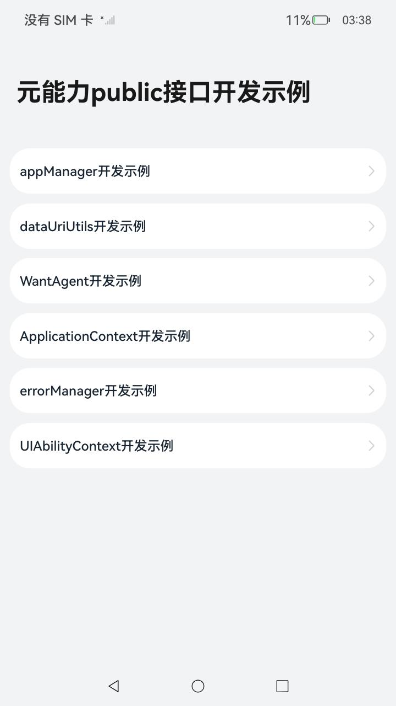
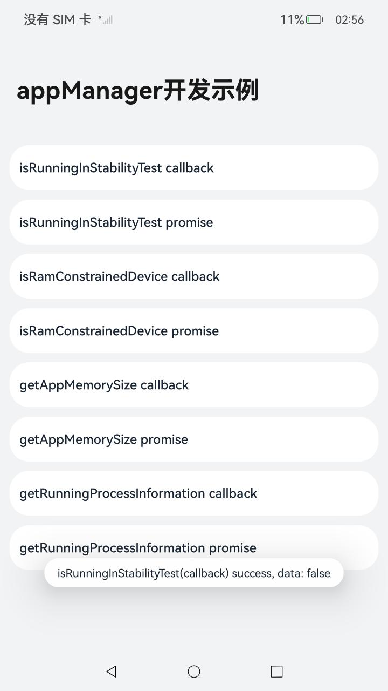
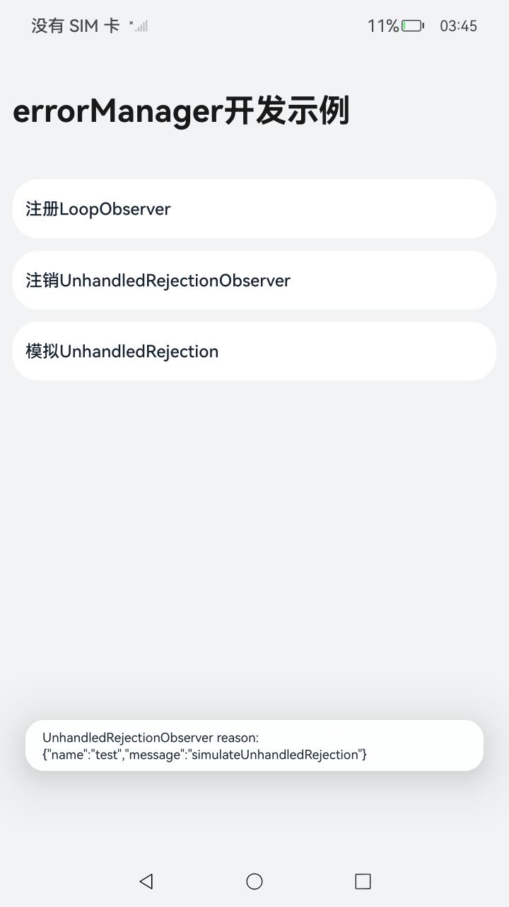
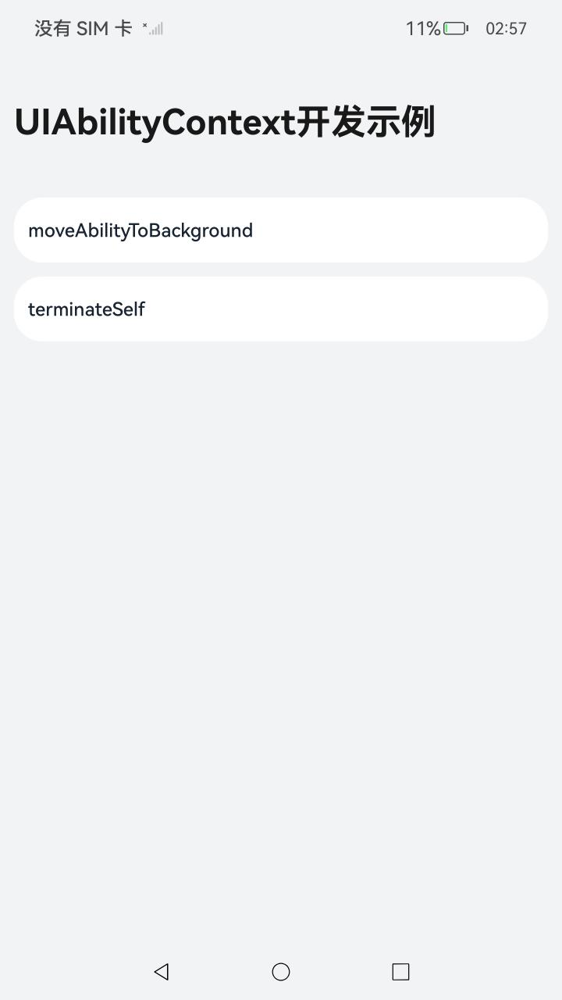

# Basic Capability Enhancement

### Introduction

This sample demonstrates the following APIs in the Ability kit: [AppManager](https://gitcode.com/openharmony/docs/blob/master/en/application-dev/reference/apis-ability-kit/js-apis-app-ability-appManager.md), [dataUriUtils](https://gitcode.com/openharmony/docs/blob/master/en/application-dev/reference/apis-ability-kit/js-apis-ability-dataUriUtils.md), [WantAgent](https://gitcode.com/openharmony/docs/blob/master/en/application-dev/reference/apis-ability-kit/js-apis-wantAgent.md), [ApplicationContext](https://gitcode.com/openharmony/docs/blob/master/en/application-dev/reference/apis-ability-kit/js-apis-inner-application-applicationContext.md), [errorManager](https://gitcode.com/openharmony/docs/blob/master/en/application-dev/reference/apis-ability-kit/js-apis-app-ability-errorManager.md), and [UIAbilityContext](https://gitcode.com/openharmony/docs/blob/master/en/application-dev/reference/apis-ability-kit/js-apis-inner-application-uiAbilityContext.md).

### Preview

|                      Main Page                      |                  AppManager Sample                  |                  ErrorManager Sample                   |                  UIAbilityContext Sample                   |
| :----------------------------------------------: | :---------------------------------------------------: | :-----------------------------------------------------: | :---------------------------------------------------------: |
|  |  |  |  |

### Usage

**AppManager interfaces**

1. Tap **AppManager Sample** on the main page to enter the AppManager sample page.
2. Tap **isRunningInStabilityTest callback** to display `isRunningInStabilityTest(callback) success...`.
3. Tap **isRunningInStabilityTest promise** to display `isRunningInStabilityTest(promise) success...`.
4. Tap **isRamConstrainedDevice callback** to display `isRamConstrainedDevice(callback) success...`.
5. Tap **isRamConstrainedDevice promise** to display `isRamConstrainedDevice(promise) success...`.
6. Tap **getAppMemorySize callback** to display `getAppMemorySize(callback) success...`.
7. Tap **getAppMemorySize promise** to display `getAppMemorySize(promise) success...`.
8. Tap **getRunningProcessInformation callback** to display `getRunningProcessInformation(callback) success...`.
9. Tap **getRunningProcessInformation promise** to display `getRunningProcessInformation(promise) success...`.

**dataUriUtils interfaces**

1. Tap **dataUriUtils Sample** on the main page to enter the dataUriUtils sample page.
2. Tap **getId** to display `dataUriUtils.getId() called...`.
3. Tap **attachId** to display `dataUriUtils.attachd() called...`.
4. Tap **deleteId** to display `dataUriUtils.deleteId() called...`.
5. Tap **updateId** to display `dataUriUtils.updateId() called...`.

**WantAgent interfaces**

1. Tap **WantAgent Sample** on the main page to enter the WantAgent sample page.
2. Tap **getBundleName callback** to display `getBundleName(callback) success...`.
3. Tap **getBundleName promise** to display `getBundleName(promise) success...`.
4. Tap **getUid callback** to display `getUid(callback) success...`.
5. Tap **getUid promise** to display `getUid(promise) success...`.
6. Tap **cancel callback** to display `cancel(callback) success`.
7. Tap **cancel promise** to display `cancel(promise) success`.
8. Tap **equal callback** to display `equal(callback) success...`.
9. Tap **equal promise** to display `equal(promise) success...`.
10. Tap **getOperationType callback** to display `getOperationType(callback) success...`.
11. Tap **getOperationType promise** to display `getOperationType(promise) success...`.
12. Tap **trigger** to display `trigger success...`.

**ApplicationContext interfaces**

1. Tap **ApplicationContext Sample** on the main page to enter the ApplicationContext sample page.
2. Tap **setFont** to display `setFont successfully`.
3. Tap **getRunningProcessInformation promise** to display `getRunningProcessInformation promise successfully...`.
4. Tap **getRunningProcessInformation callback** to display `getRunningProcessInformation callback successfully...`.
5. Tap **getCurrentAppCloneIndex** to display `getCurrentAppCloneIndex  successfully...`.

**errorManager interfaces**

1. Tap **ErrorManager Sample** on the main page to enter the errorManager sample page.
2. Tap **Register LoopObserver** to display `loopObserver registered successfully...`.
3. Tap **Register UnhandledRejectionObserver** to display `unhandledRejection registered successfully`, and a **Simulate UnhandledRejection** button is added to the list. The original **Register UnhandledRejectionObserver** button changes to **Unregister UnhandledRejectionObserver**.
4. Tap **Simulate UnhandledRejection** to display `UnhandledRejectionObserver  reason...`.
5. Tap **Unregister UnhandledRejection** to display `unhandledRejection unregistered successfully`. The **Unregister UnhandledRejectionObserver** button changes back to **Register UnhandledRejectionObserver**, and the **Simulate UnhandledRejection** button disappears.

**UIAbilityContext interfaces**

1. Tap **UIAbilityContext Sample** on the main page to start a new Ability showing the UIAbilityContext sample page.
2. Tap **moveAbilityToBackground** to move the started Ability to the background. The main page is displayed and the lifecycle callback is triggered.
3. Tap **UIAbilityContext Sample** on the main page again to start a new Ability. Tap **terminateSelf** to return to the main page.

### Project Directory

```
entry/src/main/ets/
|---abilitylifecyclecallback
|   |---AbilityLifecycleCallback.ets        // AbilityLifecycleCallback lifecycle
|---abilitypages
|   |---ApplicationContext.ets              // ApplicationContext interfaces
|   |---AppManager.ets                      // AppManager interfaces
|   |---DataUriUtils.ets                    // DataUriUtils interfaces
|   |---ErrorManager.ets                    // ErrorManager interfaces
|   |---UIAbilityContext.ets                // UIAbilityContext interfaces
|   |---WantAgent.ets                       // WantAgent interfaces
|---entryability
|   |---EntryAbility.ets                    // Entry Ability
|---pages
|   |---Index.ets                           // Main page
```

### Implementation

For details about each interface implementation, see the corresponding source files in [abilitypages](entry/src/main/ets/abilitypages).

### Test

Automated test cases are located in `entry/src/ohosTest/ets/test`, with 51 suite files and 2740 cases in total. All cases passed on an RK3568 device (`Tests run: 2740, Failure: 0, Error: 0`). The case metadata uses `@tc.number SUB_ABILITY_RUNTIME_<topic>_NNNN` together with `@tc.type/@tc.size/@tc.level`. The second argument of each `it` is `TestType.FUNCTION | Size.XXX | Level.LEVELn`. Each case prints one hilog line at the beginning and end, prints the actual value before each assertion, and each file does not exceed 2000 lines.

For the suite file list, running instructions, and real-device constraints, see [ohosTest.md](ohosTest.md).

### Permissions

None.

### Dependencies

None.

### Constraints and Limitations

1. This sample can run only on standard-system devices and has been verified on an RK3568 board.
2. This sample uses the Stage model and supports API 26 SDK (26.0.0). The `compileSdkVersion`, `targetSdkVersion`, and `compatibleSdkVersion` are all 26.0.0.
3. DevEco Studio 26.0.0 Release or later is required to compile and run this sample.

### Download

```shell
git init
git config core.sparsecheckout true
echo code/BasicFeature/Ability/AbilityRuntime > .git/info/sparse-checkout
git remote add origin https://gitcode.com/openharmony/applications_app_samples.git
git pull origin master
```
