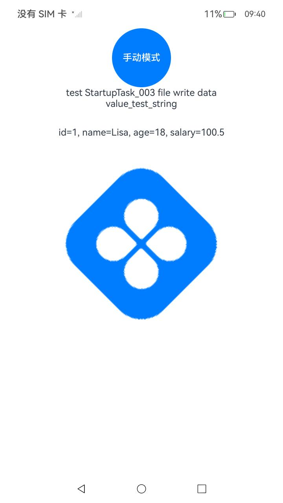

# Application Startup Framework AppStartup

### Introduction

This sample uses the following AppStartup APIs:
[@ohos.app.appstartup.StartupTask](https://gitcode.com/openharmony/docs/blob/master/en/application-dev/reference/apis-ability-kit/js-apis-app-appstartup-startupTask.md),
[@ohos.app.appstartup.StartupConfig](https://gitcode.com/openharmony/docs/blob/master/en/application-dev/reference/apis-ability-kit/js-apis-app-appstartup-startupConfig.md),
[@ohos.app.appstartup.StartupConfigEntry](https://gitcode.com/openharmony/docs/blob/master/en/application-dev/reference/apis-ability-kit/js-apis-app-appstartup-startupConfigEntry.md),
[@ohos.app.appstartup.StartupListener](https://gitcode.com/openharmony/docs/blob/master/en/application-dev/reference/apis-ability-kit/js-apis-app-appstartup-startupListener.md), and
[@ohos.app.appstartup.startupManager](https://gitcode.com/openharmony/docs/blob/master/en/application-dev/reference/apis-ability-kit/js-apis-app-appstartup-startupManager.md).
It demonstrates how to use the application startup framework AppStartup in eTS.

### Preview

|              Main Page (Auto Mode)              |            Manual Mode            |
|:-----------------------------------:|:-----------------------------------------:|
|  |  |

### Usage

After launching the application:

1. `excludeFromAutoStart:false` is the auto mode. The data displayed on the index page is initialized by the AppStartup framework.
2. `excludeFromAutoStart:true` is the manual mode. Tap the button to enter manual mode, which calls `startupManager.run()` in code to load `ImageKnifeTask`, and then the image is displayed on the page.

### Project Directory

```
entry/src/main/ets/
|---util
|   |---SingleKVStore.ts                   // Utility class
|---startup
|   |---FileTask.ets                       // Create a file and write data
|   |---ImageKnifeTask.ets                 // Initialize ImageKnifeTask
|   |---KvManagerUtilTask.ets              // Obtain KvManager
|   |---KVStoreTask.ets                    // Create a KVStore and save data
|   |---RdbStoreTask.ets                   // Create an RdbStore and save data
|   |---ResourceManagerTask.ets            // Obtain image resources
|   |---StartupConfig.ets                  // StartupConfig configuration
|---pages
|   |---Index.ets                          // Main page
|   |---ImageKnife.ets                     // Load image through the framework
```

### Implementation

Configure the tasks under the `startup` directory in `resources/base/profile/startup_config.json`, and add these tasks in `module.json5`. When the application starts, these configured tasks are executed first. The page then obtains the initialized instance or some data according to the business requirements.

### Test

Automated test cases are located in `entry/src/ohosTest/ets/test`, with 27 suite files and 1376 cases in total. All cases passed on an RK3568 device (`Tests run: 1376, Failure: 0, Error: 0`). The case metadata uses `@tc.number SUB_APP_STARTUP_<topic>_NNNN` together with `@tc.type/@tc.size/@tc.level`. The second argument of each `it` is `TestType.FUNCTION | Size.XXX | Level.LEVELn`. Each case prints one hilog line at the beginning and end, prints the actual value before each assertion, and each file does not exceed 2000 lines.

For the suite file list, running instructions, and real-device constraints, see [ohosTest.md](ohosTest.md).

### Permissions

None.

### Dependencies

This sample uses the [ImageKnife](https://gitcode.com/openharmony-tpc/ImageKnife) framework to load images.

### Constraints and Limitations

1. This sample can run only on standard-system devices and has been verified on an RK3568 board.
2. This sample uses the Stage model and supports API 26 SDK (26.0.0). The `compileSdkVersion`, `targetSdkVersion`, and `compatibleSdkVersion` are all 26.0.0.
3. DevEco Studio 26.0.0 Release or later is required to compile and run this sample.

### Download

```shell
git init
git config core.sparsecheckout true
echo code/BasicFeature/Ability/AppStartup/ > .git/info/sparse-checkout
git remote add origin https://gitcode.com/openharmony/applications_app_samples.git
git pull origin master
```
