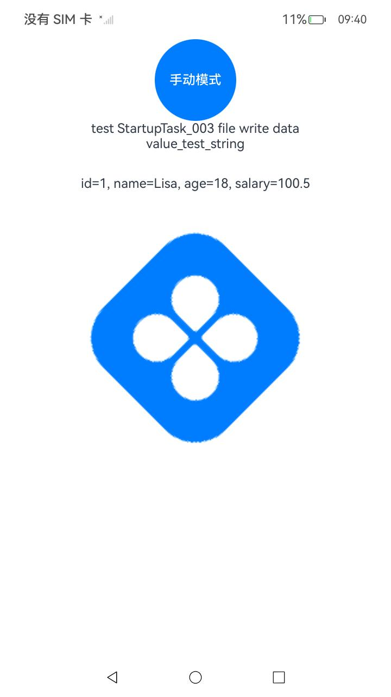

# 应用启动框架AppStartup

### 介绍

本示例使用了：
[@ohos.app.appstartup.StartupTask](https://gitcode.com/openharmony/docs/blob/master/zh-cn/application-dev/reference/apis-ability-kit/js-apis-app-appstartup-startupTask.md)，
[@ohos.app.appstartup.StartupConfig](https://gitcode.com/openharmony/docs/blob/master/zh-cn/application-dev/reference/apis-ability-kit/js-apis-app-appstartup-startupConfig.md)，
[@ohos.app.appstartup.StartupConfigEntry](https://gitcode.com/openharmony/docs/blob/master/zh-cn/application-dev/reference/apis-ability-kit/js-apis-app-appstartup-startupConfigEntry.md)，
[@ohos.app.appstartup.StartupListener](https://gitcode.com/openharmony/docs/blob/master/zh-cn/application-dev/reference/apis-ability-kit/js-apis-app-appstartup-startupListener.md)，
[@ohos.app.appstartup.startupManager](https://gitcode.com/openharmony/docs/blob/master/zh-cn/application-dev/reference/apis-ability-kit/js-apis-app-appstartup-startupManager.md)
接口，展示了在eTS中如何使用应用启动框架AppStartup；

### 效果预览

|              主页面(自动模式)              |            手动模式            | 
|:-----------------------------------:|:-----------------------------------------:|
|  |  | 

使用说明： 
 在启动应用后：
 1. excludeFromAutoStart:false 是自动模式，index页面中显示的数据都是在应用启动框架AppStartup中初始化完成的；
 2. excludeFromAutoStart:true 是手动模式，点击按钮手动模式在代码中通过startupManager.run()函数来加载ImageKnifeTask后在页面显示出图片；

### 工程目录

```
entry/src/main/ets/
|---util
|   |---SingleKVStore.ts                   // 工具类
|---startup
|   |---FileTask.ets                       // 创建文件，且写入数据
|   |---ImageKnifeTask.ets                 // 初始化ImageKnifeTask
|   |---KvManagerUtilTask.ets              // 获取KvManager
|   |---KVStoreTask.ets                    // 创建KVStore，且存入数据
|   |---RdbStoreTask.ets                   // 创建RdbStore，且存入数据
|   |---ResourceManagerTask.ets            // 获取图片资源
|   |---StartupConfig.ets                  // StartupConfig配置
|---pages
|   |---Index.ets                          // 首页
|   |---ImageKnife.ets                     // 框架加载图片
```

### 具体实现

在resources->base->profile->startup_config.json 配置startup目录下的task，在module.json5中添加这些task，
启动应用首先会执行这些配置的task，然后在页面获取初始化的实例或者一些数据，具体情况根据业务所定；

### 测试

自动化用例位于 `entry/src/ohosTest/ets/test`，共 27 个套件文件 1376 条，全部在 RK3568 真机上实测通过（`Tests run: 1376, Failure: 0, Error: 0`）。用例元数据统一为 `@tc.number SUB_APP_STARTUP_<主题>_NNNN` + `@tc.type/@tc.size/@tc.level`，`it` 的第二个参数为 `TestType.FUNCTION | Size.XXX | Level.LEVELn`，每条用例首尾各打一行 hilog、每条断言前打印实际值，单文件不超过 2000 行：

| 套件文件 | 用例数 |
| -------- | ------ |
| BundleConfigMatrix.test.ets | 84 |
| BundleInfoExtendedMatrixCore / Extended / Tail.test.ets | 83 / 79 / 30 |
| BundleManagerFlagMatrix.test.ets | 33 |
| ColdStart.test.ets | 30 |
| ResourceLocaleExtended.test.ets | 30 |
| ResourceLocaleHugeMatrixCore / Tail.test.ets | 73 / 7 |
| ResourceLocaleMatrix.test.ets | 44 |
| ResourceLocaleMoreMatrix.test.ets | 40 |
| StartupDataExtended.test.ets | 11 |
| StartupDataMatrix.test.ets | 73 |
| StartupInvalidNameMatrix.test.ets | 35 |
| StartupListenerMatrix.test.ets | 7 |
| StartupManagerMatrixCore / Tail.test.ets | 74 / 55 |
| StartupRunPermutationMatrixCore / Extended / Advanced / Extra / More / Final / Last / Tail.test.ets | 69 / 68 / 66 / 65 / 65 / 65 / 47 / 65 |
| StartupRunSubsetMatrix.test.ets | 63 |
| UiSmoke.test.ets | 15 |

测试入口与辅助文件：`test/List.test.ets`（按顺序注册 27 个套件，ColdStart 必须第一个跑）、`test/TestHelper.ets`（startupManager 调用与状态采集、回到基线、读业务文件 / 键值库 / 关系型库、包信息等）、`test/UiHelper.ets`（UiTest 查找与点击）、`testrunner/OpenHarmonyTestRunner.ets`、`testrunner/AppStartupTestRunner.ets`、`testability/TestAbility.ets`。

测试运行：在 DevEco Studio 中构建并安装 `entry@default` 与 `entry@ohosTest` 两个包的 HAP，安装后右键 `entry/src/ohosTest` 运行全部用例；也可用设备命令行方式执行测试，测试模块为 `entry_test`，入口为 `/ets/testrunner/OpenHarmonyTestRunner`。签名材料只在本地配置，不入库。

用例设计说明、手工用例与真机实测约束见 [ohosTest.md](ohosTest.md)。

### 相关权限

不涉及。

### 依赖

[ImageKnife](https://gitcode.com/openharmony-tpc/ImageKnife) 示例中加载图片使用的是ImageKnife框架。

### 约束与限制

1. 本示例仅支持标准系统上运行，已在 RK3568 真机上验证安装与运行；

2. 本示例为 Stage 模型，支持 API 26 版本 SDK（26.0.0），compileSdkVersion / targetSdkVersion / compatibleSdkVersion 均为 26.0.0；

3. 本示例需要使用 DevEco Studio 26.0.0 Release 及以上版本才可编译运行；

### 下载

如需单独下载本工程，执行如下命令：

```
git init
git config core.sparsecheckout true
echo code/BasicFeature/Ability/AppStartup/ > .git/info/sparse-checkout
git remote add origin https://gitcode.com/openharmony/applications_app_samples.git
git pull origin master
```