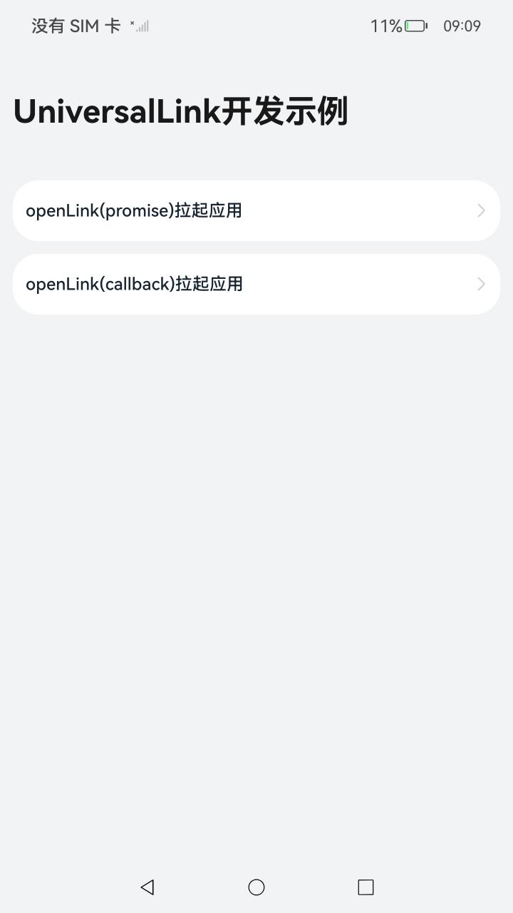
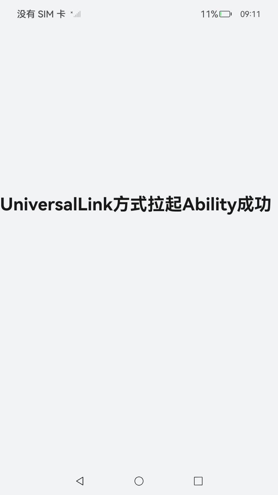

# Basic Capability Enhancement

### Introduction

This sample demonstrates how to start a UIAbility through AppLinking using the [UIAbilityContext](https://gitcode.com/openharmony/docs/blob/master/en/application-dev/reference/apis-ability-kit/js-apis-inner-application-uiAbilityContext.md) API.

### Preview

|                      Main Page                      |                  Launch Ability by Button                  |
| :----------------------------------------------: | :---------------------------------------------------: |
|  |  |

### Usage

UniversalLink basic capability demonstration:

1. Tap **openLink(promise) launch app** on the main page to launch a new Ability. The page displays "UniversalLink方式拉起Ability成功".

2. Tap **openLink(callback) launch app** on the main page to launch a new Ability. The page displays "UniversalLink方式拉起Ability成功".

### Project Directory

```
entry/src/main/ets/
|---entryability
|   |---EntryAbility.ets                    // Entry Ability
|   |---OpenLinkAbility.ets                 // UIAbility for verifying UniversalLink
|---pages
|   |---Index.ets                           // Main page (calls openLink)
|   |---UniversalLinkIndex.ets              // Display page of the launched UIAbility
```

### Implementation

* UniversalLink basic capability implementation, see [Index.ets](entry/src/main/ets/pages/Index.ets).
  * `openLink(promise)`: calls `context.openLink` with the same configuration as the target app to launch it.
  * `openLink(callback)`: calls `context.openLink` with the same configuration as the target app to launch it.

### Test

Automated test cases are located in `entry/src/ohosTest/ets/test`, with 22 suite files and 951 cases in total. All cases passed on an RK3568 device (`Tests run: 951, Failure: 0, Error: 0`). The case metadata uses `@tc.number SUB_UNIVERSAL_LINK_<topic>_NNNN` together with `@tc.type/@tc.size/@tc.level`. The second argument of each `it` is `TestType.FUNCTION | Size.XXX | Level.LEVELn`. Each case prints one hilog line at the beginning and end, prints the actual value before each assertion, and each file does not exceed 2000 lines.

For the suite file list, running instructions, and real-device constraints, see [ohosTest.md](ohosTest.md).

### Permissions

None.

### Dependencies

None.

### Constraints and Limitations

1. This sample can run only on standard-system devices and has been verified on an RK3568 board.
2. This sample uses the Stage model and supports API 26 SDK (26.0.0). The `compileSdkVersion`, `targetSdkVersion`, and `compatibleSdkVersion` are all 26.0.0.
3. DevEco Studio 26.0.0 Release or later is required to compile and run this sample.

### Download

```shell
git init
git config core.sparsecheckout true
echo code/BasicFeature/Ability/UniversalLink/ > .git/info/sparse-checkout
git remote add origin https://gitcode.com/openharmony/applications_app_samples.git
git pull origin master
```
