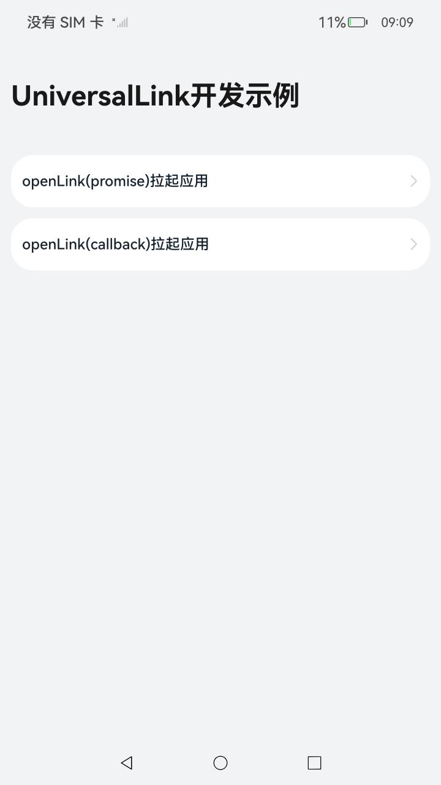
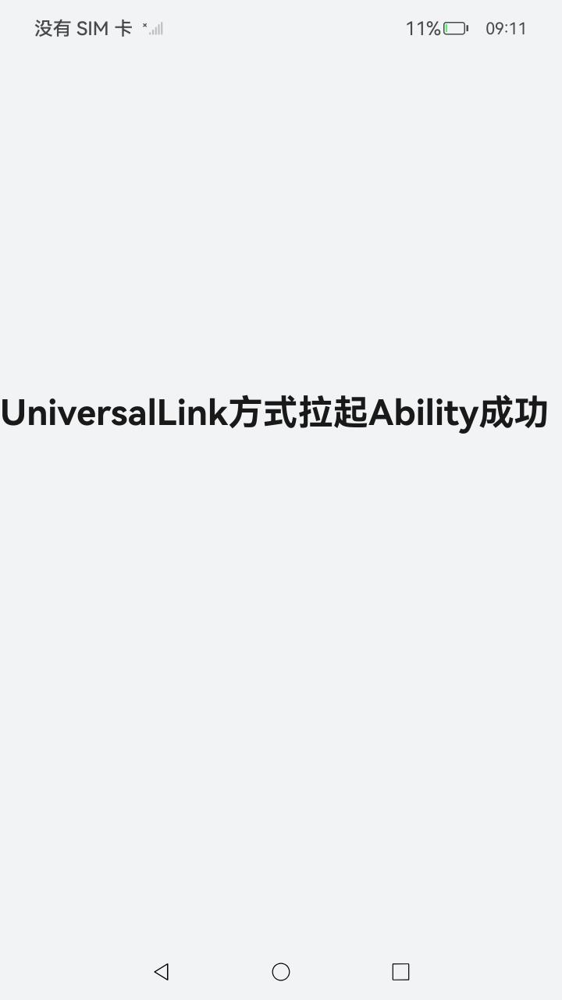

# 基础能力增强

### 介绍

本示例使用 [UIAbilityContext](https://gitcode.com/openharmony/docs/blob/master/zh-cn/application-dev/reference/apis-ability-kit/js-apis-inner-application-uiAbilityContext.md) 接口实现了通过AppLinking启动UIAbility功能。

### 效果预览

|                      主页面                      |                  点击按钮拉起Ability                  |
| :----------------------------------------------: | :---------------------------------------------------: |
|  |  |

### 使用说明

UniversalLink基础能力展示

1.点击主页面**openLink(promise)拉起应用**按钮，拉起新的Ability，页面显示'UniversalLink方式拉起Ability成功'；

2.点击主页面**openLink(callback)拉起应用**按钮，拉起新的Ability，页面显示'UniversalLink方式拉起Ability成功'；

### 工程目录

```
entry/src/main/ets/
|---entryability
|   |---EntryAbility.ets					// 首页的Ability
|   |---OpenLinkAbility.ets				    // UIAbility(用于验证UniversalLink功能使用)
|---pages
|   |---Index.ets							// 首页(包含openLink接口的调用)
|   |---UniversalLinkIndex.ets				// 被启动的UIAbility的展示页
```

### 具体实现

* UniversalLink基础能力实现，源码参考[Index.ets](entry/src/main/ets/pages/Index.ets)

  * openLink（promise）接口实现：通过调用context.openLink接口，传入与要拉起的应用相同的配置，实现拉起应用的功能；
  * openLink（callback）接口实现：通过调用context.openLink接口，传入与要拉起的应用相同的配置，实现拉起应用的功能；

### 测试

自动化用例位于 `entry/src/ohosTest/ets/test`，共 22 个套件文件 951 条，全部在 RK3568 真机上实测通过（`Tests run: 951, Failure: 0, Error: 0`）。用例元数据统一为 `@tc.number SUB_UNIVERSAL_LINK_<主题>_NNNN` + `@tc.type/@tc.size/@tc.level`，`it` 的第二个参数为 `TestType.FUNCTION | Size.XXX | Level.LEVELn`，每条用例首尾各打一行 hilog、每条断言前打印实际值，单文件不超过 2000 行：

| 套件文件 | 用例数 |
| -------- | ------ |
| AbilityLifecycle.test.ets | 18 |
| BundleConfigMatrix.test.ets | 60 |
| BundleInfoExtendedMatrixCore / Extended / Tail.test.ets | 84 / 79 / 29 |
| BundleManagerFlagMatrix.test.ets | 33 |
| CanOpenLinkMatrix.test.ets | 31 |
| CanOpenLinkMoreMatrix.test.ets | 42 |
| OpenLinkCallback.test.ets | 31 |
| OpenLinkErrorMatrix.test.ets | 10 |
| OpenLinkMatrixCore / Tail.test.ets | 71 / 9 |
| ParamPassthrough.test.ets | 30 |
| ResourceLocaleExtended.test.ets | 32 |
| ResourceLocaleHugeMatrixCore / Tail.test.ets | 73 / 55 |
| ResourceLocaleMatrix.test.ets | 50 |
| ResourceLocaleMoreMatrix.test.ets | 64 |
| SkillMatchActionEntity.test.ets | 55 |
| SkillMatchUri.test.ets | 40 |
| SkillMatchUriExtended.test.ets | 41 |
| UniversalLinkUiSmoke.test.ets | 14 |

测试入口与辅助文件：`test/List.test.ets`（注册 22 个套件）、`test/TestHelper.ets`（取 AbilityDelegator、栈顶 Ability、EntryAbility context、entry 模块资源等）、`test/LinkHelper.ets`（拉起观测与复位）、`testrunner/OpenHarmonyTestRunner.ets`、`testrunner/UniversalLinkTestRunner.ets`、`testability/TestAbility.ets`。

测试运行：在 DevEco Studio 中构建并安装 `entry@default` 与 `entry@ohosTest` 两个包的 HAP，安装后右键 `entry/src/ohosTest` 运行全部用例；也可用设备命令行方式执行测试，测试模块为 `entry_test`，入口为 `/ets/testrunner/OpenHarmonyTestRunner`。签名材料只在本地配置，不入库。

用例设计说明、手工用例与真机实测约束见 [ohosTest.md](ohosTest.md)。

### 相关权限

不涉及。

### 依赖

不涉及。

### 约束与限制

1.本示例仅支持标准系统上运行，已在 RK3568 真机上验证安装与运行；

2.本示例为 Stage 模型，支持 API 26 版本 SDK（26.0.0），compileSdkVersion / targetSdkVersion / compatibleSdkVersion 均为 26.0.0；

3.本示例需要使用 DevEco Studio 26.0.0 Release 及以上版本才可编译运行；

### 下载

```shell
git init
git config core.sparsecheckout true
echo code/BasicFeature/Ability/UniversalLink/ > .git/info/sparse-checkout
git remote add origin https://gitcode.com/openharmony/applications_app_samples.git
git pull origin master
```

