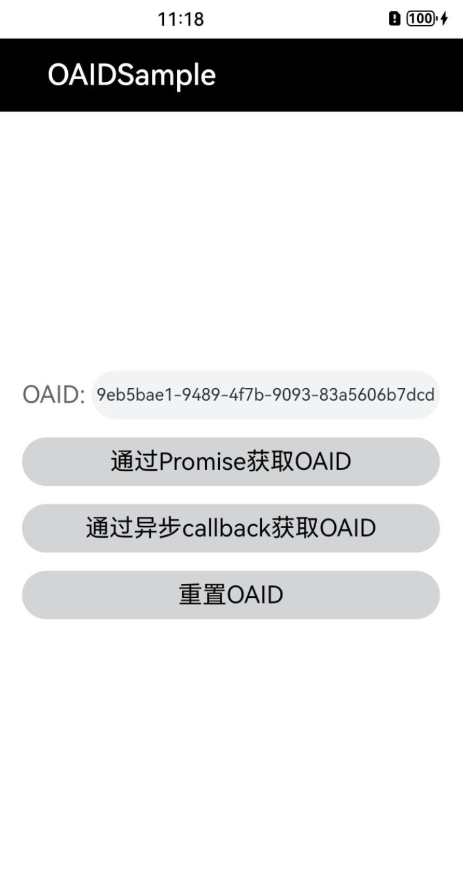
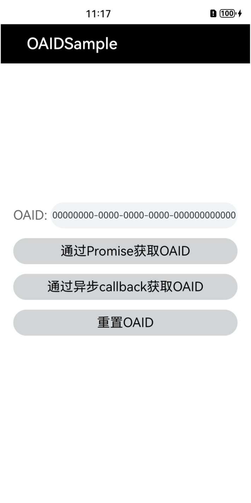

# Ads Identifier Service Sample

### Introduction

This sample demonstrates how to obtain and reset the Open Anonymous Device Identifier (OAID) through the APIs provided by the Ads identifier service.

### Preview

| OAID obtained successfully | Failed to obtain OAID |
|----------------------------|------------------------|
|  |  |

Concept:

- Open Anonymous Device Identifier

  The Open Anonymous Device Identifier (OAID) is a non-persistent device identifier. Based on the OAID, personalized ads can be provided to users while protecting their personal data privacy, and third-party tracking platforms can provide conversion attribution analysis for advertisers.

### Usage

1. Set the cross-app association access permission to "Allow" in the Settings app.

2. Tap "Get OAID (Promise)". The OAID is displayed in the text box above.

3. Tap "Get OAID (async callback)". The OAID is displayed in the text box above.

4. The reset function requires installing [ResetOAID](/code/BasicFeature/Ads/OAIDSample/lib/ResetOAID-1.0.0.hap). In addition, the app bundle name must be configured in the device-side system configuration file. Follow the steps below, then tap "Reset OAID". The OAID displayed in the text box above changes after it is obtained again.

```
hdc shell mount -o rw,remount /
hdc file recv etc/advertising/oaid/oaid_service_config.json
// Modify the oaid_service_config.json file and add the bundle name
{
    "resetOAIDBundleName": ["com.samples.resetOAID"],
    "providerBundleName": "",
    "providerAbilityName": ""
}
hdc file send oaid_service_config.json etc/advertising/oaid/oaid_service_config.json
```

### Project Directory

```
entry/src/main/ets/
|---entryability
|   |---EntryAbility.ts
|---log
|   |---Logger.ts          // Logging
|---pages
|   |---Index.ets          // Home page: get OAID and reset OAID

```

### Implementation

1. Configure the module information:

- Add the required permissions to the "requestPermissions" tag in the module.json5 file, for example, the permission to read the OAID:

```
"requestPermissions": [
  {
    "name": "ohos.permission.APP_TRACKING_CONSENT",
    "reason": "$string:reason",
    "usedScene": {
      "abilities": [
        "EntryFormAbility"
      ],
      "when": "inuse"
    }
  }
]

```

2. Obtain the OAID

- Call the identifier.getOAID API provided by the Ads identifier service in the Index.ets page.

3. Reset the OAID

- Call the identifier.resetOAID API provided by the Ads identifier service in the Index.ets page.

### Required Permissions

Obtaining the OAID requires the ad tracking permission:
[ohos.permission.APP_TRACKING_CONSENT](https://gitcode.com/openharmony/docs/blob/master/en/application-dev/security/AccessToken/permissions-for-all-user.md#ohospermissionapp_tracking_consent).

### Dependencies

N/A

### Constraints

1. This sample is supported only on standard systems.

2. This sample uses the stage model and is adapted to API version 26 SDK (compileSdkVersion 26.0.0).

3. This project must be compiled and run with DevEco Studio 7.0 or later.

### Testing

This project provides Hypium-based automated tests in `entry/src/ohosTest`, with 901 test cases in 28 suites in total,
covering the OAID interface capabilities and general system API matrices such as Want/BundleFlag/resources.
See [ohosTest.md](ohosTest.md) for detailed suite descriptions and execution commands.

### Download

To download this project separately, run the following commands:

```shell
git init
git config core.sparsecheckout true
echo code/BasicFeature/Ads/OAIDSample/ > .git/info/sparse-checkout
git remote add origin https://gitcode.com/openharmony/applications_app_samples.git
git pull origin master
```
