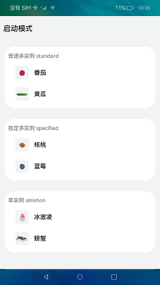
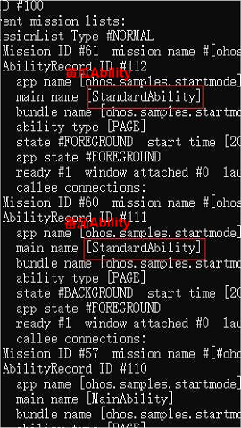
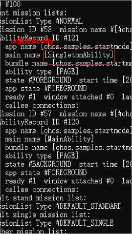
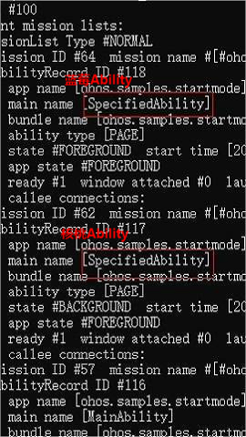

# Ability Launch Modes

### Introduction

This sample demonstrates how to implement the standard, singleton, and specified launch modes in the stage model.

This sample refers to the [development guide](https://gitee.com/openharmony/docs/blob/master/en/application-dev/quick-start/application-package-structure-stage.md).
It requires the ability management command-line tool to view the launch mode information of application abilities.

### Preview

| Home | Standard (multi-instance) ability info | Singleton ability info | Specified (multi-instance) ability info |
|--------------------------------|--------------------------------|--------------------------------|--------------------------------|
| | | | |

### Usage

1. standard mode:

1) On the home page, tap the tomato. A new tomato ability is created and the tomato details are displayed.

2) On the tomato details page, tap the cucumber. A new cucumber ability is created and the cucumber details are displayed.

3) Use the ability management command-line tool to check the ability information. At this point, there are the following abilities: 1 tomato ability, 1 cucumber ability, and 1 home ability.

2. singleton mode:

1) On the home page, tap the ice cream. A new ice cream ability is created and the ice cream details are displayed.

2) On the ice cream details page, tap the crab. The ice cream ability is reused. The page data is refreshed and the crab details are displayed.

3) Use the ability management command-line tool to check the ability information. At this point, there are the following abilities: 1 ice cream ability and 1 home ability.

3. specified mode:

1) On the home page, tap the walnut. A new walnut ability is created and the walnut details are displayed.

2) On the walnut details page, tap the blueberry. A new blueberry ability is created and the blueberry details are displayed.

3) On the blueberry details page, tap the walnut. The existing walnut ability is reused, implementing the single-instance behavior of the specified mode. The page data is refreshed and the walnut details are displayed.

4) Use the ability management command-line tool to check the ability information. At this point, there are the following abilities: 1 walnut ability, 1 blueberry ability, and 1 home ability.

### Project Directory

```
entry/src/main/ets/
|---Application
|---common
|   |---Logger.ts                     // Logging utility
|   |---Util.ts                       // Common utility functions
|---MainAbility
|---model
|   |---DataModel.ts                  // Data types
|   |---DataUtil.ts                   // Data processing functions
|   |---MokeData.ts                   // Mock data
|---pages
|   |---component
|   |   |---FoodListItem.ets          // Food list item component
|   |---FoodDetail.ets                // Food details page
|   |---Home.ets                      // Home page
```

### Implementation

* The methods for launching the three modes (standard, singleton, specified) are mainly encapsulated in Util. See [Util.ts](entry/src/main/ets/common/Util.ts).
    * Create abilities: create three abilities representing the standard, singleton, and specified modes, such as SingletonAbility, SpecifiedAbility, and StandardAbility in the project directory, and set the launchType property in the module.json file to the corresponding launch mode.
    * Launch a specified ability: use the startMode function in Util to launch the ability matching the abilityName passed from the page and enter the details page.
    * Specified multi-instance: in the specified mode, the onAcceptWant function in MyAbilityStage returns an ability identifier to the user. If an ability with that identifier has been launched before, no new instance is created and the existing one is brought back to the top of the stack; otherwise, a new instance is created and launched.

### Required Permissions

N/A

### Dependencies

N/A

### Constraints

1. This sample is supported only on standard systems. Supported device: RK3568.

2. This sample is adapted to API version 26 SDK (compileSdkVersion 26.0.0), targeting OpenHarmony.

3. This sample must be compiled and run with DevEco Studio 7.0 or later.

### Testing

This project provides Hypium-based automated tests in `entry/src/ohosTest`, with 923 test cases in 33 suites in total,
covering launch modes, ability skills, categories, Want parameters, and emitter events.
See [ohosTest.md](ohosTest.md) for detailed suite descriptions and execution commands.

### Download

To download this project separately, run the following commands:

```
git init
git config core.sparsecheckout true
echo code/BasicFeature/ApplicationModels/AbilityStartMode/ > .git/info/sparse-checkout
git remote add origin https://gitee.com/openharmony/applications_app_samples.git
git pull origin master
```
