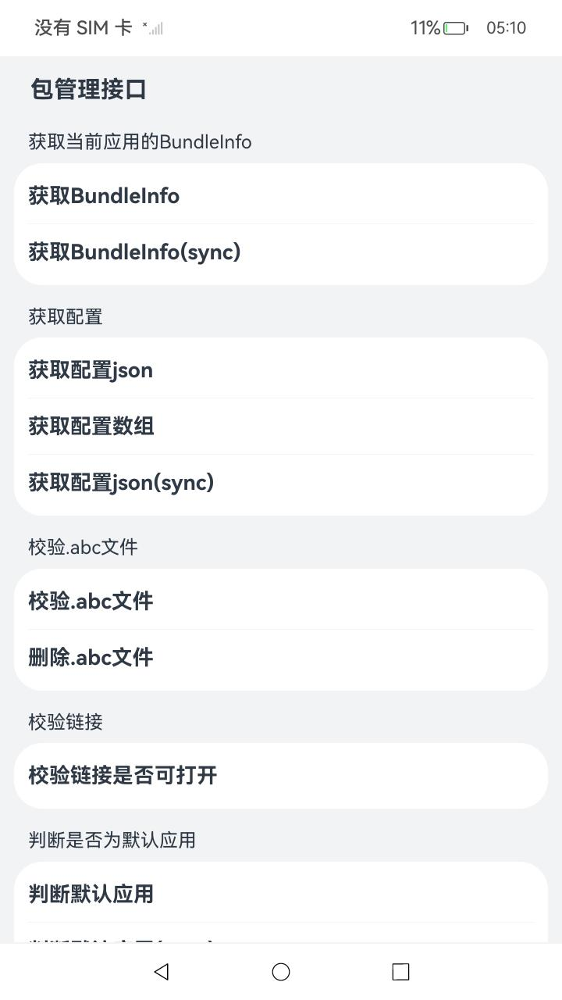
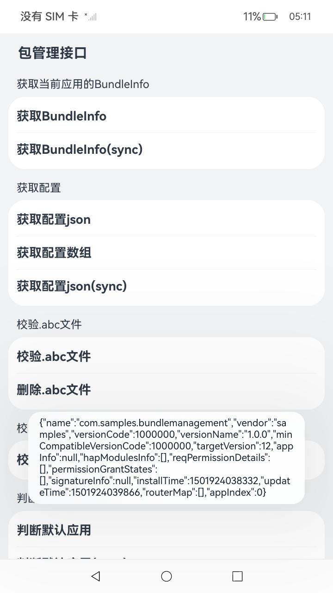

# 5.0 Feature Capabilities Sample

### Introduction

This sample uses [@ohos.bundle.bundleManager](https://gitee.com/openharmony/docs/blob/master/en/application-dev/reference/apis-ability-kit/js-apis-bundleManager.md), [@ohos.bundle.defaultAppManager](https://gitee.com/openharmony/docs/blob/master/en/application-dev/reference/apis-ability-kit/js-apis-defaultAppManager.md), [@ohos.bundle.overlay](https://gitee.com/openharmony/docs/blob/master/en/application-dev/reference/apis-ability-kit/js-apis-overlay.md)
and other APIs to show developers how to call the public APIs provided by bundle management and verify their functions.

### Preview

| Home |
|---|
| |

### Usage

This page is the home page, which demonstrates the calls of various bundle management APIs and the Overlay feature scenario:

1. Tap each sample button to call a bundle management API and display the returned data in a dialog.

For example, as shown in the figure below, the result returned by the API corresponding to the "Get BundleInfo" button is displayed in a dialog. The other sample buttons return results in the same form.

| Resource API test |
|---|
| |

### Project Directory

```
entry/src/main/ets/
|---entryability
|---newuiextability                   // ExtensionAbility implementation class
|---pages
|   |---Index.ets                     // Home page
|   |---NewPage.ets                   // Static shortcut scenario
|---libraryOverlay                    // Dynamic shared package (HSP)
|---libraryRuntimeOverlay
```

For dynamic shared packages, see [HSP (openharmony.cn)](https://docs.openharmony.cn/pages/v4.1/en/application-dev/quick-start/in-app-hsp.md).

### Implementation

#### Implementation of the bundle management API call examples:

1. Import the d.ts header files: import bundleManager from '@ohos.bundle.bundleManager'; import defaultAppMgr from '@ohos.bundle.defaultAppManager'; import overlay from '@ohos.bundle.overlay'; Then call the related APIs, for example:

* Obtain the BundleInfo of the current application: bundleManager.getBundleInfoForSelf()
* Obtain the BundleInfo (sync): bundleManager.getBundleInfoForSelfSync()
* Obtain the configured json: bundleManager.getProfileByAbility()
* Obtain the configured json (sync): bundleManager.getProfileByAbilitySync()
* Obtain the configured array: bundleManager.getProfileByExtensionAbility()
* Obtain the configured array (sync): bundleManager.getProfileByExtensionAbilitySync()
* Verify an .abc file: bundleManager.verifyAbc()
* Delete an .abc file: bundleManager.deleteAbc()
* Verify whether a link can be opened: bundleManager.canOpenLink()
* Check the default application: defaultAppMgr.isDefaultApplication()
* Check the default application (sync): defaultAppMgr.isDefaultApplicationSync()
* Set the overlay state: overlay.setOverlayEnabled()
* Obtain overlayModuleInfo: overlay.getOverlayModuleInfo()
* Obtain multiple overlayModuleInfo entries: overlay.getTargetOverlayModuleInfos()

Source code reference: [Resource API call example](entry/src/main/ets/pages/Index.ets)

#### Installation commands:

modules.abc (the \ets\modules.abc file in any hap).

1. Testing the verifyAbc() and deleteAbc() APIs (verifying and deleting .abc files) depends on an .abc file, so it must be pushed to the specified directory:

```
hdc_std file send local_path\modules.abc /data/app/el1/bundle/public/com.samples.bundlemanagement/
```

2. Testing setOverlayEnabled(), getOverlayModuleInfo(), and getTargetOverlayModuleInfos() (setting the overlay state and obtaining overlayModuleInfo) depends on dynamic shared packages, so they must be installed together:

```
hdc_std install local_path\entry-default-signed.hap local_path\libraryRuntimeOverlay-default-signed.hsp local_path\libraryOverlay-default-signed.hsp
```

### Required Permissions

N/A

### Dependencies

N/A

### Constraints

1. This sample is supported only on standard systems. Supported device: RK3568.

2. This sample uses the stage model and is adapted to API version 26 SDK (compileSdkVersion 26.0.0).

3. This sample must be compiled and run with DevEco Studio 7.0 or later.

4. The permissions involved in this sample are at least at the system_basic level.

### Testing

This project provides Hypium-based automated tests in `entry/src/ohosTest`, with 833 test cases in 31 suites in total,
covering bundle information queries, ExtensionAbility, BundleFlag, UID/icon/launchWant, and other bundle management capabilities.
See [ohosTest.md](ohosTest.md) for detailed suite descriptions and execution commands.

### Download

To download this project separately, run the following commands:

```
git init
git config core.sparsecheckout true
echo code/BasicFeature/ApplicationModels/BundleManager/BundleManagement/ > .git/info/sparse-checkout
git remote add origin https://gitee.com/openharmony/applications_app_samples.git
git pull origin master
```
