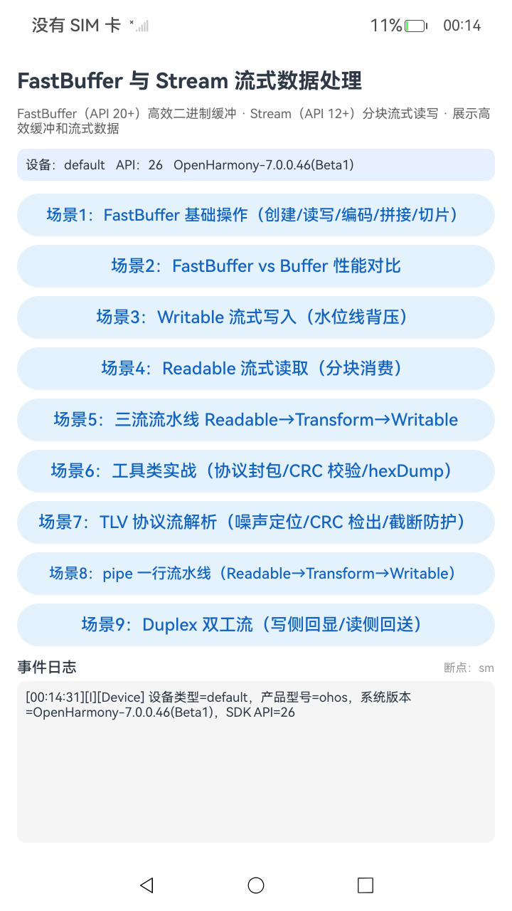
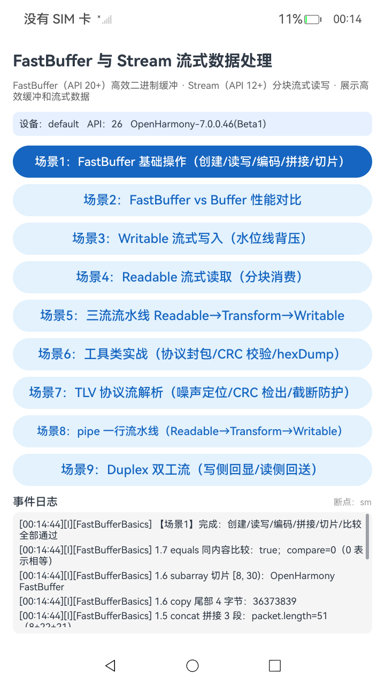
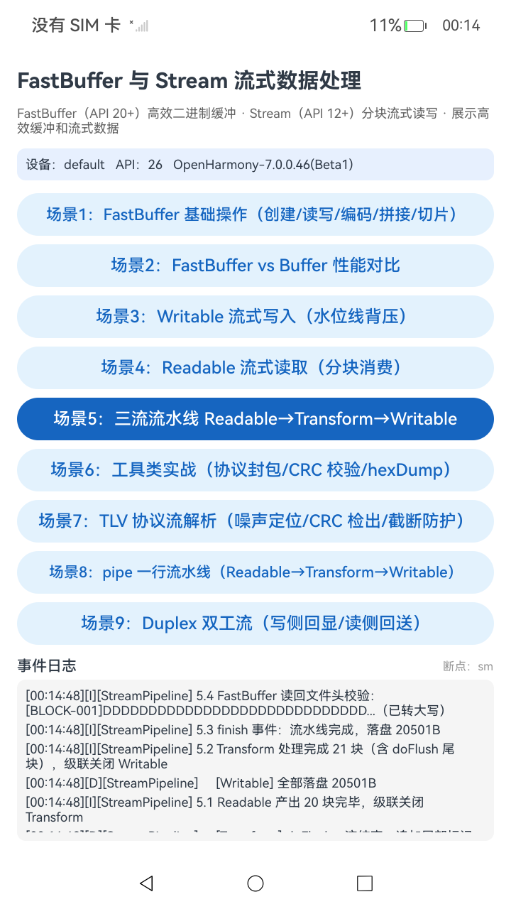
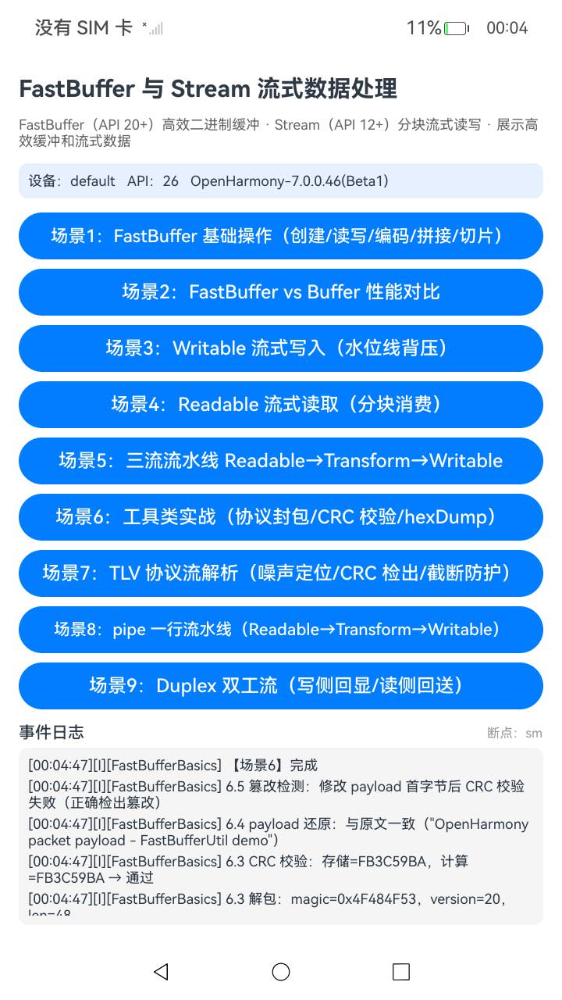
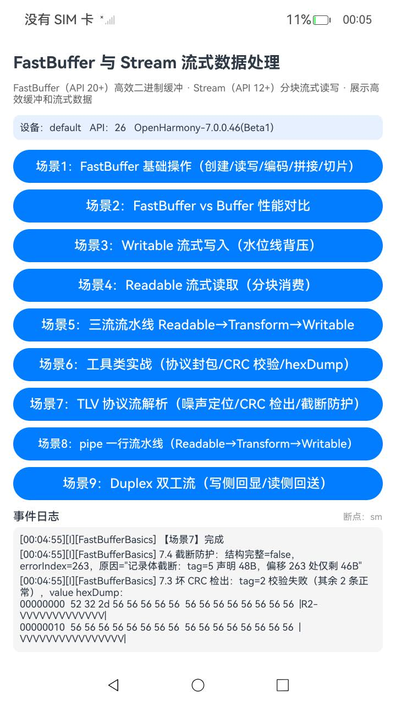
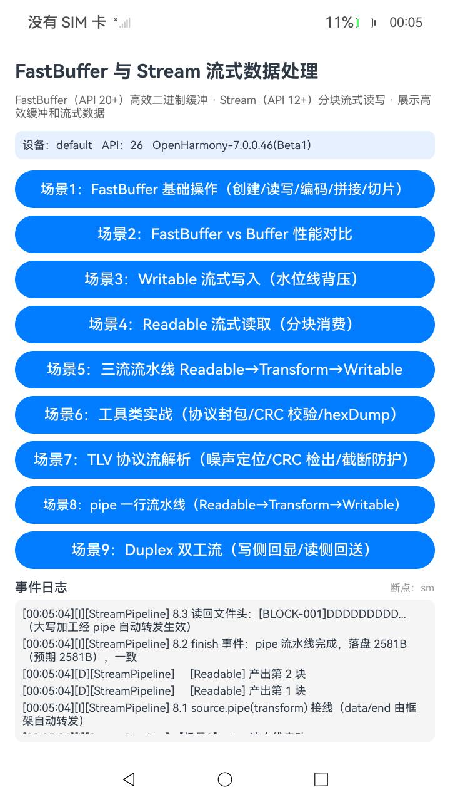
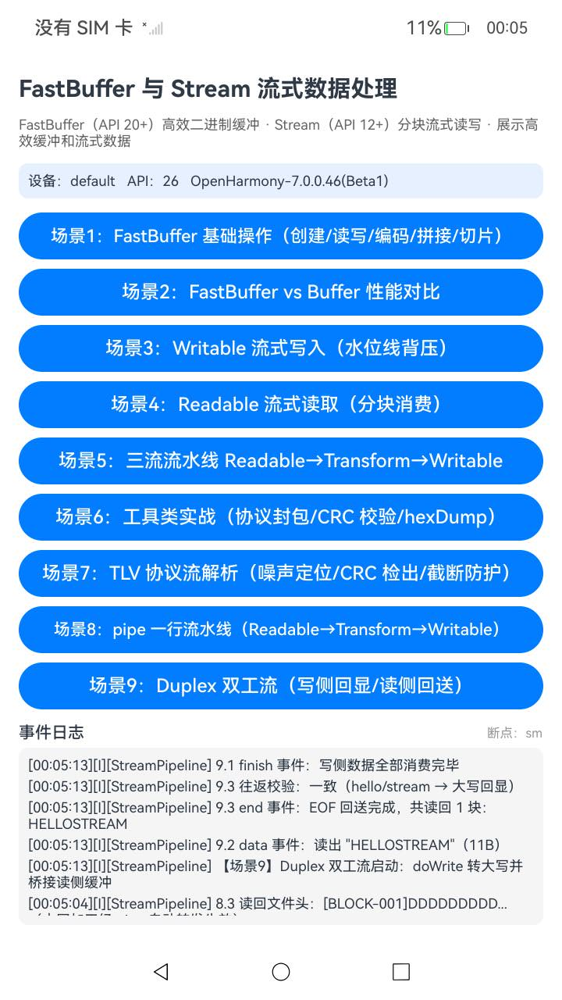

# FastBufferStreamDemo

## 简介

本示例用 **FastBuffer**（`@ohos.fastbuffer`，API 20+，高效二进制缓冲区）与 **Stream**（`@ohos.util.stream`，API 12+，数据流基类）展示**高效缓冲和流式数据**的完整用法：基础读写与编码转换、性能对比、流式写入/读取、三流流水线、二进制协议封包与解析、`pipe()` 一行接线与 `Duplex` 双工流。

共 9 个演示场景，纯软件演示、零权限，模拟器/开发板安装即用；代码按样例目录表格直接导入 `@ohos.fastbuffer` / `@ohos.buffer` / `@ohos.util.stream`。

- 应用标识：`com.example.fastbufferstreamdemo`，主 Ability 为 `EntryAbility`
- 真机验证：RK3568 dayu200（OpenHarmony 7.0.0.46 Beta1 / API 26，720×1280，断点 `sm`）
- 设备侧测试：**Tests run: 74, Failure: 0, Error: 0**

## 环境要求

* DevEco Studio 6.1.1+，SDK API 26（工程 `targetSdkVersion 26.0.0`，`compatibleSdkVersion: 6.1.1(24)`）
* 已在 RK3568 开发板（dayu200，OpenHarmony 7.0.0.46 Beta1 / API 26）真机验证
* 无需任何权限、无网络依赖；演示文件均写入应用沙箱 `filesDir`，卸载即清除

## 场景一览

| # | 场景 | 模块 | 执行方式 | 关键 API |
| --- | --- | --- | --- | --- |
| 1 | FastBuffer 基础操作：创建/二进制读写/编码转换/拼接/切片/比较 | FastBufferBasics | 同步 | `from` `alloc` `writeUInt32BE` `readUInt32BE` `toString('hex'/'base64')` `concat` `copy` `subarray` `equals` `compare` |
| 2 | FastBuffer vs Buffer 性能对比（1 万次 4B 写读 + 2000 片拼接） | FastBufferBasics | 同步 | `fastbuffer.*` vs `buffer.*` + PerfTimer 计时、校验和核对 |
| 3 | Writable 流式写入（cork/uncork、水位线背压） | StreamPipeline | 异步 | `stream.Writable` `doWrite` `writableHighWatermark` `cork` `finish` |
| 4 | Readable 流式读取（分块消费，不整载） | StreamPipeline | 异步 | `stream.Readable` `doRead` `push` `data` `end` |
| 5 | 三流流水线 Readable→Transform→Writable | StreamPipeline | 异步 | `stream.Transform` `doTransform` `doFlush` + 事件级联 |
| 6 | 工具类实战：协议封包/CRC32 校验/hexDump/篡改检测 | FastBufferBasics | 同步 | FastBufferUtil：`writeUint32` `crc32` `hexDump` |
| 7 | TLV 多记录协议流解析：噪声中定位魔数/坏 CRC 检出/截断防护 | FastBufferBasics | 同步 | `indexOf` `subarray` `readUInt8` + TlvUtil 解析器 |
| 8 | pipe 一行流水线 Readable→Transform→Writable | StreamPipeline | 异步 | `source.pipe(transform)` `transform.pipe(sink)` |
| 9 | Duplex 双工流（写侧回显/读侧回送） | StreamPipeline | 异步 | `stream.Duplex` `doWrite` `doRead` `data` `end` |

场景 1/2/6/7 点击即执行（同步）；场景 3/4/5/8/9 流式异步执行，执行期间按钮锁定、完成后自动解锁（事件日志面板实时刷新全过程）。最近点击的场景按钮保持深色高亮，其余按钮为浅色。

## 预览

主界面（设备信息卡 + 9 个场景按钮 + 事件日志面板），截图见 [docs/screenshots/](docs/screenshots/)：

| 首页 | 场景1 基础操作 | 场景5 流水线 |
| --- | --- | --- |
|  |  |  |

| 场景6 封包/CRC | 场景7 TLV 解析 | 场景8 pipe | 场景9 Duplex |
| --- | --- | --- | --- |
|  |  |  |  |

场景 3/4（Writable/Readable 单流）的界面形态与场景 5 相同，可参考场景 5 截图；日志内容分别为 cork/背压记录与分块消费记录。

## 工程目录

```txt
entry/src/main/ets/                              # 业务与 UI（约 1630 行）
├── entryability/EntryAbility.ets                // 入口 Ability
├── entrybackupability/EntryBackupAbility.ets    // 备份扩展（模板自带）
├── model/
│   ├── FastBufferBasics.ets                     // 场景1/2/6/7：FastBuffer 基础、性能对比、封包、TLV 解析
│   ├── StreamPipeline.ets                       // 场景3/4/5/8/9：Writable/Readable/Transform/pipe/Duplex
│   ├── utils/
│   │   ├── FastBufferUtil.ets                   // 二进制工具：编码转换/字节序读写/hexDump/CRC32/视图解码
│   │   ├── StreamFileUtil.ets                   // 流式文件工具：FileWritable/FileReadable + 一行 Promise API
│   │   ├── TlvUtil.ets                          // TLV 协议工具：构造/解析多记录字节流（噪声/坏 CRC/截断）
│   │   ├── LogUtil.ets                          // 统一日志：hilog + UI 日志面板双通道
│   │   ├── PerfTimer.ets                        // 性能计时器：start/stop/measure/summary
│   │   └── DeviceUtil.ets                       // 设备信息与断点档位
└── pages/Index.ets                              // 演示界面：9 按钮 + 事件日志面板 + 断点自适应布局
entry/src/ohosTest/ets/test/                     // 设备侧测试（74 例，约 940 行，hypium）
docs/screenshots/                                // 真机截图
```

## 总体架构与运行机制

```txt
┌───────────────────────────────────────────────────────────────┐
│ UI 层   pages/Index.ets                                        │
│   9 个场景按钮（busy 锁）· 设备信息卡 · 事件日志面板             │
│   sm/md/lg 断点自适应（单栏 / 左按钮右日志双栏）                 │
├───────────────────────────────────────────────────────────────┤
│ 业务层  model/                                                 │
│   FastBufferBasics（场景1/2/6/7）· StreamPipeline（场景3/4/5/8/9）│
├───────────────────────────────────────────────────────────────┤
│ 工具层  model/utils/                                           │
│   FastBufferUtil · TlvUtil · StreamFileUtil · LogUtil          │
│   PerfTimer · DeviceUtil                                       │
├───────────────────────────────────────────────────────────────┤
│ 系统 API                                                       │
│   @ohos.fastbuffer · @ohos.buffer · @ohos.util.stream          │
│   @ohos.file.fs（沙箱文件）· hilog · deviceInfo                 │
└───────────────────────────────────────────────────────────────┘
```

设计约定：

* **业务层不直接写 UI**：全部输出经 `LogUtil`，UI 只注入一个日志回调（`LogUtil.init`），未注入时仅输出 hilog。
* **工具类纯函数化**：`FastBufferUtil`/`TlvUtil` 无状态、无日志副作用（错误以返回值/异常表达），可脱离 UI 被设备测试直接断言。
* **场景间低耦合**：唯一的数据衔接是场景 4 复用场景 3 写入的沙箱文件（未跑场景 3 时自动生成 200KB 兜底文件）。

启动流程（`Index.aboutToAppear`）：注入日志回调 → 绑定 `pipeline.onDone` 解锁按钮 → 读取并打印设备档案（类型/型号/系统版本/API）→ 首帧后按窗口宽度计算断点（<600vp 为 `sm`，<840vp 为 `md`，否则 `lg`）。

日志面板：新日志插入头部、最多保留 120 条（`MAX_LOG_COUNT`），行格式 `[HH:mm:ss][D/I/W/E][Tag] 消息`。

沙箱演示文件：`stream_write_demo.txt`（场景3，400KB）、`stream_read_source.txt`（场景4 兜底，200KB）、`stream_pipeline_demo.txt`（场景5）、`stream_pipe_demo.txt`（场景8）。

## 具体实现

* **场景1（FastBuffer 基础）**：`from()/alloc()` 创建，`writeUInt32BE()/readUInt32BE()` 写入并读回魔数 `0x4F484F53`（"OHOS"）与版本 20；`toString('hex'|'base64')` 编码转换并还原比对；`concat()` 把 8B 头 + 22B 文本 + 21B payload 拼成 51B 数据包；`copy()` 取尾部 4B；`subarray(8,30)` 取共享内存视图（经 `utf8ViewDecode` 解码，见适配第 4 条）；`equals()/compare()` 比较。全程日志打印预期与实际，便于核对。
* **场景2（性能对比）**：同一负载（1 万轮 4B 写读 + 2000 片拼接）分别用 `fastbuffer` 与 `buffer` 执行，`PerfTimer` 四个区段计时；累加校验和与拼接长度核对两套结果一致后给出"谁更快、差多少毫秒"的结论。
* **场景3（Writable 写入）**：`FileWritable extends stream.Writable`，`doWrite` 用 `fs.writeSync()` 落盘后**同步** `callback()`；`cork()/uncork()` 分两批（5 块/10 块）演示强制缓冲；cork 期间连续写入越过 `writableHighWatermark`（默认 16KB）时 `write()` 返回 `false`（背压信号，数据不丢失）；其余 90 块常规写入；`finish` 校验文件大小为 100 块 × 4KB = **409600B**。
* **场景4（Readable 读取）**：`FileReadable extends stream.Readable`，`doRead` 按 4KB `fs.readSync()` 并 `push(字符串)`，读完经 `setTimeout(0)` 延后 `push(null)`；消费端 `on('data')` 逐块统计块数与字节数，`on('end')` 校验总字节数与文件大小一致，强调"全程分块流转、未整载"。
* **场景5（三流流水线）**：`GeneratorReadable`（20 块 × 1024B）→ `UpperCaseTransform`（`doTransform` 转大写、`doFlush` 追加尾块 `[PIPELINE-FLUSH-TAIL]` 22B）→ `FileWritable` 落盘，四组 `data/end` 事件级联串联；`finish` 校验落盘 **20502B**，并用 FastBuffer 读回文件头 64B 确认已转大写。
* **场景6（协议封包/解包）**：用 FastBufferUtil 构造 `[魔数 4B][版本 4B][payload 长度 4B 大端][payload][CRC32 4B]` 数据包（payload 48B，整包 64B）；`hexDump` 可视化前 48B；解包逐字段校验 CRC；翻转 payload 首字节后重算 CRC，演示篡改检出。
* **场景7（TLV 解析）**：TlvUtil 构造 5 条记录（tag=1..5，value 各 48B）+ 19B 噪声的字节流（总长 5×61+19 = **324B**），记录格式 `[魔数 4B][tag 1B][长度 4B 大端][value][CRC32 4B]`；解析器用 `indexOf` 定位魔数、跳过噪声、`subarray` 截 value、逐记录 CRC 校验（坏 CRC 标记但继续）；再演示坏 CRC 检出与砍掉末尾 6B 后的截断报错（`errorIndex` + `errorMessage`）。
* **场景8（pipe 接线）**：与场景 5 同拓扑（10 块 × 256B），改用 `source.pipe(transformer)` + `transformer.pipe(sink)`，data/end 由框架自动转发；三个流各自挂 `error` 监听；`finish` 校验落盘 **2582B**（2560 + 22 尾块）并读回文件头 32B 确认大写加工。
* **场景9（Duplex 双工）**：`EchoDuplex extends stream.Duplex`，`doWrite` 把输入转大写后直接 `push()` 回读侧（写读同步桥接），`doRead` 不再补数据；主流程 `write('hello')/write('stream')/end()`，`on('data')` 收集回显、`on('end')` 校验往返结果等于 `HELLOSTREAM`。

## 工具类职责

| 工具类 | 职责 |
| --- | --- |
| `FastBufferUtil` | `utf8Encode/utf8Decode`、`utf8ViewDecode`（视图逐字节拷贝解码）、`toHex/fromHex`（非法输入抛错）、`toBase64/fromBase64`、`writeUint32/readUint32`（大小端）、`concatAll`、`hexDump`（地址+十六进制+ASCII）、`crc32`（IEEE 802.3 查表法）/`crc32Hex` |
| `TlvUtil` | `buildTlvStream`（多记录+可选噪声）、`makeBadCrcStream`（篡改第 2 条记录 CRC）、`parseTlvStream`（噪声定位/逐记录解析/CRC/截断定位），返回 `TlvRecord` / `TlvParseResult` |
| `StreamFileUtil` | `FileWritable`（写侧落盘实现）、`FileReadable`（读侧分块实现）、`getFileSize`、`writeFileStreaming`、`readFileStreaming`、`copyFileStreaming`（三条 Promise 化 API，出错统一 reject） |
| `LogUtil` | 双通道日志：级别过滤（DEBUG/INFO/WARN/ERROR）+ hilog + UI 面板；`init` 注入回调，未注入仅 hilog |
| `PerfTimer` | `start/stop/measure/summary/clear`；未 start 的 `stop` 返回 -1 |
| `DeviceUtil` | 设备类型/系统版本/API 读取，断点划分（600/840vp）与宽屏判定 |

## 本 ROM（API 26 开发板）适配说明

示例在 RK3568 API 26 镜像上调通，过程中确认了若干与文档/Node.js 语义有差异的行为。在其他 ROM 版本或模拟器上复现本示例时，若遇到异常请先对照以下各条：

1. **stream 子类不得声明名为 `buf` 的字段**：`stream.Writable/Readable` 基类内部持有 `private buf: Array<number>`，子类同名私有字段会覆盖基类缓冲区，运行时报 `cannot Callspread`。本示例 FileReadable 的读取缓冲命名为 `readBuf`。
2. **`doWrite` 必须同步调用 `callback()`**：框架以同步递归方式排空写队列，延迟回调会导致排队块丢失（实测 3 块只落盘 2 块）。由此 Cork 期间单次积压不可过大（实测一次性 cork 400KB 会同步递归爆栈），示例仅 cork 5/10 块。
3. **`push()` 一律送字符串，EOF 延后一拍**：`push(Uint8Array)` 送达不可靠；同一次 `doRead` 内先 `push(数据)` 再 `push(null)` 会丢 EOF，需 `setTimeout(0)` 错开。
4. **fastbuffer 视图（subarray 结果）偏移语义不完整**：视图的 `toString()`、`fastbuffer.from(视图)`、`byteOffset` 属性均不识别视图偏移（`byteOffset` 恒为 0，读取会落到底层缓冲开头）；对**视图再嵌套 `subarray()`** 也不累加父偏移。只有 `readUInt8/writeUInt8/copy` 按偏移正确读写。因此 FastBufferUtil 提供 `utf8ViewDecode`（`readUInt8` 逐字节拷贝后解码），解析器只对完整缓冲做一级 `subarray`，不做嵌套切片。
5. **Duplex 的 `end()` 会立即终结读侧**：本 ROM 的 Duplex 为组合实现，`end()` 触发 `setEndType()` 在微任务中直接置读侧 EOF 并发 `END` 事件，此后再 `push` 的排队数据不可消费。回显场景须在 `doWrite` 内直接 `push()` 桥接写读两侧。
6. **事件载荷类型**：`on('data')` 回调的 `emitter.EventData` 载荷在 ArkTS 严格模式下需 `data.data as Object as string` 两段断言。
7. **主线程阻塞超 6 秒会被系统杀进程**：本 ROM 对 UI 线程连续阻塞超过约 6 秒的进程报 `THREAD_BLOCK_6S`（appfreeze）并终止。`@ohos.buffer` 在本镜像上每次读写调用约 60µs，场景 2 基准因此取 1 万轮（约 1.2 秒）；若自行放大轮次，建议改为分片 `setTimeout` 让出主线程。

## 真机实测数据

场景 2 性能对比（修复后单次运行参考值，随设备负载波动）：

| 指标 | FastBuffer | Buffer | 结论 |
| --- | ---: | ---: | --- |
| 1 万次 4B 写读 | 67ms | 1478ms | FastBuffer 约快 22 倍 |
| 2000 片拼接 | 133ms | 733ms | FastBuffer 约快 5.5 倍 |

两套 API 的校验和与拼接长度一致（正确性校验通过）。工程只做同负载对比，不下绝对快慢结论。

流式场景实测：场景 3 `finish` 后文件 **409600B**（与预期一致，cork 期间出现多次 `write()=false` 背压信号）；场景 4 分块读回总量与文件大小一致；场景 5 落盘 **20502B** 且文件头已大写；场景 8 落盘 **2582B** 且大写加工生效；场景 9 回显 `HELLOSTREAM` 往返一致。

稳定性事件：调试期点击场景 2 曾闪退，hilog 抓到 `THREAD_BLOCK_6S` + `RecordAppWithReason killId:2000`，确认为 10 万轮同步基准阻塞 UI 线程约 12 秒被系统杀进程（场景 3 的报错是杀进程/重启期间的连带现象，单独复现健康）。改为 1 万轮后按"场景 2 → 场景 3"连续执行无异常。

## 构建、安装与测试

使用 SDK 默认签名即可本地开发运行（无需自行生成证书）：

```bash
# 构建 ohosTest HAP（含设备侧测试）
hvigorw --mode module -p module=entry@ohosTest -p product=default assembleHap --no-daemon

# 安装到设备（hdc 已在 PATH）
hdc install -r entry/build/default/outputs/ohosTest/entry-ohosTest-signed.hap

# 运行设备侧测试
hdc shell aa test -b com.example.fastbufferstreamdemo -m entry_test \
  -s unittest OpenHarmonyTestRunner -s timeout 150000
# 预期：Tests run: 74, Failure: 0, Error: 0

# 构建主 HAP 并运行演示
hvigorw --mode module -p module=entry@default -p product=default assembleHap --no-daemon
hdc install -r entry/build/default/outputs/default/entry-default-signed.hap
hdc shell aa start -b com.example.fastbufferstreamdemo -a EntryAbility
```

提示：安装 ohosTest HAP 可能顶替设备上的主模块，测试完重新安装主 HAP 即可；日志查看 `hdc shell hilog -T FastBufferStream`；设备自动锁屏会造成"应用消失"的假象，自动化前先 `power-shell wakeup` 并解锁。

## 测试矩阵

设备侧 hypium 测试 74 例（`entry/src/ohosTest/ets/test/`），真机 API 26 全部通过：

| 套件 | 用例数 | 用例 |
| --- | ---: | --- |
| fastBufferBasicsTest | 16 | `from_string_length` `alloc_zeroFill` `alloc_fillChar` `alloc_zeroSize_and_emptyString` `writeRead_uint32BE_roundtrip` `writeRead_uint32LE_roundtrip` `writeRead_int8_negative` `toString_hex` `base64_roundtrip` `from_hex_decode` `concat_lengthAndContent` `copy_tailBytes` `subarray_sharedMemory` `equals_and_compare` `byteLength_multibyte` `isBuffer_and_fill` |
| fastBufferUtilTest | 16 | `utf8_roundtrip` `toHex_known` `fromHex_valid` `fromHex_oddLength_throws` `fromHex_invalidChar_throws` `base64_roundtrip` `writeRead_uint32_endian` `concatAll_lengthAndContent` `hexDump_empty` `hexDump_lineCount` `hexDump_asciiColumn` `hexDump_unprintable` `crc32_knownVector` `crc32_empty` `crc32_tamperDetected` `crc32Hex_format` |
| streamPipelineTest | 11 | `writable_finish_fileSize` `writable_backpressure_logged` `readable_end_totalMatch` `pipeline_finish_fileSize` `pipeline_content_uppercase` `pipeline_flush_tail` `pipeline_readable_reuse` `pipe_finish_fileSize` `pipe_content_uppercase` `duplex_roundtrip_logs` `duplex_eof_logged` |
| streamFileUtilTest | 6 | `writeFileStreaming_size` `readFileStreaming_totalAndProgress` `readFileStreaming_contentRestored` `copyFileStreaming_size` `copyFileStreaming_contentIdentical` `getFileSize_missing` |
| tlvUtilTest | 6 | `buildParseRoundtrip` `magicSearchWithNoise` `bigEndianLengthField` `badCrcDetected` `truncatedRecord` `emptyStream` |
| perfTimerTest | 6 | `startStop_nonNegative` `stopWithoutStart_returnsNegative` `measure_returnsValue` `measure_records` `summary_format` `clear_empties` |
| deviceUtilTest | 6 | `deviceType_nonEmpty` `isXxx_mutuallyExclusive` `breakpoint_boundaries` `breakpoint_typeSafe` `profileFields_nonEmpty` `wideScreen_consistentWithBreakpoint` |
| logUtilTest | 6 | `init_deliversToSink` `lineFormat_timestamp` `levelFilter` `levelMark_mapping` `formatTime_format` `errorLevel_delivered` |
| ActsAbilityTest | 1 | `assertContain` |

测试分层：工具/纯逻辑（FastBufferUtil、TlvUtil、PerfTimer、LogUtil、DeviceUtil、Ability）走设备侧断言；文件流用真实沙箱文件与真实 stream；场景 3–5/8/9 直接调用业务方法后断言落盘文件与日志。弹窗之外的 UI 呈现由真机点按 + 截图验证。

## 已知限制

* 场景 2 性能结论依设备而异（本示例只做同负载计时与正确性对比，不下绝对快慢结论）。
* 场景 8 的两跳 `pipe()` 链与场景 9 的 Duplex 在部分较早 ROM 版本上存在行为差异（见适配说明第 2/5 条）；若在低版本上挂起，可退化为单跳 `source.pipe(sink)` + Transform 手动中转。
* `FileReadable` 按 4KB 字节边界切分后转 utf8 字符串，仅适用于分块边界落在字符边界的内容（演示数据均为 ASCII）；处理任意二进制/多字节文本应改用 `Uint8Array` 推送（需先在目标 ROM 复验适配第 3 条）。
* 流式场景的进度日志做了抽样输出（避免日志面板过载），完整数据以 `finish` 校验为准。
* 真机验证环境为 OpenHarmony 7.0.0.46 Beta1（API 26）；模拟器如出现 stream/fastbuffer 行为差异，请对照适配说明逐条排查。

## 相关文档

* [README.md](README.md)：English overview
* [docs/screenshots/](docs/screenshots/)：真机截图
* 系统 API 参考：`@ohos.fastbuffer`、`@ohos.buffer`、`@ohos.util.stream`（SDK 内置 d.ts 与官方文档）
