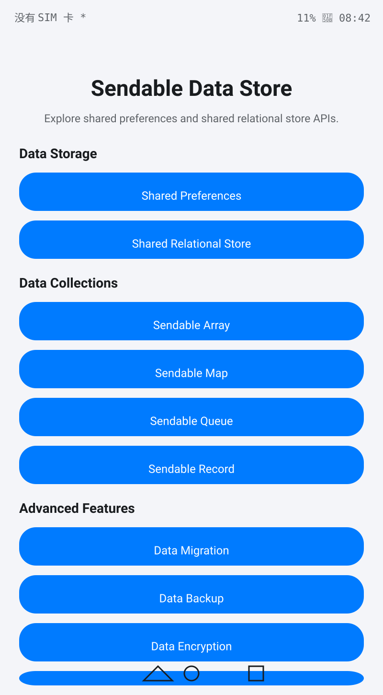
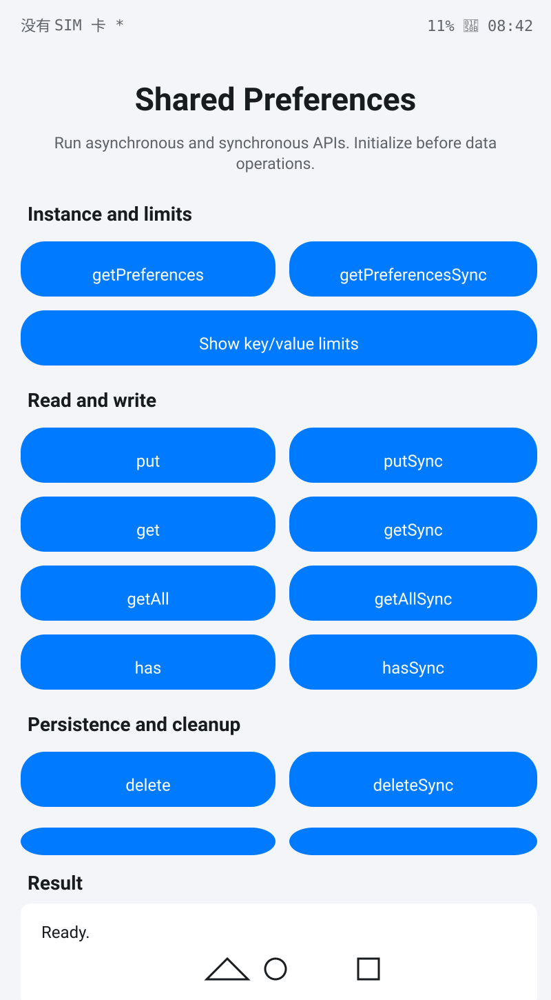

# SendableDataStore

### Introduction

This sample uses the Stage model and ArkTS. It demonstrates the shared preferences, shared relational store, and Sendable data structure APIs provided by [@ohos.data.sendablePreferences](https://gitcode.com/openharmony/docs/blob/master/en/application-dev/reference/apis-arkdata/js-apis-data-sendablePreferences.md), [@ohos.data.sendableRelationalStore](https://gitcode.com/openharmony/docs/blob/master/en/application-dev/reference/apis-arkdata/js-apis-data-sendableRelationalStore.md), and [@ohos.util.Sendable](https://gitcode.com/openharmony/docs/blob/master/en/application-dev/reference/apis-arkts/js-apis-sendable.md).

SendableDataStore covers the following core feature modules:
- **Data Storage**: Shared Preferences and Shared Relational Store
- **Data Collections**: Sendable Array, Sendable Map, Sendable Queue, Sendable Record
- **Advanced Features**: Data Migration, Data Backup, Data Encryption, Distributed Data Management

### Preview

| Home | Shared Preferences |
|------|--------------------|
|  |  |

### Instructions

1. Start SendableDataStore. The home page displays all feature entries organized into three sections: Data Storage, Data Collections, and Advanced Features.
2. **Shared Preferences**: Tap "Shared Preferences" to execute `getPreferences`/`getPreferencesSync` initialization, `put`/`get` read/write, `flush` persistence, `on change` event subscription, and more.
3. **Shared Relational Store**: Tap "Shared Relational Store" to execute RDB database creation, table management, Sendable data conversion, CRUD operations, transactions, and raw SQL execution.
4. **Sendable Array**: Tap "Sendable Array" to execute array creation, element operations, sorting, searching, slicing, and statistics.
5. **Sendable Map**: Tap "Sendable Map" to execute key-value CRUD, batch operations, traversal, and conversion.
6. **Sendable Queue**: Tap "Sendable Queue" to execute FIFO/LIFO queue operations, priority queue, and batch enqueue/dequeue.
7. **Sendable Record**: Tap "Sendable Record" to execute record creation, field management, nested records, and conversion.
8. **Data Migration**: Tap "Data Migration" to execute schema versioning, migration steps, and rollback.
9. **Data Backup**: Tap "Data Backup" to execute backup creation, restoration, deletion, and auto-backup scheduling.
10. **Data Encryption**: Tap "Data Encryption" to execute data encryption/decryption, key management, and hash computation.
11. **Distributed Data**: Tap "Distributed Data" to execute distributed CRUD, device management, data sync, and conflict resolution.

### Project Structure

```
entry/src/main/ets/
|---entryability
|   |---EntryAbility.ets                       // Application entry ability
|---pages
|   |---Index.ets                              // Main entry page with sectioned navigation
|---sendablepreferences
|   |---SendablePreferencesHelper.ets           // Shared preferences manager (async/sync API wrapper)
|   |---pages
|       |---SendablePreferencesHome.ets        // Shared preferences operation page
|---sendablerelationalstore
|   |---SendableRdbHelper.ets                  // Shared relational store manager
|   |---pages
|       |---SendableRelationalStoreHome.ets    // Shared relational store operation page
|---sendablearray
|   |---SendableArrayManager.ets               // Sendable array manager
|   |---pages
|       |---SendableArrayHome.ets              // Sendable array operation page
|---sendablemap
|   |---SendableMapManager.ets                 // Sendable map manager
|   |---pages
|       |---SendableMapHome.ets                // Sendable map operation page
|---sendablequeue
|   |---SendableQueueManager.ets               // Sendable queue manager
|   |---pages
|       |---SendableQueueHome.ets              // Sendable queue operation page
|---sendablerecord
|   |---SendableRecordManager.ets              // Sendable record manager
|   |---pages
|       |---SendableRecordHome.ets             // Sendable record operation page
|---migration
|   |---DataMigrationManager.ets               // Data migration manager
|   |---pages
|       |---DataMigrationHome.ets              // Data migration operation page
|---backup
|   |---DataBackupManager.ets                  // Data backup manager
|   |---pages
|       |---DataBackupHome.ets                 // Data backup operation page
|---encryption
|   |---DataEncryptionManager.ets              // Data encryption manager
|   |---pages
|       |---DataEncryptionHome.ets             // Data encryption operation page
|---distributed
|   |---DistributedDataManager.ets             // Distributed data manager
|   |---pages
|       |---DistributedDataHome.ets            // Distributed data operation page
|---models
|   |---DataModels.ets                         // Data models, enums, and constants
|---config
|   |---DataStoreConfig.ets                    // Data store configuration management
|---constants
|   |---DataStoreConstants.ets                 // Constants definition
|---utils
|   |---DataValidator.ets                      // Data validation utility
|   |---ErrorHandling.ets                      // Error handling utility
|   |---Logger.ets                             // Logger utility
|   |---PerformanceMonitor.ets                 // Performance monitoring utility
entry/src/ohosTest/ets/
|---testkit
|   |---SharedDriver.ets                       // Shared UI operation helper
|---testability
|   |---TestAbility.ets                        // Test ability
|---testrunner
|   |---OpenHarmonyTestRunner.ts               // Test runner
|---test
|   |---List.test.ets                          // Test suite entry (33 suites)
|   |---AbilityTest.test.ets                   // [Infra] App lifecycle test (3)
|   |---IndexAndNavigationTest.test.ets        // [UI] Home and navigation test (10)
|   |---AdvancedPagesUITest.test.ets           // [UI] Advanced pages UI test (20)
|   |---CollectionPagesUITest.test.ets         // [UI] Collection pages UI test (20)
|   |---PreferencesRdbUITest.test.ets          // [UI] Preferences/RDB UI test (17)
|   |---SendableArrayTest.test.ets             // [Sendable] Array test (36)
|   |---SendableMapTest.test.ets               // [Sendable] Map test (26)
|   |---SendablePreferencesTest.test.ets       // [Sendable] Preferences test (68)
|   |---SendableQueueTest.test.ets             // [Sendable] Queue test (26)
|   |---SendableRdbTest.test.ets               // [Sendable] RDB test (39)
|   |---SendableRecordTest.test.ets            // [Sendable] Record test (26)
|   |---DataBackupTest.test.ets                // [Feature] Backup test (22)
|   |---DataEncryptionTest.test.ets            // [Feature] Encryption test (27)
|   |---DataMigrationTest.test.ets             // [Feature] Migration test (22)
|   |---DistributedDataTest.test.ets           // [Feature] Distributed test (28)
|   |---DataStoreConfigTest.test.ets           // [Config] Config test (20)
|   |---DataModelsEnumAndConstantsTest.test.ets // [Config] Enum and constants test (39)
|   |---DataValidatorTest.test.ets             // [Util] Validator test (69)
|   |---ErrorHandlingTest.test.ets             // [Util] Error handling test (35)
|   |---LoggerTest.test.ets                    // [Util] Logger test (4)
|   |---PerformanceMonitorTest.test.ets        // [Util] Performance monitor test (26)
|   |---PreferencesDeepTest.test.ets           // [Deep] Preferences deep test (120)
|   |---RdbDeepTest.test.ets                   // [Deep] RDB deep test (120)
|   |---EncryptionDeepTest.test.ets            // [Deep] Encryption deep test (118)
|   |---DistributedDeepTest.test.ets           // [Deep] Distributed deep test (120)
|   |---BackupMigrationDeepTest.test.ets       // [Deep] Backup migration deep test (120)
|   |---QueueRecordDeepTest.test.ets           // [Deep] Queue record deep test (120)
|   |---ConfigPerfErrorDeepTest.test.ets       // [Deep] Config perf error deep test (120)
|   |---BatchCapacityGuardTest.test.ets        // [Boundary] Batch capacity test (25)
|   |---E2EWorkflowAndBoundaryTest.test.ets    // [Boundary] E2E workflow test (24)
|   |---ErrorHandlingOverflowTest.test.ets     // [Boundary] Error overflow test (17)
|   |---ManagerMethodGapTest.test.ets          // [Boundary] Method gap test (40)
|   |---SupplementaryCoverageTest.test.ets     // [Boundary] Supplementary coverage test (72)
```

### Implementation

* Shared preferences APIs are called through `sendablePreferences` from `@kit.ArkData`. [SendablePreferencesHome.ets](entry/src/main/ets/sendablepreferences/pages/SendablePreferencesHome.ets) wraps `getPreferences`/`getPreferencesSync` initialization, async/sync read/write, multi-key operations, typed operations, prefix operations, version management, event subscription, and cache management. Instance lifecycle is managed by [SendablePreferencesHelper.ets](entry/src/main/ets/sendablepreferences/SendablePreferencesHelper.ets).
* Shared relational store APIs are called through `sendableRelationalStore` from `@kit.ArkData`. [SendableRelationalStoreHome.ets](entry/src/main/ets/sendablerelationalstore/pages/SendableRelationalStoreHome.ets) wraps RDB database creation, table management, Sendable data conversion, multi-table operations, extended CRUD, transactions, and raw SQL execution. Database instance is managed by [SendableRdbHelper.ets](entry/src/main/ets/sendablerelationalstore/SendableRdbHelper.ets).
* Sendable data structures (Array, Map, Queue, Record) use Sendable collections from `@kit.ArkTS`. Each manager class encapsulates creation, manipulation, searching, conversion, and statistics.
* Data migration is implemented by [DataMigrationManager.ets](entry/src/main/ets/migration/DataMigrationManager.ets) with schema versioning, migration steps, and rollback.
* Data backup is implemented by [DataBackupManager.ets](entry/src/main/ets/backup/DataBackupManager.ets) with backup creation, restoration, deletion, and auto-backup scheduling.
* Data encryption is implemented by [DataEncryptionManager.ets](entry/src/main/ets/encryption/DataEncryptionManager.ets) with encryption/decryption, key management, and hash computation.
* Distributed data is implemented by [DistributedDataManager.ets](entry/src/main/ets/distributed/DistributedDataManager.ets) with distributed CRUD, device management, data sync, and conflict resolution.
* The entry page [Index.ets](entry/src/main/ets/pages/Index.ets) organizes navigation into Data Storage, Data Collections, and Advanced Features sections. The page uses a scrollable layout and localized resources for different window sizes.
* The test project contains 34 test files (33 suites plus the `List.test.ets` entry) and 1599 test cases, organized into seven categories: infrastructure tests, UI tests, Sendable data type tests, feature module tests, config/utility tests, deep tests, and boundary/supplementary tests. Test infrastructure includes [SharedDriver.ets](entry/src/ohosTest/ets/testkit/SharedDriver.ets) and [OpenHarmonyTestRunner.ts](entry/src/ohosTest/ets/testrunner/OpenHarmonyTestRunner.ts). See [ohosTest.md](ohosTest.md) for the test archive.

### Permissions

This sample does not require any sensitive permissions that need user authorization.

### Dependencies

This sample does not depend on other samples or modules. All APIs are called directly from the system kits `@kit.ArkData` and `@kit.ArkTS`.

### Constraints

1. This sample targets Phones, Tablets, and PCs/2in1 devices running the standard system with `SystemCapability.DistributedDataManager.Preferences.Core` and `SystemCapability.DistributedDataManager.RelationalStore.Core`.
2. This sample uses the Stage model and the OpenHarmony API version 26 SDK. `compileSdkVersion`, `targetSdkVersion`, and `compatibleSdkVersion` are all `26.0.0`, and the build model version is 6.1.0.
3. Use DevEco Studio and a build toolchain that support OpenHarmony API version 26.
4. `sendablePreferences` is available since API version 10, and `sendableRelationalStore` is available since API version 12. This project uses API 26 for all build settings.
5. Sendable data structures require immutability during cross-thread transfer. After write operations in the original thread, a new Sendable reference must be obtained.

### Download

To download this project separately, run the following commands:

```
git init
git config core.sparsecheckout true
echo code/BasicFeature/DataManagement/SendableDataStore/ > .git/info/sparse-checkout
git remote add origin https://gitcode.com/openharmony/applications_app_samples.git
git pull origin master
```
