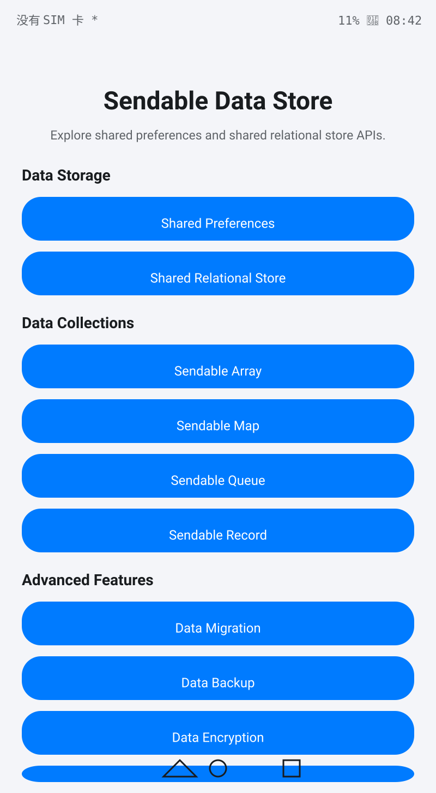
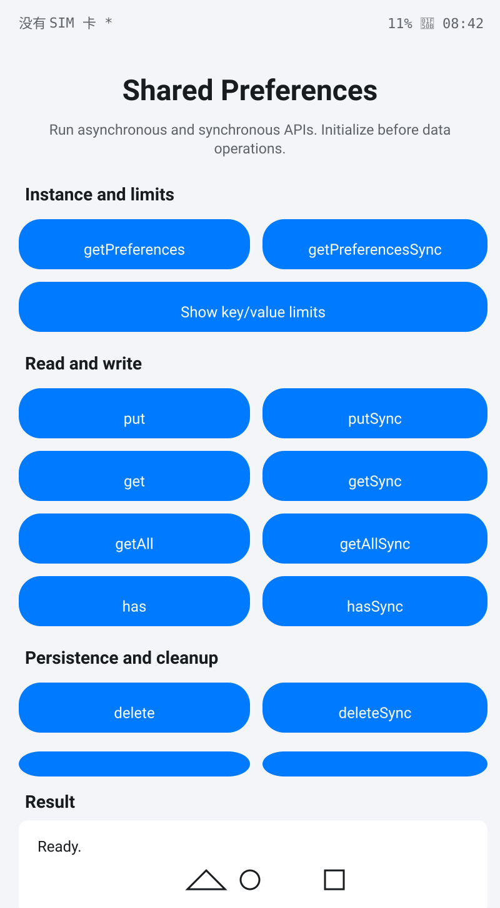

# SendableDataStore

### 介绍

本示例基于Stage模型和ArkTS语言，使用[@ohos.data.sendablePreferences](https://gitcode.com/openharmony/docs/blob/master/zh-cn/application-dev/reference/apis-arkdata/js-apis-data-sendablePreferences.md)、[@ohos.data.sendableRelationalStore](https://gitcode.com/openharmony/docs/blob/master/zh-cn/application-dev/reference/apis-arkdata/js-apis-data-sendableRelationalStore.md)和[@ohos.util.Sendable](https://gitcode.com/openharmony/docs/blob/master/zh-cn/application-dev/reference/apis-arkts/js-apis-sendable.md)提供的接口，展示Shared Preferences、Shared Relational Store及Sendable数据结构的使用方法。

SendableDataStore涵盖以下核心功能模块：
- **数据存储**：Shared Preferences 和 Shared Relational Store
- **数据集合**：Sendable Array、Sendable Map、Sendable Queue、Sendable Record
- **高级功能**：数据迁移、数据备份、数据加密、分布式数据管理

### 效果预览

| 主页 | Shared Preferences |
|------|------------|
|  |  |

### 使用说明

1. 启动SendableDataStore，主页面按"Data Storage"、"Data Collections"、"Advanced Features"三个分区展示所有功能入口。
2. **Shared Preferences**：点击"Shared Preferences"进入，可执行`getPreferences`/`getPreferencesSync`初始化、`put`/`get`读写、`flush`持久化、`on change`事件订阅等操作。
3. **Shared Relational Store**：点击"Shared Relational Store"进入，可执行RDB建库建表、Sendable数据转换、增删改查、事务操作和原生SQL执行。
4. **Sendable Array**：点击"Sendable Array"进入，可执行数组创建、元素操作、排序、搜索、切片和统计操作。
5. **Sendable Map**：点击"Sendable Map"进入，可执行键值对CRUD、批量操作、遍历和转换操作。
6. **Sendable Queue**：点击"Sendable Queue"进入，可执行FIFO/LIFO队列操作、优先级队列和批量入队出队。
7. **Sendable Record**：点击"Sendable Record"进入，可执行记录创建、字段管理、嵌套记录和转换操作。
8. **Data Migration**：点击"Data Migration"进入，可执行Schema版本管理、迁移步骤执行和回滚操作。
9. **Data Backup**：点击"Data Backup"进入，可执行备份创建、恢复、删除和自动备份调度。
10. **Data Encryption**：点击"Data Encryption"进入，可执行数据加密解密、密钥管理和哈希计算。
11. **Distributed Data**：点击"Distributed Data"进入，可执行分布式CRUD、设备管理、数据同步和冲突解决。

### 工程目录

```
entry/src/main/ets/
|---entryability
|   |---EntryAbility.ets                       // 应用入口元能力
|---pages
|   |---Index.ets                              // 主入口页面，按分区展示所有功能入口
|---sendablepreferences
|   |---SendablePreferencesHelper.ets           // Shared Preferences 管理器（异步/同步API封装）
|   |---pages
|       |---SendablePreferencesHome.ets        // Shared Preferences 操作页面
|---sendablerelationalstore
|   |---SendableRdbHelper.ets                  // 共享关系型数据库管理器
|   |---pages
|       |---SendableRelationalStoreHome.ets    // 共享关系型数据库操作页面
|---sendablearray
|   |---SendableArrayManager.ets               // Sendable数组管理器
|   |---pages
|       |---SendableArrayHome.ets              // Sendable数组操作页面
|---sendablemap
|   |---SendableMapManager.ets                 // Sendable映射管理器
|   |---pages
|       |---SendableMapHome.ets                // Sendable映射操作页面
|---sendablequeue
|   |---SendableQueueManager.ets               // Sendable队列管理器
|   |---pages
|       |---SendableQueueHome.ets              // Sendable队列操作页面
|---sendablerecord
|   |---SendableRecordManager.ets              // Sendable记录管理器
|   |---pages
|       |---SendableRecordHome.ets             // Sendable记录操作页面
|---migration
|   |---DataMigrationManager.ets               // 数据迁移管理器
|   |---pages
|       |---DataMigrationHome.ets              // 数据迁移操作页面
|---backup
|   |---DataBackupManager.ets                  // 数据备份管理器
|   |---pages
|       |---DataBackupHome.ets                 // 数据备份操作页面
|---encryption
|   |---DataEncryptionManager.ets              // 数据加密管理器
|   |---pages
|       |---DataEncryptionHome.ets             // 数据加密操作页面
|---distributed
|   |---DistributedDataManager.ets             // 分布式数据管理器
|   |---pages
|       |---DistributedDataHome.ets            // 分布式数据操作页面
|---models
|   |---DataModels.ets                         // 数据模型、枚举和常量定义
|---config
|   |---DataStoreConfig.ets                    // 数据存储配置管理
|---constants
|   |---DataStoreConstants.ets                 // 常量定义
|---utils
|   |---DataValidator.ets                      // 数据验证工具
|   |---ErrorHandling.ets                      // 错误处理工具
|   |---Logger.ets                             // 日志工具
|   |---PerformanceMonitor.ets                 // 性能监控工具
entry/src/ohosTest/ets/
|---testkit
|   |---SharedDriver.ets                       // UI操作共享工具类
|---testability
|   |---TestAbility.ets                        // 测试Ability
|---testrunner
|   |---OpenHarmonyTestRunner.ts               // 测试运行器
|---test
|   |---List.test.ets                          // 测试套件入口（33个套件）
|   |---AbilityTest.test.ets                   // [基础设施] 应用生命周期测试（3）
|   |---IndexAndNavigationTest.test.ets        // [UI] 首页和导航测试（10）
|   |---AdvancedPagesUITest.test.ets           // [UI] 高级页面UI测试（20）
|   |---CollectionPagesUITest.test.ets         // [UI] 集合页面UI测试（20）
|   |---PreferencesRdbUITest.test.ets          // [UI] Preferences/RDB UI测试（17）
|   |---SendableArrayTest.test.ets             // [Sendable] 数组测试（36）
|   |---SendableMapTest.test.ets               // [Sendable] 映射测试（26）
|   |---SendablePreferencesTest.test.ets       // [Sendable] Preferences 测试（68）
|   |---SendableQueueTest.test.ets             // [Sendable] 队列测试（26）
|   |---SendableRdbTest.test.ets               // [Sendable] 数据库测试（39）
|   |---SendableRecordTest.test.ets            // [Sendable] 记录测试（26）
|   |---DataBackupTest.test.ets                // [功能] 备份测试（22）
|   |---DataEncryptionTest.test.ets            // [功能] 加密测试（27）
|   |---DataMigrationTest.test.ets             // [功能] 迁移测试（22）
|   |---DistributedDataTest.test.ets           // [功能] 分布式测试（28）
|   |---DataStoreConfigTest.test.ets           // [配置] 配置测试（20）
|   |---DataModelsEnumAndConstantsTest.test.ets // [配置] 枚举常量测试（39）
|   |---DataValidatorTest.test.ets             // [工具] 验证器测试（69）
|   |---ErrorHandlingTest.test.ets             // [工具] 错误处理测试（35）
|   |---LoggerTest.test.ets                    // [工具] 日志测试（4）
|   |---PerformanceMonitorTest.test.ets        // [工具] 性能监控测试（26）
|   |---PreferencesDeepTest.test.ets           // [深度] Preferences 深度测试（120）
|   |---RdbDeepTest.test.ets                   // [深度] 数据库深度测试（120）
|   |---EncryptionDeepTest.test.ets            // [深度] 加密深度测试（118）
|   |---DistributedDeepTest.test.ets           // [深度] 分布式深度测试（120）
|   |---BackupMigrationDeepTest.test.ets       // [深度] 备份迁移深度测试（120）
|   |---QueueRecordDeepTest.test.ets           // [深度] 队列记录深度测试（120）
|   |---ConfigPerfErrorDeepTest.test.ets       // [深度] 配置性能错误深度测试（120）
|   |---BatchCapacityGuardTest.test.ets        // [边界] 批量容量测试（25）
|   |---E2EWorkflowAndBoundaryTest.test.ets    // [边界] 端到端工作流测试（24）
|   |---ErrorHandlingOverflowTest.test.ets     // [边界] 错误溢出测试（17）
|   |---ManagerMethodGapTest.test.ets          // [边界] 方法差距测试（40）
|   |---SupplementaryCoverageTest.test.ets     // [边界] 补充覆盖测试（72）
```

### 具体实现

* Shared Preferences通过`@kit.ArkData`中的`sendablePreferences`调用。[SendablePreferencesHome.ets](entry/src/main/ets/sendablepreferences/pages/SendablePreferencesHome.ets)封装了`getPreferences`/`getPreferencesSync`初始化、异步/同步读写、多键操作、类型化操作、前缀操作、版本管理、事件订阅和缓存管理等完整API，通过[SendablePreferencesHelper.ets](entry/src/main/ets/sendablepreferences/SendablePreferencesHelper.ets)管理实例生命周期。
* 共享关系型数据库通过`@kit.ArkData`中的`sendableRelationalStore`调用。[SendableRelationalStoreHome.ets](entry/src/main/ets/sendablerelationalstore/pages/SendableRelationalStoreHome.ets)封装了RDB建库建表、Sendable数据转换、多表操作、扩展CRUD、事务管理和原生SQL执行，通过[SendableRdbHelper.ets](entry/src/main/ets/sendablerelationalstore/SendableRdbHelper.ets)管理数据库实例。
* Sendable数据结构（Array、Map、Queue、Record）通过`@kit.ArkTS`中的Sendable集合调用，各Manager类封装了创建、操作、搜索、转换和统计功能。
* 数据迁移通过[DataMigrationManager.ets](entry/src/main/ets/migration/DataMigrationManager.ets)实现Schema版本管理、迁移步骤执行和回滚。
* 数据备份通过[DataBackupManager.ets](entry/src/main/ets/backup/DataBackupManager.ets)实现备份创建、恢复、删除和自动备份调度。
* 数据加密通过[DataEncryptionManager.ets](entry/src/main/ets/encryption/DataEncryptionManager.ets)实现数据加密解密、密钥管理和哈希计算。
* 分布式数据通过[DistributedDataManager.ets](entry/src/main/ets/distributed/DistributedDataManager.ets)实现分布式CRUD、设备管理、数据同步和冲突解决。
* 入口页面[Index.ets](entry/src/main/ets/pages/Index.ets)按Data Storage、Data Collections、Advanced Features三个分区组织导航。页面使用滚动布局和中英文资源，适配不同窗口尺寸。
* 测试工程共34个测试文件（33个套件和1个`List.test.ets`入口）、1599条用例，分为基础设施测试、UI测试、Sendable数据类型测试、功能模块测试、配置工具测试、深度测试和边界补充测试七大类。测试基础设施包括[SharedDriver.ets](entry/src/ohosTest/ets/testkit/SharedDriver.ets)和[OpenHarmonyTestRunner.ts](entry/src/ohosTest/ets/testrunner/OpenHarmonyTestRunner.ts)。完整测试归档见[ohosTest.md](ohosTest.md)。

### 相关权限

本示例不涉及需要用户授权的敏感权限。

### 依赖

无外部依赖。所有接口直接通过系统库`@kit.ArkData`和`@kit.ArkTS`调用。

### 约束与限制

1. 本示例适用于标准系统的Phone、Tablet和PC/2in1设备，需要设备支持`SystemCapability.DistributedDataManager.Preferences.Core`和`SystemCapability.DistributedDataManager.RelationalStore.Core`。
2. 本示例为Stage模型，使用OpenHarmony API version 26 SDK。工程的`compileSdkVersion`、`targetSdkVersion`和`compatibleSdkVersion`均为`26.0.0`，构建模型版本为6.1.0。
3. 请使用支持OpenHarmony API version 26的DevEco Studio和构建工具链。
4. `sendablePreferences`自API version 10开始支持，`sendableRelationalStore`自API version 12开始支持。本工程统一使用API 26编译。
5. Sendable数据结构要求跨线程传输时数据不可变，写操作在原始线程执行后需要重新获取Sendable引用。

### 下载

如需单独下载本工程，执行如下命令：

```
git init
git config core.sparsecheckout true
echo code/BasicFeature/DataManagement/SendableDataStore/ > .git/info/sparse-checkout
git remote add origin https://gitcode.com/openharmony/applications_app_samples.git
git pull origin master
```
