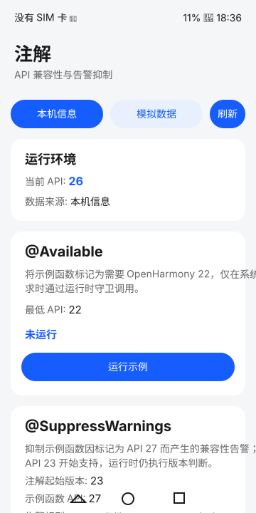

# Annotation

## Introduction

This sample uses [annotation in Basic Services Kit](https://gitcode.com/openharmony/docs/blob/master/zh-cn/application-dev/reference/apis-basic-services-kit/js-apis-annotation.md) to demonstrate `@Available` version checks and `@SuppressWarnings` warning suppression.

The ArkTS Stage sample runs as a normal application on an emulator or a local device without special hardware. Local mode reads the system API version, while mock mode uses API 21 to demonstrate compatibility fallback deterministically.

## Preview



The home page displays the runtime API version, the annotation starting version, the demo function API version, suppression rules and demo results.

## Usage

1. Launch the application to read the local API version.
2. Select **Run example** in the `@Available` card. The annotated function runs only when the system supports OpenHarmony 22 or later.
3. Select **Run example** in the `@SuppressWarnings` card. The sample suppresses a compile-time compatibility warning for a demo function marked API 27, but still performs a runtime version check. The card shows the annotation starting version (API 23) and the demo function API (27) as separate values.
4. Select **Mock data** to use API 21 and verify that both examples safely fall back.
5. Select **Refresh** to reload the selected environment and reset the demo results.

## Project Structure

```text
Annotation
├── AppScope
├── entry
│   └── src
│       ├── main/ets
│       │   ├── entryability/EntryAbility.ets
│       │   ├── pages/Index.ets
│       │   └── annotation/AnnotationPage.ets
│       └── ohosTest
└── library
    ├── Index.ets
    └── src/main/ets/annotation
        ├── feature/AnnotationService.ets
        └── utils/Logger.ts
```

## Implementation

1. [AnnotationService.ets](library/src/main/ets/annotation/feature/AnnotationService.ets) declares functions with `@Available`, suppresses a compatibility warning with `@SuppressWarnings` and protects every call with a runtime version guard.
2. The service also returns `compatibility`, `syscap` and `permission` through `SuppressWarningsType`.
3. [AnnotationPage.ets](entry/src/main/ets/annotation/AnnotationPage.ets) displays the local or mock API version and presents executed or fallback results.
4. [Ability.test.ets](entry/src/ohosTest/ets/test/Ability.test.ets) covers startup, environment display, mock data, fallback, refresh and version-dependent local results.
5. [AnnotationApi.test.ets](entry/src/ohosTest/ets/test/AnnotationApi.test.ets) provides API-level XTS cases for version guards, mock fallback, rule enumeration and repeated call stability.
6. [ConstantValidation.test.ets](entry/src/ohosTest/ets/test/ConstantValidation.test.ets) validates constant values, ordering relationships and array immutability.
7. [ApiVersionBoundary.test.ets](entry/src/ohosTest/ets/test/ApiVersionBoundary.test.ets) performs boundary matrix testing for API version thresholds.
8. [AnnotationState.test.ets](entry/src/ohosTest/ets/test/AnnotationState.test.ets) verifies state machine transitions across environment switches.
9. [MockEnvironment.test.ets](entry/src/ohosTest/ets/test/MockEnvironment.test.ets) provides dedicated testing for mock environment behaviors.
10. [Robustness.test.ets](entry/src/ohosTest/ets/test/Robustness.test.ets) validates fault tolerance and high-frequency call stability.
11. [ohosTest.md](ohosTest.md) archives runtime test scenarios and lists warning diagnostic scenarios that require verification through independent compilation fixtures.

## Permissions

No permissions are required. Suppressing a permission warning does not grant a permission.

## Dependencies

No other samples or third-party runtime dependencies are required.

## Constraints

1. The sample supports only the Stage model on standard-system emulators and devices.
2. `@Available` is available since API 22. `@SuppressWarnings` and `SuppressWarningsType` are available since API 23, while the `PERMISSION` rule is available since API 26.0.0.
3. The sample uses compileSdkVersion 26.1.0 and compatibleSdkVersion 26.0.0. Use DevEco Studio with API 26.1.0 SDK support.
4. Warning suppression affects compiler diagnostics only. It does not add runtime API support, system capabilities or permissions.
5. The card shows two versions: API 23 is the starting version of `@SuppressWarnings`, while API 27 is the `minApiVersion` of the user-defined demo function. API 27 exceeds compatibleSdkVersion 26.0.0 on purpose so that a suppressible compatibility warning is raised. It is not a call to a future system API and is never executed on systems below API 27.
6. Mock mode always uses API 21 and does not represent the actual device version.

## Testing

The project includes 363 automated test cases across 30 test files:

- **AnnotationApi.test.ets**: 15 API functional tests
- **Ability.test.ets**: 8 UI interaction tests
- **ConstantValidation.test.ets**: 17 constant validation tests
- **ApiVersionBoundary.test.ets**: 20 boundary value tests
- **AnnotationState.test.ets**: 22 state machine tests
- **MockEnvironment.test.ets**: 22 mock environment tests
- **Robustness.test.ets**: 20 fault tolerance and stability tests
- **AnnotationServiceEdgeCases.test.ets**: 12 edge case tests
- **AnnotationException.test.ets**: 9 exception handling tests
- **AnnotationDeep.test.ets**: 9 deep functionality tests
- **AnnotationConsistency.test.ets**: 10 consistency tests
- **AnnotationLifecycle.test.ets**: 10 lifecycle tests
- **AnnotationIntegration.test.ets**: 10 integration tests
- **AnnotationError.test.ets**: 10 error handling tests
- **AnnotationConfig.test.ets**: 10 configuration tests
- **AnnotationSecurity.test.ets**: 10 security tests
- **AnnotationStateMachine.test.ets**: 10 state machine extension tests
- **AnnotationBoundary.test.ets**: 18 boundary value extension tests
- **AnnotationExceptionInput.test.ets**: 8 exception input tests
- **AnnotationLifecycleExt.test.ets**: 10 lifecycle extension tests
- **AnnotationIntegrationExt.test.ets**: 8 integration extension tests
- **AnnotationConstantDeep.test.ets**: 12 constant deep tests
- **AnnotationSecurityDeep.test.ets**: 10 security deep tests
- **AnnotationUIDeep.test.ets**: 10 service call sequence and return value tests
- **AnnotationMonitor.test.ets**: 10 monitor tests
- **AnnotationConcurrency.test.ets**: 9 sequential repeated-call and array isolation tests
- **AnnotationMemory.test.ets**: 10 array independence and repeated-call stability tests
- **AnnotationErrorBoundary.test.ets**: 12 error boundary tests
- **AnnotationRuleEngine.test.ets**: 10 rule engine tests
- **AnnotationRegression.test.ets**: 12 regression tests

See [ohosTest.md](ohosTest.md) for detailed test case documentation.

## Download

To download only this project, run:

```text
git init
git config core.sparsecheckout true
echo code/BasicFeature/DeviceManagement/Annotation/ > .git/info/sparse-checkout
git remote add origin https://gitcode.com/openharmony/applications_app_samples.git
git pull origin master
```
