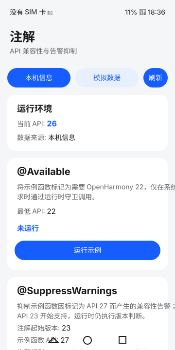

# 注解

## 介绍

本示例使用 [Basic Services Kit 的 annotation 接口](https://gitcode.com/openharmony/docs/blob/master/zh-cn/application-dev/reference/apis-basic-services-kit/js-apis-annotation.md) 演示 `@Available` 版本检查和 `@SuppressWarnings` 告警抑制。

示例采用 ArkTS 和 Stage 模型，普通应用可在模拟器或本机直接运行，无需特殊硬件。本机模式读取系统 API 版本，模拟模式固定使用 API 21，以便稳定演示兼容性回退。

## 效果预览



应用首页展示运行环境 API 版本、注解起始版本、示例函数 API 版本、告警规则及示例结果。

## 使用说明

1. 启动应用后读取本机 API 版本。
2. 点击 `@Available` 卡片的“运行示例”，仅在系统支持 OpenHarmony 22 或更高版本时执行注解函数。
3. 点击 `@SuppressWarnings` 卡片的“运行示例”，示例抑制标记为 API 27 的函数产生的编译期兼容性告警，同时保留运行时版本判断。卡片分别展示注解起始版本（API 23）和示例函数 API 版本（27）。
4. 点击“模拟数据”切换至 API 21，验证两个示例均安全回退。
5. 点击“刷新”重新加载当前环境并重置示例结果。

## 工程目录

```text
Annotation
├── AppScope
│   └── app.json5
├── entry
│   └── src
│       ├── main
│       │   ├── ets
│       │   │   ├── entryability/EntryAbility.ets
│       │   │   ├── pages/Index.ets
│       │   │   └── annotation/AnnotationPage.ets
│       │   └── module.json5
│       └── ohosTest
│           └── ets
│               ├── test（30 个测试文件、31 个 describe 及 List.test.ets）
│               ├── testability
│               └── testrunner
└── library
    ├── Index.ets
    └── src/main/ets/annotation
        ├── feature/AnnotationService.ets
        └── utils/Logger.ts
```

## 具体实现

1. [AnnotationService.ets](library/src/main/ets/annotation/feature/AnnotationService.ets) 使用 `@Available` 标记函数，通过 `@SuppressWarnings` 抑制兼容性告警，并为每次调用保留运行时版本守卫。
2. 服务通过 `SuppressWarningsType` 返回 `compatibility`，`syscap` 和 `permission` 三种规则。
3. [AnnotationPage.ets](entry/src/main/ets/annotation/AnnotationPage.ets) 展示本机或模拟 API 版本，并呈现执行或回退结果。
4. [AnnotationApi.test.ets](entry/src/ohosTest/ets/test/AnnotationApi.test.ets) 提供接口级 XTS 用例，验证版本守卫、模拟回退、规则枚举和重复调用稳定性。
5. [Ability.test.ets](entry/src/ohosTest/ets/test/Ability.test.ets) 提供 UI 自动化 XTS 用例，覆盖应用启动、环境展示、模拟数据、安全回退、重复执行、环境切换和刷新。
6. [ConstantValidation.test.ets](entry/src/ohosTest/ets/test/ConstantValidation.test.ets) 验证常量值、顺序关系和数组不可变性。
7. [ApiVersionBoundary.test.ets](entry/src/ohosTest/ets/test/ApiVersionBoundary.test.ets) 对 API 版本阈值进行边界矩阵测试。
8. [AnnotationState.test.ets](entry/src/ohosTest/ets/test/AnnotationState.test.ets) 验证环境切换时的状态机转换。
9. [MockEnvironment.test.ets](entry/src/ohosTest/ets/test/MockEnvironment.test.ets) 专项测试模拟环境行为。
10. [Robustness.test.ets](entry/src/ohosTest/ets/test/Robustness.test.ets) 验证容错能力和高频调用稳定性。
11. [ohosTest.md](ohosTest.md) 归档运行时测试场景，并列出需通过独立编译 fixture 验证的告警诊断场景。

## 相关权限

本示例不需要申请权限。示例中使用 `@SuppressWarnings` 抑制权限告警仅影响编译诊断，不会授予应用相应权限。

## 依赖

不涉及额外 Sample 或第三方运行时依赖。

## 约束与限制

1. 本示例仅支持 Stage 模型，支持标准系统的模拟器和设备。
2. `@Available` 从 API 22 开始支持。`@SuppressWarnings` 和 `SuppressWarningsType` 从 API 23 开始支持，`PERMISSION` 规则从 API 26.0.0 开始支持。
3. 本示例的 compileSdkVersion 为 26.1.0，compatibleSdkVersion 为 26.0.0，需要使用支持 API 26.1.0 SDK 的 DevEco Studio。
4. 告警抑制仅影响编译诊断，不会增加运行时 API 支持，系统能力或权限。
5. 卡片中的两个版本含义不同：API 23 是 `@SuppressWarnings` 的起始版本，API 27 是用户自定义示例函数的 `minApiVersion`。27 大于 compatibleSdkVersion 26.0.0，用于特意触发可被抑制的兼容性告警，并非调用未来系统接口，在低于 API 27 的系统上不会执行。
6. 模拟模式固定使用 API 21，不代表设备的真实版本。

## 测试

本工程包含 363 个自动化测试用例，分布在 30 个测试文件中：

- **AnnotationApi.test.ets**：15 个 API 功能测试
- **Ability.test.ets**：8 个 UI 交互测试
- **ConstantValidation.test.ets**：17 个常量验证测试
- **ApiVersionBoundary.test.ets**：20 个边界值测试
- **AnnotationState.test.ets**：22 个状态机测试
- **MockEnvironment.test.ets**：22 个 Mock 环境测试
- **Robustness.test.ets**：20 个容错稳定性测试
- **AnnotationServiceEdgeCases.test.ets**：12 个边界场景测试
- **AnnotationException.test.ets**：9 个异常处理测试
- **AnnotationDeep.test.ets**：9 个深度功能测试
- **AnnotationConsistency.test.ets**：10 个一致性测试
- **AnnotationLifecycle.test.ets**：10 个生命周期测试
- **AnnotationIntegration.test.ets**：10 个集成测试
- **AnnotationError.test.ets**：10 个错误处理测试
- **AnnotationConfig.test.ets**：10 个配置测试
- **AnnotationSecurity.test.ets**：10 个安全性测试
- **AnnotationStateMachine.test.ets**：10 个状态机扩展测试
- **AnnotationBoundary.test.ets**：18 个边界值扩展测试
- **AnnotationExceptionInput.test.ets**：8 个异常输入测试
- **AnnotationLifecycleExt.test.ets**：10 个生命周期扩展测试
- **AnnotationIntegrationExt.test.ets**：8 个集成扩展测试
- **AnnotationConstantDeep.test.ets**：12 个常量深度测试
- **AnnotationSecurityDeep.test.ets**：10 个安全深度测试
- **AnnotationUIDeep.test.ets**：10 个服务调用序列与返回值测试
- **AnnotationMonitor.test.ets**：10 个监控测试
- **AnnotationConcurrency.test.ets**：9 个同步顺序重复调用与数组隔离测试
- **AnnotationMemory.test.ets**：10 个数组独立性与重复调用稳定性测试
- **AnnotationErrorBoundary.test.ets**：12 个错误边界测试
- **AnnotationRuleEngine.test.ets**：10 个规则引擎测试
- **AnnotationRegression.test.ets**：12 个回归测试

详见 [ohosTest.md](ohosTest.md) 获取完整测试用例文档。

## 下载

如需单独下载本工程，执行如下命令：

```text
git init
git config core.sparsecheckout true
echo code/BasicFeature/DeviceManagement/Annotation/ > .git/info/sparse-checkout
git remote add origin https://gitcode.com/openharmony/applications_app_samples.git
git pull origin master
```
