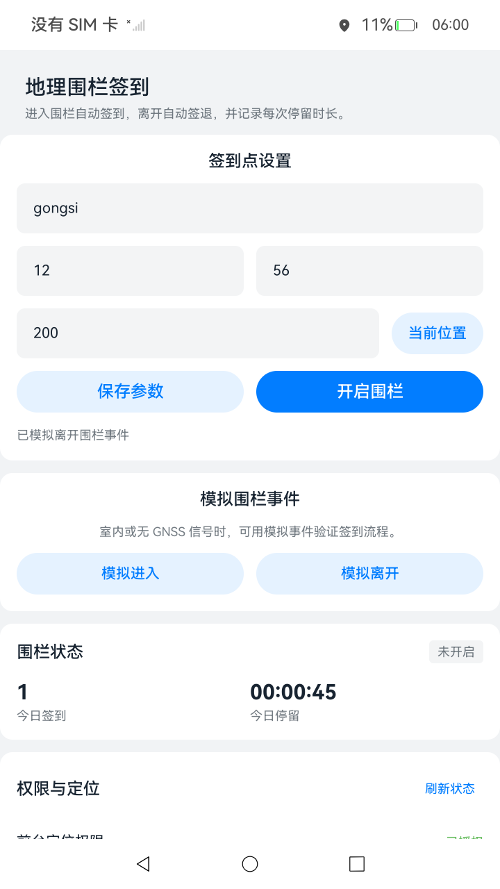
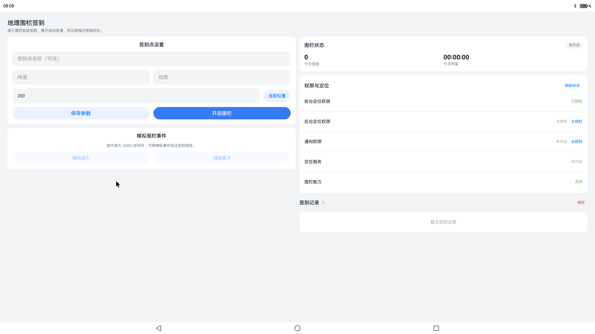

# 地理围栏签到

## 介绍

本示例演示基于 Location Kit 的 GNSS 地理围栏实现自动签到与签退，代码拆分为可复用的 Library 特性模块和 entry 场景模块。

- 使用 [@kit.LocationKit](https://gitee.com/openharmony/docs/blob/master/zh-cn/application-dev/reference/apis-location-kit/Readme-CN.md) 中的 geoLocationManager 添加和删除 GNSS 地理围栏，并通过 FenceExtensionAbility 接收围栏进出事件。
- 使用 [@kit.ArkData](https://gitee.com/openharmony/docs/blob/master/zh-cn/application-dev/reference/apis-arkdata/Readme-CN.md) 中的 relationalStore 保存围栏参数和签到记录，供应用进程与围栏扩展进程共同读写。
- 使用 [@kit.NotificationKit](https://gitee.com/openharmony/docs/blob/master/zh-cn/application-dev/reference/apis-notification-kit/Readme-CN.md) 发布签到和签退通知，点击通知回到应用主界面。
- 使用 [@kit.AbilityKit](https://gitee.com/openharmony/docs/blob/master/zh-cn/application-dev/reference/apis-ability-kit/Readme-CN.md) 中的 abilityAccessCtrl 申请前台定位权限，并引导用户开启后台定位权限和通知权限。

主要功能如下：

- 手动输入围栏中心经纬度与半径，或一键填入当前位置。
- 开启围栏后，进入围栏自动签到，离开围栏自动签退，无需用户确认。
- 应用退到后台时由 FenceExtensionAbility 接收围栏事件，并写入签到记录、发布通知。
- 展示今日签到次数与累计停留时长，以及最近 20 条签到记录。
- 提供进入、离开事件的模拟入口，室内或无 GNSS 信号时也能验证签到流程。
- 检查围栏能力、定位服务、前台定位权限、后台定位权限与通知权限状态。

## 效果预览




### 使用说明

1. 在主界面“签到点设置”卡片中填写签到点名称、纬度、经度和半径（50 米到 5000 米），点击“保存参数”。
2. 点击“当前位置”可以把设备当前经纬度填入输入框，也可以手动输入坐标。
3. 首次打开应用会自动申请前台定位与通知权限，按系统弹窗允许即可；后台定位权限需在“权限与定位”卡片中点击“去授权”，按系统引导选择“始终允许”。
4. 点击“开启围栏”，系统注册一个有效期 7 天的圆形 GNSS 围栏；进入围栏时自动签到并发布通知，离开围栏时自动签退。
5. 围栏开启后，切换到后台或锁屏，走入、走出围栏区域即可验证后台自动签到流程。
6. 在“模拟围栏事件”卡片中点击“模拟进入”或“模拟离开”，可以在室内验证签到、签退和记录写入流程。
7. 在“签到记录”区域查看每次进入时间、离开时间与停留时长，点击“清空”删除全部记录。
8. 平板等宽屏设备会展示左右两栏布局，手机为单列滚动布局。

## 工程目录

```text
GeofenceCheckIn/
|--- AppScope
|--- entry                                    // 场景模块，依赖 Library
|   |--- src/main/ets
|   |   |--- entryability/EntryAbility.ets    // 应用入口
|   |   |--- pages/Index.ets                  // 唯一入口页面
|   |   |--- geofence
|   |   |   |--- GeofenceMainPage.ets         // 围栏签到主页面，一多布局
|   |   |   |--- components/StatusRow.ets     // 权限与状态行组件
|   |   |   |--- viewmodel/GeofenceViewModel.ets // 场景状态与操作编排
|   |   |--- geofenceextension/GeofenceFenceAbility.ets // 围栏扩展，接收围栏事件
|   |--- src/ohosTest/ets/test
|   |   |--- GeofenceCheckIn.test.ets         // UI 自动化用例
|   |   |--- List.test.ets                    // 测试入口
|--- Library                                  // 特性模块，可独立编译为 HAR
|   |--- Index.ets                            // 对外导出
|   |--- src/main/ets/geofence
|   |   |--- GeofenceFeature.ets              // 地理围栏签到对外接口
|   |   |--- components
|   |   |   |--- FenceStatusCard.ets          // 今日签到状态卡片
|   |   |   |--- CheckInRecordItem.ets        // 签到记录条目
|   |   |--- feature
|   |   |   |--- FenceService.ets             // 围栏注册、删除与权限申请
|   |   |   |--- CheckInService.ets           // 围栏事件到签到记录的转换
|   |   |   |--- RecordStore.ets              // 围栏参数与签到记录持久化
|   |   |   |--- NotificationService.ets      // 签到、签退通知
|   |   |--- model/GeofenceTypes.ets          // 数据模型与常量
|   |   |--- utils
|   |   |   |--- Logger.ets                   // hilog 封装
|   |   |   |--- TimeUtil.ets                 // 时间与时长格式化
|   |--- src/main/resources                   // 字符串与颜色资源
```

## 具体实现

地理围栏签到能力的封装位于 Library 模块，对场景层以静态类的方式开放，入口文件为 [GeofenceFeature.ets](Library/src/main/ets/geofence/GeofenceFeature.ets)，统一导出在 [Index.ets](Library/Index.ets)。

- 围栏注册与权限：在 [FenceService.ets](Library/src/main/ets/geofence/feature/FenceService.ets) 中调用 geoLocationManager.addGnssGeofence 注册圆形围栏，通过 fenceExtensionAbilityName 指定围栏扩展，通过 removeGnssGeofence 删除围栏；使用 abilityAccessCtrl.requestPermissionsFromUser 申请前台定位权限，requestPermissionOnSetting 引导后台定位权限。接口说明参考 [@ohos.geoLocationManager](https://gitee.com/openharmony/docs/blob/master/zh-cn/application-dev/reference/apis-location-kit/js-apis-geoLocationManager.md)。
- 签到记录：在 [CheckInService.ets](Library/src/main/ets/geofence/feature/CheckInService.ets) 中把进入、离开事件转换为幂等的签到、签退操作，进入事件在已存在未签退记录时忽略，离开事件在无未签退记录时忽略，避免回调和扩展重复写入。
- 数据持久化：在 [RecordStore.ets](Library/src/main/ets/geofence/feature/RecordStore.ets) 中使用 relationalStore 建立 fence_config 与 check_in_record 两张表，应用进程与 FenceExtensionAbility 进程通过同一数据库文件共享围栏参数和签到记录。
- 通知：在 [NotificationService.ets](Library/src/main/ets/geofence/feature/NotificationService.ets) 中发布 BasicText 通知，通过 WantAgent 设置点击通知回到 EntryAbility。
- 围栏扩展：在 [GeofenceFenceAbility.ets](entry/src/main/ets/geofenceextension/GeofenceFenceAbility.ets) 中实现 onFenceStatusChange，收到围栏事件后交给 CheckInService 处理，因此应用在后台时也能完成签到。
- 场景页面：主页面为 [GeofenceMainPage.ets](entry/src/main/ets/geofence/GeofenceMainPage.ets)，页面状态由 [GeofenceViewModel.ets](entry/src/main/ets/geofence/viewmodel/GeofenceViewModel.ets) 管理。
- 一多布局：在 [GeofenceMainPage.ets](entry/src/main/ets/geofence/GeofenceMainPage.ets) 中通过 GridRow 的 sm、md、lg 断点切换单列与双列布局，手机单列滚动，平板左右两栏。
- UI 自动化：在 [GeofenceCheckIn.test.ets](entry/src/ohosTest/ets/test/GeofenceCheckIn.test.ets) 中覆盖启动，保存参数，非法参数，模拟签到，模拟签退，清空记录，响应式布局共 7 条用例。

## 相关权限

本示例已在 entry 模块的 module.json5 中声明以下权限：

```json5
"requestPermissions": [
  {
    "name": "ohos.permission.APPROXIMATELY_LOCATION"
  },
  {
    "name": "ohos.permission.LOCATION"
  },
  {
    "name": "ohos.permission.LOCATION_IN_BACKGROUND"
  }
]
```

- ohos.permission.APPROXIMATELY_LOCATION 与 ohos.permission.LOCATION 为 user_grant 权限，添加 GNSS 围栏和获取当前位置时必需。
- ohos.permission.LOCATION_IN_BACKGROUND 为 user_grant 权限，应用退到后台后接收围栏事件时使用。该权限不能在弹窗中直接授予，示例通过 requestPermissionOnSetting 打开设置页引导用户选择“始终允许”。
- 通知无需额外声明权限，首次发布通知前调用 requestEnableNotification 申请通知授权。

## 依赖

无。

## 约束与限制

1. 本示例仅支持标准系统上运行，支持设备为 Phone 和 Tablet。
2. 本示例使用 API 26 版本 SDK（26.0.0）编译，compatibleSdkVersion 为 23。
3. 地理围栏依赖 GNSS 芯片能力，仅在室外开阔区域才能准确识别进出事件，模拟器可能不支持该能力，此时页面“围栏能力”显示“不支持”，可使用模拟围栏事件验证签到流程。模拟器或无 GNSS 的设备点击“当前位置”可能提示未获取到定位结果（3301200），点击“开启围栏”可能提示位置服务暂不可用（3301000），均属于设备能力限制，可手动输入经纬度并用模拟事件验证流程。
4. 围栏有效期设置为 7 天，到期后需要重新开启围栏。
5. 本示例需要使用 DevEco Studio 6.0.0 Release 及以上版本编译运行。
6. UI 自动化用例位于 entry/src/ohosTest，运行前请连接真机并完成签名配置，用例需要定位、通知等系统弹窗处于未授权状态时结果更稳定。

## 测试

UI 自动化用例说明与执行结果参见 [TestReport.md](TestReport.md)。

## 下载

如需单独下载本工程，执行如下命令：

```shell
git init
git config core.sparsecheckout true
echo code/BasicFeature/DeviceManagement/GeofenceCheckIn/ > .git/info/sparse-checkout
git remote add origin https://gitee.com/openharmony/applications_app_samples.git
git pull origin master
```
