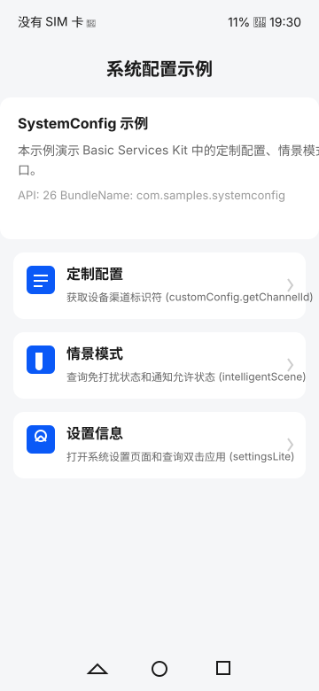
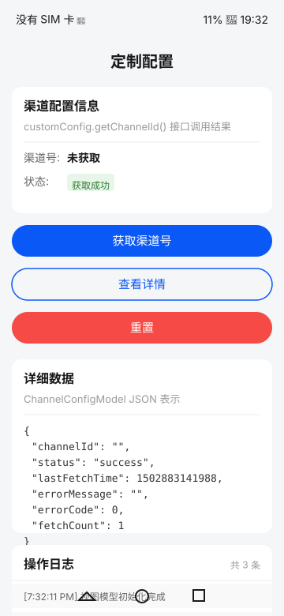
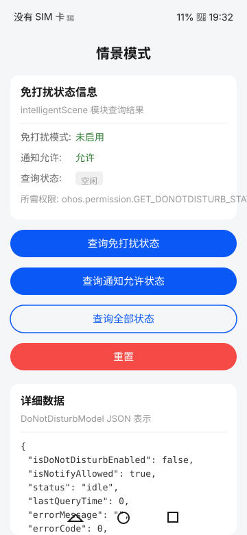
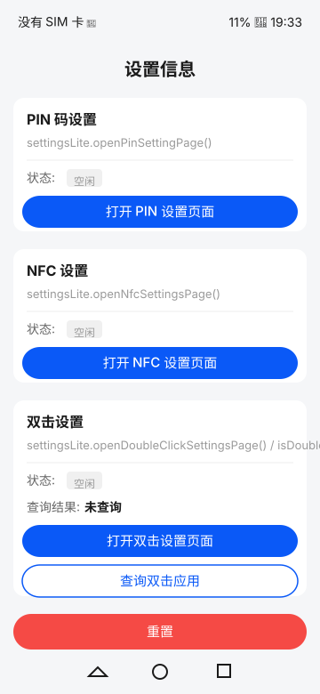

# SystemConfig

## Introduction

SystemConfig is a sample application based on OpenHarmony Basic Services Kit, demonstrating how to use the `@ohos.customization.customConfig`, `@ohos.intelligentScene` APIs and Want-based system settings page launching for system configuration management.

This sample uses APIs from the Basic Services Kit, covering the following features:

- **Custom Config**: Retrieve device channel identifier via `customConfig.getChannelId()`
- **Intelligent Scene**: Query Do Not Disturb status and notification permission via `intelligentScene` module
- **Settings Lite**: Open system settings pages (PIN, NFC, Double-click) via `startAbility` with settings Want actions. The `@ohos.settingsLite` module itself is FA-model-only and cannot be called in this Stage-model sample, so the double-click app query honestly reports an unsupported error instead of a mock result

The project uses a Library module (`library`) to encapsulate API interfaces, services, and utility classes, while the Entry module handles business logic and page display, achieving interface reuse and business decoupling.

## Preview

Home Page [](ScreenShot/home.svg)
Custom Config [](ScreenShot/custom_config.svg)
Intelligent Scene [](ScreenShot/intelligent_scene.svg)
Settings Lite [](ScreenShot/settings_lite.svg)

## Usage

1. Open the `SystemConfig` project in DevEco Studio.
2. Connect an OpenHarmony device (e.g., RK3568 development board) via USB.
3. Select the target device in DevEco Studio and click **Run** to build and install the app.
4. On the home page, you will see three feature entries: Custom Config, Intelligent Scene, and Settings Lite.
5. Tap any entry to navigate to the corresponding feature page.
6. On each page, you can perform API calls, view results, and check operation logs.

> **Note**: The `intelligentScene` APIs require the `ohos.permission.GET_DONOTDISTURB_STATE` permission.

## Project Structure

```
SystemConfig/
├── AppScope/                              # Global app configuration
│   ├── app.json5                          # App config (bundleName: com.samples.systemconfig)
│   └── resources/                         # Global resources
├── ScreenShot/                            # Device screenshots for Preview
├── library/                               # Library module (HAR) - API encapsulation
│   ├── Index.ets                          # Module export barrel
│   ├── oh-package.json5                   # Module package config
│   └── src/main/ets/
│       ├── constants/                     # Constants
│       │   ├── SystemConfigConstants.ts   # System config constants
│       │   └── PageConstants.ts           # Page routing constants
│       ├── model/                         # Data models
│       │   ├── ChannelConfigModel.ets     # Channel config model
│       │   ├── DoNotDisturbModel.ets      # DND model
│       │   └── SettingsItemModel.ets      # Settings item model
│       ├── service/                       # Service layer
│       │   ├── CustomConfigService.ets    # Custom config service
│       │   ├── IntelligentSceneService.ets # Intelligent scene service
│       │   ├── SettingsLiteService.ets    # Settings lite service
│       │   ├── TraceService.ets           # hiTraceMeter service
│       │   └── EventService.ets           # hiAppEvent service
│       └── utils/                         # Utility classes (4 categories, 20 classes)
│           ├── basic/                     # Basic utilities
│           ├── device/                    # Device & storage utilities
│           ├── network/                   # Network & permission utilities
│           └── validation/               # Validation & random utilities
├── entry/                                 # Entry module - Business logic
│   ├── oh-package.json5                   # Depends on library module
│   └── src/
│       ├── main/ets/
│       │   ├── components/                # Reusable UI components
│       │   ├── entryability/              # EntryAbility
│       │   ├── pages/                     # Pages
│       │   │   ├── Index.ets              # Home page
│       │   │   ├── customconfig/          # Custom config page
│       │   │   ├── intelligentScene/      # Intelligent scene page
│       │   │   └── settingslite/          # Settings lite page
│       │   └── viewmodel/                 # View models
│       ├── ohosTest/                      # UI automation tests (54 suites / 624 cases)
│       │   └── ets/test/                  # Test suites (9 categories)
│       └── main/resources/                # Module resources
├── build-profile.json5                    # Project build config (API 26)
├── hvigorfile.ts                          # Build script
└── oh-package.json5                       # Project package config
```

## Implementation Details

### Library Module

The Library module encapsulates the core APIs and can be independently compiled as a HAR for reuse.

- **Service Layer** ([library/src/main/ets/service/](library/src/main/ets/service/)): Each API module has a corresponding Service class that wraps the actual API calls with logging, tracing, and error handling. For example, `CustomConfigService` wraps `customConfig.getChannelId()`.
- **Data Models** ([library/src/main/ets/model/](library/src/main/ets/model/)): Three model classes (`ChannelConfigModel`, `DoNotDisturbModel`, `SettingsItemModel`) manage state, track operation history, and provide serialization.
- **Trace & Event** ([library/src/main/ets/service/TraceService.ets](library/src/main/ets/service/TraceService.ets)): `TraceService` wraps hiTraceMeter for performance tracing; `EventService` wraps hiAppEvent for event reporting.
- **Utility Classes** ([library/src/main/ets/utils/](library/src/main/ets/utils/)): 20 utility classes across 4 categories covering basic operations, device/storage, network/permissions, and validation/random.
- **Module Exports** ([library/Index.ets](library/Index.ets)): Barrel export of all public APIs.

### Entry Module

The Entry module handles business logic and page display.

- **Home Page** ([entry/src/main/ets/pages/Index.ets](entry/src/main/ets/pages/Index.ets)): Displays app info and navigation entries for all three feature modules.
- **Feature Pages** ([entry/src/main/ets/pages/](entry/src/main/ets/pages/)): Three feature pages (CustomConfig, IntelligentScene, SettingsLite) each with operation buttons, status display, and log panels.
- **View Models** ([entry/src/main/ets/viewmodel/](entry/src/main/ets/viewmodel/)): Each page has a ViewModel that coordinates service calls and manages page state.
- **UI Components** ([entry/src/main/ets/components/](entry/src/main/ets/components/)): Reusable components including `InfoCard`, `ActionButton`, `LogPanel`, and `StatusBadge`.

### hiTraceMeter & hiAppEvent Integration

- `TraceService` wraps hiTraceMeter performance tracing, automatically adding trace points around key API calls.
- `EventService` wraps hiAppEvent event reporting, supporting event filtering and statistics.

## Automated Testing

This sample provides comprehensive ohosTest automation tests: **54 test suites with 624 cases** in 9 categories, covering the service layer, data models, utility classes, validation, network/permissions, device storage, constants, page navigation and multi-service integration scenarios.

- **Case naming**: `it()` and `@tc.name` use `test<Feature><NNNN>`, with the last four digits starting at `0001` and incrementing by 1 per case; `@tc.number` uses `SUB_<MODULE>_<SEQ>`, with the last four digits starting at `0100` and incrementing by 100 per case, numbered consecutively within each file and globally unique.
- **How to run**: After building and installing the ohosTest HAP, launch the ohosTest cases on the target device for a full run, or specify a suite / single case.
- **Latest results**: Two consecutive full runs both report `Tests run: 624, Failure: 0, Error: 0, Pass: 624, Ignore: 0`.

For the full case list, naming conventions, and execution details, see [ohosTest.md](ohosTest.md).

## Permissions

This sample requires the following permissions, configured in [entry/src/main/module.json5](entry/src/main/module.json5):

| Permission | Description |
| --- | --- |
| `ohos.permission.GET_DONOTDISTURB_STATE` | Query Do Not Disturb state |

## Dependencies

### Other Sample Dependencies

This sample does not depend on other samples.

### System Kit Dependencies

| Kit | Usage |
| --- | --- |
| [BasicServicesKit](https://gitcode.com/openharmony/docs/tree/master/zh-cn/application-dev/reference/apis-basic-services-kit) | customConfig, intelligentScene, hiAppEvent |
| [PerformanceAnalysisKit](https://gitcode.com/openharmony/docs/tree/master/zh-cn/application-dev/reference/apis-performance-analysis-kit) | hiTraceMeter tracing, hilog logging |
| [AbilityKit](https://gitcode.com/openharmony/docs/tree/master/zh-cn/application-dev/reference/apis-ability-kit) | UIAbility lifecycle |
| [ArkUI](https://gitcode.com/openharmony/docs/tree/master/zh-cn/application-dev/ui) | Declarative UI framework |

## Constraints

1. **OS**: OpenHarmony Standard System
2. **Device**: OpenHarmony device with system settings support (e.g., RK3568 development board)
3. **API Version**: API 26 (CompileSdkVersion 26, CompatibleSdkVersion 26)
4. **IDE Version**: DevEco Studio 5.0+
5. **SDK Version**: OpenHarmony SDK API 26
6. **Runtime**: OpenHarmony (runtimeOS)
7. **Permission**: `GET_DONOTDISTURB_STATE` requires system grant or debug mode

## Download

```bash
# Download using sparse-checkout
git clone --filter=sparse --no-checkout https://gitcode.com/openharmony/applications_app_samples.git
cd applications_app_samples
git sparse-checkout set code/BasicFeature/DeviceManagement/SystemConfig/
git checkout
```

> Ensure the path ends with `/` to download the complete directory.
