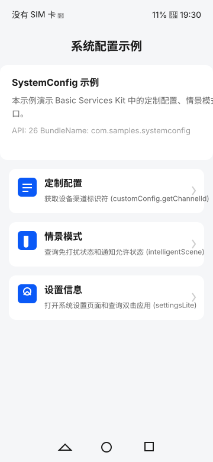
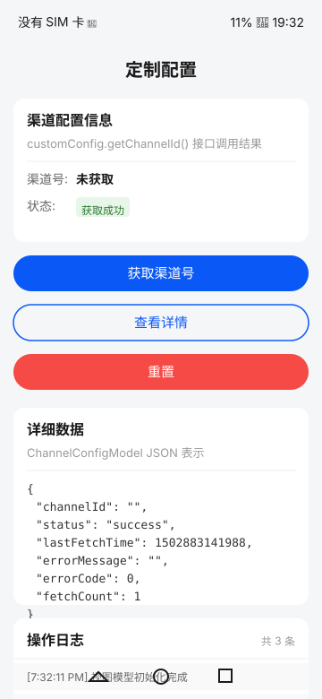
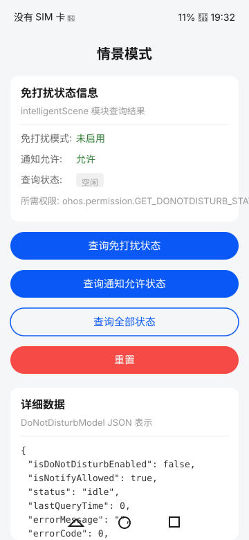
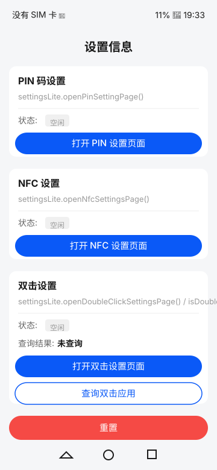

# SystemConfig

## 简介

SystemConfig 是一个基于 OpenHarmony Basic Services Kit 的示例应用，展示如何使用 `@ohos.customization.customConfig`、`@ohos.intelligentScene` 接口以及基于 Want 的系统设置页面拉起实现系统配置管理。

本示例使用 Basic Services Kit（基础服务）中的相关 API，涵盖以下功能：

- **定制配置**：通过 `customConfig.getChannelId()` 获取设备渠道标识符
- **情景模式**：通过 `intelligentScene` 模块查询免打扰状态和通知允许状态
- **设置信息**：通过 `startAbility` + 设置类 Want 打开系统设置页面（PIN、NFC、双击）。`@ohos.settingsLite` 模块本身为 FA 模型专用接口，本 Stage 模型示例无法直接调用，双击应用归属查询如实返回不支持错误，不返回模拟结果

工程采用 Library 模块（`library`）封装 API 接口、服务和工具类，entry 模块负责业务逻辑和页面展示，实现接口复用与业务解耦。

## 效果预览

主页 
定制配置 
情景模式 
设置信息 

## 使用说明

1. 在 DevEco Studio 中打开工程 `SystemConfig`。
2. 将 OpenHarmony 设备（如 RK3568 开发板）通过 USB 连接到电脑。
3. 在 DevEco Studio 中选择目标设备，点击 **Run** 编译并安装应用。
4. 启动应用后，首页展示三个功能入口：定制配置、情景模式和设置信息。
5. 点击任一功能入口，进入对应功能页面。
6. 在功能页面中，可以执行 API 调用、查看结果和操作日志。

> **注意**：`intelligentScene` 相关接口需要 `ohos.permission.GET_DONOTDISTURB_STATE` 权限。

## 工程目录

```
SystemConfig/
├── AppScope/                              # 应用全局配置
│   ├── app.json5                          # 应用配置（bundleName: com.samples.systemconfig）
│   └── resources/                         # 应用全局资源
├── ScreenShot/                            # 效果预览真机截图
├── library/                               # Library 模块（HAR）—— API 封装层
│   ├── Index.ets                          # 模块导出入口
│   ├── oh-package.json5                   # 模块包配置
│   └── src/main/ets/
│       ├── constants/                     # 常量定义
│       │   ├── SystemConfigConstants.ts   # 系统配置常量
│       │   └── PageConstants.ts           # 页面路由常量
│       ├── model/                         # 数据模型
│       │   ├── ChannelConfigModel.ets     # 渠道配置模型
│       │   ├── DoNotDisturbModel.ets      # 免打扰模型
│       │   └── SettingsItemModel.ets      # 设置项模型
│       ├── service/                       # 服务层
│       │   ├── CustomConfigService.ets    # 定制配置服务
│       │   ├── IntelligentSceneService.ets # 情景模式服务
│       │   ├── SettingsLiteService.ets    # 设置信息服务
│       │   ├── TraceService.ets           # hiTraceMeter 追踪服务
│       │   └── EventService.ets           # hiAppEvent 事件服务
│       └── utils/                         # 工具类（4 大类 21 个）
│           ├── basic/                     # 基础工具
│           ├── device/                    # 设备与存储工具
│           ├── network/                   # 网络与权限工具
│           └── validation/               # 校验与随机工具
├── entry/                                 # Entry 模块 —— 业务逻辑
│   ├── oh-package.json5                   # 依赖 library 库
│   └── src/
│       ├── main/ets/
│       │   ├── components/                # 可复用 UI 组件
│       │   ├── entryability/              # EntryAbility
│       │   ├── pages/                     # 页面
│       │   │   ├── Index.ets              # 首页
│       │   │   ├── customconfig/          # 定制配置页面
│       │   │   ├── intelligentScene/      # 情景模式页面
│       │   │   └── settingslite/          # 设置信息页面
│       │   └── viewmodel/                 # 视图模型
│       ├── ohosTest/                      # UI 自动化测试（54 个套件 / 627 条用例）
│       │   └── ets/test/                  # 测试套件（9 个分类）
│       └── main/resources/                # 模块资源
├── build-profile.json5                    # 工程构建配置（API 26）
├── hvigorfile.ts                          # 构建脚本
└── oh-package.json5                       # 工程包配置
```

## 具体实现

### Library 模块

Library 模块封装了系统配置的核心接口，可独立编译为 HAR 复用。

- **服务层**（[library/src/main/ets/service/](library/src/main/ets/service/)）：每个 API 模块对应一个 Service 类，封装实际 API 调用并集成日志、追踪和错误处理。例如 `CustomConfigService` 封装了 `customConfig.getChannelId()` 的调用。
- **数据模型**（[library/src/main/ets/model/](library/src/main/ets/model/)）：三个模型类（`ChannelConfigModel`、`DoNotDisturbModel`、`SettingsItemModel`）管理状态、追踪操作历史并提供序列化能力。
- **追踪与事件**（[library/src/main/ets/service/TraceService.ets](library/src/main/ets/service/TraceService.ets)）：`TraceService` 封装 hiTraceMeter 性能追踪；`EventService` 封装 hiAppEvent 事件上报。
- **工具类**（[library/src/main/ets/utils/](library/src/main/ets/utils/)）：4 大类共 21 个工具类，覆盖基础运算、设备存储、网络权限、数据校验等场景。
- **模块导出**（[library/Index.ets](library/Index.ets)）：统一导出所有公开 API。

### Entry 模块

Entry 模块负责业务逻辑和页面展示。

- **首页**（[entry/src/main/ets/pages/Index.ets](entry/src/main/ets/pages/Index.ets)）：展示应用信息和三个功能模块的导航入口。
- **功能页面**（[entry/src/main/ets/pages/](entry/src/main/ets/pages/)）：三个功能页面（定制配置、情景模式、设置信息），每个页面包含操作按钮、状态展示和日志面板。
- **视图模型**（[entry/src/main/ets/viewmodel/](entry/src/main/ets/viewmodel/)）：每个页面对应一个 ViewModel，协调服务调用并管理页面状态。
- **UI 组件**（[entry/src/main/ets/components/](entry/src/main/ets/components/)）：可复用组件包括 `InfoCard`、`ActionButton`、`LogPanel` 和 `StatusBadge`。

### hiTraceMeter 与 hiAppEvent 集成

- `TraceService` 封装了 hiTraceMeter 的性能追踪能力，在关键 API 调用前后自动打点。
- `EventService` 封装了 hiAppEvent 的事件上报能力，支持事件过滤和统计。

## 自动化测试

本示例提供完整的 ohosTest 自动化测试，共 **54 个测试套件、627 条用例**，分为 9 个分类，覆盖服务层、数据模型、工具类、数据校验、网络权限、设备存储、常量、页面导航与多服务集成场景。

- **用例命名**：`it()` 与 `@tc.name` 统一为 `test<Feature><NNNN>`，后四位从 `0001` 起每条自增 1；`@tc.number` 为 `SUB_<MODULE>_<SEQ>`，后四位从 `0100` 起每条自增 100，同一文件内连续编号、全局唯一。
- **运行方式**：构建并安装 ohosTest HAP 后，在目标设备上启动 ohosTest 用例进行全量运行，也可指定套件或单条用例。
- **最新结果**：连续两轮全量运行均为 `Tests run: 627, Failure: 0, Error: 0, Pass: 627, Ignore: 0`。

详细用例清单、命名规范与执行说明见 [ohosTest.md](ohosTest.md)。

## 相关权限

本示例需要以下权限，配置在 [entry/src/main/module.json5](entry/src/main/module.json5) 中：

| 权限 | 说明 |
| --- | --- |
| `ohos.permission.GET_DONOTDISTURB_STATE` | 查询免打扰状态 |

## 依赖

### 其余 Sample 依赖

本示例不依赖其余 Sample。

### 系统 Kit 依赖

| Kit | 用途 |
| --- | --- |
| [BasicServicesKit](https://gitcode.com/openharmony/docs/tree/master/zh-cn/application-dev/reference/apis-basic-services-kit) | customConfig、intelligentScene、hiAppEvent |
| [PerformanceAnalysisKit](https://gitcode.com/openharmony/docs/tree/master/zh-cn/application-dev/reference/apis-performance-analysis-kit) | hiTraceMeter 性能追踪、hilog 日志 |
| [AbilityKit](https://gitcode.com/openharmony/docs/tree/master/zh-cn/application-dev/reference/apis-ability-kit) | UIAbility 生命周期 |
| [ArkUI](https://gitcode.com/openharmony/docs/tree/master/zh-cn/application-dev/ui) | 声明式 UI 框架 |

## 约束与限制

1. **操作系统**：OpenHarmony 标准系统
2. **设备要求**：支持系统设置的 OpenHarmony 真机（如 RK3568 开发板）
3. **API 版本**：API 26（CompileSdkVersion 26，CompatibleSdkVersion 26）
4. **IDE 版本**：DevEco Studio 5.0 及以上
5. **SDK 版本**：OpenHarmony SDK API 26
6. **运行时**：OpenHarmony（runtimeOS）
7. **权限限制**：`GET_DONOTDISTURB_STATE` 需要系统授权或调试模式

## 下载

```bash
# 使用 sparse-checkout 下载当前示例工程
git clone --filter=sparse --no-checkout https://gitcode.com/openharmony/applications_app_samples.git
cd applications_app_samples
git sparse-checkout set code/BasicFeature/DeviceManagement/SystemConfig/
git checkout
```

> 工程路径以 `/` 结尾，确保下载完整目录。
