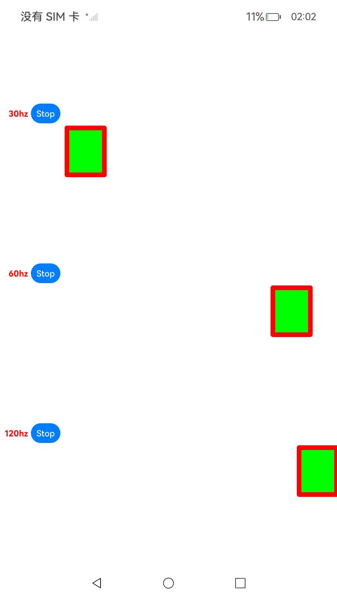

# DisplaySoloist Hierarchical Control

### Introduction

This sample uses the DisplaySoloist hierarchical control capability to set the expected frame rate of the content drawn by an XComponent from a thread other than the UI thread.

### Preview

| XComponent                                                    |
|---------------------------------------------------------------|
|  |

### Usage

1. Go to the XComponent page and tap **Start**. The three squares move at 30 Hz, 60 Hz, and 120 Hz respectively. Tap **Stop** to stop the animation.

### Project Directory

```
├──entry/src/main
│  ├──cpp                                       // C++ code
│  │  ├──CMakeLists.txt                         // CMake configuration file
│  │  ├──hello.cpp                              // NAPI module registration
│  │  ├──common
│  │  │  └──log_common.h                        // Log definition file
│  │  ├──plugin                                 // Lifecycle management module
│  │  │  ├──plugin_manager.cpp
│  │  │  └──plugin_manager.h
│  │  ├──samples                                // Samples rendering module
│  │  │  ├──sample_xcomponent.cpp
│  │  │  └──sample_xcomponent.h
│  ├──ets                                       // ArkTS code
│  │  ├──entryability
│  │  │  ├──EntryAbility.ts                     // Entry ability
│  │  │  └──EntryAbility.ets
│  │  ├──interface
│  │  │  └──XComponentContext.ts                // XComponentContext
│  │  ├──pages                                  // Pages
│  │  │  └──Index.ets                           // XComponent page
│  │  ├──utils                                  // Utilities
│  ├──resources                                 // Resource files
```

### Implementation

* XComponent: A Native C++ project created in DevEco Studio exposes the `register`, `unregister`, and `destroy` interfaces from the C++ code and calls the NativeDisplaySoloist hierarchical control APIs, so that the page can draw with the expected frame rate through drawing.
    * Related APIs ([C API reference](https://gitcode.com/openharmony/docs/blob/master/en/application-dev/reference/apis-arkgraphics2d/_native_display_soloist.md)):

      | API | Description |
      | -------- | -------- |
      | OH_DisplaySoloist_Create | Creates an OH_DisplaySoloist instance. |
      | OH_DisplaySoloist_Destroy | Destroys an OH_DisplaySoloist instance. |
      | OH_DisplaySoloist_Start | Sets the per-frame callback, which is invoked each time a vsync signal arrives. |
      | OH_DisplaySoloist_Stop | Stops requesting the next vsync signal and stops invoking the callback. |
      | OH_DisplaySoloist_SetExpectedFrameRateRange | Sets the expected frame rate range. |

### Permissions

None.

### Dependencies

None.

### Constraints and Limitations

1. This sample can run only on standard-system devices and has been verified on an RK3568 board.
2. This sample uses the Stage model and supports API 26 SDK (26.0.0). The `compileSdkVersion`, `targetSdkVersion`, and `compatibleSdkVersion` are all 26.0.0.
3. DevEco Studio 26.0.0 Release or later is required to compile and run this sample.

### Download

To download this project separately, run the following commands:

```
git init
git config core.sparsecheckout true
echo code/BasicFeature/Graphics/DisplaySoloist/ > .git/info/sparse-checkout
git remote add origin https://gitcode.com/openharmony/applications_app_samples.git
git pull origin master
```
