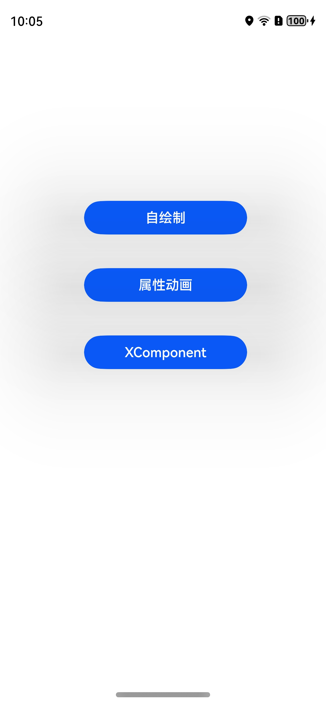
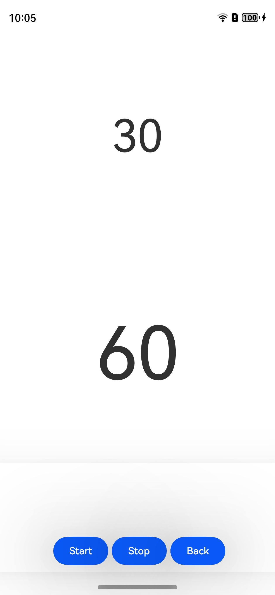
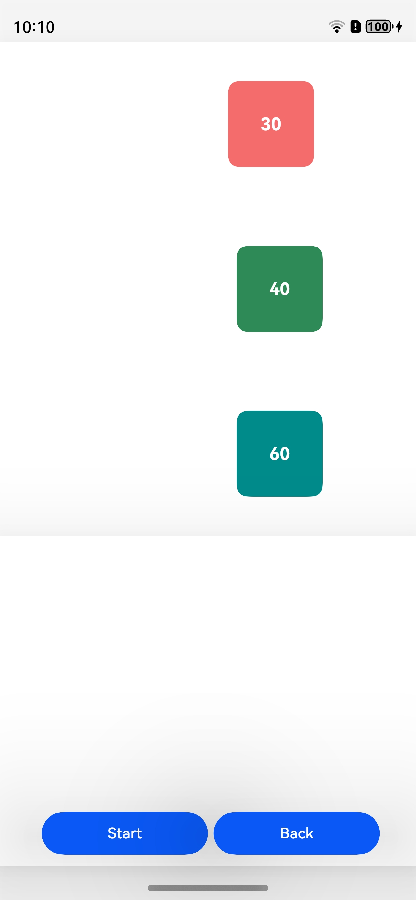
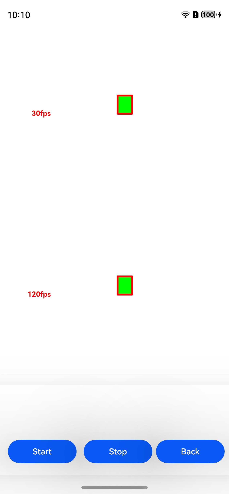

# DisplaySync Hierarchical Control

### Introduction

This sample uses the DisplaySync hierarchical control capability to set the expected frame rate of self-drawn content, property animations, and XComponent content.

### Preview

| Initial Page | Custom Draw | Property Animation | XComponent |
|--------------------------------|--------------------------------|--------------------------------|--------------------------------|
|  |  |  |  |

### Usage

1. On the initial page, tap **CustomDraw** to go to the custom draw page, and tap **Start**. The number **30** scales at 30 Hz and the number **60** scales at 60 Hz. Tap **Stop** to stop drawing, and tap **Back** to return to the initial page.

2. On the initial page, tap **PropertyAnimation** to go to the property animation page, and tap **Start**. The three squares move at 30 Hz, 40 Hz, and 60 Hz respectively. Tap **Back** to return to the initial page.

3. On the initial page, tap **XComponent** to go to the XComponent page, and tap **Start**. Two squares move at 30 Hz and 120 Hz respectively. Tap **Stop** to stop the animation, and tap **Back** to return to the initial page.

4. On the initial page, tap **Animator** to go to the animator page. Tap **Create** and then **Play**. The three squares scale at 10 Hz, 30 Hz, and 60 Hz respectively. Tap **Back** to return to the initial page.

### Project Directory

```
├──entry/src/main
│  ├──cpp                                       // C++ code
│  │  ├──CMakeLists.txt                         // CMake configuration file
│  │  ├──hello.cpp                              // NAPI module registration
│  │  ├──common
│  │  │  └──log_common.h                        // Log definition file
│  │  ├──plugin                                 // Lifecycle management module
│  │  │  ├──plugin_manager.cpp
│  │  │  └──plugin_manager.h
│  │  ├──samples                                // Samples rendering module
│  │  │  ├──sample_xcomponent.cpp
│  │  │  └──sample_xcomponent.h
│  ├──ets                                       // ArkTS code
│  │  ├──entryability
│  │  │  ├──EntryAbility.ts                     // Entry ability
│  │  │  └──EntryAbility.ets
│  │  ├──interface
│  │  │  └──XComponentContext.ts                // XComponentContext
│  │  ├──pages                                  // Pages
│  │  │  ├──Index.ets                           // Initial page
│  │  │  ├──CustomDrawDisplaySync.ets           // Custom draw page
│  │  │  ├──PropertyAnimationDisplaySync.ets    // Property animation page
│  │  │  ├──XComponentDisplaySync.ets           // XComponent page
│  │  │  └──AnimatorDisplaySync.ets             // Animator page
│  │  ├──utils                                  // Utilities
│  ├──resources                                 // Resource files
```

### Implementation

* Custom draw: Uses the [@ohos.graphics.displaySync](https://gitcode.com/openharmony/docs/blob/master/en/application-dev/reference/apis-arkgraphics2d/js-apis-graphics-displaySync.md) APIs. A frame callback is registered and the refresh rate range is set to control the callback period.
    * Related APIs (import with `import displaySync from '@ohos.graphics.displaySync'`):

      | API | Description |
      | -------- | -------- |
      | Create(): DisplaySync | Creates a DisplaySync instance. |
      | setExpectedFrameRateRange(rateRange: ExpectedFrameRateRange): void | Sets the expected frame rate. |
      | on(type: 'frame', callback: Callback\<IntervalInfo\>): void | Sets the callback for custom drawing. |
      | off(type: 'frame', callback?: Callback\<IntervalInfo\>): void | Removes the callback for custom drawing. |
      | start(): void | Enables DisplaySync. |
      | stop(): void | Disables DisplaySync. |

* Property animation: Uses the `expectedFrameRateRange` parameter added to the [animation](https://gitcode.com/openharmony/docs/blob/master/en/application-dev/reference/apis-arkui/arkui-ts/ts-animatorproperty.md) and [animateTo](https://gitcode.com/openharmony/docs/blob/master/en/application-dev/reference/apis-arkui/arkui-ts/ts-explicit-animation.md) APIs to set the refresh rate range of the animation.
    * Related API:

      | API | Description |
      | -------- | -------- |
      | expectedFrameRateRange | Optional animation attribute of `animation` and `animateTo` that specifies the expected frame rate range. |

* XComponent: A Native C++ project created in DevEco Studio exposes the `register` and `unregister` interfaces from the C++ code and calls the C APIs, so that the page can draw with the expected frame rate by using drawing.
    * Related APIs ([C API reference](https://gitcode.com/openharmony/docs/blob/master/en/application-dev/reference/apis-arkui/_o_h___native_x_component.md)):

      | API | Description |
      | -------- | -------- |
      | OH_NativeXComponent_SetExpectedFrameRateRange | Sets the expected frame rate range. |
      | OH_NativeXComponent_RegisterOnFrameCallback | Registers the frame update callback. |
      | OH_NativeXComponent_UnregisterOnFrameCallback | Unregisters the frame update callback. |

* Animator: Uses the `setExpectedFrameRateRange` API added to [animator](https://gitcode.com/openharmony/docs/blob/master/en/application-dev/reference/apis-arkui/js-apis-animator.md) to set the expected frame rate range of the animation.
    * Related API:

      | API | Description |
      | -------- | -------- |
      | setExpectedFrameRateRange: (rateRange: ExpectedFrameRateRange): void | Sets the expected frame rate range. |

### Permissions

None.

### Dependencies

None.

### Constraints and Limitations

1. This sample can run only on standard-system devices and has been verified on an RK3568 board.
2. This sample uses the Stage model and supports API 26 SDK (26.0.0). The `compileSdkVersion`, `targetSdkVersion`, and `compatibleSdkVersion` are all 26.0.0.
3. DevEco Studio 26.0.0 Release or later is required to compile and run this sample.

### Download

To download this project separately, run the following commands:

```
git init
git config core.sparsecheckout true
echo code/BasicFeature/Graphics/DisplaySync/ > .git/info/sparse-checkout
git remote add origin https://gitcode.com/openharmony/applications_app_samples.git
git pull origin master
```
