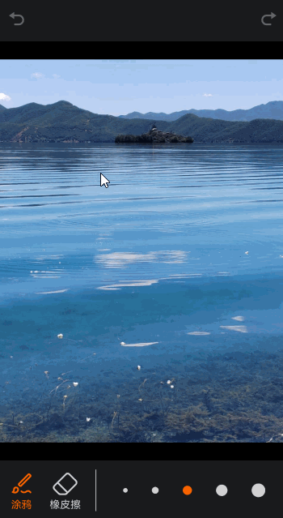

# Eraser

### Introduction

This sample implements an eraser with [@ohos.graphics.drawing](https://gitcode.com/openharmony/docs/blob/master/en/application-dev/reference/apis-arkgraphics2d/js-apis-graphics-drawing.md) and [blendMode](https://gitcode.com/openharmony/docs/blob/master/en/application-dev/reference/apis-arkui/arkui-ts/ts-universal-attributes-image-effect.md#blendmode11). It erases previously drawn content along the finger movement track, and supports undoing and redoing the drawing.

### Preview



### Usage

1. At the bottom left of the page, the doodle and eraser buttons are displayed. Tap them to switch the selected state and the current drawing mode. On the right, the line width list is displayed. Tap an item to change the track width.
2. Touch the image and drag your finger to draw a path. In doodle mode, an orange line is drawn; in eraser mode, the line is erased.
3. The buttons at the top of the page are unavailable by default. After drawing, the undo button on the left is highlighted; tap it to undo the last drawing. After that, before any new drawing, the redo button on the right is highlighted; tap it to redo the last undo.

### Implementation

1. Use `NodeContainer` to build the drawing area.

   - Define a subclass `MyNodeController` of `NodeController`. After instantiation, a self-drawn `RenderNode` is mounted to the `NodeContainer` to implement custom drawing. For details, see [RenderNodeModel.ets](casesfeature/erasercomponent/src/main/ets/model/RenderNodeModel.ets).

   ```ts
   /**
    * Subclass MyNodeController of NodeController
    */
   export class MyNodeController extends NodeController {
     private rootNode: FrameNode | null = null; // Root node
     rootRenderNode: RenderNode | null = null; // RenderNode obtained from the root node of NodeController

     // Triggered when the NodeContainer bound to MyNodeController is created
     makeNode(uiContext: UIContext): FrameNode {
       this.rootNode = new FrameNode(uiContext);
       if (this.rootNode !== null) {
         this.rootRenderNode = this.rootNode.getRenderNode();
       }
       return this.rootNode;
     }

     // Triggered when the bound NodeContainer is laid out
     aboutToResize(size: Size): void {
       if (this.rootRenderNode !== null) {
         this.rootRenderNode.backgroundColor = 0X00000000;
         this.rootRenderNode.frame = {
           x: 0,
           y: 0,
           width: size.width,
           height: size.height
         };
       }
     }

     // Add a node
     addNode(node: RenderNode): void {
       if (this.rootNode === null) {
         return;
       }
       if (this.rootRenderNode !== null) {
         this.rootRenderNode.appendChild(node);
       }
     }

     // Clear nodes
     clearNodes(): void {
       if (this.rootNode === null) {
         return;
       }
       if (this.rootRenderNode !== null) {
         this.rootRenderNode.clearChildren();
       }
     }
   }
   ```

   - Create the custom `NodeContainer` component with an instance of `MyNodeController`. Its width and height are those of the actually drawn content after the image is loaded, and `alignRules` of the relative container is used to overlap the `NodeContainer` with the image content area. For details, see [EraserMainPage.ets](casesfeature/erasercomponent/src/main/ets/pages/EraserMainPage.ets).

   ```ts
   @Builder
   drawingArea() {
     Image($r('app.media.palette_picture'))
       .width($r('app.string.palette_full_size'))
       .objectFit(ImageFit.Contain)
       .onComplete((event) => {
         if (event !== undefined) {
           this.nodeContainerWidth = px2vp(event.contentWidth);
           this.nodeContainerHeight = px2vp(event.contentHeight);
         }
       })
     if (this.nodeContainerWidth && this.nodeContainerHeight) {
       NodeContainer(this.myNodeController)
         .width(this.nodeContainerWidth)
         .height(this.nodeContainerHeight)
         .id(Constants.NODE_CONTAINER_ID)
         // ...
     }
   }
   ```

   - Set the `blendMode` attribute of `NodeContainer` to create an offscreen canvas, so that the color blending of its child nodes is performed based on that canvas.

   ```ts
   .blendMode(BlendMode.SRC_OVER, BlendApplyType.OFFSCREEN)
   ```

2. Use the `MyImageRenderNode` class to create a node as the basic drawing layer. It manages the drawing history of the whole canvas and records the canvas state (`pixelMap`) after each drawing. For details, see [RenderNodeModel.ets](casesfeature/erasercomponent/src/main/ets/model/RenderNodeModel.ets).

   - `MyImageRenderNode` defines the `pixelMapHistory` and `cacheStack` properties to manage and record pattern changes on the canvas. When the node is rendered, the `pixelMap` on the top of the `pixelMapHistory` stack is drawn to the canvas.

3. Use the `MyRenderNode` class to draw the path. It defines properties such as the path object, color blend mode, and line width so that they can be changed dynamically. For details, see [RenderNodeModel.ets](casesfeature/erasercomponent/src/main/ets/model/RenderNodeModel.ets).

4. In the `onTouch` callback of the `NodeContainer` component, handle the finger down, move, and up events to draw or erase the path on the screen.

5. Implement the undo and redo features by pushing and popping the canvas state (`pixelMap`) in the `pixelMapHistory` and `cacheStack` properties of the `currentImageNode` node.

### Performance Tips

1. `onTouch` is a high-frequency system callback. Avoid redundant or time-consuming operations in it, such as printing logs, which causes considerable performance loss.

### Project Directory

```
erasercomponent                               // HAR module
|---model
|   |---RenderNodeModel.ets                   // Data model layer - node data model
|---pages
|   |---EraserMainPage.ets                    // View layer - main page
|---constants
|   |---Constants.ets                         // Constants
```

### References

[@ohos.graphics.drawing](https://gitcode.com/openharmony/docs/blob/master/en/application-dev/reference/apis-arkgraphics2d/js-apis-graphics-drawing.md)

[NodeController](https://gitcode.com/openharmony/docs/blob/master/en/application-dev/reference/apis-arkui/js-apis-arkui-nodeController.md)

[RenderNode](https://gitcode.com/openharmony/docs/blob/master/en/application-dev/reference/apis-arkui/js-apis-arkui-renderNode.md)

[RelativeContainer](https://gitcode.com/openharmony/docs/blob/master/en/application-dev/reference/apis-arkui/arkui-ts/ts-container-relativecontainer.md)

[blendMode](https://gitcode.com/openharmony/docs/blob/master/en/application-dev/reference/apis-arkui/arkui-ts/ts-universal-attributes-image-effect.md#blendmode11)

### Permissions

None.

### Dependencies

None.

### Constraints and Limitations

1. This sample can run only on standard-system devices and has been verified on an RK3568 board.
2. This sample supports API 26 SDK (26.0.0). The `compileSdkVersion`, `targetSdkVersion`, and `compatibleSdkVersion` are all 26.0.0.
3. DevEco Studio 26.0.0 Release or later is required to compile and run this sample.

### Download

To download this project separately, run the following commands:

```
git init
git config core.sparsecheckout true
echo code/BasicFeature/Graphics/Graphics2d/Eraser > .git/info/sparse-checkout
git remote add origin https://gitcode.com/openharmony/applications_app_samples.git
git pull origin master
```
