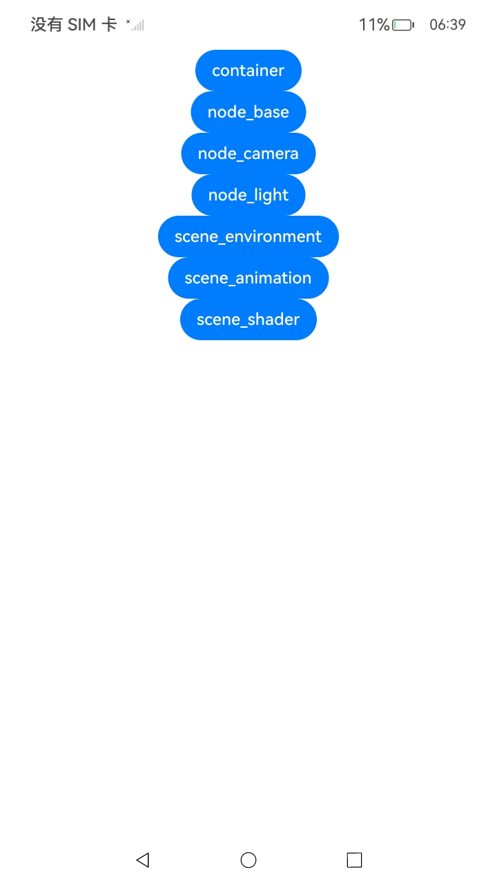
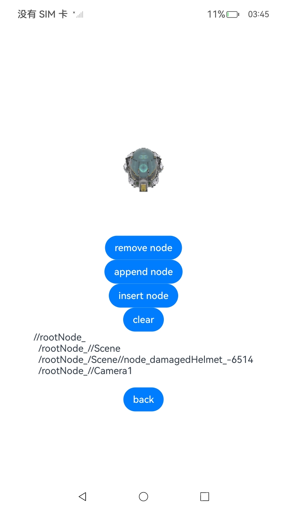
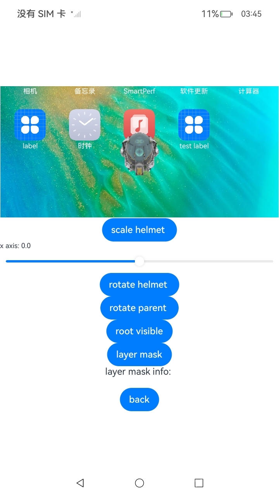
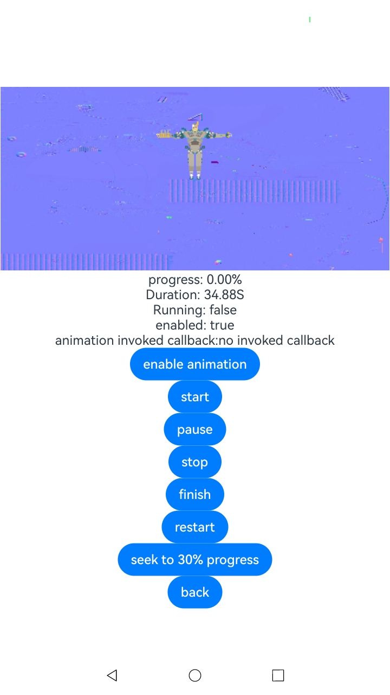

# 3D Engine API Sample

### Introduction

This sample tests the APIs provided by the 3D graphics engine through [@ohos.graphics.scene](https://gitcode.com/openharmony/docs/blob/master/en/application-dev/reference/apis-arkgraphics3d/js-apis-scene.md). Each API is exercised, and the rendered result is displayed in the [Component3D](https://gitcode.com/openharmony/docs/blob/master/en/application-dev/reference/apis-arkui/arkui-ts/ts-basic-components-component3d.md) component. Tapping a button triggers the corresponding feature so that you can observe the change of the rendered image. Some APIs do not change the rendered image directly, so the sample prints logs for them; filter the logs with "lume_api_test".

### Preview

| Main Page                             | container                                | node_base                           | scene_animation                           |
|-------------------------------------|------------------------------------------|-------------------------------------|-------------------------------------------|
|  |  |  |  |

### Usage

1. On the main page, tap a button to go to a subpage. Each subpage tests one category of 3D engine APIs. Tap **back** on a subpage to return to the main page.
2. On the **container** page, tap the buttons to add or remove child nodes; the structure of the nodes is printed on the page. The child node used in this sample is a helmet model.
3. On the **node_base** page, tap the buttons to operate basic node attributes such as position, rotation, scale, and visibility. The child node used in this sample is a helmet model.
4. On the **node_camera** page, tap the buttons to operate camera attributes such as projection and post-processing.
5. On the **node_light** page, tap the buttons to operate light attributes such as type, color, intensity, and shadow.
6. On the **scene_environment** page, tap the buttons to operate the background.
7. On the **scene_animation** page, tap the buttons to play or pause the animation.
8. On the **scene_shader** page, tap the buttons to operate texture materials.

### Project Directory

```
entry/src/main/
├─ets
│  ├─entryability
│  ├─graphics3d
│  └─pages
│      ├─container.ets                  // Child node operations
│      ├─Index.ets                      // Main page
│      ├─node_base.ets                  // Basic node attributes
│      ├─node_camera.ets                // Camera
│      ├─node_light.ets                 // Light
│      ├─scene_animation.ets            // Animation
│      ├─scene_environment.ets          // Background
│      └─scene_shader.ets               // Texture
└─resources
    ├─base
    │  ├─element
    │  ├─media
    │  └─profile
    ├─en_US
    │  └─element
    ├─rawfile
    │  ├─assets
    │  │  └─app
    │  │      ├─rendernodegraphs
    │  │      └─shaders
    │  ├─gltf                           // Models used in this sample
    │  └─shaders
    └─zh_CN
        └─element
```

### Implementation

* Node adding, removing and traversal are encapsulated in graphics3d/[SceneNodes](https://gitcode.com/openharmony/docs/blob/master/en/application-dev/reference/apis-arkgraphics3d/js-apis-inner-scene-nodes.md); see `container.ets`:
    * On initialization, every node in the scene is traversed in depth-first order starting from the root node, and its information is printed.
    * Remove: calls `remove` to remove the specified node without duplicate removal; in this sample the helmet node is removed.
    * Append: calls `append` to add the specified node to the end of the child node list without duplicate addition; in this sample the helmet node is added.
    * Insert after: calls `insertAfter` to add the specified node at the given position of the child node list without duplicate addition; in this sample the helmet node is added.
    * Clear: calls `clear` to remove all nodes in the child node list; in this sample the child nodes of the root node are cleared.
    * Get: calls `get` to obtain the specified node in the child node list.
    * Count: calls `count` to obtain the size of the child node list.
* Basic node attributes (position, rotation, scale, and so on) are encapsulated in graphics3d/[SceneNodes](https://gitcode.com/openharmony/docs/blob/master/en/application-dev/reference/apis-arkgraphics3d/js-apis-inner-scene-nodes.md); see `node_base.ets`:
    * Modifies `scale` to change the node size; in this sample the size of the helmet is changed.
    * Modifies `position` to change the node position; in this sample the x coordinate of the helmet is changed.
    * Modifies `rotation` to change the node rotation direction. Changing the rotation of the parent node also changes that of its child nodes (the same applies to `position`); in this sample the rotation direction of the helmet is changed.
    * Modifies `visible` to change the node visibility; in this sample the visibility of the helmet is changed.
    * Uses `getEnabled` and `setEnabled` to operate the `layerMask` of the node; in this sample the `layerMask` information is printed on the page.
* Camera attributes (projection, post-processing, and so on) are encapsulated in graphics3d/[SceneNodes](https://gitcode.com/openharmony/docs/blob/master/en/application-dev/reference/apis-arkgraphics3d/js-apis-inner-scene-nodes.md); see `node_camera.ets`:
    * Modifies `fov` to change the field of view of the projection; 45, 60, and 90 are provided in this sample.
    * Modifies `nearPlane` and `farPlane` to change the near and far planes of the projection.
    * Modifies `enabled` to enable or disable the camera. When it is set to false, the image in the component is no longer refreshed.
    * Modifies `postProcess.toneMapping.type` to change the tone mapping method. ACES, ACES_2020, and FILMIC are supported.
    * Modifies `postProcess.toneMapping.exposure` to change the exposure of tone mapping.
    * Modifies `clearColor` to set the background color refreshed for each frame. Setting the alpha channel to zero produces a transparent background, and setting it to null does not refresh all background pixels.
* Light attributes (type, color, intensity, shadow, and so on) are encapsulated in graphics3d/[SceneNodes](https://gitcode.com/openharmony/docs/blob/master/en/application-dev/reference/apis-arkgraphics3d/js-apis-inner-scene-nodes.md); see `node_light.ets`:
    * `lightType` is read-only and indicates the light type. DIRECTIONAL and SPOT are supported.
    * Modifies `enabled` to enable or disable the light.
    * Modifies `color` to change the light color; three colors are available in this sample.
    * Modifies `intensity` to change the light intensity.
    * Modifies `shadowEnabled` to enable or disable the light shadow.
* Background operations are encapsulated in graphics3d/[SceneResources](https://gitcode.com/openharmony/docs/blob/master/en/application-dev/reference/apis-arkgraphics3d/js-apis-inner-scene-resources.md); see `scene_environment.ets`:
    * Modifies `backgroundType` and `environmentImage` to set the background image. `BACKGROUND_IMAGE` and `BACKGROUND_EQUIRECTANGULAR` correspond to png or jpeg images, `BACKGROUND_CUBEMAP` corresponds to a ktx image, and `BACKGROUND_NONE` sets no background image; in that case the alpha channel of the camera `clearColor` must be set to 0 to obtain a transparent background.
    * Modifies `radianceImage` to change the environment map of PBR.
    * Modifies `indirectDiffuseFactor` to change the corresponding PBR parameter.
    * Modifies `indirectSpecularFactor` to change the corresponding PBR parameter.
    * Modifies `irradianceCoefficients` to change the corresponding PBR parameter.
    * Modifies `environmentMapFactor` to change the corresponding parameter of the background image.
* Animation operations are encapsulated in graphics3d/[SceneResources](https://gitcode.com/openharmony/docs/blob/master/en/application-dev/reference/apis-arkgraphics3d/js-apis-inner-scene-resources.md); see `scene_animation.ets`:
    * Modifies `enabled` to enable or disable the animation.
    * Read-only properties `duration`, `running`, and `progress` indicate the animation duration, running state, and progress.
    * Calls `start` to start the animation.
    * Calls `pause` to pause the animation.
    * Calls `stop` to stop the animation and reset it to the beginning.
    * Calls `finish` to finish the animation and move it to the end.
    * Calls `restart` to restart the animation from the beginning.
    * Calls `seek` to set the animation to a specified state.
    * `onStarted` executes the callback when the animation starts.
    * `onFinished` executes the callback when the animation ends.
* Texture material operations are encapsulated in graphics3d/[SceneResources](https://gitcode.com/openharmony/docs/blob/master/en/application-dev/reference/apis-arkgraphics3d/js-apis-inner-scene-resources.md); see `scene_shader.ets`:
    * Creates a shader as the `colorShader` of a `ShaderMaterial`, and then creates a material as the `ShaderMaterial` of the texture.
    * Uses `Geometry` to obtain the corresponding Mesh node that carries the material.
    * Modifies the input parameters of the shader.
    * Modifies the `material` property of the sub-mesh to the custom `ShaderMaterial`.
    * Modifies `materialOverride` to override the texture with the custom `ShaderMaterial`.

### Permissions

None.

### Dependencies

None.

### Constraints and Limitations

1. This sample can run only on standard-system devices and has been verified on an RK3568 board.
2. This sample supports API 26 SDK (26.0.0). The `compileSdkVersion`, `targetSdkVersion`, and `compatibleSdkVersion` are all 26.0.0.
3. DevEco Studio 26.0.0 Release or later is required to compile and run this sample.

### Download

To download this project separately, run the following commands:

```
git init
git config core.sparsecheckout true
echo code/BasicFeature/Graphics/Graphics3d/ > .git/info/sparse-checkout
git remote add origin https://gitcode.com/openharmony/applications_app_samples.git
git pull origin master
```
