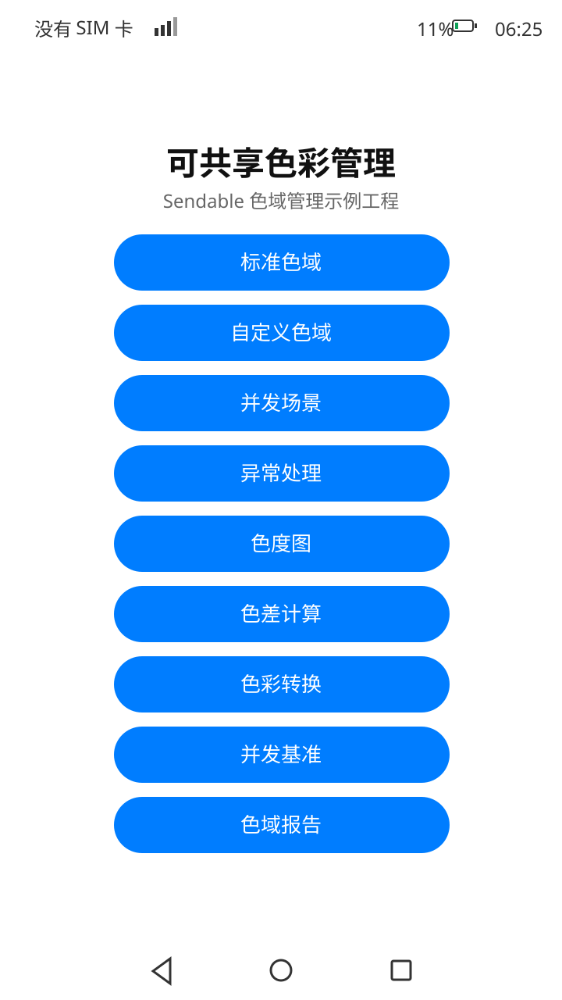
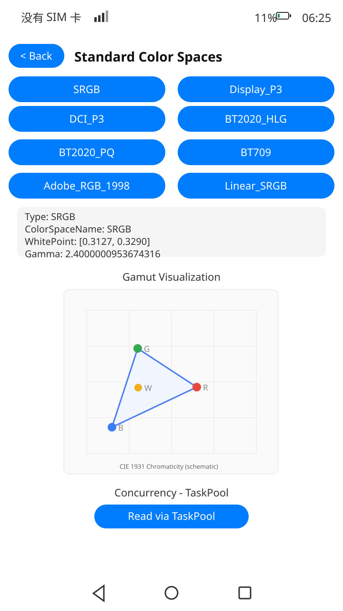
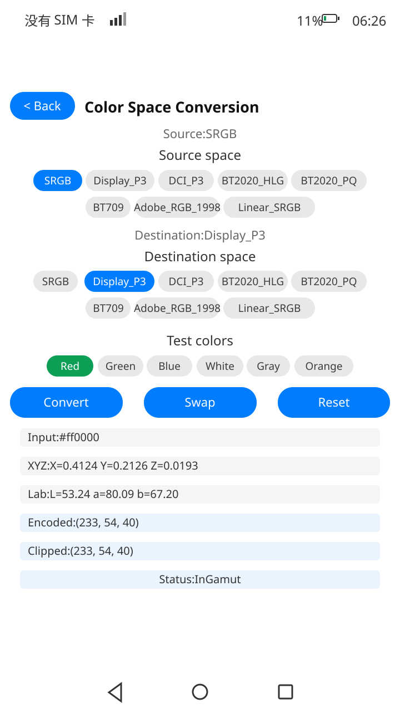

# SendableColorSpace

### Introduction

This sample is developed with the Stage model and ArkTS. It uses the `create` API provided by [@ohos.graphics.sendableColorSpaceManager](https://gitcode.com/openharmony/docs/blob/master/zh-cn/application-dev/reference/apis-arkgraphics2d/js-apis-sendableColorSpaceManager.md) to create sendable (`@Sendable`) color space objects, and uses `ColorSpaceManager.getColorSpaceName`, `getWhitePoint` and `getGamma` to query the color space type, white point and gamma.

The sample declares 26 color spaces (8 standard, 7 extended and 11 LIMIT range) and demonstrates three groups of capabilities. First, standard color spaces and custom color spaces (user-defined primaries, white point and gamma from 0.1 to 5.0) are created and queried. Second, the same color space object is passed by reference to worker threads through a `@Concurrent` function, `taskpool` and `worker`, and the properties read on the main thread, in TaskPool and in the Worker are compared. Third, [ColorSpaceMath.ets](entry/src/main/ets/common/ColorSpaceMath.ets) implements RGB/XYZ/Lab conversion, CIE 1931 chromaticity area and containment tests, and ΔE76/ΔE94/ΔE2000 color difference, which are used by the chromaticity diagram, color difference, color conversion and color space report pages.

### Preview

| Home page | Standard color spaces | Color conversion |
|:---:|:---:|:---:|
|  |  |  |

### How to Use

1. Start the application. The home page lists nine entries: Standard Color Spaces, Custom Color Space, Concurrency Scenarios, Exception Handling, Chromaticity Diagram, Color Difference, Color Conversion, Concurrency Benchmark and Color Space Report.
2. Open "Standard Color Spaces" and tap a color space button such as SRGB. The result area shows `Type`, `ColorSpaceName`, `WhitePoint` and `Gamma`, and the gamut visualization area draws the CIE 1931 triangle of that space. Tap "Read via TaskPool" to read the current properties in the task pool.
3. Open "Custom Color Space", edit the CIE xy inputs of the R/G/B primaries and the white point, and drag the gamma slider (step 0.1). After creation the result area shows `Primaries`, `WhitePoint Input`, `Gamma` and the queried properties. Tap reset to restore the defaults.
4. Open "Concurrency Scenarios". The page creates SRGB automatically. Tap "Read via TaskPool" or "Read via Worker" to read the properties in the corresponding worker thread; the comparison area reports whether both channels observed the same object reference. Switch the color space and read again; the operation log records the latest 50 entries with timestamps.
5. Open "Exception Handling" and tap the UNKNOWN, CUSTOM, negative gamma, zero gamma, out-of-range primaries, enum 999 and enum -1 buttons. The result area reports the actual platform behavior, either a `BusinessError` with its code or the accepted properties. The property self-check buttons show the gamma and white point verification of SRGB, DCI_P3 and LINEAR_SRGB and the enum alias verification.
6. Open "Chromaticity Diagram" and switch among the 26 color spaces. The page shows the triangle area, the ratio to sRGB and whether sRGB is covered. Tap the reference overlay button to toggle ON/OFF. Enter x and y in the 0..1 inputs and tap locate to test whether the point falls inside the current triangle; an out-of-range input shows `Point invalid: enter numbers in 0..1`.
7. Open "Color Difference". Choose a preset pair or drag the RGB sliders of color A. The page shows the A/B previews, the Lab values, `dE76`, `dE94` and `dE2000`, and the perceptibility verdict (Imperceptible/Slight/Noticeable/Obvious). Changing the color space or swapping the colors updates the result.
8. Open "Color Conversion" and select the source space, the destination space and a test color (Red/Green/Blue/White/Gray/Orange). The page shows `Input` as a hex value, `XYZ`, `Lab`, `Encoded`, `Clipped` and `Status`. When the color exceeds the destination gamut, `Status` becomes `OutOfGamut`, `Encoded` keeps the signed overflow values and `Clipped` shows the clamped values. Swap exchanges the two spaces and Reset restores the default combination.
9. Open "Concurrency Benchmark" and tap the local, TaskPool or Worker button, or "Run All". Each channel runs 200 samples or round trips and the summary names the fastest channel. Open "Color Space Report" to list all 26 color spaces by area together with the ratio and the coverage flag; the page supports the standard/extended/LIMIT filters, ascending/descending order and reset.

### Project Structure

```
entry/src/main/ets/
|---entryability
|   |---EntryAbility.ets                       // Entry ability
|---pages
|   |---Index.ets                              // Single entry page with nine navigation entries
|   |---StandardColorSpace.ets                 // Standard/extended/LIMIT creation, properties, gamut drawing and comparison
|   |---CustomColorSpace.ets                   // Custom primaries, white point and gamma creation
|   |---Concurrency.ets                        // TaskPool and Worker reads of the sendable color space object
|   |---ExceptionTest.ets                      // Invalid enums, gammas and primaries, plus property self-checks
|   |---ChromaticityDiagram.ets                // CIE 1931 diagram, area, coverage ratio and probe test
|   |---ColorDifference.ets                    // Lab and ΔE76/ΔE94/ΔE2000 color difference
|   |---ColorConversion.ets                    // Cross-space RGB conversion, signed encoding and clamping
|   |---ConcurrencyBenchmark.ets               // Local/TaskPool/Worker elapsed time benchmark
|   |---ColorSpaceReport.ets                   // Area report of the 26 color spaces with filters and sorting
|---common
|   |---ColorSpaceData.ets                     // Metadata of the 26 color spaces in STANDARD/EXTENDED/LIMIT groups
|   |---ColorSpaceMath.ets                     // Color science layer: matrices, transfer functions, Lab, delta E, area and containment
|---sendable
|   |---ColorSpaceResult.ets                   // @Sendable property result used across threads
|   |---BenchmarkResult.ets                    // @Sendable benchmark result
|---workers
|   |---ColorSpaceWorker.ets                   // Worker message handler that returns the properties
|---utils
|   |---Logger.ets                             // hilog utility
entry/src/ohosTest/ets/
|---test
|   |---List.test.ets                         // SUITE_MANIFEST entry with 42 test suites
|   |---*.test.ets                            // 27 page and algorithm suites with 325 cases
|   |---utils
|   |   |---UtilsSuite*.test.ets              // 15 utility suites with 1500 cases
|---testkit
|   |---SharedDriver.ets                      // UI driver and platform truth helper library
|---testability
|   |---TestAbility.ets                       // Test ability
|---testrunner
|   |---OpenHarmonyTestRunner.ts              // Test runner
```

### Implementation

* Creating sendable color space objects and querying properties: [Index.ets](entry/src/main/ets/pages/Index.ets) navigates to the nine pages with `router.pushUrl`; [StandardColorSpace.ets](entry/src/main/ets/pages/StandardColorSpace.ets) calls `sendableColorSpaceManager.create(colorSpaceManager.ColorSpace.XXX)` and reads the result with `getColorSpaceName()`, `getWhitePoint()` and `getGamma()` to build the `Type`, `ColorSpaceName`, `WhitePoint` and `Gamma` lines; [CustomColorSpace.ets](entry/src/main/ets/pages/CustomColorSpace.ets) calls `create(primaries, gamma)`.
* Passing the object by reference across threads: [Concurrency.ets](entry/src/main/ets/pages/Concurrency.ets) reads the properties through a `@Concurrent` function executed with `taskpool.execute`, and posts the sendable object to a Worker thread with `worker.ThreadWorker.postMessageWithSharedSendable`; the worker returns a `@Sendable` result with the same API. Both channels pack the properties into the `@Sendable` class [ColorSpaceResult.ets](entry/src/main/ets/sendable/ColorSpaceResult.ets), and the page compares the `name`, `whitePoint` and `gamma` of all three channels. Constants required by the TaskPool path are passed as `taskpool.Task` arguments, because a `@Concurrent` function cannot reference module-level variables.
* Color science layer: [ColorSpaceMath.ets](entry/src/main/ets/common/ColorSpaceMath.ets) implements the primary matrices with `rgbToXyzMatrix` and `invert3x3`, the sRGB piecewise transfer functions `srgbToLinear`/`linearToSrgb`, the generic `applyGamma`/`removeGamma`, `xyToXyz`, `xyzToLab`/`labToXyz`, `gamutArea`/`relativeArea`/`containsPoint`/`isDegenerate`, `deltaE76`/`deltaE94`/`deltaE2000`, `convertRgb` and the text helpers `toByte`, `fromByte`, `toSignedByte` and `byteToHex`. The metadata of all color spaces is kept in [ColorSpaceData.ets](entry/src/main/ets/common/ColorSpaceData.ets).
* Color science pages: [ChromaticityDiagram.ets](entry/src/main/ets/pages/ChromaticityDiagram.ets) draws the triangle and the probe on a `Canvas`; [ColorDifference.ets](entry/src/main/ets/pages/ColorDifference.ets) converts the byte colors of the current space to Lab before computing the three metrics; [ColorConversion.ets](entry/src/main/ets/pages/ColorConversion.ets) calls `convertRgb` between the source and the destination space; [ColorSpaceReport.ets](entry/src/main/ets/pages/ColorSpaceReport.ets) sorts the spaces by area and builds the report rows.
* Benchmark: [ConcurrencyBenchmark.ets](entry/src/main/ets/pages/ConcurrencyBenchmark.ets) measures the local loop, the TaskPool task and the Worker round trips, passes the sample count as a `taskpool.Task` argument and stores the results in [BenchmarkResult.ets](entry/src/main/ets/sendable/BenchmarkResult.ets).
* Test coverage: the suites follow the `SUITE_MANIFEST` pattern with 1825 cases in 42 suites (27 page and algorithm suites with 325 cases, 15 utility suites with 1500 cases), covering the data model, the color science algorithms, the API properties, enums and aliases, the custom input matrix, the slider boundaries, navigation and state reset, the five added pages and the exception paths. The shared driver [SharedDriver.ets](entry/src/ohosTest/ets/testkit/SharedDriver.ets) provides screen recovery, scroll-based location, slider setting and platform truth comparison. See [ohosTest.md](ohosTest.md) for the full case list.

### Permissions

None.

### Dependencies

No external dependencies. All APIs come from system kits: `colorSpaceManager` and `sendableColorSpaceManager` from `@kit.ArkGraphics2D`, `taskpool`, `worker` and `collections` from `@kit.ArkTS`, `router` from `@kit.ArkUI`, and `hilog` from `@kit.PerformanceAnalysisKit`.

### Constraints

1. This sample targets standard system Phone and Tablet devices. The `deviceTypes` of `module.json5` are `default` and `tablet`, and the device must support `SystemCapability.Graphic.Graphic2D.ColorManager.Core`. Build, installation and the full test run were verified on an OpenHarmony 7.1.0.21 (API version 26) device.
2. This sample uses the Stage model and the OpenHarmony API version 26 SDK. `compileSdkVersion`, `targetSdkVersion` and `compatibleSdkVersion` are all `26.0.0`.
3. Use DevEco Studio and a build toolchain that support OpenHarmony API version 26.
4. `sendableColorSpaceManager` is available from API version 12; this project is compiled with API 26.
5. The `UNKNOWN` and `CUSTOM` enums cannot be passed to `create(colorSpaceName)`. Gamma ranges from 0.1 to 5.0 with a slider step of 0.1.

### Download

To download this project separately, run the following commands:

```
git init
git config core.sparsecheckout true
echo code/BasicFeature/Graphics/SendableColorSpace/ > .git/info/sparse-checkout
git remote add origin https://gitcode.com/openharmony/applications_app_samples.git
git pull origin master
```
