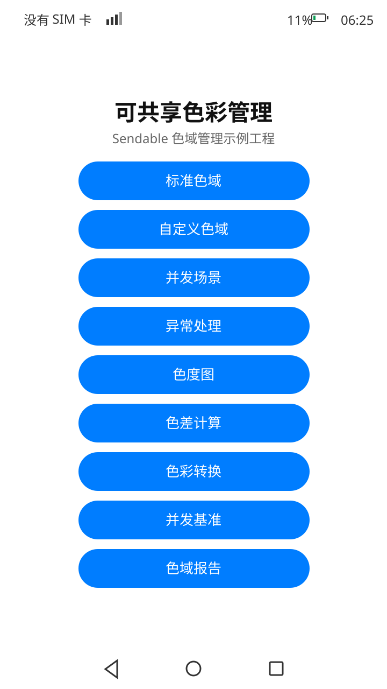
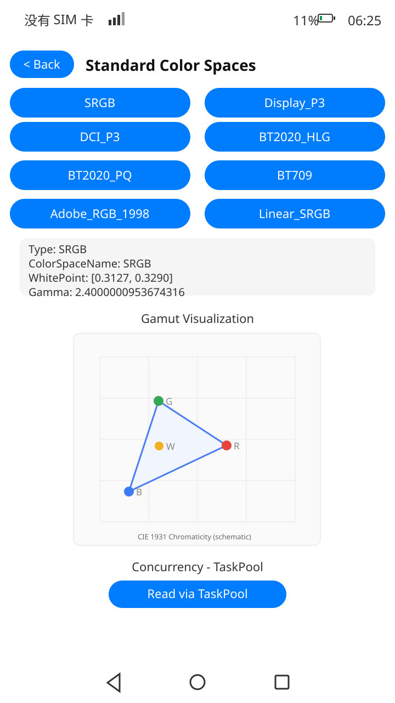
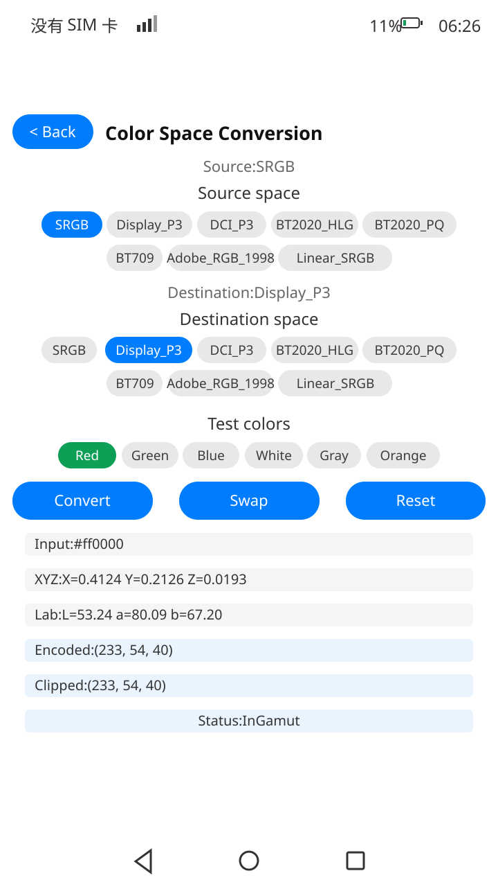

# 可共享色彩管理

### 介绍

本示例基于 Stage 模型和 ArkTS 语言，使用[@ohos.graphics.sendableColorSpaceManager](https://gitcode.com/openharmony/docs/blob/master/zh-cn/application-dev/reference/apis-arkgraphics2d/js-apis-sendableColorSpaceManager.md)提供的`create`接口创建可共享（`@Sendable`）色域对象，并使用`ColorSpaceManager`的`getColorSpaceName`、`getWhitePoint`、`getGamma`接口查询色域类型、白点坐标和 gamma 值。

示例内置 26 个色域定义（8 个标准色域、7 个扩展色域、11 个 LIMIT 范围色域），并演示三类能力：一是标准色域与自定义色域（自定义三原色和白点、gamma 0.1~5.0）的创建与属性查询；二是通过`@Concurrent`函数、`taskpool`和`worker`将同一个色域对象按引用传递到工作线程，比较主线程、TaskPool、Worker 三条路径读到的属性是否一致；三是在[ColorSpaceMath.ets](entry/src/main/ets/common/ColorSpaceMath.ets)中实现 RGB/XYZ/Lab 转换、CIE 1931 色度图面积与包含判定、ΔE76/ΔE94/ΔE2000 色差计算，用于色度图、色差计算、色彩转换和色域报告四个页面。

### 效果预览

| 主页面 | 标准色域 | 色彩转换 |
|:---:|:---:|:---:|
|  |  |  |

### 使用说明

1. 启动应用进入主页面，页面列出标准色域、自定义色域、并发场景、异常处理、色度图、色差计算、色彩转换、并发基准、色域报告共九个入口。
2. 进入“标准色域”，点击任一色域按钮（如 SRGB），结果区域展示`Type`、`ColorSpaceName`、`WhitePoint`、`Gamma`四行属性，下方色域可视化区域绘制该色域的 CIE 1931 色度三角形；点击“Read via TaskPool”在任务池中重新读取当前色域属性。
3. 进入“自定义色域”，修改 R/G/B 三原色与白点的 CIE xy 输入框，拖动 gamma 滑块（步长 0.1），点击创建后结果区域展示`Primaries`、`WhitePoint Input`、`Gamma`和实际色域属性；点击重置恢复默认值。
4. 进入“并发场景”，页面启动时自动创建 SRGB 色域，点击“Read via TaskPool”或“Read via Worker”分别在工作线程读取属性，比对区域展示两条路径结果是否引用同一色域对象；切换色域后可再次读取，操作日志按时间戳记录最近 50 条。
5. 进入“异常处理”，逐一点击 UNKNOWN、CUSTOM、负数 gamma、零 gamma、越界坐标、枚举 999、枚举 -1 等按钮，结果区域展示平台实际行为（抛出`BusinessError`并给出错误码，或接受参数并返回属性）；属性自检按钮展示 SRGB、DCI_P3、LINEAR_SRGB 的 gamma 与白点校验结果和枚举别名校验结果。
6. 进入“色度图”，在 26 个色域间切换，页面展示该色域三角形面积、相对 sRGB 的覆盖比和是否覆盖 sRGB；点击参考叠加按钮切换 ON/OFF；在坐标输入框输入 0~1 之间的 x、y 后点击定位，页面判定该点是否落在当前三角形内，越界输入展示`Point invalid: enter numbers in 0..1`。
7. 进入“色差计算”，选择预设色对或拖动 A 色 RGB 滑块，页面展示 A/B 预览、Lab 值和`dE76`、`dE94`、`dE2000`三种色差及可感知程度判定（Imperceptible/Slight/Noticeable/Obvious）；切换色域或交换两色后结果同步更新。
8. 进入“色彩转换”，分别选择源色域、目标色域和测试色（Red/Green/Blue/White/Gray/Orange），页面展示`Input`十六进制值、`XYZ`、`Lab`、`Encoded`、`Clipped`和`Status`；超出目标色域时`Status`为`OutOfGamut`，`Encoded`保留有符号溢出值，`Clipped`为限幅后的可显示值；Swap 交换源和目标，Reset 恢复默认组合。
9. 进入“并发基准”，分别点击本地、TaskPool、Worker 三个按钮或“Run All”，页面按 200 次采样/往返统计各路径耗时并汇总最快路径；进入“色域报告”，页面按面积排序列出 26 个色域的面积、相对覆盖比和覆盖标记，可切换标准/扩展/LIMIT 过滤、正序/逆序排序和重置。

### 工程目录

```
entry/src/main/ets/
|---entryability
|   |---EntryAbility.ets                       // 应用入口元能力
|---pages
|   |---Index.ets                              // 唯一入口页面，九个功能入口
|   |---StandardColorSpace.ets                // 标准/扩展/LIMIT 色域创建、属性查询、色域可视化与对比
|   |---CustomColorSpace.ets                  // 自定义三原色、白点与 gamma 创建
|   |---Concurrency.ets                       // TaskPool 与 Worker 跨线程读取可共享色域对象
|   |---ExceptionTest.ets                     // 非法枚举、非法 gamma、非法坐标与属性自检
|   |---ChromaticityDiagram.ets               // CIE 1931 色度图、面积、覆盖比与探针判定
|   |---ColorDifference.ets                   // Lab 与 ΔE76/ΔE94/ΔE2000 色差计算
|   |---ColorConversion.ets                   // 跨色域 RGB 转换、溢出编码与限幅
|   |---ConcurrencyBenchmark.ets              // 主线程/TaskPool/Worker 三路径耗时基准
|   |---ColorSpaceReport.ets                  // 26 个色域面积报表、过滤与排序
|---common
|   |---ColorSpaceData.ets                    // 26 个色域元数据与三组色域数组（STANDARD/EXTENDED/LIMIT）
|   |---ColorSpaceMath.ets                    // 色度学计算层：矩阵、传递函数、Lab、色差、面积与包含判定
|---sendable
|   |---ColorSpaceResult.ets                  // @Sendable 色域属性结果类，用于跨线程传输
|   |---BenchmarkResult.ets                   // @Sendable 基准测量结果类
|---workers
|   |---ColorSpaceWorker.ets                  // Worker 线程消息处理，回传色域属性
|---utils
|   |---Logger.ets                            // hilog 日志工具类
entry/src/ohosTest/ets/
|---test
|   |---List.test.ets                         // SUITE_MANIFEST 测试套件入口（42 个套件）
|   |---*.test.ets                            // 27 个页面与算法套件，共 325 条用例
|   |---utils
|   |   |---UtilsSuite*.test.ets              // 15 个工具类套件，共 1500 条用例
|---testkit
|   |---SharedDriver.ets                      // UI 驱动与平台真值辅助库
|---testability
|   |---TestAbility.ets                       // 测试用元能力
|---testrunner
|   |---OpenHarmonyTestRunner.ts              // 测试运行器
```

### 具体实现

* 可共享色域对象的创建与属性查询：入口页面[Index.ets](entry/src/main/ets/pages/Index.ets)通过`router.pushUrl`跳转到九个功能页面；[StandardColorSpace.ets](entry/src/main/ets/pages/StandardColorSpace.ets)调用`sendableColorSpaceManager.create(colorSpaceManager.ColorSpace.XXX)`创建标准色域，使用`getColorSpaceName()`、`getWhitePoint()`、`getGamma()`读取属性并拼接`Type`、`ColorSpaceName`、`WhitePoint`、`Gamma`四行文本；[CustomColorSpace.ets](entry/src/main/ets/pages/CustomColorSpace.ets)调用`create(primaries, gamma)`创建自定义色域。
* 跨线程按引用传递：[Concurrency.ets](entry/src/main/ets/pages/Concurrency.ets)使用`@Concurrent`函数配合`taskpool.execute`读取色域属性，通过`worker.ThreadWorker`的`postMessageWithSharedSendable`把可共享对象传递到 Worker 线程，Worker 线程同样使用`postMessageWithSharedSendable`回传`@Sendable`结果对象[ColorSpaceResult.ets](entry/src/main/ets/sendable/ColorSpaceResult.ets)，页面比对三条路径的`name`、`whitePoint`、`gamma`是否一致。TaskPool 路径所需的常量以`taskpool.Task`入参传入，避免`@Concurrent`函数引用模块级变量导致编译失败。
* 色度学计算层：[ColorSpaceMath.ets](entry/src/main/ets/common/ColorSpaceMath.ets)实现`rgbToXyzMatrix`与`invert3x3`基色矩阵推导、sRGB 分段传递函数`srgbToLinear`/`linearToSrgb`、通用`applyGamma`/`removeGamma`、`xyToXyz`、`xyzToLab`/`labToXyz`、`gamutArea`/`relativeArea`/`containsPoint`/`isDegenerate`、`deltaE76`/`deltaE94`/`deltaE2000`、`convertRgb`以及`toByte`/`fromByte`/`toSignedByte`/`byteToHex`等文本工具；色域元数据集中在[ColorSpaceData.ets](entry/src/main/ets/common/ColorSpaceData.ets)，按标准、扩展、LIMIT 三组分列。
* 四个色度学页面：[ChromaticityDiagram.ets](entry/src/main/ets/pages/ChromaticityDiagram.ets)在`Canvas`上绘制色度三角形与探针；[ColorDifference.ets](entry/src/main/ets/pages/ColorDifference.ets)按当前色域把字节色转换为 Lab 后计算三种色差；[ColorConversion.ets](entry/src/main/ets/pages/ColorConversion.ets)调用`convertRgb`完成源色域到目标色域的转换；[ColorSpaceReport.ets](entry/src/main/ets/pages/ColorSpaceReport.ets)按面积排序并生成报表行。
* 并发基准：[ConcurrencyBenchmark.ets](entry/src/main/ets/pages/ConcurrencyBenchmark.ets)分别测量主线程循环读取、TaskPool 任务和 Worker 往返的耗时，采样次数通过`taskpool.Task`参数传入，结果写入[BenchmarkResult.ets](entry/src/main/ets/sendable/BenchmarkResult.ets)。
* 测试覆盖：测试套件采用`SUITE_MANIFEST`模式组织，共 1825 条用例分布在 42 个套件中（页面与算法 27 套 325 例，工具类 15 套 1500 例），覆盖数据模型、色度学算法、接口属性、枚举与别名、自定义输入矩阵、滑块边界、页面导航与状态复位、色度图/色差/转换/基准/报表五个新增页面以及异常路径；公共驱动[SharedDriver.ets](entry/src/ohosTest/ets/testkit/SharedDriver.ets)提供屏幕自愈、滚动定位、滑块设值和平台真值比对能力。详细用例见[ohosTest.md](ohosTest.md)。

### 相关权限

无。

### 依赖

无外部依赖。全部接口通过系统 Kit 调用：`@kit.ArkGraphics2D`中的`colorSpaceManager`和`sendableColorSpaceManager`、`@kit.ArkTS`中的`taskpool`/`worker`/`collections`、`@kit.ArkUI`中的`router`，日志使用`@kit.PerformanceAnalysisKit`中的`hilog`。

### 约束与限制

1. 本示例适用于标准系统的 Phone 和 Tablet 设备，`module.json5`的`deviceTypes`为`default`与`tablet`，需要设备支持`SystemCapability.Graphic.Graphic2D.ColorManager.Core`。已在 OpenHarmony 7.1.0.21（API version 26）真机完成构建、安装与全量测试。
2. 本示例为 Stage 模型，使用 OpenHarmony API version 26 SDK。工程的`compileSdkVersion`、`targetSdkVersion`和`compatibleSdkVersion`均为`26.0.0`。
3. 请使用支持 OpenHarmony API version 26 的 DevEco Studio 和构建工具链。
4. `sendableColorSpaceManager`自 API version 12 开始支持，本工程统一使用 API 26 编译。
5. `UNKNOWN`与`CUSTOM`枚举不能直接用于`create(colorSpaceName)`创建，需分别通过异常演示与自定义三原色接口处理。gamma 取值为 0.1~5.0，滑块步长 0.1。

### 下载

如需单独下载本工程，执行如下命令：

```
git init
git config core.sparsecheckout true
echo code/BasicFeature/Graphics/SendableColorSpace/ > .git/info/sparse-checkout
git remote add origin https://gitcode.com/openharmony/applications_app_samples.git
git pull origin master
```
