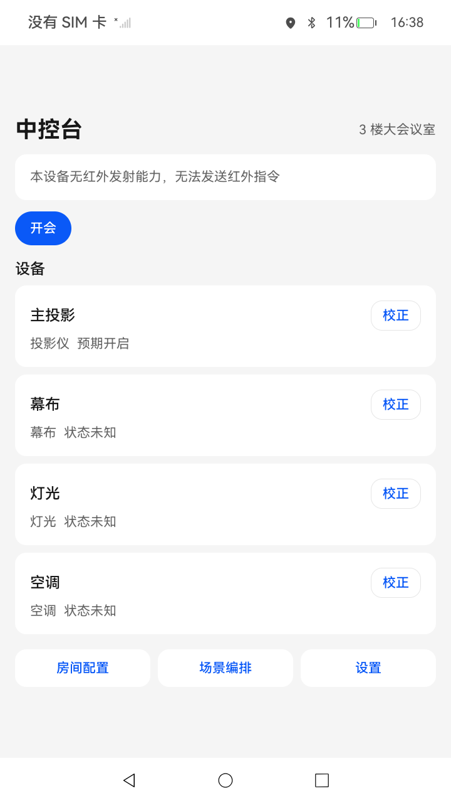

# 会议室场景控制

## 介绍

本示例演示基于红外发射能力的会议室设备控制应用。应用包名为 `com.samples.infraredandgesture`，支持手机与平板两种设备形态：手机作为会议室中控台，平板用于房间，设备和场景的编排配置。

主要功能如下：

1. 红外设备控制：探测设备红外发射能力，编译 NEC，SONY，RC5 与 RAW 码型并串行发送，支持单个按键重发与失败重试。
2. 场景编排：按顺序编排多个设备的按键动作，设置步骤间隔与启用状态，执行前校验设备与键位是否有效。
3. 配置管理：房间，设备，键位，场景的增删改查，配置包导出与导入，开源红外码库导入。
4. 发送日志：记录每次发送的设备，键位，结果与耗时，便于现场排查。

使用到的系统能力如下：

- [@kit.InputKit](https://gitcode.com/openharmony/docs/blob/master/zh-cn/application-dev/reference/apis-input-kit/Readme-CN.md)：`infraredEmitter` 红外发射。
- [@kit.ArkData](https://gitcode.com/openharmony/docs/blob/master/zh-cn/application-dev/reference/apis-arkdata/Readme-CN.md)：`relationalStore` 关系型数据库，`preferences` 轻量级键值对存储。
- [@kit.CoreFileKit](https://gitcode.com/openharmony/docs/blob/master/zh-cn/application-dev/reference/apis-core-file-kit/Readme-CN.md)：配置包文件的读写与目录管理。
- [@kit.AbilityKit](https://gitcode.com/openharmony/docs/blob/master/zh-cn/application-dev/reference/apis-ability-kit/Readme-CN.md)：UIAbility 生命周期与上下文。
- [@kit.PerformanceAnalysisKit](https://gitcode.com/openharmony/docs/blob/master/zh-cn/application-dev/reference/apis-performance-analysis-kit/Readme-CN.md)：`hilog` 日志输出与 `hiTraceMeter` 性能打点。

## 效果预览



## 使用说明

1. 在手机主界面，可以查看当前房间的设备卡片与场景按钮。
2. 点击设备卡片上的“重发”按钮，可以重新发送该设备最近一次按键。
3. 点击设备卡片上的“校正”按钮，可以手动修正设备的预期开关状态。
4. 点击底部“房间配置”按钮，可以编辑房间信息，管理设备，键位与红外码绑定。
5. 点击底部“场景编辑”按钮，可以创建场景，添加按键步骤，调整步骤顺序与间隔，并校验场景是否有效。
6. 点击底部“设置”按钮，可以查看发送日志。
7. 在平板主界面，可以创建房间并进入房间编排页，也可以打开配置包页面导出或导入房间配置。

## 工程目录

```
InfraredAndGesture
├── AppScope                                        // 应用级配置与资源
├── entry                                           // 场景业务模块，承载手机与平板页面
│   └── src/main/ets
│       ├── entryability/EntryAbility.ets           // 应用入口，初始化数据库，探测红外能力
│       ├── pages/Index.ets                         // 唯一入口页面，按设备形态路由
│       ├── console/pages                           // 手机中控台页面
│       │   ├── ConsolePage.ets                     // 中控台页面
│       │   ├── RoomConfigPage.ets                  // 房间配置页面
│       │   ├── SceneEditorPage.ets                 // 场景编辑页面
│       │   └── SettingsPage.ets                    // 发送日志页面
│       ├── orchestration/viewmodel
│       │   └── OrchestrationViewModel.ets          // 编排页视图模型
│       └── orchestration/pages                     // 平板编排页面
│           ├── OrchestrationHome.ets               // 编排首页
│           ├── RoomConfigPage.ets                  // 房间配置页面
│           ├── SceneEditorPage.ets                 // 场景编辑页面
│           └── ConfigTransferPage.ets              // 配置包页面
├── Library                                         // 特性模块，独立编译为 HAR
│   ├── common/src/main/ets/common
│   │   ├── AppLogger.ets                           // 统一日志封装
│   │   ├── AppConstants.ets                        // 全局常量
│   │   ├── StringResources.ets                     // 非 UI 层资源字符串访问
│   │   └── utils                                   // 基础，文件，安全，运行时与网络工具类
│   ├── ircore/src/main/ets
│   │   ├── model/IrTypes.ets                       // 红外码型与脉冲序列数据类型
│   │   ├── data/IrLibraryRepository.ets            // 开源红外码库加载与检索
│   │   └── service                                 // 能力探测，码型编译，串行发送队列
│   ├── room/src/main/ets
│   │   ├── model/RoomTypes.ets                     // 房间数据模型
│   │   ├── data                                    // 数据库，DAO 与默认配置导入
│   │   └── service                                 // 场景校验，配置包，预期状态等服务
│   └── consoleui/src/main/ets
│       ├── viewmodel/ConsoleViewModel.ets          // 中控台视图模型
│       ├── views                                   // 设备卡片，场景栏，进度面板，日志面板
│       └── components                              // 只读横幅与发送结果提示组件
├── entry/src/ohosTest/ets/test/MeetingScene.test.ets // UI 自动化用例
└── screenshots                                     // 真机效果截图
```

## 具体实现

### 红外能力封装

红外相关能力封装在 `ircore` 模块：

- [IrCapabilityProbe.ets](Library/ircore/src/main/ets/service/IrCapabilityProbe.ets)：调用 `infraredEmitter.getInfraredFrequencies()` 探测设备是否具备红外发射器以及支持的频率范围。
- [IrCodeCompiler.ets](Library/ircore/src/main/ets/service/IrCodeCompiler.ets)：将 NEC，SONY，RC5 与 RAW 码编译为 `infraredEmitter` 可发送的脉冲序列，并处理帧长度上限。
- [IrSendQueue.ets](Library/ircore/src/main/ets/service/IrSendQueue.ets)：进程内串行发送队列，忙碌时拒绝新任务，避免多次发射互相干扰。
- [IrTransmitter.ets](Library/ircore/src/main/ets/service/IrTransmitter.ets)：调用 `infraredEmitter.transmit()` 完成发送，并统一转换错误码。
- [IrLibraryRepository.ets](Library/ircore/src/main/ets/data/IrLibraryRepository.ets)：加载并检索 `Library/ircore/src/main/resources/rawfile/ir-library` 下的开源红外码库，按品牌与型号定位红外码。

码型编译（`MeetingScene.IrCompileRaw` 等），串行发送（`MeetingScene.IrSendTask`），发射调用（`MeetingScene.IrTransmit`）与能力探测（`MeetingScene.IrProbe`）均使用 `hiTraceMeter` 的 `startTrace`/`finishTrace` 打点，可用 DevEco Studio 的性能分析工具采集调用耗时。

### 房间与场景数据

数据层封装在 `room` 模块：

- [AppDatabase.ets](Library/room/src/main/ets/data/AppDatabase.ets)：使用 `relationalStore.getRdbStore()` 创建数据库，执行建表与版本迁移。
- [DefaultConfigSeeder.ets](Library/room/src/main/ets/data/DefaultConfigSeeder.ets)：数据库中尚无房间时，从 `rawfile/default-config.json` 导入演示房间，设备，键位与场景。
- [SceneValidator.ets](Library/room/src/main/ets/service/SceneValidator.ets)：校验场景步骤引用的设备，键位与红外码是否存在。
- [ExpectedStateService.ets](Library/room/src/main/ets/service/ExpectedStateService.ets)：根据键位语义推进设备预期状态，手动校正的状态不会被场景覆盖。
- [ConfigPackageService.ets](Library/room/src/main/ets/service/ConfigPackageService.ets)：将房间配置导出为 JSON 配置包，并支持导入与备份。

### 界面与状态管理

界面采用 MVVM 架构与 ArkUI 状态管理 V2 装饰器：

- [Index.ets](entry/src/main/ets/pages/Index.ets)：通过 `deviceInfo.deviceType` 判断设备形态，手机进入中控台，平板进入编排首页。
- [ConsoleViewModel.ets](Library/consoleui/src/main/ets/viewmodel/ConsoleViewModel.ets)：加载房间与设备数据，执行场景并汇总发送结果。
- [ConsolePage.ets](entry/src/main/ets/console/pages/ConsolePage.ets)：展示设备卡片，场景栏与执行进度。
- [StringResources.ets](Library/common/src/main/ets/common/StringResources.ets)：在非 UI 层同步读取资源字符串，保证视图模型也能使用国际化文案。

一多适配采用按需策略：入口页在路由处按设备形态一次性分流；平板侧的房间卡片，设备列表与场景列表使用 `GridRow`/`GridCol` 双列弹性栅格（见 [OrchestrationHome.ets](entry/src/main/ets/orchestration/pages/OrchestrationHome.ets)，[RoomConfigPage.ets](entry/src/main/ets/orchestration/pages/RoomConfigPage.ets)，[SceneEditorPage.ets](entry/src/main/ets/orchestration/pages/SceneEditorPage.ets)），提升平板与折叠屏展开态的屏幕利用率；手机侧表单与执行流保持单列，避免半宽栅格导致内容溢出。

### 公共工具类库

公共能力封装在 `common` 模块，其中 `utils` 目录提供可复用的工具类：

- 基础类：`StringUtils`，`NumberUtils`，`DateUtils`，`ArrayUtils`，`ObjectUtils`，`ValidateUtils`，覆盖字符串，数值，日期，数组，对象与入参校验。
- 文件与安全类：[FileUtils.ets](Library/common/src/main/ets/common/utils/FileUtils.ets) 基于 `@kit.CoreFileKit` 封装文件存在性判断，读写，目录创建与删除；[SecurityUtils.ets](Library/common/src/main/ets/common/utils/SecurityUtils.ets) 基于 `@kit.CryptoArchitectureKit` 提供 MD5/SHA1/SHA256 摘要与 Base64 编解码。
- 运行时与网络类：[DeviceUtils.ets](Library/common/src/main/ets/common/utils/DeviceUtils.ets)，[NetworkUtils.ets](Library/common/src/main/ets/common/utils/NetworkUtils.ets) 与 [AppInfoUtils.ets](Library/common/src/main/ets/common/utils/AppInfoUtils.ets)，分别封装设备信息，网络状态查询与包信息查询。

## 相关权限

本示例声明以下权限：

- `ohos.permission.MANAGE_INPUT_INFRARED_EMITTER`：管理红外发射器，用于发送红外码。该权限为 system_basic 级别，需要通过 ACL 申请。

权限定义可参考[应用权限列表](https://gitcode.com/openharmony/docs/blob/master/zh-cn/application-dev/security/AccessToken/permissions-for-system-apps.md)。

## 依赖

本示例无三方运行时依赖，全部功能基于系统 Kit 实现。

测试框架依赖（`oh-package.json5` 的 devDependencies）：

- [@ohos/hypium](https://gitcode.com/openharmony/docs/blob/master/zh-cn/application-dev/application-test/arkxtest-guidelines.md)：1.0.25，UI 自动化测试框架。
- @ohos/hamock：1.0.0，Mock 框架。

## 约束与限制

1. 本示例仅支持标准系统上运行，支持设备为 phone 与 tablet。
2. 本示例基于 OpenHarmony SDK API 26.0.0 开发。
3. 本示例使用系统接口 `infraredEmitter`，需要使用 Full SDK 编译，且应用需要系统级签名。Full SDK 替换方法可参考[替换指南](https://gitcode.com/openharmony/docs/blob/master/zh-cn/application-dev/faqs/full-sdk-compile-guide.md)。
4. 本示例需要 DevEco Studio 6.0 Release 或更高版本。

## 测试

UI 自动化用例位于 `entry/src/ohosTest`，套件名为 `MeetingSceneUiTest`，共 8 条用例，覆盖启动路由，首页设备控件区，二级页面跳转，发送日志页，房间管理，场景管理，场景编辑步骤列表与配置包导出入口等基本场景。用例的场景，步骤与结果记录见 [TestReport.md](TestReport.md)。

## 下载

如需单独下载本工程，执行如下命令：

```
git init
git config core.sparsecheckout true
echo code/BasicFeature/Input/InfraredAndGesture/ > .git/info/sparse-checkout
git remote add origin https://gitcode.com/openharmony/applications_app_samples.git
git pull origin master
```
