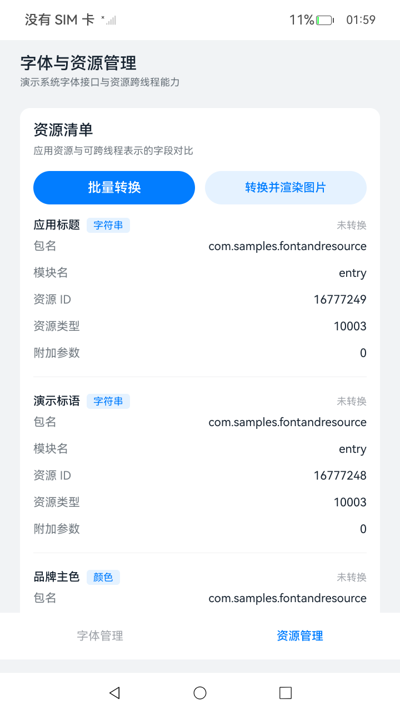

# 字体与资源管理

## 介绍

本示例演示 OpenHarmony 字体管理与资源转换能力，代码拆分为可复用的 Library 特性模块和 entry 场景模块。

- 使用 [@kit.LocalizationKit](https://gitee.com/openharmony/docs/blob/master/zh-cn/application-dev/reference/apis-localization-kit/Readme-CN.md) 中的 sendableResourceManager 完成 Resource 与 SendableResource 的双向转换。
- 使用 [@kit.ArkUI](https://gitee.com/openharmony/docs/blob/master/zh-cn/application-dev/reference/apis-arkui/Readme-CN.md) 中的 UIContext.getFont().registerFont 注册沙箱字体，用于界面预览。
- 使用 [@kit.ArkTS](https://gitee.com/openharmony/docs/blob/master/zh-cn/application-dev/reference/apis-arkts/Readme-CN.md) 中的 TaskPool 和 Worker 在子线程完成资源往返转换。
- 使用 [@kit.CoreFileKit](https://gitee.com/openharmony/docs/blob/master/zh-cn/application-dev/reference/apis-core-file-kit/Readme-CN.md) 中的 fileIo 将随包字体复制到应用沙箱。

主要功能如下：

- 启动时自检系统能力，UPDATE_FONT 权限申请状态和字体预览能力。
- 将随包字体复制到沙箱，展示沙箱路径与文件大小。
- 注册沙箱字体做界面预览，对比系统字体与自定义字体效果。
- 把字符串资源，颜色资源，浮点资源与媒体资源转换为 SendableResource 并渲染。
- 使用 TaskPool 与 Worker 两条路径完成跨线程资源往返转换，并展示耗时。
- 记录操作日志，日志同时输出到 hilog。

## 效果预览





### 使用说明

1. 在主界面顶部查看应用标题，在底部页签或左侧导航中切换“字体管理”和“资源管理”。
2. 在字体管理页点击“准备字体文件”，随包字体 DroidSerif-Regular.ttf 会被复制到应用沙箱，状态变为“已就绪”。
3. 打开“自定义字体预览”开关，对比系统字体与自定义字体的示例文本。
4. 在资源管理页点击“批量转换”，查看字符串资源，颜色资源，浮点资源的转换详情。
5. 点击“转换图片”，查看媒体资源转换后的渲染结果。
6. 依次点击 TaskPool 和 Worker 按钮，查看跨线程往返转换的路径名称与耗时。
7. 点击日志面板右上角的“清空”，清空当前页面的操作日志。

## 工程目录

```text
FontAndResource/
|--- AppScope
|--- entry                                  // 场景模块，依赖 Library
|   |--- src/main/ets
|   |   |--- entryability/EntryAbility.ets  // 应用入口
|   |   |--- pages/Index.ets                // 唯一入口页面
|   |   |--- fontresource
|   |   |   |--- MainPage.ets               // 一多布局导航容器
|   |   |   |--- pages
|   |   |   |   |--- FontPage.ets           // 字体管理页面
|   |   |   |   |--- ResourcePage.ets       // 资源管理页面
|   |   |   |--- viewmodel
|   |   |   |   |--- FontViewModel.ets      // 字体场景状态与操作编排
|   |   |   |   |--- ResourceViewModel.ets  // 资源场景状态与操作编排
|   |--- src/ohosTest/ets/test
|   |   |--- FontResource.test.ets          // UI 自动化用例
|   |   |--- List.test.ets                  // 测试入口
|--- Library                                // 特性模块，可独立编译为 HAR
|   |--- Index.ets                          // 对外导出
|   |--- src/main/ets/fontresource
|   |   |--- FontResource.ets               // 字体与资源能力对外接口
|   |   |--- feature
|   |   |   |--- CapabilityService.ets      // 运行环境自检
|   |   |   |--- FontFileService.ets        // 随包字体复制到沙箱
|   |   |   |--- FontManagerService.ets     // 字体安装与卸载
|   |   |   |--- FontPreviewService.ets     // 沙箱字体注册
|   |   |   |--- ResourceConvertService.ets // Resource 与 SendableResource 转换
|   |   |   |--- ResourceTask.ets           // TaskPool 并发任务
|   |   |   |--- ResourceWorkerClient.ets   // Worker 客户端
|   |   |--- common/ErrorCodeMap.ets        // 错误码说明字典
|   |   |--- components                     // InfoRow，SectionCard，LogPanel
|   |   |--- model                          // 数据模型
|   |   |--- utils/Logger.ets               // hilog 封装
|   |   |--- workers/ResourceWorker.ets     // Worker 线程实现
|   |   |--- src/main/resources             // 字符串，颜色，rawfile 字体
|   |--- src/test/LogTypes.test.ets         // 本地单元测试
```

## 具体实现

字体与资源能力的封装位于 Library 模块，对场景层以静态类的方式开放，入口文件为 [FontResource.ets](Library/src/main/ets/fontresource/FontResource.ets)，统一导出在 [Index.ets](Library/Index.ets)。

- 运行环境自检：在 [CapabilityService.ets](Library/src/main/ets/fontresource/feature/CapabilityService.ets) 中使用 canIUse 判断 SystemCapability.Global.FontManager，通过 bundleManager 读取 UPDATE_FONT 的申请与授权状态，通过 deviceInfo.sdkApiVersion 判断 registerFont 是否可用。
- 字体文件准备：在 [FontFileService.ets](Library/src/main/ets/fontresource/feature/FontFileService.ets) 中使用 resourceManager.getRawFileContentSync 读取 rawfile 字体，再通过 fileIo 写入应用沙箱的 files/fonts 目录。
- 字体预览：在 [FontPreviewService.ets](Library/src/main/ets/fontresource/feature/FontPreviewService.ets) 中调用 UIContext.getFont().registerFont 注册沙箱字体，接口说明参考 [UIContext Font](https://gitee.com/openharmony/docs/blob/master/zh-cn/application-dev/reference/apis-arkui/arkts-apis-uicontext-font.md)。
- 错误码说明：在 [ErrorCodeMap.ets](Library/src/main/ets/fontresource/common/ErrorCodeMap.ets) 中把 fontManager 的 14 个错误码映射为标题，原因与处理建议，错误码含义参考 [字体管理错误码](https://gitee.com/openharmony/docs/blob/master/zh-cn/application-dev/reference/apis-localization-kit/errorcode-font-manager.md)。
- 资源转换：在 [ResourceConvertService.ets](Library/src/main/ets/fontresource/feature/ResourceConvertService.ets) 中调用 sendableResourceManager.resourceToSendableResource 与 sendableResourceManager.sendableResourceToResource 完成双向转换，接口说明参考 [@ohos.sendableResourceManager](https://gitee.com/openharmony/docs/blob/master/zh-cn/application-dev/reference/apis-localization-kit/js-apis-sendable-resource-manager.md)。
- 跨线程转换：TaskPool 路径在 [ResourceTask.ets](Library/src/main/ets/fontresource/feature/ResourceTask.ets) 中使用 @Concurrent 函数配合 taskpool.execute 执行；Worker 路径在 [ResourceWorkerClient.ets](Library/src/main/ets/fontresource/feature/ResourceWorkerClient.ets) 中创建 ThreadWorker，线程实现位于 [ResourceWorker.ets](Library/src/main/ets/fontresource/workers/ResourceWorker.ets)，两条路径都带 3 秒超时保护。
- 场景页面：字体管理页面为 [FontPage.ets](entry/src/main/ets/fontresource/pages/FontPage.ets)，资源管理页面为 [ResourcePage.ets](entry/src/main/ets/fontresource/pages/ResourcePage.ets)，页面状态由 [FontViewModel.ets](entry/src/main/ets/fontresource/viewmodel/FontViewModel.ets) 和 [ResourceViewModel.ets](entry/src/main/ets/fontresource/viewmodel/ResourceViewModel.ets) 管理。
- 一多布局：在 [MainPage.ets](entry/src/main/ets/fontresource/MainPage.ets) 中通过 GridRow 断点切换布局，小屏使用底部页签，中屏与大屏使用左侧导航。
- UI 自动化：在 [FontResource.test.ets](entry/src/ohosTest/ets/test/FontResource.test.ets) 中覆盖启动，页签切换，字体准备，预览开关，批量转换，媒体转换，TaskPool 往返转换，Worker 往返转换共 8 条用例。

## 相关权限

本示例已在 entry 模块的 module.json5 中声明 ohos.permission.UPDATE_FONT：

```json5
"requestPermissions": [
  {
    "name": "ohos.permission.UPDATE_FONT"
  }
]
```

该权限级别为 system_basic，授权类型为 system_grant，ACL 使能。normal 等级应用声明 system_basic 权限时，系统会在安装阶段校验签名配置；若签名配置中没有对应 ACL，安装会报 9568289（权限请求失败导致安装失败）。配置方法参考 [申请受限权限](https://gitee.com/openharmony/docs/blob/master/zh-cn/application-dev/security/AccessToken/declare-permissions-in-acl.md)，即在高权限签名配置的 acls.allowed-acls 中加入该权限后重新签名。

## 依赖

无。

## 约束与限制

1. 本示例仅支持标准系统上运行，支持设备为 Phone 和 Tablet。
2. 本示例仅支持 API 26 版本 SDK，SDK 版本号为 26.0.0.38。
3. 本示例使用系统接口 fontManager，需要手动替换 Full SDK 才能编译通过，具体操作可参考 [Full SDK 编译指南](https://gitee.com/openharmony/docs/blob/master/zh-cn/application-dev/faqs/full-sdk-compile-guide.md)。
4. 本示例已在 module.json5 中声明 ohos.permission.UPDATE_FONT，该权限级别为 system_basic。使用普通签名安装会报 9568289，需要先配置 ACL 与高权限签名，可参考 [特殊权限配置方法](https://gitee.com/openharmony/docs/blob/master/zh-cn/application-dev/security/AccessToken/declare-permissions-in-acl.md)；完成配置后安装仍会因 SELinux 策略返回 201 或 31100106。
5. 本示例需要使用 DevEco Studio 6.0.0 Release 及以上版本编译运行。
6. UI 自动化用例位于 entry/src/ohosTest，运行前请连接真机并完成签名配置。

## 下载

如需单独下载本工程，执行如下命令：

```shell
git init
git config core.sparsecheckout true
echo code/BasicFeature/International/FontAndResource/ > .git/info/sparse-checkout
git remote add origin https://gitee.com/openharmony/applications_app_samples.git
git pull origin master
```
