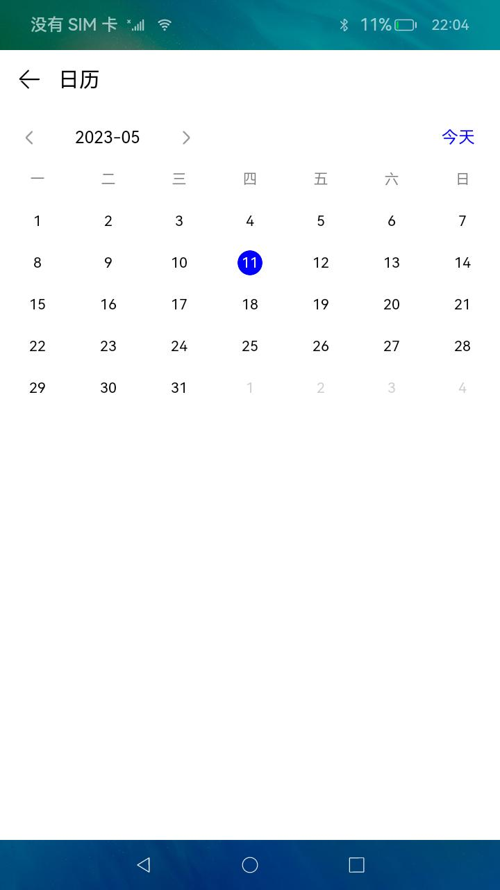

# Internationalization

### Introduction

This sample demonstrates the internationalization features provided by [@ohos.i18n](https://gitcode.com/openharmony/docs/blob/master/en/application-dev/reference/apis-localization-kit/js-apis-i18n.md), including simple calendar display, character type identification, and text line breaking.

### Preview

| Home Page                            | Calendar                                    | Character and Text Processing                                               |
|-------------------------------|---------------------------------------|-------------------------------------------------------|
|  |  |  |

### Usage

1. On the home page, tap the calendar or the character and text processing button to go to the corresponding page.
2. On the calendar page, tap **<** or **>** to view the Gregorian calendar information of the previous or next month.
3. On the character and text processing page, enter a character in the upper text box and tap the character type button to view the type of the character. Enter a long text in the lower text box and tap the text break button to view the line break result; break points are marked in red.

### Project Directory

```
entry/src/main/ets/
|---component
|   |---OperationView.ets                  // Item component of the home page
|   |---TitleBar.ets                       // Title bar component
|---entryability
|---pages
|   |---Calendar.ets                       // Calendar page
|   |---Index.ets                          // Home page
|   |---TextProcessing.ets                 // Character and text break page
|---util
|   |---Logger.ets                         // Log utility
|   |---ResourceUtil.ts                    // Resource management utility
```

### Implementation

1. The calendar feature is implemented by using `Calendar` of [@ohos.i18n](https://gitcode.com/openharmony/docs/blob/master/en/application-dev/reference/apis-localization-kit/js-apis-i18n.md). All the logic is in [Calendar.ets](entry/src/main/ets/pages/Calendar.ets).
2. The character type identification feature is implemented by using `Unicode` of [@ohos.i18n](https://gitcode.com/openharmony/docs/blob/master/en/application-dev/reference/apis-localization-kit/js-apis-i18n.md). All the logic is in [TextProcessing.ets](entry/src/main/ets/pages/TextProcessing.ets).
3. The text line breaking feature is implemented by using `breakIterator` of [@ohos.i18n](https://gitcode.com/openharmony/docs/blob/master/en/application-dev/reference/apis-localization-kit/js-apis-i18n.md). All the logic is in [TextProcessing.ets](entry/src/main/ets/pages/TextProcessing.ets).

### Permissions

None.

### Dependencies

None.

### Tests

The latest RK3568 run passed all 2985 cases (Failure/Error/Ignore: 0). Four smoke cases call real Calendar, Unicode.getType and line-break APIs to verify February/year boundaries, character categories, increasing break positions, complete text reconstruction and iterator reuse with empty input. Only test Calendar objects use UTC; system time, language and time zone are unchanged. These tests do not verify numeric/currency formatting or page interactions. See [test coverage and execution](ohosTest.md). Local signing material is excluded from repository changes.

### Constraints and Limitations

1. This sample can run only on standard-system devices and has been verified on an RK3568 board.
2. This sample supports API 26 SDK (26.0.0). The `compileSdkVersion`, `targetSdkVersion`, and `compatibleSdkVersion` are all 26.0.0.
3. DevEco Studio 26.0.0 Release or later is required to compile and run this sample.

### Download

To download this project separately, run the following commands:

```
git init
git config core.sparsecheckout true
echo code/BasicFeature/International/International/ > .git/info/sparse-checkout
git remote add origin https://gitcode.com/openharmony/applications_app_samples.git
git pull origin master
```
