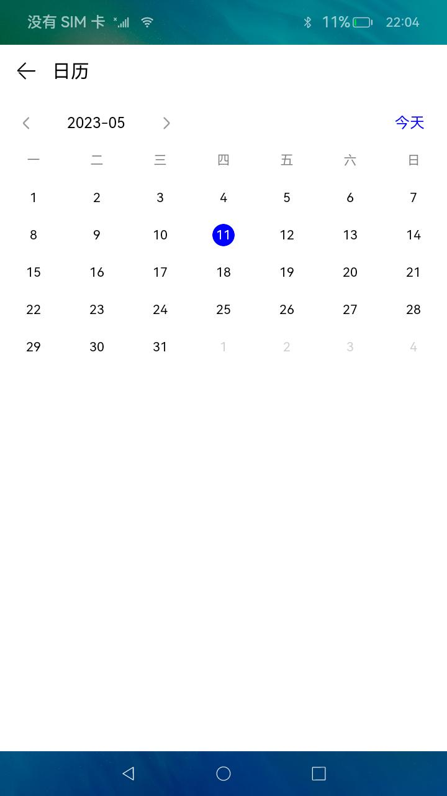

# 国际化

### 介绍

本示例主要展示了国际化模块的相关功能，使用[@ohos.i18n](https://gitcode.com/openharmony/docs/blob/master/zh-cn/application-dev/reference/apis-localization-kit/js-apis-i18n.md)
接口，实现简单日历展示、字符类型判断、文本断点处理功能。

### 效果预览

| 首页                            | 日历                                    | 字符、文本处理                                               |
|-------------------------------|---------------------------------------|-------------------------------------------------------|
|  |  |  |

### 使用说明

1. 在主界面，可以点击日历、字符文本处理按钮进入对应功能界面；
2. 在日历界面，点击“<” “>”按钮，可以查看上/下月公历信息；
3. 在字符、文本处理界面，上方输入框输入一个字符，点击字符类型判断可以查看当前输入的字符类型，下方输入框输入长文本，点击文本断点可以查看文本断点结果，断点处用红色/标记；

### 工程目录

```
entry/src/main/ets/
|---component
|   |---OperationView.ets                  // 主页item组件
|   |---TitleBar.ets                       // TitleBar组件
|---entryability
|---pages
|   |---Calendar.ets                       // 日历页面
|   |---Index.ets                          // 首页
|   |---TextProcessing.ets                 // 字符、文本断点处理页面
|---util
|   |---Logger.ets                         // log工具
|   |---ResourceUtil.ts                    // 资源管理工具
```

### 具体实现
1. 日历功能使用[@ohos.i18n](https://gitcode.com/openharmony/docs/blob/master/zh-cn/application-dev/reference/apis-localization-kit/js-apis-i18n.md)模块中Calendar实现，全部逻辑处于Calendar，源码参考：[Calendar.ets](entry/src/main/ets/pages/Calendar.ets)。
2. 字符类型判断功能使用[@ohos.i18n](https://gitcode.com/openharmony/docs/blob/master/zh-cn/application-dev/reference/apis-localization-kit/js-apis-i18n.md)模块中Unicode实现，全部逻辑处于TextProcessing，源码参考：[TextProcessing.ets](entry/src/main/ets/pages/TextProcessing.ets)。
3. 文本断点功能使用[@ohos.i18n](https://gitcode.com/openharmony/docs/blob/master/zh-cn/application-dev/reference/apis-localization-kit/js-apis-i18n.md)模块中breakIterator实现，全部逻辑处于TextProcessing，源码参考：[TextProcessing.ets](entry/src/main/ets/pages/TextProcessing.ets)。

### 相关权限

不涉及

### 依赖

不涉及

### 测试

本轮 RK3568 全量 2985/2985 通过，Failure/Error/Ignore 均为 0。四条冒烟实际调用 Calendar、Unicode.getType 和断行 API，验证二月/跨年边界、字符分类、递增断点、原文重建与迭代器复用空文本。仅测试 Calendar 对象使用 UTC，不改系统时间、语言或时区；不代表数字/货币格式化或页面交互已验证。详见 [测试覆盖与运行](ohosTest.md)。签名材料仅保留本地，不纳入仓库改动。

### 约束与限制

1. 本示例仅支持标准系统上运行，支持设备：RK3568；
2. 本示例支持 API 26 版本 SDK（26.0.0），compileSdkVersion、targetSdkVersion、compatibleSdkVersion 均为 26.0.0；
3. 本示例需要使用 DevEco Studio 26.0.0 Release 及以上版本才可编译运行；

### 下载

如需单独下载本工程，执行如下命令：
```
git init
git config core.sparsecheckout true
echo code/BasicFeature/International/International/ > .git/info/sparse-checkout
git remote add origin https://gitcode.com/openharmony/applications_app_samples.git
git pull origin master

```