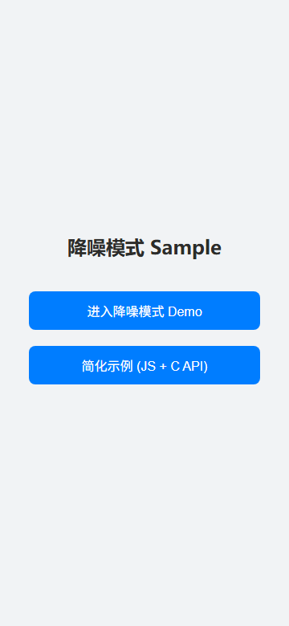
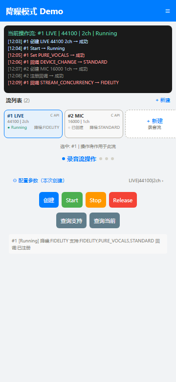
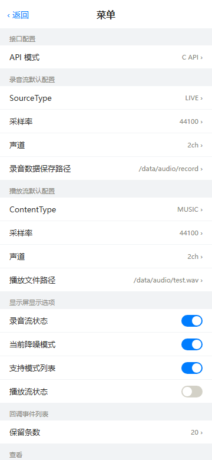
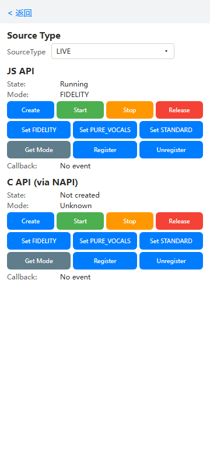

## 降噪模式变更回调

## 介绍

本示例主要展示了 AudioCapturer 降噪模式变更回调的相关功能，提供 **JS API 和 C API 两套接口**的测试验证。

采用**显示屏+滑动操作区布局**：上方显示屏实时显示操作日志和回调事件，下方左右滑动切换操作区，所有操作以流为中心——先选流再操作。

**JS API**（ArkTS 层）：使用[@ohos.multimedia.audio](https://gitcode.com/openharmony/docs/blob/master/zh-cn/application-dev/reference/apis-audio-kit/arkts-apis-audio.md)接口实现录音流降噪模式的查询、设置以及变更事件订阅。

**C API**（Native 层）：通过 NAPI 桥接调用 `native_audiocapturer.h` 和 `native_audio_common.h` 中的 C 接口，实现与 JS API 等价的功能。

## 功能特性

- **多录音流管理**：支持创建多条录音流，每条流有独立 streamId，可单独查询/设置降噪模式、注册回调
- **以流为中心的操作模型**：先在流列表选中指定流，所有操作（Start/Stop/降噪/回调）都作用于当前选中的流
- **显示屏实时日志**：深色显示屏始终可见，显示所有流的关键操作日志和回调事件（带 streamId 和时间戳）
- **左右滑动切换操作区**：4 屏滑动（录音流操作/降噪模式/回调/流详情），圆点指示器与操作区标题合并
- **参数配置弹窗**：点击"配置参数"弹出弹窗，配置 SourceType/采样率/声道等参数
- **菜单页**：API 模式切换、录音流/播放流默认配置、显示屏显示选项、查看使用说明等
- **降噪变更回调**：订阅降噪模式变更事件，4种变更原因全覆盖，回调事件列表保留历史

核心API（version 26.1.0）：
- `NoiseReductionModeChangeReason` 枚举：降噪模式变更原因
- `NoiseReductionModeChangeInfo` 接口：变更信息（reason + noiseReductionMode）
- `onNoiseReductionModeChanged(callback)`：订阅降噪模式变更事件
- `offNoiseReductionModeChanged(callback?)`：取消订阅降噪模式变更事件

C API 对应（version 26.1.0）：
- `OH_Audio_NoiseReductionModeChangeReason` 枚举
- `OH_Audio_NoiseReductionModeChangeInfo` 结构体（含 structSize 版本控制）
- `OH_AudioCapturer_RegisterNoiseReductionModeChangeCallback`：注册回调
- `OH_AudioCapturer_UnregisterNoiseReductionModeChangeCallback`：注销回调

关联API（version 26.0.0）：
- `createAudioCapturer` / `OH_AudioStreamBuilder_Create`：创建录音流
- `getSupportedNoiseReductionModes()` / `OH_AudioCapturer_GetSupportedNoiseReductionModes`：查询支持的降噪模式
- `getNoiseReductionMode()` / `OH_AudioCapturer_GetNoiseReductionMode`：查询当前降噪模式
- `setNoiseReductionMode(mode)` / `OH_AudioCapturer_SetNoiseReductionMode`：设置降噪模式

## 界面布局

```
┌─────────────────────────────┐
│ 降噪模式 Demo          ≡    │  标题栏，≡ 进菜单
├─────────────────────────────┤
│  显示屏（固定，始终可见）      │  操作日志 + 回调事件（带streamId）
│  当前操作流: #1 LIVE|44100|2ch│
│  [12:03] #1 创建 LIVE → 成功  │
│  [12:05] #1 Set PURE → 成功   │
│  [12:06] #1 回调 DEVICE→STD  │
├─────────────────────────────┤
│ 流列表 (2)          + 新建   │  横向卡片，点击选中
│ [#1 LIVE✓] [#2 MIC] [+新建]  │
├─────────────────────────────┤
│ 选中: #1 | 操作作用于此流    │
├─────────────────────────────┤
│ ● ○ ○ ○   录音流操作        │  圆点+标题合并
├─────────────────────────────┤
│ ⚙ 配置参数  LIVE|44100|2ch › │  点此弹窗配置
│ [创建] [Start] [Stop] [Rel] │  操作按钮
│ [查询支持] [查询当前]        │
│ #1 [Running] 降噪:FIDELITY   │  选中流状态条
└─────────────────────────────┘
```

**左右滑动切换 4 个操作区**：

| 屏 | 标题 | 内容 |
|---|---|---|
| 第1屏 | 录音流操作 | 配置参数弹窗 + 创建/Start/Stop/Release + 查询支持/当前 |
| 第2屏 | 降噪模式 | FIDELITY/PURE_VOCALS/STANDARD（对选中流操作） |
| 第3屏 | 回调 | 注册/取消指定/取消全部（对选中流操作） |
| 第4屏 | 流详情 | 选中流的完整信息（streamId/参数/状态/降噪/回调） |

## 效果预览

> 下列界面图按工程内页面代码（布局、文案、配色、按钮）1:1 复刻渲染，与实际应用界面保持一致。

| 入口页 | 主页面（第1屏） | 菜单页 | 简化示例 |
|------|------|------|------|
|  |  |  |  |

## 使用说明

1. 点击主页"进入降噪模式 Demo"进入主页面
2. 点击主页"简化示例 (JS + C API)"进入 JS API 与 C API 并排对照页面

**主页面：**
3. 点击流列表标题行的"+ 新建"或列表末尾的"+ 新建"卡片，弹出参数配置弹窗，选择 SourceType（LIVE/MIC/CAMCORDER/VOICE_COMMUNICATION）、采样率、声道，点确定创建录音流
4. 在流列表中点击某条流卡片选中它（高亮蓝框），显示屏同步显示该流的完整信息，后续操作都作用于该流
5. 左右滑动切换操作区：录音流操作（配置参数条 + 创建/Start/Stop/Release/查询 + 选中流状态条）、降噪模式（Set FIDELITY/PURE_VOCALS/STANDARD）、回调（注册/取消）、流详情（基本信息/降噪信息分组）
6. 显示屏实时显示所有流的关键操作日志和回调事件
7. 点击标题栏 ≡ 进入菜单页

**菜单页：**
8. API 模式：切换 C API / JS API（影响录音流创建和回调的调用方式）
9. 录音流默认配置：SourceType/采样率/声道/录音数据保存路径
10. 播放流默认配置：ContentType/采样率/声道/播放文件路径
11. 显示屏显示选项：选择显示屏显示哪些信息
12. 回调事件保留条数：10/20/50/100
13. 查看使用说明 / 查看简化示例代码 / 查看 C API vs JS API 对照

**简化示例：**
14. JS API 与 C API 并排对照，各含 Create/Start/Stop/Release + Set 三个模式 + Get Mode/Register/Unregister

## 回调变更原因触发方式

| 变更原因 | 枚举值 | 枚举常量 | 触发方式 |
| -------- | ------ | -------- | -------- |
| 用户系统设置 | 0 | `OH_AUDIO_NOISE_REDUCTION_MODE_CHANGE_REASON_USER_SETTING_BY_SYSTEM_RECORD_CONTROLLER` | 在系统录音控制面板 UX 中手动切换降噪模式 |
| 应用设置 | 1 | `OH_AUDIO_NOISE_REDUCTION_MODE_CHANGE_REASON_APP_SETTING` | 在 demo 中点击 FIDELITY/PURE_VOCALS/STANDARD 按钮调用 setNoiseReductionMode |
| 设备变更 | 2 | `OH_AUDIO_NOISE_REDUCTION_MODE_CHANGE_REASON_DEVICE_CHANGE` | 拔插有线耳机或切换蓝牙音频输出设备 |
| 流并发冲突 | 3 | `OH_AUDIO_NOISE_REDUCTION_MODE_CHANGE_REASON_STREAM_CONCURRENCY` | 创建第二个录音流并开始录音，造成并发冲突 |

## 工程目录

```
entry/src/main/ets/
|---entryability
|   |---EntryAbility.ts                         // 入口Ability
|---pages
|   |---Index.ets                               // 主页，功能入口
|   |---NoiseReductionMain.ets                  // 主页面：显示屏+流列表+Swiper操作区+参数弹窗
|   |---MenuPage.ets                            // 菜单页：API模式/默认配置/显示选项/查看入口
|   |---NoiseReductionSimpleExample.ets         // 简化示例：JS+C API基础功能对照
|---utils
|   |---MicPermissionUtil.ets                   // 麦克风权限工具
entry/src/main/cpp/
|---CMakeLists.txt                              // CMake构建配置，链接libohaudio.so
|---noise_reduction_capi.cpp                    // C API NAPI桥接实现（多流管理，streamId参数）
|---noise_reduction_stub.cpp                    // 回调函数stub实现（SDK stub库缺符号补丁）
|---types/libentry/
    |---Index.d.ts                              // NAPI类型声明
    |---oh-package.json5                        // NAPI模块配置
```

## 具体实现

**主页面（NoiseReductionMain.ets）：**

* 显示屏：深色固定区域，显示当前操作流编号 + 所有流的关键操作日志（创建/Start/Stop/Set/回调事件），带 streamId 前缀和时间戳，按时间倒序排列
* 流列表：横向滚动卡片，每张卡片显示 streamId/SourceType/参数/状态/降噪模式，点击选中后蓝框高亮
* Swiper 操作区：4 屏左右滑动，圆点指示器与操作区标题合并（当前屏圆点亮蓝色+显示标题）
* 参数配置弹窗：点击"配置参数"弹出，SourceType/采样率/声道以按钮组形式平铺，选中高亮
* 多流管理：C API 通过 streamId 管理多条流（map<streamId, CapturerInfo>），JS API 通过 AudioCapturer 实例管理
* 降噪模式查询：调用 `getSupportedNoiseReductionModes` / `OH_AudioCapturer_GetSupportedNoiseReductionModes` 获取支持的模式
* 降噪模式设置：调用 `setNoiseReductionMode` / `OH_AudioCapturer_SetNoiseReductionMode` 设置降噪模式
* 变更回调注册：调用 `onNoiseReductionModeChanged` / `OH_AudioCapturer_RegisterNoiseReductionModeChangeCallback` 注册回调
* 变更回调注销：调用 `offNoiseReductionModeChanged` / `OH_AudioCapturer_UnregisterNoiseReductionModeChangeCallback` 注销回调

**C API NAPI 桥接（noise_reduction_capi.cpp）：**

* 多流管理：使用 `std::map<int32_t, CapturerInfo>` 管理多条录音流，每条流有独立 streamId
* 录音流创建：`OH_AudioStreamBuilder_Create` + `SetCapturerInfo` + `SetSamplingRate` + `SetChannelCount` + `SetSampleFormat` + `GenerateCapturer`，返回 streamId
* 录音流控制：`OH_AudioCapturer_Start` / `OH_AudioCapturer_Stop` / `OH_AudioCapturer_Release`，接受 streamId 参数
* 降噪操作：`Get/Set/GetSupported` / `Register/Unregister` 均接受 streamId 参数，操作指定流
* 回调结果传递：C 回调在音频服务线程触发，将结果存入对应流的 callbackLog，ArkTS 层通过 `getCallbackLog(streamId)` 轮询获取

**菜单页（MenuPage.ets）：**

* API 模式切换：C API / JS API
* 录音流默认配置：SourceType/采样率/声道/录音数据保存路径
* 播放流默认配置：ContentType/采样率/声道/播放文件路径
* 显示屏显示选项：录音流状态/当前降噪模式/支持模式列表/播放流状态（开关）
* 回调事件保留条数：10/20/50/100
* 查看入口：使用说明/简化示例代码/C API vs JS API 对照

## 相关权限

| 权限名 | 权限说明 |
| ------ | -------- |
| ohos.permission.MICROPHONE | 麦克风权限，用于音频录制 |

## 依赖

不依赖额外的三方库。

## 约束与限制

1. 本示例仅支持标准系统，支持的设备形态为 default 和 tablet
2. 本示例 C API Demo 默认创建 LIVE 类型录音流，可通过参数配置弹窗切换 SourceType
3. setNoiseReductionMode 仅可在录音流创建后未开始录音或停止录音后调用
4. 请勿在回调函数中调用 AudioCapturer 相关接口，以免死锁
5. 多次订阅时如果 callback 函数对象不同，会记录所有 callback，按订阅顺序依次回调
6. 本示例支持 SDK 版本：26.0.0（API 26）及以上版本
7. 本示例支持 DevEco Studio 版本：DevEco Studio 6.0及以上版本

## 下载命令

如需单独下载本工程，执行如下命令：

```
git init
git config core.sparsecheckout true
echo code/BasicFeature/Media/AudioNoiseReduction > .git/info/sparse-checkout
git remote add origin https://gitcode.com/openharmony/applications_app_samples.git
git pull origin master
```
