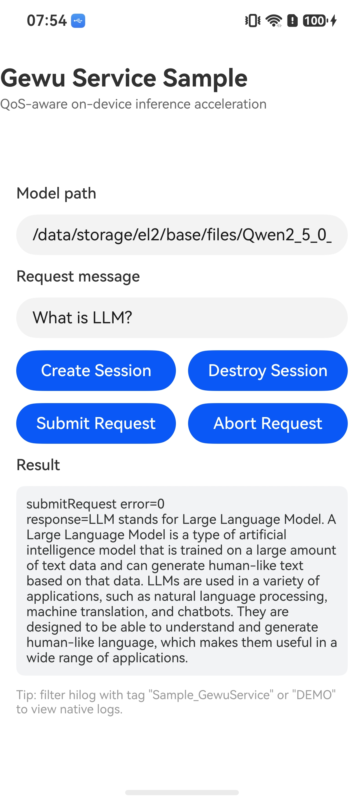

# Gewu Service

## 介绍

本示例演示如何使用内核增强 Kit 的格物服务（Gewu Service）能力，进行 QoS 感知的端侧推理加速与资源管理优化。示例以 Native C++ 工程形态承载 NDK 接口调用，ArkTS 侧通过 NAPI 调用 native 能力，覆盖创建会话（`OH_QoS_GewuCreateSession`）、提交推理请求（`OH_QoS_GewuSubmitRequest`）、中止请求（`OH_QoS_GewuAbortRequest`）、销毁会话（`OH_QoS_GewuDestroySession`）的完整流程，并在主界面展示各接口的调用结果与推理响应内容。

使用到的接口：

- [格物服务开发指导](https://gitcode.com/openharmony/docs/blob/master/zh-cn/application-dev/kernel-enhance/gewu-ndk-api-guidelines.md)：内核增强 Kit 的 Gewu Service NDK 接口，头文件为 `qos/qos.h`。

## 效果预览

| 主界面 | 推理结果 |
| -------- | -------- |
|  |  |

### 使用说明

1. 安装编译生成的 hap 包，并打开应用。
2. 在主界面"Model path"输入框中确认或修改端侧模型路径，默认值为 `/data/storage/el2/base/files/Qwen2_5_0_5B_CPU_Q4`。
3. 点击"Create Session"按钮创建格物会话，按钮下方"Result"区域显示接口返回的错误码。
4. 在"Request message"输入框中输入要发送的推理消息，点击"Submit Request"按钮提交请求，请求执行完成后"Result"区域展示推理响应内容。
5. 点击"Abort Request"按钮可提前中止已提交的请求，点击"Destroy Session"按钮销毁会话。
6. 在日志中过滤 `Sample_GewuService` 或 `DEMO` 关键字，可查看各接口调用结果与推理过程的日志。

## 工程目录

```
entry/src/main
├── cpp                            // C++代码区
│   ├── CMakeLists.txt             // CMake配置文件，链接libqos.so、libhilog_ndk.z.so等
│   ├── include
│   │   └── nlohmann
│   │       └── json.hpp           // 第三方JSON库（已内置，无需额外依赖）
│   ├── napi_init.cpp              // Gewu NDK接口调用与NAPI注册
│   └── types
│       └── libentry
│           └── index.d.ts         // native侧暴露给ArkTS侧接口的声明
├── ets                            // ets代码区
│   ├── entryability
│   │   └── EntryAbility.ets       // 程序入口类
│   ├── entrybackupability
│   │   └── EntryBackupAbility.ets // 备份扩展能力
│   └── pages
│       └── Index.ets              // 主界面
└── resources                      // 资源文件目录
```

## 具体实现

Gewu NDK 接口的调用与 NAPI 注册集中在 `napi_init.cpp`，源码参考：[napi_init.cpp](entry/src/main/cpp/napi_init.cpp)

* 向 ArkTS 侧暴露 `createSession`、`destroySession`、`submitRequest`、`abortRequest`、`getResponse` 五个接口，接口声明参考：[index.d.ts](entry/src/main/cpp/types/libentry/index.d.ts)。
* 创建会话：在 `CreateSession` 中构造包含 `"model"`（模型路径）与 `"eval_settings"`（推理后端与上下文长度）的 JSON 属性串，调用 `OH_QoS_GewuCreateSession` 获取会话句柄，将错误码返回给 ArkTS 侧。
* 提交请求：在 `SubmitRequest` 中构造包含 `"type"`、`"messages"`、`"stream"` 的 JSON 请求串，调用 `OH_QoS_GewuSubmitRequest` 提交异步推理请求，通过回调 `OnChatResponse` 累积推理响应内容，`Join` 等待请求执行完成。
* 中止请求：调用 `OH_QoS_GewuAbortRequest` 中止已提交的请求。
* 销毁会话：调用 `OH_QoS_GewuDestroySession` 销毁会话，并复位全局会话句柄与请求句柄。

涉及到的相关接口：

| 接口名 | 描述 |
| -------- | -------- |
| `OH_QoS_GewuCreateSession(const char* attributes)` | 创建格物会话，异步加载推理资源 |
| `OH_QoS_GewuSubmitRequest(OH_QoS_GewuSession session, const char* request, OH_QoS_GewuOnResponse callback, void* context)` | 向会话提交异步推理请求 |
| `OH_QoS_GewuAbortRequest(OH_QoS_GewuSession session, OH_QoS_GewuRequest request)` | 提前中止推理请求 |
| `OH_QoS_GewuDestroySession(OH_QoS_GewuSession session)` | 销毁格物会话 |

详细的接口说明请参考[格物服务开发指导](https://gitcode.com/openharmony/docs/blob/master/zh-cn/application-dev/kernel-enhance/gewu-ndk-api-guidelines.md)。

## 相关权限

不涉及。

## 依赖

不涉及其他 Sample 依赖。示例使用第三方库 nlohmann/json 解析与构造 JSON，`json.hpp` 已内置在 `cpp/include` 目录，无需额外下载与链接库文件。

## 约束与限制

1. 本示例仅支持标准系统上运行，支持设备：默认设备（如 RK3568）与平板，工程 `deviceTypes` 配置为 `["default", "tablet"]`。
2. 格物服务能力从 API version 20 开始支持，本示例基于 API version 26 编译运行，工程 `compileSdkVersion` 配置为 `26.0.0`。
3. 运行本示例前，需要将端侧推理模型（如 Qwen2.5-0.5B CPU 量化模型）放置到设备上应用沙箱 `/data/storage/el2/base/files/Qwen2_5_0_5B_CPU_Q4` 目录，并在主界面"Model path"输入框中确认模型路径与实际一致。
4. 本示例依赖内核增强 Kit 的 NDK 头文件 `qos/qos.h` 与链接库 `libqos.so`，若使用的 SDK 未包含该能力，需替换为 Full SDK 后编译，参考[Full SDK替换方法](https://gitcode.com/openharmony/docs/blob/master/zh-cn/application-dev/faqs/full-sdk-switch-guide.md)。
5. 本示例需要使用 DevEco Studio 5.0 及以上版本才可编译运行。

## 下载

如需单独下载本工程，执行如下命令：

```text
git init
git config core.sparsecheckout true
echo code/BasicFeature/Native/GewuService/ > .git/info/sparse-checkout
git remote add origin https://gitcode.com/openharmony/applications_app_samples.git
git pull origin master
```
