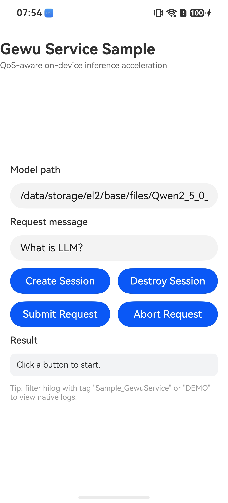

# Gewu Service

## 介绍

本示例演示如何使用内核增强 Kit 的格物服务（Gewu Service）能力，进行 QoS 感知的端侧推理加速与资源管理优化。示例以 Native C++ 工程形态承载 NDK 接口调用，ArkTS 侧通过 NAPI 调用 native 能力，以类聊天（Chat）界面覆盖创建会话（`OH_QoS_GewuCreateSession`）、提交推理请求（`OH_QoS_GewuSubmitRequest`）、中止请求（`OH_QoS_GewuAbortRequest`）、销毁会话（`OH_QoS_GewuDestroySession`）的完整流程：用户输入 prompt 点击发送后，若会话不存在则先自动创建会话再提交请求，请求执行期间可点击"Stop"中止推理，会话空闲 30 秒后自动销毁，并支持多轮对话（完整会话历史随每次请求一并提交）。

使用到的接口：

- [格物服务开发指导](https://gitcode.com/openharmony/docs/blob/master/zh-cn/application-dev/kernel-enhance/gewu-ndk-api-guidelines.md)：内核增强 Kit 的 Gewu Service NDK 接口，头文件为 `qos/qos.h`。

## 效果预览



### 使用说明

1. 安装编译生成的 hap 包，并打开应用。
2. 在主界面"Model path"输入框中确认或修改端侧模型路径，默认值为模型目录名 `Qwen2_5_0_5B_CPU_Q4`。应用启动后，输入框不会显示绝对路径：创建会话时，若输入相对目录名，则自动拼接运行时沙箱 `files` 目录（如 `/data/storage/el2/base/files/Qwen2_5_0_5B_CPU_Q4`）生成完整路径；若输入以 `/` 开头的绝对路径，则原样使用。
3. 在底部输入框中输入 prompt，点击"Send"（或回车）发送。发送时若会话不存在，会自动调用 `createSession` 创建会话（首轮发送包含加载模型的耗时，界面显示"Creating session..."），随后调用 `submitRequest` 提交推理请求，界面显示"Thinking..."气泡等待推理完成。
4. 请求执行期间，发送按钮变为"Stop"，点击可调用 `abortRequest` 中止当前推理；已中止的消息气泡会标记"stopped by user"。
5. 会话创建后若 30 秒内没有新的请求，会自动调用 `destroySession` 销毁会话，并在对话区提示；再次发送时会重新自动创建会话。
6. 支持多轮对话：每次发送时会把完整的会话历史（`developer`/`user`/`assistant` 消息数组）作为请求的 `messages` 一并提交，模型可基于上文持续回答。
7. 在日志中过滤 `Sample_GewuService` 或 `DEMO` 关键字，可查看各接口调用结果与推理过程的日志。

#### 模型权重获取

1. 从[兼容性测试资源库](https://gitcode.com/openharmony-sig/compatibility/tree/master/test_suite/resource/master/standard%20system/acts/resource/qos/model)获取 `Qwen2.5-0.5B-CPU-Q4` 模型目录，其中包含三个文件：`params`（模型权重）、`tokenizer.json`（分词器）与 `api_config.json`（模型配置）。
2. 先将应用安装到设备并启动一次，以创建应用沙箱目录；再使用 hdc 将上述三个文件推送到沙箱目录 `/data/storage/el2/base/files/Qwen2_5_0_5B_CPU_Q4`。hdc 推送时需使用沙箱在设备上的物理路径：

```text
hdc file send params /data/app/el2/100/base/com.samples.gewuservice/files/Qwen2_5_0_5B_CPU_Q4/
hdc file send tokenizer.json /data/app/el2/100/base/com.samples.gewuservice/files/Qwen2_5_0_5B_CPU_Q4/
hdc file send api_config.json /data/app/el2/100/base/com.samples.gewuservice/files/Qwen2_5_0_5B_CPU_Q4/
```

3. 修改沙箱内 `api_config.json` 中的模型路径与分词器路径，使其指向沙箱内的实际位置（`esets.backend` 需为 `cpu` 以匹配 CPU 量化模型）：

```json
{
    "tokenizer": {
        "model_path": "/data/storage/el2/base/files/Qwen2_5_0_5B_CPU_Q4/tokenizer.json"
    },
    "params_path": "/data/storage/el2/base/files/Qwen2_5_0_5B_CPU_Q4/params",
    "esets": {
        "backend": "cpu"
    }
}
```

4. 确认主界面"Model path"输入框中的模型目录名与沙箱内实际目录一致（默认值 `Qwen2_5_0_5B_CPU_Q4` 与推送的沙箱目录同名）后，直接输入 prompt 并发送即可，应用会在首次发送时自动创建会话。

## 工程目录

```
entry/src/main
├── cpp                            // C++代码区
│   ├── CMakeLists.txt             // CMake配置文件，链接libqos.so、libhilog_ndk.z.so等
│   ├── include
│   │   └── nlohmann
│   │       └── json.hpp           // 第三方JSON库（已内置，无需额外依赖）
│   ├── napi_init.cpp              // Gewu NDK接口调用与NAPI注册
│   └── types
│       └── libentry
│           └── index.d.ts         // native侧暴露给ArkTS侧接口的声明
├── ets                            // ets代码区
│   ├── entryability
│   │   └── EntryAbility.ets       // 程序入口类
│   ├── entrybackupability
│   │   └── EntryBackupAbility.ets // 备份扩展能力
│   └── pages
│       └── Index.ets              // 主界面
└── resources                      // 资源文件目录
```

## 具体实现

Gewu NDK 接口的调用与 NAPI 注册集中在 `napi_init.cpp`，源码参考：[napi_init.cpp](entry/src/main/cpp/napi_init.cpp)

* 向 ArkTS 侧暴露 `createSession`、`destroySession`、`submitRequest`、`abortRequest`、`getResponse` 五个接口，其中 `createSession` 与 `submitRequest` 为异步接口（返回 Promise），接口声明参考：[index.d.ts](entry/src/main/cpp/types/libentry/index.d.ts)。
* 创建会话：在 `CreateSession` 中构造包含 `"model"`（模型路径）与 `"eval_settings"`（推理后端与上下文长度）的 JSON 属性串，调用 `OH_QoS_GewuCreateSession` 获取会话句柄；模型加载耗时较长，通过 `napi_create_async_work` 放到工作线程执行，完成后以 Promise 将错误码返回给 ArkTS 侧。
* 提交请求：在 `SubmitRequest` 中把 ArkTS 侧传入的 `messages` JSON 数组包装为包含 `"type"`、`"messages"`、`"stream"` 的 JSON 请求串，调用 `OH_QoS_GewuSubmitRequest` 提交异步推理请求，通过回调 `OnChatResponse` 累积推理响应内容；等待推理完成的工作线程以 100ms 间隔轮询 future，用户调用 `abortRequest` 成功后可提前结束等待，避免阻塞 ArkTS 主线程。
* 中止请求：调用 `OH_QoS_GewuAbortRequest` 中止已提交的请求，中止成功后置位中止标记，通知等待线程结束等待。
* 销毁会话：调用 `OH_QoS_GewuDestroySession` 销毁会话，并复位全局会话句柄与请求句柄；ArkTS 侧在会话空闲 30 秒后自动调用。

涉及到的相关接口：

| 接口名 | 描述 |
| -------- | -------- |
| `OH_QoS_GewuCreateSession(const char* attributes)` | 创建格物会话，异步加载推理资源 |
| `OH_QoS_GewuSubmitRequest(OH_QoS_GewuSession session, const char* request, OH_QoS_GewuOnResponse callback, void* context)` | 向会话提交异步推理请求 |
| `OH_QoS_GewuAbortRequest(OH_QoS_GewuSession session, OH_QoS_GewuRequest request)` | 提前中止推理请求 |
| `OH_QoS_GewuDestroySession(OH_QoS_GewuSession session)` | 销毁格物会话 |

详细的接口说明请参考[格物服务开发指导](https://gitcode.com/openharmony/docs/blob/master/zh-cn/application-dev/kernel-enhance/gewu-ndk-api-guidelines.md)。

## 相关权限

不涉及。

## 依赖

不涉及其他 Sample 依赖。示例使用第三方库 nlohmann/json 解析与构造 JSON，`json.hpp` 已内置在 `cpp/include` 目录，无需额外下载与链接库文件。

## 约束与限制

1. 本示例仅支持标准系统上运行，支持设备：默认设备（如 RK3568）与平板，工程 `deviceTypes` 配置为 `["default", "tablet"]`。
2. 格物服务能力从 API version 20 开始支持，本示例基于 API version 26 编译运行，工程 `compileSdkVersion` 配置为 `26.0.0`。
3. 运行本示例前，需要将端侧推理模型（如 Qwen2.5-0.5B CPU 量化模型）放置到设备上应用沙箱 `/data/storage/el2/base/files/Qwen2_5_0_5B_CPU_Q4` 目录，并在主界面"Model path"输入框中确认模型目录名与实际一致（默认值 `Qwen2_5_0_5B_CPU_Q4`）。
4. 本示例依赖内核增强 Kit 的 NDK 头文件 `qos/qos.h` 与链接库 `libqos.so`，若使用的 SDK 未包含该能力，需替换为 Full SDK 后编译，参考[Full SDK替换方法](https://gitcode.com/openharmony/docs/blob/master/zh-cn/application-dev/faqs/full-sdk-switch-guide.md)。
5. 本示例需要使用 DevEco Studio 5.0 及以上版本才可编译运行。

## 下载

如需单独下载本工程，执行如下命令：

```text
git init
git config core.sparsecheckout true
echo code/BasicFeature/Native/GewuService/ > .git/info/sparse-checkout
git remote add origin https://gitcode.com/openharmony/applications_app_samples.git
git pull origin master
```
