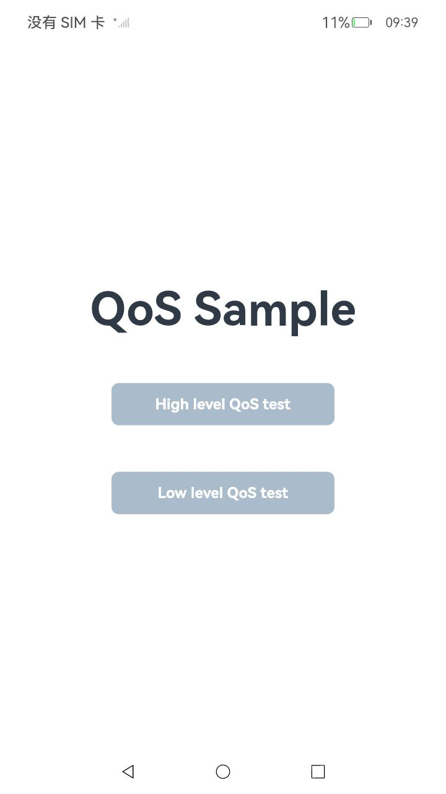
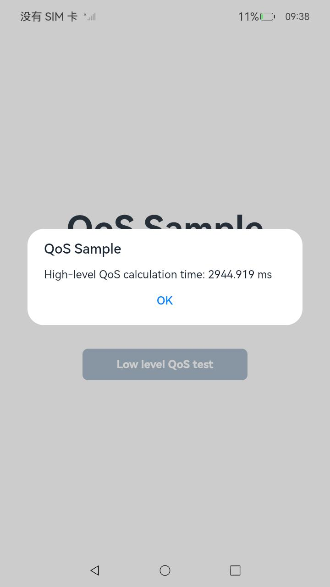
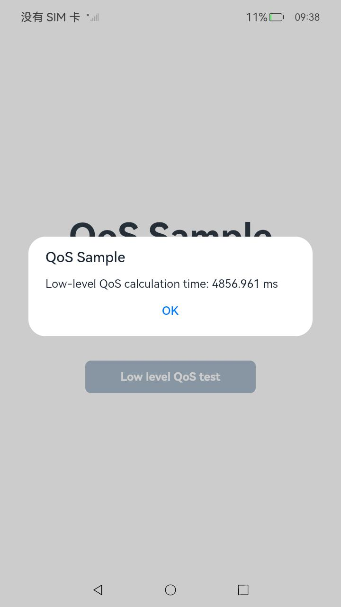
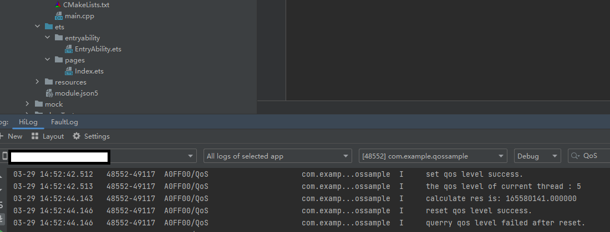

# Native QoS

### Introduction

This sample shows how to control thread QoS levels with the C APIs of [Native QoS](https://gitcode.com/openharmony/docs/blob/master/en/application-dev/kernel-enhance/qos-guidelines.md). It sets, queries and resets the QoS level of a thread, and displays the time cost of the same computation executed at different levels.

The sample is organized as a runnable and self-explanatory project:

- The home page keeps the one-tap comparison between the high and low levels.
- The **QoS level settings** page covers all six levels from `QOS_BACKGROUND` to `QOS_USER_INTERACTIVE`, and runs the computation asynchronously so that the UI is not blocked.
- The **Level benchmark** page repeats the computation for every level and aggregates the average, minimum and maximum durations.
- The **Concurrent stress test** page runs the computation on multiple threads with a given level.
- The **CPU topology and affinity** page queries the CPU count and the current affinity mask, and binds or unbinds the calling thread.
- The **Run records** page persists each experiment into a CSV file in the application sandbox and summarizes the stored records.

All native return codes are passed back to ArkTS, so every screen can show what the QoS APIs actually reported.

### Effect Preview

| Home page                            | High-level QoS calculation time                                | Low-level QoS calculation time                               |
| ------------------------------------ | -------------------------------------------------------------- | ------------------------------------------------------------ |
|  |       |       |

Log output

Filter the logs by the keyword "QoS" to view the logs related to QoS API calls, including the results of setting, querying and resetting the QoS level of a thread.



### Usage Instructions

1. Install the compiled HAP package and launch the application.
2. Tap **High level QoS test** or **Low level QoS test** on the home page. A dialog box shows the time cost of the computation performed by a thread created with that QoS level.
3. Filter the logs by the keyword "QoS" to view the time spent on QoS API calls and their results.
4. Tap **OK** in the dialog box to return to the home page.
5. Tap **QoS level settings**, select a level from `QOS_BACKGROUND` to `QOS_USER_INTERACTIVE`, and tap **Run calculation asynchronously**. The page shows the duration together with the return codes of `OH_QoS_SetThreadQoS`, `OH_QoS_GetThreadQoS`, `OH_QoS_ResetThreadQoS` and `sched_setaffinity`.
6. Tap **Level benchmark**, choose the rounds per level and tap **Run benchmark**. The table lists the average, minimum and maximum durations of each level, and the summary area shows the accumulated statistics of the process.
7. Tap **Concurrent stress test**, choose the level, the thread count and the rounds per thread, and tap **Run stress test** to view the pass count, fail count and duration range.
8. Tap **CPU topology and affinity** to view the CPU count and the affinity mask, select a target CPU and tap **Bind current thread**, or tap **Reset affinity** to restore all CPUs.
9. Tap **Run records**, choose a level and tap **Run and record** to append a record. Tap **Read records**, **Refresh stats** or **Clear records** to query or clear the record file.

### Project Structure

```
├──entry/src/main
│  ├──cpp                                // C++ code
│  │  ├──CMakeLists.txt                  // CMake build configuration
│  │  ├──main.cpp                        // NAPI registration and exported functions
│  │  ├──qos_core.cpp                    // One QoS experiment: set, query, bind, compute, reset
│  │  ├──qos_core.h                      // Declarations of the QoS experiment
│  │  ├──qos_bench.cpp                   // Level benchmark, concurrent stress test, level comparison
│  │  ├──qos_bench.h                     // Declarations of the benchmark reports
│  │  ├──qos_sysinfo.cpp                 // CPU topology and thread affinity
│  │  ├──qos_sysinfo.h                   // Declarations of the topology reports
│  │  ├──qos_history.cpp                 // Record file persistence, parsing and statistics
│  │  ├──qos_history.h                   // Declarations of the record reports
│  │  ├──qos_napi_util.h                 // Shared NAPI argument parsing and object building helpers
│  │  └──types
│  │      └──libentry
│  │          └──index.d.ts              // Declarations of the native interfaces exposed to ArkTS
│  ├──ets
│  │  ├──entryability
│  │  │  └──EntryAbility.ets             // Application entry
│  │  ├──model
│  │  │  └──QosLevelModel.ets            // QoS level names and option items
│  │  └──pages
│  │     ├──Index.ets                    // Home page
│  │     ├──QosLevelPage.ets             // QoS level settings page
│  │     ├──BenchmarkPage.ets            // Level benchmark page
│  │     ├──ConcurrencyPage.ets          // Concurrent stress test page
│  │     ├──DeviceInfoPage.ets           // CPU topology and affinity page
│  │     └──HistoryPage.ets              // Run records page
│  └──resources                          // Strings, colors and page configuration
└──entry/src/ohosTest                    // Automated test cases, see ohosTest.md
```

### Implementation

**Thread QoS level**

The QoS experiment is implemented in [qos_core.cpp](entry/src/main/cpp/qos_core.cpp). One experiment runs on the calling thread and follows a fixed sequence:

1. Call `OH_QoS_SetThreadQoS` to set the requested level.
2. Call `OH_QoS_GetThreadQoS` to read back the level, and print it in the log to verify the setting.
3. Call `sched_setaffinity` to pin the working thread to one CPU, so that the difference between levels is easier to observe.
4. Compute the 34th item of the Fibonacci sequence and measure the elapsed time in milliseconds.
5. Call `OH_QoS_ResetThreadQoS` to reset the level, and call `OH_QoS_GetThreadQoS` again to confirm the reset.

Before each experiment, the sample starts background load threads to simulate system load: the thread count is the CPU count minus one, capped at six, and each thread is set to `QOS_BACKGROUND` and bound to its own CPU. The working thread is bound to CPU 2, or to CPU 0 on devices with two or fewer cores. Keeping the load threads and the working thread on fixed CPUs makes the difference between levels easier to observe. The load threads do not print logs for every iteration: frequent `printf` calls fall back to hilog, compete for the same global lock with the UI thread, and can block the main thread. Load threads also pause briefly between computation segments to avoid starving the main thread, which would otherwise be reported as a `THREAD_BLOCK_6S` freeze.

The NAPI layer exports `useHighQos` and `useLowQos` for the home page, `useQos` and `useQosAsync` for the level settings page, and `getLastQosInfo` to read back the return codes and the duration of the latest experiment. Source code: [main.cpp](entry/src/main/cpp/main.cpp), [qos_core.cpp](entry/src/main/cpp/qos_core.cpp).

**Level benchmark, stress test and comparison**

[qos_bench.cpp](entry/src/main/cpp/qos_bench.cpp) provides `runLevelBenchmarkAsync`, which runs the experiment for each of the six levels in turn and aggregates the sample count, average, minimum and maximum durations. `runConcurrentAsync` runs the experiment on the requested number of threads, and `compareLevels` runs two levels sequentially and returns the ratio of their durations. `getRunSummary` and `resetRunSummary` maintain the statistics accumulated in the current process.

**CPU topology and affinity**

[qos_sysinfo.cpp](entry/src/main/cpp/qos_sysinfo.cpp) implements the NAPI entry points `getCpuTopology`, `bindCurrentThread` and `resetThreadAffinity`, which report the CPU count and the affinity mask of the calling thread. The affinity call itself is implemented in [qos_core.cpp](entry/src/main/cpp/qos_core.cpp). The mask is initialized with `CPU_ZERO` before `CPU_SET`, because an uninitialized mask may contain arbitrary bits.

**Run records**

[qos_history.cpp](entry/src/main/cpp/qos_history.cpp) appends every experiment to `qos_history.csv` in the directory passed by ArkTS, which is `context.filesDir` of the application sandbox. Each line has the format `level,duration,setResult,queryLevel,resetResult,bindResult`. The file keeps at most 200 records and drops the oldest ones first. The module also provides the record query, statistics, clear and single-line parsing interfaces.

**Native QoS interfaces**

The sample uses the C API declared in `qos/qos.h` and links `libqos.so` in [CMakeLists.txt](entry/src/main/cpp/CMakeLists.txt):

| Interface | Description |
| -------- | -------- |
| int OH_QoS_SetThreadQoS(QoS_Level level) | Sets the QoS level of the current thread. |
| int OH_QoS_GetThreadQoS(QoS_Level *level) | Obtains the QoS level of the current thread. |
| int OH_QoS_ResetThreadQoS() | Resets the QoS level of the current thread. |

The `QoS_Level` enumeration used by the sample:

| Value | Level | Description |
| -------- | -------- | -------- |
| 0 | `QOS_BACKGROUND` | Task that is not visible to users. |
| 1 | `QOS_UTILITY` | Important background task. |
| 2 | `QOS_DEFAULT` | Default level. |
| 3 | `QOS_USER_INITIATED` | Task triggered by users. |
| 4 | `QOS_DEADLINE_REQUEST` | Time-limited task. |
| 5 | `QOS_USER_INTERACTIVE` | User interaction task. |

All interfaces exported to ArkTS are declared in [index.d.ts](entry/src/main/cpp/types/libentry/index.d.ts).

For details about the interfaces, see [qos.h](https://gitcode.com/openharmony/docs/blob/master/en/application-dev/reference/apis-kernel-enhance-kit/capi-qos-h.md) and [Native QoS](https://gitcode.com/openharmony/docs/blob/master/en/application-dev/kernel-enhance/qos-guidelines.md).

### Permissions

Not involved.

The thread QoS APIs do not expose a permission name that must be requested. When a call fails due to insufficient permission, the return code is `201`.

### Dependencies

No third-party dependency is involved.

### Constraints & Limitations

1. This sample runs on standard systems only.
2. This sample uses the Stage model. It is compiled with the API version 26.0.0 SDK. The SDK version is 26.0.0 and the image version is 6.1 Release.
3. DevEco Studio 26.0.0.821 or later is required to build and run this sample.
4. A QoS level applies to the calling thread only. Valid values are 0 to 5 and are the same as the `QoS_Level` enumeration.
5. The measured durations depend on the scheduling policy of the device and on the current system load, so the numbers vary between runs and between devices.
6. The run record file keeps at most 200 records. New records replace the oldest ones when the capacity is reached.

### Download

To download this project separately, run the following commands:

```
git init
git config core.sparsecheckout true
echo code/BasicFeature/Native/NdkQoS/ > .git/info/sparse-checkout
git remote add origin https://gitcode.com/openharmony/applications_app_samples.git
git pull origin master
```
