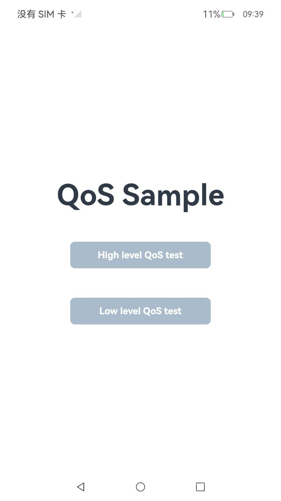
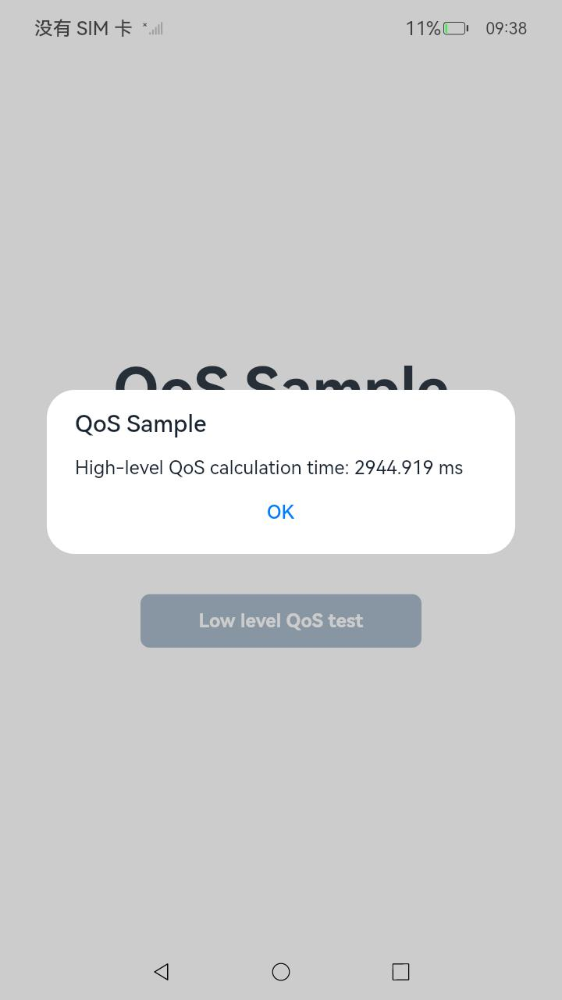
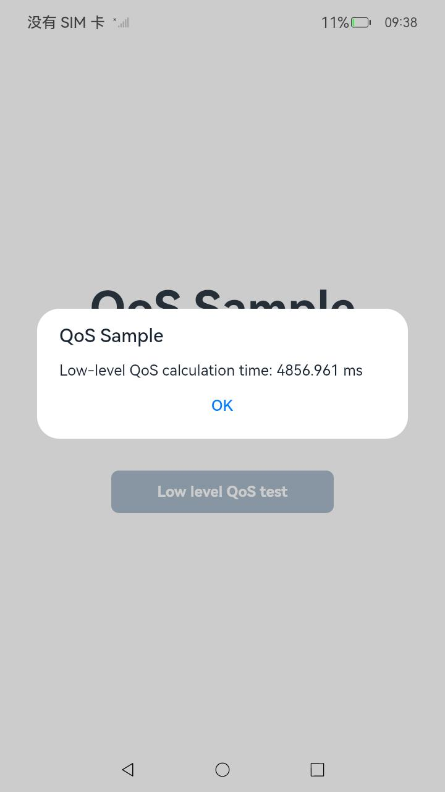
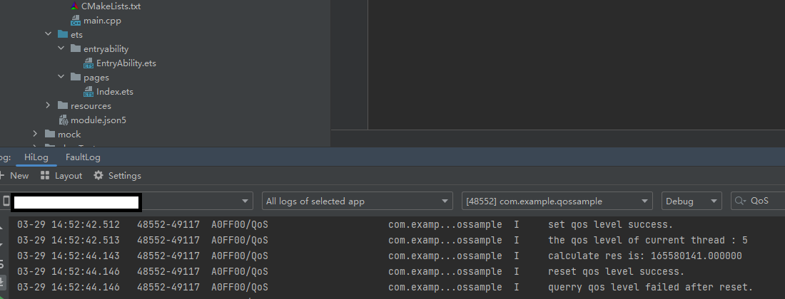

# Native QoS

### 介绍

本示例介绍如何使用 Native QoS 的 C API 完成线程 QoS 等级控制，包括设置，查询与重置线程的 QoS 等级，并通过界面展示不同等级线程完成同一计算任务的耗时差异。完整接口说明请参考 [Native QoS](https://gitcode.com/openharmony/docs/blob/master/zh-cn/application-dev/kernel-enhance/qos-guidelines.md)。

工程按完整示例组织，同时兼顾可运行与可教学：

- 主页保留高等级与低等级的一键对比入口。
- **QoS 等级设置**页覆盖 `QOS_BACKGROUND` 至 `QOS_USER_INTERACTIVE` 共 6 个等级，并以异步方式执行计算，界面不会被阻塞。
- **等级基准测试**页对每个等级重复执行计算，并汇总平均耗时，最小耗时与最大耗时。
- **并发压测**页以指定等级在多个线程上并发执行计算。
- **CPU 拓扑与亲和性**页查询 CPU 核数与当前亲和性掩码，并可绑定或解除绑定调用线程。
- **实验记录**页把每次实验写入应用沙箱中的 CSV 文件，并对已存记录做统计。

所有 Native 返回码都会回到 ArkTS 侧展示，因此每个页面都能看到 QoS 接口的真实返回结果。

### 效果预览

| 主页                                 | 弹窗显示高等级 QoS 任务计算时间                                    | 弹窗显示低等级 QoS 任务计算时间                                            |
| ------------------------------------ | -------------------------------------------------------------- | ------------------------------------------------------------ |
|  |       |       |

日志打印

在日志中过滤 "QoS" 关键字，可以看到与 QoS 接口调用相关的日志打印，包括设置线程 QoS 等级的结果，查询线程 QoS 等级的结果以及重置线程 QoS 等级的结果。



### 使用说明

1. 安装编译生成的 HAP 包并打开应用。
2. 点击主页的 "High level QoS test" 或 "Low level QoS test" 按钮，页面将弹窗显示使用该 QoS 等级的线程完成计算任务所花费的时间。
3. 在日志中过滤 "QoS" 关键字，可以查看调用 QoS 接口的耗时与返回结果。
4. 点击弹窗中的 "OK" 按钮返回主页。
5. 点击 "QoS 等级设置"，选择 `QOS_BACKGROUND` 至 `QOS_USER_INTERACTIVE` 中的任一等级后点击 "异步执行计算任务"。页面会展示耗时，以及 `OH_QoS_SetThreadQoS`，`OH_QoS_GetThreadQoS`，`OH_QoS_ResetThreadQoS` 与 `sched_setaffinity` 的返回码。
6. 点击 "等级基准测试"，选择每等级轮次后点击 "开始基准测试"。表格按等级列出平均耗时，最小耗时与最大耗时，统计区展示进程内的累计数据，"刷新统计" 与 "清零统计" 用于回读与清零。
7. 点击 "并发压测"，选择 QoS 等级，线程数与每线程轮次后点击 "开始压测"，查看成功次数，失败次数与耗时区间。
8. 点击 "CPU 拓扑与亲和性" 查看 CPU 核数与亲和性掩码，选择要绑定的核后点击 "绑定当前线程"，或点击 "解除绑定" 恢复为全部核可用。
9. 点击 "实验记录"，选择等级后点击 "运行并记录" 追加一条记录；点击 "读取记录"，"刷新统计" 或 "清空记录" 查询或清空记录文件。

### 工程目录

```
├──entry/src/main
│  ├──cpp                                // C++ 代码区
│  │  ├──CMakeLists.txt                  // CMake 编译与链接配置
│  │  ├──main.cpp                        // NAPI 模块注册与导出函数
│  │  ├──qos_core.cpp                    // 单次 QoS 实验：设置，回读，绑核，计算，重置
│  │  ├──qos_core.h                      // 单次实验的数据结构声明
│  │  ├──qos_bench.cpp                   // 等级基准测试，并发压测与等级对比
│  │  ├──qos_bench.h                     // 测试报告的数据结构声明
│  │  ├──qos_sysinfo.cpp                 // CPU 拓扑与线程亲和性
│  │  ├──qos_sysinfo.h                   // 拓扑报告的数据结构声明
│  │  ├──qos_history.cpp                 // 记录文件读写，解析与统计
│  │  ├──qos_history.h                   // 记录报告的数据结构声明
│  │  ├──qos_napi_util.h                 // NAPI 参数解析与对象构造的公共封装
│  │  └──types
│  │      └──libentry
│  │          └──index.d.ts              // native 侧暴露给 ArkTS 侧接口的声明
│  ├──ets
│  │  ├──entryability
│  │  │  └──EntryAbility.ets             // 程序入口类
│  │  ├──model
│  │  │  └──QosLevelModel.ets            // QoS 等级名称与选项
│  │  └──pages
│  │     ├──Index.ets                    // 主界面
│  │     ├──QosLevelPage.ets             // QoS 等级设置页
│  │     ├──BenchmarkPage.ets            // 等级基准测试页
│  │     ├──ConcurrencyPage.ets          // 并发压测页
│  │     ├──DeviceInfoPage.ets           // CPU 拓扑与亲和性页
│  │     └──HistoryPage.ets              // 实验记录页
│  └──resources                          // 字符串，颜色与页面配置
└──entry/src/ohosTest                    // 自动化测试用例，详见 ohosTest.md
```

### 具体实现

**线程 QoS 等级**

单次 QoS 实验实现在 [qos_core.cpp](entry/src/main/cpp/qos_core.cpp)，运行在调用线程上，固定执行以下步骤：

1. 调用 `OH_QoS_SetThreadQoS` 设置本次实验要求的等级。
2. 调用 `OH_QoS_GetThreadQoS` 回读等级，并通过日志打印，用于确认设置是否生效。
3. 调用 `sched_setaffinity` 把工作线程绑定到一个 CPU 核，使不同等级之间的差异更容易观察。
4. 计算斐波那契数列第 34 项，并统计耗时，单位为毫秒。
5. 调用 `OH_QoS_ResetThreadQoS` 重置等级，再次调用 `OH_QoS_GetThreadQoS` 确认重置结果。

每次实验前会拉起一批负载线程模拟系统负载：线程数为 CPU 核数减一，上限为 6，均设置为 `QOS_BACKGROUND` 并各自绑定到一个 CPU 核；工作线程则绑定到 CPU 2，核数不超过 2 时绑定 CPU 0。把负载线程与工作线程固定在确定的核上，可以让不同等级之间的耗时差异更明显。负载线程不会逐次打印日志：高频 `printf` 会经 stdout 落到 hilog，与界面线程争抢同一把全局锁，导致主线程长时间阻塞。负载线程在每段计算之间还会短暂休眠，避免把主线程饿住而被看门狗判定为 `THREAD_BLOCK_6S` 冻屏。

NAPI 层为主页导出 `useHighQos` 与 `useLowQos`，为等级设置页导出 `useQos` 与 `useQosAsync`，并通过 `getLastQosInfo` 回读最近一次实验的各接口返回码与耗时。源码参考：[main.cpp](entry/src/main/cpp/main.cpp)，[qos_core.cpp](entry/src/main/cpp/qos_core.cpp)。

**等级基准测试，并发压测与等级对比**

[qos_bench.cpp](entry/src/main/cpp/qos_bench.cpp) 中的 `runLevelBenchmarkAsync` 依次对 6 个等级执行实验，并汇总样本数，平均耗时，最小耗时与最大耗时。`runConcurrentAsync` 在指定线程数上并发执行实验，`compareLevels` 先后以两个等级各执行一次并返回耗时比值。`getRunSummary` 与 `resetRunSummary` 维护进程内累计的统计数据。

**CPU 拓扑与亲和性**

[qos_sysinfo.cpp](entry/src/main/cpp/qos_sysinfo.cpp) 实现 `getCpuTopology`，`bindCurrentThread` 与 `resetThreadAffinity` 三个 NAPI 入口，用于返回 CPU 核数与调用线程的亲和性掩码；绑核调用本身实现在 [qos_core.cpp](entry/src/main/cpp/qos_core.cpp)。设置掩码前会先调用 `CPU_ZERO`，因为未初始化的掩码可能包含随机位。

**实验记录**

[qos_history.cpp](entry/src/main/cpp/qos_history.cpp) 把每次实验追加到 ArkTS 传入目录下的 `qos_history.csv`，该目录为应用沙箱的 `context.filesDir`。每行格式为 `level,duration,setResult,queryLevel,resetResult,bindResult`。文件最多保留 200 条记录，超出后丢弃最旧记录。该模块同时提供记录查询，统计，清空与单行解析接口。

**Native QoS 接口**

本示例使用 `qos/qos.h` 中的 C 接口，并在 [CMakeLists.txt](entry/src/main/cpp/CMakeLists.txt) 中链接 `libqos.so`：

| 接口名 | 描述 |
| -------- | -------- |
| int OH_QoS_SetThreadQoS(QoS_Level level) | 设置当前线程的 QoS 等级。 |
| int OH_QoS_GetThreadQoS(QoS_Level *level) | 获取当前线程的 QoS 等级。 |
| int OH_QoS_ResetThreadQoS() | 重置当前线程的 QoS 等级。 |

本示例使用的 `QoS_Level` 枚举取值：

| 取值 | 等级 | 描述 |
| -------- | -------- | -------- |
| 0 | `QOS_BACKGROUND` | 用户不可见任务。 |
| 1 | `QOS_UTILITY` | 后台重要任务。 |
| 2 | `QOS_DEFAULT` | 默认等级。 |
| 3 | `QOS_USER_INITIATED` | 用户触发任务。 |
| 4 | `QOS_DEADLINE_REQUEST` | 限时任务。 |
| 5 | `QOS_USER_INTERACTIVE` | 用户交互任务。 |

暴露给 ArkTS 侧的全部接口声明见 [index.d.ts](entry/src/main/cpp/types/libentry/index.d.ts)。

接口细节请参考 [qos.h](https://gitcode.com/openharmony/docs/blob/master/zh-cn/application-dev/reference/apis-kernel-enhance-kit/capi-qos-h.md) 与 [Native QoS](https://gitcode.com/openharmony/docs/blob/master/zh-cn/application-dev/kernel-enhance/qos-guidelines.md)。

### 相关权限

不涉及。

线程 QoS 接口未公开申请型权限名，权限不足时返回码为 `201`。

### 依赖

不涉及第三方依赖。

### 约束与限制

1. 本示例仅支持在标准系统上运行。
2. 本示例为 Stage 模型，使用 API version 26.0.0 版本 SDK 编译，SDK 版本号为 26.0.0，镜像版本号为 6.1 Release。
3. 本示例需要使用 DevEco Studio 26.0.0.821 及以上版本才可编译运行。
4. QoS 等级只作用于调用线程，等级取值 0 至 5，与 `QoS_Level` 枚举一致。
5. 实测耗时受设备调度策略与当前系统负载影响，不同运行次数与不同设备之间数值会有差异。
6. 实验记录文件最多保留 200 条，达到容量上限后新记录会覆盖最旧记录。

### 下载

如需单独下载本工程，执行如下命令：

```
git init
git config core.sparsecheckout true
echo code/BasicFeature/Native/NdkQoS/ > .git/info/sparse-checkout
git remote add origin https://gitcode.com/openharmony/applications_app_samples.git
git pull origin master
```
