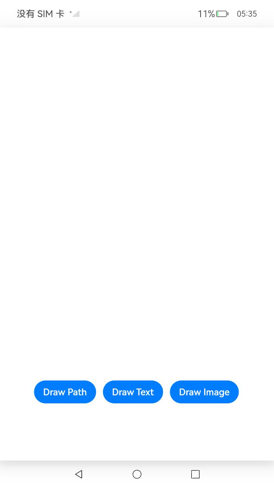
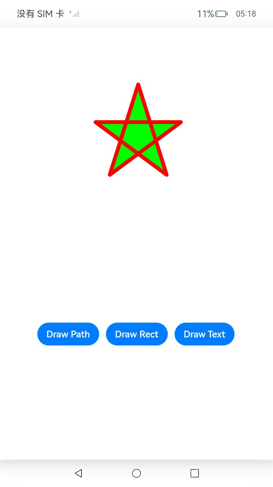
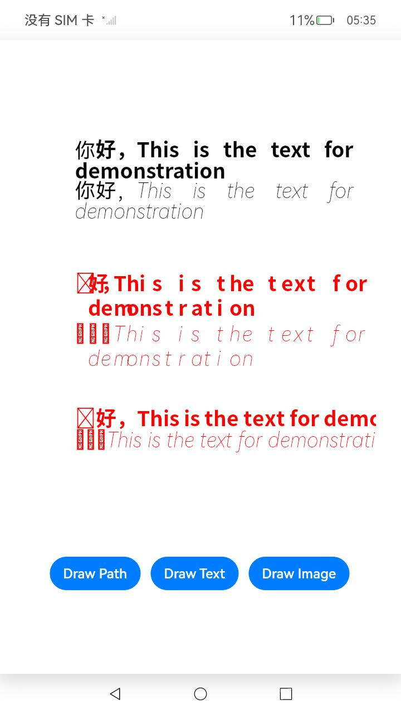
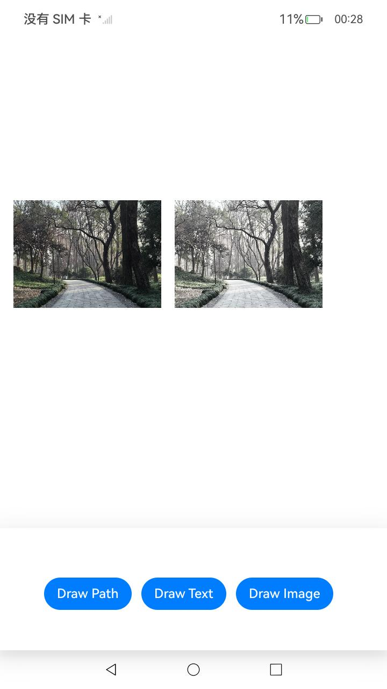

# Native RenderNode Drawing

### Introduction

This sample shows how to draw custom content on a page with a self-drawn render node (`RenderNode`) that calls the
Drawing APIs through a Node-API bridge.
The sample is organized as "capability navigation home page + capability matrix catalog + RenderNode topic catalog +
39 demo pages (10 topic pages + 10 basic demo pages + 19 capability domain pages)" and covers six capability groups:

1. Native Drawing: geometric primitives, drawing effects, canvas transforms, image drawing, text drawing and
   text measurement;
2. RenderNode capabilities: node tree append and remove, render properties, lifecycle and disposal;
3. Capabilities added in API 26: background blur, content blur and foreground blur;
4. Unified scene dispatch and parameter validation: ArkTS only passes a scene index, and the C++ side validates it
   and dispatches it to the matching drawing module;
5. Schema-driven capability matrix (P3–P5): 19 capability domains — canvas, geometry, paint, color, color filter,
   shader, mask filter, image filter, bitmap, pixel map, image stream, font, TextBlob, typography, shadow, matrix,
   record, offscreen layer and error code — with 188 scenes; both the parameter panel and the native dispatch are
   generated from the schema;
6. Node-level RenderNode topics (P6): node tree, render properties, blur layer, animation, hit test, performance,
   record and replay, multi-device adaptation, lifecycle and frame callback — 10 topic pages with 40 scenes, all
   driven by `TopicNodeController` and `TopicEngine`.

### Effect Preview

> The `screenshots` directory still holds the drawing screenshots taken before this refactoring, and the
> screenshots of the new demo pages will be added after the device regression.

| Home page | Draw Path | Draw Text | Draw Image |
| ------------------------------------ |------------------------------------| ------------------------------------ | ------------------------------------ |
|  |  |  |  |

### Usage Instructions

1. Install the compiled HAP package and launch the application. The home page is the capability navigation list.
2. Tap **Canvas Drawing** to open the original three-primitive demo, where path, text and image drawing can be
   switched.
3. Tap **Primitives**, **Drawing Effects** and **Canvas Transform** to view primitives, effects and canvas
   transforms respectively.
4. Tap **Image Drawing** and **Text Drawing** to view image drawing, text layout and text measurement.
5. Tap **Node Tree**, **Render Properties**, **Blur Effects** and **Lifecycle** to try the RenderNode node tree,
   render properties, blur and lifecycle.
6. Tap **Capability Matrix** to open the capability matrix catalog and then any of the 19 capability domains: switch
   scenes with the scene buttons and drag the parameter sliders, and the canvas is redrawn with the current
   parameters; tap **Reset** to restore the default parameters of that scene.
7. Tap **RenderNode Topics** to open the topic catalog and then any of the 10 node-level topics: **Re-apply**
   re-dispatches the scene with the current parameters, and the status bar shows the node count, the redraw count,
   the touch count and the rebuild count; in the hit test topic, tap the canvas to see the index of the hit child
   node.

### Capability Matrix

The table below matches the group definitions under `entry/src/main/ets/schema` one to one, and the scene counts
and parameter counts are identical to the runtime values.
The scene buttons, the parameter panel and the native dispatch of a capability domain page are all generated from
the schema, so adding a scene only requires one more schema entry and one more native scene function.

| # | Group key | Title resource key | Scenes | Parameters | Demo page |
| -------- | -------- | -------- | -------- | -------- | -------- |
| 1 | canvas | cap_canvas_group_title | 10 | 20 | pages/CapabilityCanvasDemo |
| 2 | geometry | cap_geometry_group_title | 11 | 23 | pages/CapabilityGeometryDemo |
| 3 | paint | cap_paint_group_title | 10 | 20 | pages/CapabilityPaintDemo |
| 4 | color | cap_color_group_title | 9 | 19 | pages/CapabilityColorDemo |
| 5 | colorFilter | cap_color_filter_group_title | 9 | 18 | pages/CapabilityColorFilterDemo |
| 6 | shader | cap_shader_group_title | 11 | 22 | pages/CapabilityShaderDemo |
| 7 | mask_filter | cap_mask_filter_group_title | 8 | 25 | pages/CapabilityMaskFilterDemo |
| 8 | image_filter | cap_image_filter_group_title | 10 | 28 | pages/CapabilityImageFilterDemo |
| 9 | bitmap | cap_bitmap_group_title | 10 | 19 | pages/CapabilityBitmapDemo |
| 10 | pixelmap | cap_pixel_map_group_title | 12 | 23 | pages/CapabilityPixelMapDemo |
| 11 | image_io | cap_image_io_group_title | 10 | 16 | pages/CapabilityImageIoDemo |
| 12 | font | cap_font_group_title | 12 | 23 | pages/CapabilityFontDemo |
| 13 | textblob | cap_text_blob_group_title | 8 | 15 | pages/CapabilityTextBlobDemo |
| 14 | typography | cap_typography_group_title | 14 | 30 | pages/CapabilityTypographyDemo |
| 15 | shadow | cap_shadow_group_title | 8 | 19 | pages/CapabilityShadowDemo |
| 16 | matrix | cap_matrix_group_title | 10 | 27 | pages/CapabilityMatrixDemo |
| 17 | record | cap_record_group_title | 8 | 14 | pages/CapabilityRecordDemo |
| 18 | offscreen | cap_offscreen_group_title | 8 | 15 | pages/CapabilityOffscreenDemo |
| 19 | error | cap_error_group_title | 10 | 13 | pages/CapabilityErrorDemo |
| Subtotal | 19 capability domains | - | 188 | 389 | - |

Topic pages do not go through the native bridge: `TopicNodeController` creates and operates the node tree directly.
They are numbered 20–29:

| # | Topic key | Title resource key | Scenes | Parameters | Demo page |
| -------- | -------- | -------- | -------- | -------- | -------- |
| 20 | topic-node-tree | topic_node_tree_group_title | 4 | 10 | pages/TopicNodeTreeDemo |
| 21 | topic-render-prop | topic_render_prop_group_title | 4 | 13 | pages/TopicRenderPropDemo |
| 22 | topic-blur | topic_blur_group_title | 4 | 9 | pages/TopicBlurDemo |
| 23 | topic-animation | topic_animation_group_title | 4 | 12 | pages/TopicAnimationDemo |
| 24 | topic-hit-test | topic_hit_test_group_title | 4 | 8 | pages/TopicHitTestDemo |
| 25 | topic-performance | topic_performance_group_title | 4 | 9 | pages/TopicPerformanceDemo |
| 26 | topic-record | topic_record_group_title | 4 | 7 | pages/TopicRecordDemo |
| 27 | topic-multi-device | topic_multi_device_group_title | 4 | 8 | pages/TopicMultiDeviceDemo |
| 28 | topic-lifecycle | topic_lifecycle_group_title | 4 | 8 | pages/TopicLifecycleDemo |
| 29 | topic-frame-tick | topic_frame_tick_group_title | 4 | 7 | pages/TopicFrameTickDemo |
| Subtotal | 10 topics | - | 40 | 91 | - |

### Project Structure

```
├──entry/src/main
│  ├──cpp                           // C++ code
│  │  ├──CMakeLists.txt             // CMake configuration, collects the bridge and all drawing modules
│  │  ├──native_bridge.cpp          // N-API registration, parameter validation and scene dispatch
│  │  ├──common
│  │  │  └──log_common.h            // Log wrapper
│  │  ├──drawing                    // Native Drawing modules
│  │  │  ├──scene_type.h            // Scene and kind enums, mirroring the ArkTS constants
│  │  │  ├──drawing_util.h          // Shared helpers such as color constants and rect creation
│  │  │  ├──drawing_shape.cpp/.h    // Point, line, circle, oval, rect, round rect, arc, path and region
│  │  │  ├──drawing_effect.cpp/.h   // Fill/stroke, blend mode, path effect, gradient, filters, mask filter
│  │  │  ├──drawing_transform.cpp/.h// Clip, translate, rotate, scale, matrix, save and restore
│  │  │  ├──drawing_image.cpp/.h    // PixelMap drawing, sampling modes and scaling
│  │  │  └──drawing_text.cpp/.h     // TextBlob, typography and text measurement
│  │  ├──capability                 // The 19 schema-driven capability domains (P3–P5)
│  │  │  ├──capability_type.h       // Capability domain and scene enums, mirroring ets/schema
│  │  │  ├──param_bag.h             // Lookup, default fallback and index clamping of the parameter array
│  │  │  ├──cap_util.cpp/.h        // Percentage coordinate frame, palette, pen and path helpers
│  │  │  ├──cap_text_util.cpp/.h   // Sample font loading and typography bundle helpers
│  │  │  ├──capability_dispatch.cpp/.h // group/scene range guard and dispatch entry
│  │  │  ├──cap_canvas.cpp/.h       // Canvas and clipping, 10 scenes
│  │  │  ├──cap_geometry.cpp/.h     // Primitives, paths and boolean operations, 11 scenes
│  │  │  ├──cap_paint.cpp/.h        // Pen, path effect and shadow, 10 scenes
│  │  │  ├──cap_color.cpp/.h        // Palette, color mixing and channel reorder, 9 scenes
│  │  │  ├──cap_color_filter.cpp/.h // Color matrix, brightness and lighting, 9 scenes
│  │  │  ├──cap_shader.cpp/.h       // Linear/radial/sweep/conical gradients and tiling, 11 scenes
│  │  │  └──cap_*.cpp/.h            // The other 13 domains: mask filter, image filter, bitmap, pixel map,
│  │  │                             // image stream, font, TextBlob, typography, shadow, matrix, record,
│  │  │                             // offscreen layer and error code
│  │  ├──types/libentry
│  │  │  └──index.d.ts              // Declarations of the native interfaces exposed to ArkTS
│  ├──ets                           // ArkTS code
│  │  ├──entryability
│  │  │  └──EntryAbility.ets        // Application entry
│  │  ├──common                     // Shared helpers
│  │  │  ├──Logger.ets              // hilog wrapper with a single DOMAIN and TAG
│  │  │  ├──SceneType.ets           // Scene and kind constants
│  │  │  ├──UnitUtil.ets            // Pixel and vp conversion
│  │  │  ├──DemoRenderNode.ets      // DemoRenderNode and DemoNodeController
│  │  │  ├──PixelMapUtil.ets        // rawfile image decoding and release
│  │  │  ├──DemoTitle.ets           // Page title and back button
│  │  │  └──ScenePanel.ets          // Generic "canvas + button group" panel
│  │  ├──core                       // Schema-driven core layer (P1, P6)
│  │  │  ├──SchemaTypes.ets         // ParamSpec / SceneSpec / GroupSpec and factory functions
│  │  │  ├──ParamEngine.ets         // Defaults, range clamping and parameter summary
│  │  │  ├──SceneRenderNode.ets     // CapabilityRenderNode and CapabilityController
│  │  │  ├──TopicTypes.ets          // Topic numbers 20–29, row/column constants and state snapshot
│  │  │  ├──TopicNode.ets           // TopicNodeController: canvas, child tree, properties, animation, stats
│  │  │  └──TopicEngine.ets         // Topic dispatch: topic number + scene + parameters → controller calls
│  │  ├──schema                     // Scene definitions (P3–P6)
│  │  │  ├──CapabilityCanvas.ets    // Canvas and clipping, 10 scenes
│  │  │  ├──CapabilityGeometry.ets  // Primitives and boolean operations, 11 scenes
│  │  │  ├──CapabilityPaint.ets     // Pen and path effects, 10 scenes
│  │  │  ├──CapabilityColor.ets     // Color model, 9 scenes
│  │  │  ├──CapabilityColorFilter.ets // Color filters, 9 scenes
│  │  │  ├──CapabilityShader.ets    // Gradients and shaders, 11 scenes
│  │  │  ├──Capability*.ets         // Scene definitions of the other 13 domains, one to one with cap_*.cpp
│  │  │  └──Topic*.ets              // Scene definitions of the 10 topic pages, matching the TopicEngine indexes
│  │  ├──widgets                    // Shared controls
│  │  │  ├──ParamPanel.ets          // Slider/switch/dropdown panel rendered from a ParamSpec
│  │  │  ├──GroupHost.ets           // Capability host: scene switch + parameter panel + canvas
│  │  │  └──TopicHost.ets           // Topic host: also writes the touch hit result back to the status bar
│  │  ├──pages                      // Pages
│  │     ├──Index.ets               // Capability navigation home page
│  │     ├──DrawDemo.ets            // Original three-primitive demo
│  │     ├──PrimitiveDemo.ets       // Geometric primitives
│  │     ├──EffectDemo.ets          // Drawing effects
│  │     ├──TransformDemo.ets       // Canvas transforms
│  │     ├──ImageDemo.ets           // Image drawing
│  │     ├──TextDemo.ets            // Text drawing and measurement
│  │     ├──NodeTreeDemo.ets        // Node tree append and remove
│  │     ├──RenderPropertyDemo.ets  // Render properties
│  │     ├──BlurDemo.ets            // API 26 blur effects
│  │     ├──LifecycleDemo.ets       // Node lifecycle
│  │     ├──Catalog.ets             // Capability matrix catalog (19 domain entries)
│  │     ├──CapabilityCanvasDemo.ets and 18 more capability domain pages (only declare GroupHost)
│  │     ├──TopicCatalog.ets        // RenderNode topic catalog (10 topic entries)
│  │     └──Topic*Demo.ets          // 10 topic pages (only declare TopicHost)
│  ├──resources                     // Resources
```

### Implementation

The sample is built on the Stage model and the Native C++ template. `native_bridge.cpp` exposes three interfaces
to ArkTS: `nativeRenderDraw(context, width, height, scene, kind, pixelMap?)`,
`nativeRenderScene(context, width, height, group, scene, params, pixelMap?)` and
`nativeMeasureText(text, fontSize, maxWidth)`; the last argument of the two drawing interfaces is an optional
`PixelMap`.

1. On the ArkTS side, `DemoRenderNode` extends `RenderNode`. In `draw(context)` it reads the pixel size from
   `context.sizeInPixel` and passes it to the bridge together with the scene index, so the global `vp2px` that is
   deprecated since API 18 is not used;
2. `DemoNodeController` extends `NodeController`. `makeNode` creates a `FrameNode` and mounts `DemoRenderNode` on
   it, `NodeContainer.onAreaChange` drives the size changes, and `dispose` releases the node when the page exits;
3. The bridge validates the argument count, the argument types, the non-null canvas and the scene range, and then
   dispatches to the `drawing_shape`, `drawing_effect`, `drawing_transform`, `drawing_image` and `drawing_text`
   modules;
4. Image drawing reads the real pixel map size through `OH_PixelMap_GetImageInfo`, and text drawing probes the font
   file with `access` and falls back to the system font collection on failure, so neither the size nor the font path
   is hard-coded;
5. The ArkTS side reuses the node tree, the render properties, `backgroundBlur/contentBlur/foregroundBlur` (API 26)
   and `label/invalidate/dispose/rebuild` of `RenderNode`, each driven by the matching demo page;
6. The capability matrix is schema-driven: `GroupSpec → SceneSpec → ParamSpec` describes scenes and parameters in
   three levels, `ParamPanel` picks a slider, a switch or a dropdown control by `kind`, and `SceneRenderNode` hands
   the parameter array to `nativeRenderScene` in `draw()`. On the native side `ParamBag` looks the values up by
   index and `capability_dispatch.cpp` dispatches by `group + scene` to the matching scene function, so adding a
   scene only requires one more schema entry and one more native scene function;
7. Topic pages do not go through native code: `TopicNodeController` extends `NodeController` and creates a canvas
   `RenderNode` plus several child nodes in `makeNode`. `TopicEngine.apply()` translates "topic number + scene
   number + parameter array" into tree building, property, timer and record calls, the local coordinates reported
   by `onTouchEvent` are turned into the index of the hit child node by rectangle containment, and the status bar
   shows the node, redraw, touch and rebuild counters.

### Resource Localization and UI Locators

1. All UI text is referenced through `$r('app.string.*')`. The `string.json` files under `resources/base`,
   `resources/en_US` and `resources/zh_CN` contain 605 keys each, with identical key names. New text must be added
   to all three, otherwise the missing key is rejected by the compile-time resource validation;
2. The titles, descriptions, scene titles and scene descriptions of the capability domains and topics, together
   with the scene switch buttons below the demo canvas, also use `$r`; no English text is hard-coded in the schema
   or in the scene buttons, so the catalog, the parameter panel, the scene buttons and the scene descriptions
   switch together with the system language;
3. UI colors are centralized in `resources/base/element/color.json` (including the card background and the selected
   text color), and the ArkTS code no longer writes color values directly; `resources/dark/element/color.json`
   overrides only the launch page background, so the natively drawn canvas keeps its fixed light palette;
4. Interactive controls carry stable ids named `<usage>_<group key>`, with `_<scene number>` appended for
   scene-related controls, so that controls of the same kind can be found by id: catalog entry
   `catalog_item_canvas`, scene button `scene_btn_canvas_3`, scene description `scene_desc_canvas_3`, parameter
   reset `params_reset_canvas`, topic re-apply `params_reapply_topic-blur`, page back `nav_back_canvas`;
5. The cases under `entry/src/ohosTest` locate controls only by the ids above and by `Driver.pressBack()`, never by
   UI text, so the test results do not depend on the system language.

Source code: the files under the [cpp](entry/src/main/cpp) and [ets](entry/src/main/ets) directories.

Interfaces involved:

| Interface | Description |
| -------- | -------- |
| OH_Drawing_CanvasAttachBrush (OH_Drawing_Canvas *, const OH_Drawing_Brush *) | Sets a brush for the canvas. The canvas fills the shapes it draws with the brush style and color. |
| OH_Drawing_CanvasAttachPen (OH_Drawing_Canvas *, const OH_Drawing_Pen *) | Sets a pen for the canvas. The canvas strokes the outlines of the shapes it draws with the pen style and color. |
| OH_Drawing_CanvasDetachBrush (OH_Drawing_Canvas *) | Clears the brush that has been set on the canvas. |
| OH_Drawing_CanvasDetachPen (OH_Drawing_Canvas *) | Clears the pen that has been set on the canvas. |
| OH_Drawing_CanvasDrawPath (OH_Drawing_Canvas *, const OH_Drawing_Path *) | Draws a custom path. |
| OH_Drawing_CanvasDrawRect (OH_Drawing_Canvas *, const OH_Drawing_Rect *) | Draws a rectangle. |
| OH_Drawing_PathCreate (void) | Creates a path object. |
| OH_Drawing_PathMoveTo (OH_Drawing_Path *, float x, float y) | Sets the start point of a custom path. |
| OH_Drawing_PathLineTo (OH_Drawing_Path *, float x, float y) | Adds a line segment to the target point. |
| OH_Drawing_PathClose (OH_Drawing_Path *) | Closes the path by adding a segment back to its start point. |
| OH_Drawing_PathDestroy (OH_Drawing_Path *) | Destroys the path object. |
| OH_Drawing_RectCreate (float left, float top, float right, float bottom) | Creates a rectangle object. |
| OH_Drawing_RectDestroy (const OH_Drawing_Rect *) | Destroys the rectangle object. |
| OH_Drawing_PenCreate (void) | Creates a pen object. |
| OH_Drawing_PenSetAntiAlias (OH_Drawing_Pen *, bool) | Sets anti-aliasing. When enabled, the edges of the drawn shapes are blended semi-transparently with the surrounding pixels. |
| OH_Drawing_PenSetWidth (OH_Drawing_Pen *, float width) | Sets the pen width, which is the width of the outline the pen strokes. |
| OH_Drawing_PenDestroy (const OH_Drawing_Pen *) | Destroys the pen object. |
| OH_Drawing_BrushCreate (void) | Creates a brush object. |
| OH_Drawing_BrushSetColor (OH_Drawing_Brush *, uint32_t color) | Sets the brush color used to fill shapes, expressed as a 32-bit ARGB value. |
| OH_Drawing_BrushDestroy (const OH_Drawing_Brush *) | Destroys the brush object. |
| OH_Drawing_CreateTypographyStyle (void) | Creates a typography style object that defines the typography style. |
| OH_Drawing_CreateTextStyle (void) | Creates a text style object that defines the text style. |
| OH_Drawing_TypographyHandlerAddText (OH_Drawing_TypographyCreate *, const char *) | Sets the text content. |
| OH_Drawing_SetTextStyleFontFamilies (OH_Drawing_TextStyle* , int , const char* fontFamilies[] ) | Sets the font families. |
| OH_Drawing_RegisterFont (OH_Drawing_FontCollection* , const char* fontFamily, const char* familySrc ) | Registers a font buffer in the font manager. |
| OH_Drawing_SetTextStyleFontStyle (OH_Drawing_TextStyle* , int  ) | Sets the font style. |
| OH_Drawing_SetTextStyleLocale (OH_Drawing_TextStyle* , const char*  ) | Sets the locale. |
| OH_Drawing_CreateTypographyHandler (OH_Drawing_TypographyStyle* , OH_Drawing_FontCollection*  ) | Creates a pointer to an OH_Drawing_TypographyCreate object. |
| OH_Drawing_TypographyHandlerPushTextStyle (OH_Drawing_TypographyCreate* , OH_Drawing_TextStyle*  ) | Pushes a text style onto the typography handler. |
| OH_Drawing_TypographyHandlerAddText (OH_Drawing_TypographyCreate* , const char*  ) | Sets the text content. |
| OH_Drawing_TypographyHandlerPopTextStyle (OH_Drawing_TypographyCreate* ) | Pops the text style from the typography handler. |
| OH_Drawing_CreateTypography (OH_Drawing_TypographyCreate* ) | Creates an OH_Drawing_Typography object. |
| OH_Drawing_TypographyLayout (OH_Drawing_Typography* , double  ) | Lays out the typography within the given maximum width. |
| OH_Drawing_TextBlobBuilderMake (OH_Drawing_TextBlobBuilder* ) | Creates a text blob from the text blob builder. |
| OH_Drawing_CanvasDrawTextBlob (OH_Drawing_Canvas* , const OH_Drawing_TextBlob* , float x, float y ) | Draws a piece of text. |
| OH_Drawing_TextBlobCreateFromString (const char* str, const OH_Drawing_Font* , OH_Drawing_TextEncoding  ) | Creates a text blob from a string. |
| OH_Drawing_TextBlobDestroy (OH_Drawing_TextBlob* ) | Destroys the text blob and releases the memory it occupies. |
| OH_Drawing_TextBlobBuilderDestroy (OH_Drawing_TextBlobBuilder* ) | Destroys the text blob builder and releases the memory it occupies. |
| OH_Drawing_TypefaceDestroy (OH_Drawing_Typeface* ) | Destroys the typeface object and releases the memory it occupies. |
| OH_Drawing_FontDestroy (OH_Drawing_Font* ) | Destroys the font object and releases the memory it occupies. |
| OH_Drawing_TypographyPaint (OH_Drawing_Typography *, OH_Drawing_Canvas *, double, double) | Paints the text. |
| OH_Drawing_DestroyTypography (OH_Drawing_Typography* ) | Releases the memory occupied by the OH_Drawing_Typography object. |
| OH_Drawing_DestroyTypographyHandler (OH_Drawing_TypographyCreate* ) | Releases the memory occupied by the OH_Drawing_TypographyCreate object. |
| OH_Drawing_DestroyTypographyStyle (OH_Drawing_TypographyStyle* ) | Releases the memory occupied by the OH_Drawing_TypographyStyle object. |
| OH_Drawing_DestroyTextStyle (OH_Drawing_TextStyle* ) | Releases the memory occupied by the OH_Drawing_TextStyle object. |
| OH_Drawing_DestroyFontCollection (OH_Drawing_FontCollection* ) | Releases the memory occupied by the font collection object. |
| OH_Drawing_TextBlobBuilderCreate (void ) | Creates a text blob builder object. |
| OH_Drawing_FontCreate (void ) | Creates a font object. |
| OH_Drawing_TypefaceCreateFromFile (const char* path, int index ) | Creates a typeface object from a file. |
| OH_Drawing_CanvasDrawPixelMapRect (OH_Drawing_Canvas* , OH_Drawing_PixelMap* , const OH_Drawing_Rect* src, const OH_Drawing_Rect* dst, const OH_Drawing_SamplingOptions*  ) | Draws the specified region of a pixel map into the specified region of the canvas. |
| OH_Drawing_SamplingOptionsCreate (OH_Drawing_FilterMode , OH_Drawing_MipmapMode  ) | Creates a sampling options object. |
| OH_Drawing_ColorFilterCreateMatrix (const float matrix[20]) | Creates a color filter with a 5x4 color matrix. |
| OH_Drawing_FilterCreate (void ) | Creates a filter object. |
| OH_Drawing_FilterSetColorFilter (OH_Drawing_Filter* , OH_Drawing_ColorFilter*  ) | Sets a color filter on the filter object. |
| OH_Drawing_BrushSetFilter (OH_Drawing_Brush* , OH_Drawing_Filter*  ) | Sets a filter on the brush. |
| OH_Drawing_CanvasTranslate (OH_Drawing_Canvas* , float dx, float dy ) | Translates the canvas by a distance. |
| OH_Drawing_CanvasRestore (OH_Drawing_Canvas* ) | Restores the canvas state on the top of the stack. |
| OH_Drawing_CanvasSave (OH_Drawing_Canvas* ) | Saves the current canvas state to the top of the stack. |
| OH_Drawing_FilterDestroy (OH_Drawing_Filter* ) | Destroys the filter object and releases the memory it occupies. |
| OH_Drawing_ColorFilterDestroy (OH_Drawing_ColorFilter* ) | Destroys the color filter object and releases the memory it occupies. |
| OH_Drawing_SamplingOptionsDestroy (OH_Drawing_SamplingOptions* ) | Destroys the sampling options object and releases the memory it occupies. |

For details about the interfaces, see
[Drawing](https://docs.openharmony.cn/pages/v4.1/en/application-dev/reference/apis-arkgraphics2d/js-apis-graphics-drawing.md).

Main interfaces additionally used by the scenes added later:

| Interface | Description |
| -------- | -------- |
| OH_Drawing_CanvasDrawPoint / DrawLine / DrawCircle / DrawOval / DrawRect / DrawRoundRect | Draws points, lines, circles, ovals, rectangles and round rectangles. |
| OH_Drawing_CanvasDrawArcWithCenter | Draws an arc or a sector. |
| OH_Drawing_CanvasDrawRegion | Draws a region object. |
| OH_Drawing_CanvasClipRect / CanvasClipPath | Clips the canvas with a rectangle or a path. |
| OH_Drawing_CanvasTranslate / Rotate / Scale / Skew | Translates, rotates, scales or skews the canvas. |
| OH_Drawing_CanvasConcatMatrix | Concatenates a matrix into the current canvas transform. |
| OH_Drawing_CanvasGetSaveCount / CanvasRestoreToCount | Queries and restores to a given canvas state level. |
| OH_Drawing_PathEffectCreateDashPathEffect | Creates a dashed path effect. |
| OH_Drawing_ShaderEffectCreateLinearGradient / RadialGradient / SweepGradient | Creates linear, radial and sweep gradient shaders. |
| OH_Drawing_MaskFilterCreateBlur | Creates a blur mask filter. |
| OH_Drawing_TypographyGetLongestLine / GetHeight | Reads the longest line width and the total height of a typography, used for text measurement. |
| OH_Drawing_PixelMapDissolve | Releases the pixel map wrapper. |
| OH_PixelMap_GetImageInfo | Reads the real pixel map size, so that drawing sizes are not hard-coded. |
| OH_Drawing_CanvasSaveLayer / CanvasDrawPoints / CanvasDrawNestedRoundRect | Layer composition, batched vertices and nested round rectangle drawing. |
| OH_Drawing_CanvasClipRoundRect / CanvasClipRegion / CanvasSkew | Round rectangle clipping, region clipping and coordinate skewing. |
| OH_Drawing_PathOp / PathAddPolygon / PathAddCircle | Path boolean operations and polygon or circle path construction. |
| OH_Drawing_RegionOp / RegionGetBoundaryPath | Region boolean operations and boundary path conversion. |
| OH_Drawing_RoundRectSetCorner | Sets the corner radii corner by corner (with `OH_Drawing_Corner_Radii`). |
| OH_Drawing_PenSetCap / PenSetJoin / PenSetMiterLimit | Pen cap, join and miter limit. |
| OH_Drawing_PenSetShadowLayer / PenSetPathEffect / PenSetFilter | Pen-level shadow, path effect and filter. |
| OH_Drawing_BrushSetShadowLayer / BrushSetShaderEffect / BrushSetBlendMode | Brush-level shadow, shader and blend mode. |
| OH_Drawing_CreateDashPathEffect / CornerPathEffect / DiscretePathEffect | Dashed, rounded corner and discrete path effects. |
| OH_Drawing_ColorFilterCreateBlendMode / Compose / Lighting / Luma | Blend mode, compose, lighting and luma color filters. |
| OH_Drawing_ShaderEffectCreateTwoPointConicalGradient / CreateColorShader | Two-point conical gradient and solid color shader. |
| OH_Drawing_MatrixPreScale / PreRotate / PreTranslate | Builds the local matrix of a shader. |

The ArkTS side uses the node tree of `RenderNode` (`appendChild` / `removeChild` / `clearChildren`), the render
properties (`backgroundColor` / `opacity` / `clipToFrame` / `shadow*` / `scale` / `rotation`), the blur properties
(`backgroundBlur` / `contentBlur` / `foregroundBlur`, available since API 26) and `label` / `invalidate` /
`dispose` / `rebuild`.

### Permissions

Not involved. The sample declares no permission in `module.json5`.

### Dependencies

RenderNode, Node-API and Native Drawing.

### Constraints & Limitations

1. This sample runs on standard systems only. The module declares the `default` and `tablet` device types.
2. This sample uses the Stage model. The compile, target and compatible SDK versions are all 26.0.0 (API 26), and
   the blur demo page relies on the RenderNode blur capabilities of API 26.
3. DevEco Studio 26.0.0 or later is required to build and run this sample.
4. The image demos rely on `resources/rawfile/test.jpg`; when the file is missing, the page shows
   "Pixel map not ready".

### Download

To download this project separately, run the following commands:

```
git init
git config core.sparsecheckout true
echo code/BasicFeature/Native/NdkRenderNodeDrawing/ > .git/info/sparse-checkout
git remote add origin https://gitcode.com/openharmony/applications_app_samples.git
git pull origin master
```
