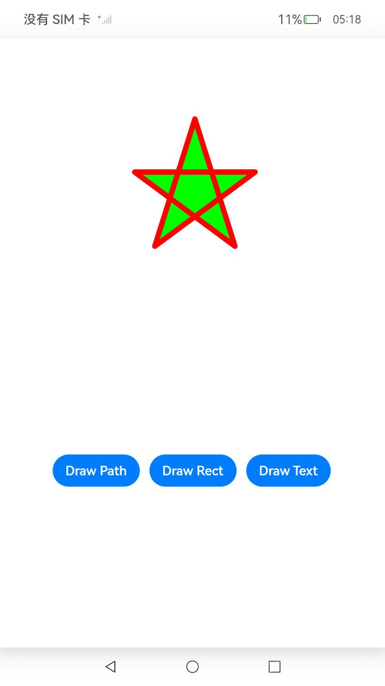
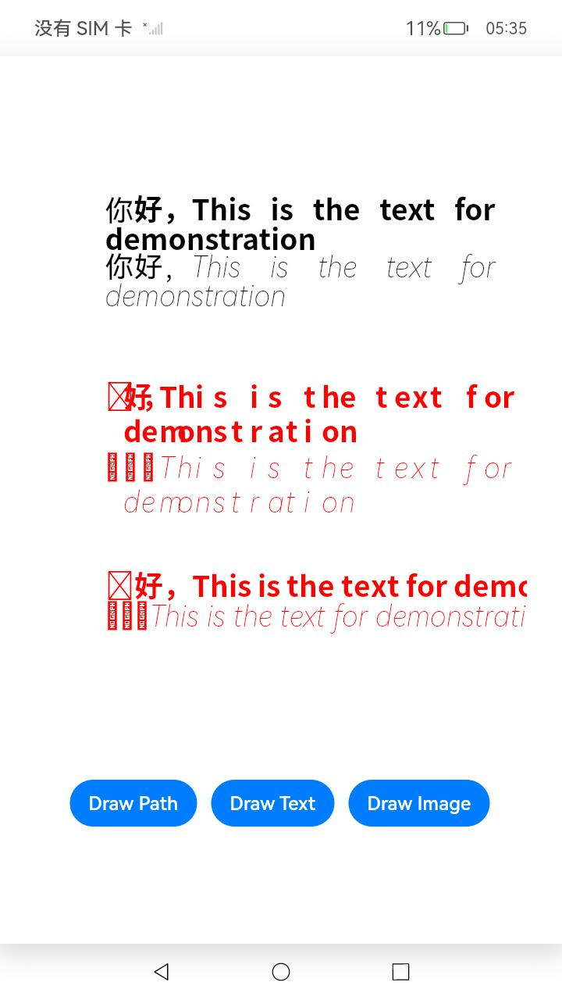
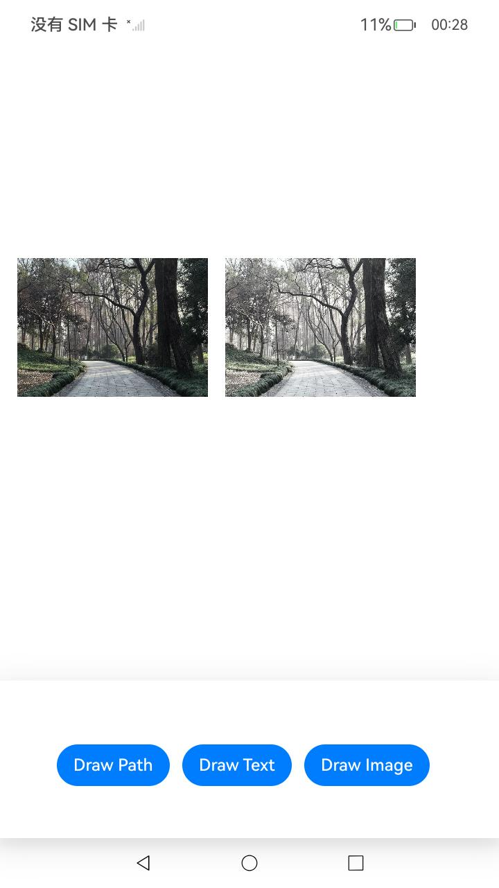

# Native RenderNode Drawing

### 介绍

本示例介绍开发者如何利用自绘制渲染节点 RenderNode，通过 Node-API 桥接调用 Drawing API 在页面上完成自定义绘制。
示例以“能力导航页 + 能力矩阵目录 + RenderNode 专题目录 + 39 个演示页（10 个专题页 + 10 个基础演示页 + 19 个能力域页）”的形式，覆盖六类能力：

1. Native Drawing 绘制：几何图元、绘制效果、画布变换、图片绘制、文本绘制与测量；
2. RenderNode 节点能力：节点树增删、渲染属性、生命周期与释放；
3. API 26 新增能力：背景模糊、内容模糊与前景模糊；
4. 统一的场景分发与参数校验：ArkTS 只需传入场景编号，由 C++ 侧校验并分发到对应绘制模块；
5. schema 驱动的能力矩阵（P3–P5）：画布、几何、画笔、颜色、颜色滤波、着色器、蒙版滤波、图像滤波、位图、
   像素图、图像流、字体、TextBlob、排版、阴影、矩阵、录制、离屏层、错误码共十九个能力域、188 个场景，
   参数面板与 native 分派均由 schema 自动生成；
6. RenderNode 节点级专题（P6）：节点树、渲染属性、模糊层、动画、命中测试、性能、录制回放、多设备适配、
   生命周期与帧回调共十个专题页、40 个场景，全部由 `TopicNodeController` 与 `TopicEngine` 驱动。

### 效果预览

> `screenshots` 目录仍为改造前首页的绘制效果图，新增演示页的截图待真机回归后补充。

| 主页                                 | 绘制路径                                         | 绘制文字                                            |绘制图片                                            |
| ------------------------------------ |------------------------------------| ------------------------------------ | ------------------------------------ |
|  |  |  |  |

### 使用说明

1. 安装编译生成的 hap 包，并打开应用，首页为能力导航列表；
2. 点击“Canvas Drawing”进入原三图元演示，可切换路径、文字与图片的绘制；
3. 点击“Primitives”“Drawing Effects”“Canvas Transform”分别查看图元、效果与画布变换；
4. 点击“Image Drawing”“Text Drawing”查看图片绘制与文本排版、文本测量；
5. 点击“Node Tree”“Render Properties”“Blur Effects”“Lifecycle”体验 RenderNode 的节点树、渲染属性、模糊与生命周期；
6. 点击“Capability Matrix”进入能力矩阵目录，可依次打开十九个能力域页面：切换场景按钮、拖动参数滑杆，
   画布会按当前参数重新绘制；点“Reset”恢复该场景的默认参数；
7. 点击“RenderNode Topics”进入专题目录，可依次打开十个节点级专题：专题页的“Re-apply”会按当前参数重新下发场景，
   状态栏同步显示节点数、重绘次数、触摸次数与重建次数；命中测试专题直接点击画布即可看到命中的子节点下标。

### 能力矩阵

下表与 `entry/src/main/ets/schema` 下的分组定义一一对应，场景数与参数数与运行期完全一致。
能力域页面的场景按钮、参数面板与 native 分派均由 schema 自动生成，新增场景只需补一份 schema 数据与一个 native 场景函数。

| # | 分组 key | 标题资源键 | 场景数 | 参数数 | 演示页 |
| -------- | -------- | -------- | -------- | -------- | -------- |
| 1 | canvas | cap_canvas_group_title | 10 | 20 | pages/CapabilityCanvasDemo |
| 2 | geometry | cap_geometry_group_title | 11 | 23 | pages/CapabilityGeometryDemo |
| 3 | paint | cap_paint_group_title | 10 | 20 | pages/CapabilityPaintDemo |
| 4 | color | cap_color_group_title | 9 | 19 | pages/CapabilityColorDemo |
| 5 | colorFilter | cap_color_filter_group_title | 9 | 18 | pages/CapabilityColorFilterDemo |
| 6 | shader | cap_shader_group_title | 11 | 22 | pages/CapabilityShaderDemo |
| 7 | mask_filter | cap_mask_filter_group_title | 8 | 25 | pages/CapabilityMaskFilterDemo |
| 8 | image_filter | cap_image_filter_group_title | 10 | 28 | pages/CapabilityImageFilterDemo |
| 9 | bitmap | cap_bitmap_group_title | 10 | 19 | pages/CapabilityBitmapDemo |
| 10 | pixelmap | cap_pixel_map_group_title | 12 | 23 | pages/CapabilityPixelMapDemo |
| 11 | image_io | cap_image_io_group_title | 10 | 16 | pages/CapabilityImageIoDemo |
| 12 | font | cap_font_group_title | 12 | 23 | pages/CapabilityFontDemo |
| 13 | textblob | cap_text_blob_group_title | 8 | 15 | pages/CapabilityTextBlobDemo |
| 14 | typography | cap_typography_group_title | 14 | 30 | pages/CapabilityTypographyDemo |
| 15 | shadow | cap_shadow_group_title | 8 | 19 | pages/CapabilityShadowDemo |
| 16 | matrix | cap_matrix_group_title | 10 | 27 | pages/CapabilityMatrixDemo |
| 17 | record | cap_record_group_title | 8 | 14 | pages/CapabilityRecordDemo |
| 18 | offscreen | cap_offscreen_group_title | 8 | 15 | pages/CapabilityOffscreenDemo |
| 19 | error | cap_error_group_title | 10 | 13 | pages/CapabilityErrorDemo |
| 小计 | 19 个能力域 | - | 188 | 389 | - |

专题页不经过 native 桥接，由 `TopicNodeController` 直接创建与操作节点树，编号 20–29：

| # | 专题 key | 标题资源键 | 场景数 | 参数数 | 演示页 |
| -------- | -------- | -------- | -------- | -------- | -------- |
| 20 | topic-node-tree | topic_node_tree_group_title | 4 | 10 | pages/TopicNodeTreeDemo |
| 21 | topic-render-prop | topic_render_prop_group_title | 4 | 13 | pages/TopicRenderPropDemo |
| 22 | topic-blur | topic_blur_group_title | 4 | 9 | pages/TopicBlurDemo |
| 23 | topic-animation | topic_animation_group_title | 4 | 12 | pages/TopicAnimationDemo |
| 24 | topic-hit-test | topic_hit_test_group_title | 4 | 8 | pages/TopicHitTestDemo |
| 25 | topic-performance | topic_performance_group_title | 4 | 9 | pages/TopicPerformanceDemo |
| 26 | topic-record | topic_record_group_title | 4 | 7 | pages/TopicRecordDemo |
| 27 | topic-multi-device | topic_multi_device_group_title | 4 | 8 | pages/TopicMultiDeviceDemo |
| 28 | topic-lifecycle | topic_lifecycle_group_title | 4 | 8 | pages/TopicLifecycleDemo |
| 29 | topic-frame-tick | topic_frame_tick_group_title | 4 | 7 | pages/TopicFrameTickDemo |
| 小计 | 10 个专题 | - | 40 | 91 | - |

### 工程目录

```
├──entry/src/main
│  ├──cpp                           // C++代码区
│  │  ├──CMakeLists.txt             // CMake配置文件，收录桥接与全部绘制模块
│  │  ├──native_bridge.cpp          // N-API 注册、参数校验与场景分发
│  │  ├──common
│  │  │  └──log_common.h            // 日志封装定义文件
│  │  ├──drawing                    // Native Drawing 绘制模块
│  │  │  ├──scene_type.h            // 场景与种类枚举，与 ArkTS 常量一一对应
│  │  │  ├──drawing_util.h          // 颜色常量与矩形创建等公共工具
│  │  │  ├──drawing_shape.cpp/.h    // 点、线、圆、椭圆、矩形、圆角矩形、圆弧、路径、区域
│  │  │  ├──drawing_effect.cpp/.h   // 填充描边、混合模式、路径效果、渐变、颜色滤波、蒙版滤波
│  │  │  ├──drawing_transform.cpp/.h// 裁剪、平移、旋转、缩放、矩阵、保存与恢复
│  │  │  ├──drawing_image.cpp/.h    // PixelMap 绘制、采样模式、缩放
│  │  │  └──drawing_text.cpp/.h     // TextBlob、Typography、文本测量
│  │  ├──capability                 // schema 驱动的十九个能力域（P3–P5）
│  │  │  ├──capability_type.h       // 能力域与场景枚举，与 ets/schema 一一对应
│  │  │  ├──param_bag.h             // 定长参数数组的取值、缺省回退与下标裁剪
│  │  │  ├──cap_util.cpp/.h        // 百分比坐标框架、调色板、画笔与路径助手
│  │  │  ├──cap_text_util.cpp/.h   // 示例字体加载与排版对象构建助手
│  │  │  ├──capability_dispatch.cpp/.h // group/scene 越界守卫与分派入口
│  │  │  ├──cap_canvas.cpp/.h       // 画布与裁剪 10 场景
│  │  │  ├──cap_geometry.cpp/.h     // 图元、路径与布尔运算 11 场景
│  │  │  ├──cap_paint.cpp/.h        // 画笔、路径效果与阴影 10 场景
│  │  │  ├──cap_color.cpp/.h        // 调色板、混色与分量重排 9 场景
│  │  │  ├──cap_color_filter.cpp/.h // 颜色矩阵、亮度与光照 9 场景
│  │  │  ├──cap_shader.cpp/.h       // 线性/径向/扫描/锥形渐变与平铺 11 场景
│  │  │  └──cap_*.cpp/.h            // 其余 13 个能力域：蒙版滤波、图像滤波、位图、像素图、图像流、
│  │  │                             // 字体、TextBlob、排版、阴影、矩阵、录制、离屏层、错误码
│  │  ├──types/libentry
│  │  │  └──index.d.ts              // native侧暴露给ArkTS侧接口的声明
│  ├──ets                           // ets代码区
│  │  ├──entryability
│  │  │  └──EntryAbility.ets        // 程序入口类
│  │  ├──common                     // 公共能力
│  │  │  ├──Logger.ets              // hilog 封装（统一 DOMAIN 与 TAG）
│  │  │  ├──SceneType.ets           // 场景与种类常量
│  │  │  ├──UnitUtil.ets            // 像素与 vp 换算
│  │  │  ├──DemoRenderNode.ets      // DemoRenderNode 与 DemoNodeController
│  │  │  ├──PixelMapUtil.ets        // rawfile 图片解码与释放
│  │  │  ├──DemoTitle.ets           // 页面标题与返回按钮
│  │  │  └──ScenePanel.ets          // 通用“画布 + 按钮组”面板
│  │  ├──core                       // schema 驱动核心层（P1、P6）
│  │  │  ├──SchemaTypes.ets         // ParamSpec / SceneSpec / GroupSpec 与工厂函数
│  │  │  ├──ParamEngine.ets         // 默认值、范围裁剪与参数摘要
│  │  │  ├──SceneRenderNode.ets     // CapabilityRenderNode 与 CapabilityController
│  │  │  ├──TopicTypes.ets          // 专题编号 20–29、行列常量与状态快照
│  │  │  ├──TopicNode.ets           // TopicNodeController：画布与子节点树、属性、动画与统计
│  │  │  └──TopicEngine.ets         // 专题分派：专题编号 + 场景 + 参数 → 控制器调用
│  │  ├──schema                     // 场景定义（P3–P6）
│  │  │  ├──CapabilityCanvas.ets    // 画布与裁剪 10 场景
│  │  │  ├──CapabilityGeometry.ets  // 图元与布尔运算 11 场景
│  │  │  ├──CapabilityPaint.ets     // 画笔与路径效果 10 场景
│  │  │  ├──CapabilityColor.ets     // 颜色模型 9 场景
│  │  │  ├──CapabilityColorFilter.ets // 颜色滤波器 9 场景
│  │  │  ├──CapabilityShader.ets    // 渐变与着色器 11 场景
│  │  │  ├──Capability*.ets         // 其余 13 个能力域的场景定义，与 cap_*.cpp 一一对应
│  │  │  └──Topic*.ets              // 十个专题页的场景定义，与 TopicEngine 的取值下标一一对应
│  │  ├──widgets                    // 通用控件
│  │  │  ├──ParamPanel.ets          // 按 ParamSpec 渲染的滑杆/开关/下拉面板
│  │  │  ├──GroupHost.ets           // 能力域宿主：场景切换 + 参数面板 + 画布
│  │  │  └──TopicHost.ets           // 专题宿主：额外把触摸命中结果写回状态栏
│  │  ├──pages                      // 页面文件
│  │     ├──Index.ets               // 能力导航首页
│  │     ├──DrawDemo.ets            // 原三图元演示
│  │     ├──PrimitiveDemo.ets       // 几何图元
│  │     ├──EffectDemo.ets          // 绘制效果
│  │     ├──TransformDemo.ets       // 画布变换
│  │     ├──ImageDemo.ets           // 图片绘制
│  │     ├──TextDemo.ets            // 文本绘制与测量
│  │     ├──NodeTreeDemo.ets        // 节点树增删
│  │     ├──RenderPropertyDemo.ets  // 渲染属性
│  │     ├──BlurDemo.ets            // API 26 模糊效果
│  │     ├──LifecycleDemo.ets       // 节点生命周期
│  │     ├──Catalog.ets             // 能力矩阵目录（十九个能力域入口）
│  │     ├──CapabilityCanvasDemo.ets 等 19 个能力域页面（仅声明 GroupHost）
│  │     ├──TopicCatalog.ets        // RenderNode 专题目录（十个专题入口）
│  │     └──Topic*Demo.ets          // 10 个专题页面（仅声明 TopicHost）
│  ├──resources                     // 资源文件目录
```

### 具体实现

工程基于 Stage 模型与 Native C++ 模板构建，`native_bridge.cpp` 向 ArkTS 暴露三个接口：
`nativeRenderDraw(context, width, height, scene, kind, pixelMap?)`、
`nativeRenderScene(context, width, height, group, scene, params, pixelMap?)` 与 `nativeMeasureText(text, fontSize, maxWidth)`；
两个绘制接口的最后一个入参均为可选的 `PixelMap`。

1. ArkTS 侧 `DemoRenderNode` 继承 `RenderNode`，在 `draw(context)` 中通过 `context.sizeInPixel` 取得像素尺寸，
   连同场景编号一并传入桥接接口，避免使用 API 18 起废弃的全局 `vp2px`；
2. `DemoNodeController` 继承 `NodeController`，在 `makeNode` 中创建 `FrameNode` 并挂载 `DemoRenderNode`，
   由 `NodeContainer.onAreaChange` 驱动尺寸变化，页面退出时调用 `dispose` 释放节点；
3. 桥接层校验参数个数、类型、画布非空与场景取值范围，再按场景分发到 `drawing_shape`、`drawing_effect`、
   `drawing_transform`、`drawing_image`、`drawing_text` 五个模块；
4. 图片绘制通过 `OH_PixelMap_GetImageInfo` 读取像素图真实宽高，文本绘制通过 `access` 探测字体文件并在失败时
   回退系统字体集合，避免硬编码尺寸与字体路径；
5. ArkTS 侧重用 `RenderNode` 的节点树、渲染属性、`backgroundBlur/contentBlur/foregroundBlur`（API 26）
   与 `label/invalidate/dispose/rebuild` 能力，分别由对应演示页驱动。
6. 能力矩阵采用 schema 驱动：`GroupSpec → SceneSpec → ParamSpec` 三级数据描述场景与参数，`ParamPanel`
   按 `kind` 自动选滑杆/开关/下拉控件，`SceneRenderNode` 在 `draw()` 中把参数数组交给 `nativeRenderScene`，
   native 侧 `ParamBag` 按下标取值后由 `capability_dispatch.cpp` 按 `group + scene` 分派到具体场景函数，
   新增场景只需补一份 schema 数据与一个 native 场景函数。
7. 专题页不经过 native：`TopicNodeController` 继承 `NodeController`，在 `makeNode` 中创建一层画布 `RenderNode`
   与若干子节点，`TopicEngine.apply()` 把「专题编号 + 场景编号 + 参数数组」翻译成建树、属性、定时器与录制调用，
   `onTouchEvent` 上报的局部坐标按矩形包含算出命中的子节点下标，状态栏统一展示节点数、重绘、触摸与重建计数。

### 多语言资源与界面定位

1. 界面文案统一通过 `$r('app.string.*')` 引用，`resources/base`、`resources/en_US`、`resources/zh_CN` 三套 `string.json`
   各 605 个键且键名完全一致；新增文案需三处同步补齐，缺键会被编译期的资源校验拦截；
2. 能力域与专题的标题、说明、场景标题与场景说明，以及演示页下方的场景切换按钮同样使用 `$r`，
   schema 与场景按钮中不出现硬编码英文文案，系统语言切换后目录、参数面板、场景按钮与场景说明同步切换；
3. 界面颜色集中在 `resources/base/element/color.json`（含卡片底色与选中态文字），ArkTS 侧不再直接写色值；
   `resources/dark/element/color.json` 仅在深色模式下覆盖启动页背景，native 自绘的画布仍使用固定的浅色底；
4. 交互控件挂载稳定 id，命名规则为 `<用途>_<分组 key>`，场景相关再追加 `_<场景编号>`，以便按 id 检索同类控件：
   目录项 `catalog_item_canvas`、场景按钮 `scene_btn_canvas_3`、场景说明 `scene_desc_canvas_3`、
   参数重置 `params_reset_canvas`、专题重下发 `params_reapply_topic-blur`、页面返回 `nav_back_canvas`；
5. `entry/src/ohosTest` 下的用例全部按上述 id 与 `Driver.pressBack()` 定位控件，不匹配任何界面文案，
   因此测试结果与系统语言无关。

源码参考：[cpp目录](entry/src/main/cpp)与[ets目录](entry/src/main/ets)下的文件。

涉及到的相关接口：


| 接口名 | 描述 | 
| -------- | -------- |
| OH_Drawing_CanvasAttachBrush (OH_Drawing_Canvas *, const OH_Drawing_Brush *) | 设置画刷给画布，画布将会使用设置的画刷样式和颜色去填充绘制的图形形状。 |
| OH_Drawing_CanvasAttachPen (OH_Drawing_Canvas *, const OH_Drawing_Pen *) | 设置画笔给画布，画布将会使用设置画笔的样式和颜色去绘制图形形状的轮廓。 |
| OH_Drawing_CanvasDetachBrush (OH_Drawing_Canvas *) | 清空画布上已设置的画刷效果。 |
| OH_Drawing_CanvasDetachPen (OH_Drawing_Canvas *) | 清空画布上已设置的画笔效果。 |
| OH_Drawing_CanvasDrawPath (OH_Drawing_Canvas *, const OH_Drawing_Path *) | 画一个自定义路径。 |
| OH_Drawing_CanvasDrawRect (OH_Drawing_Canvas *, const OH_Drawing_Rect *) | 画一个矩形。 |
| OH_Drawing_PathCreate (void) | 创建一个路径对象。 |
| OH_Drawing_PathMoveTo (OH_Drawing_Path *, float x, float y) | 设置自定义路径的起始点位置。 |
| OH_Drawing_PathLineTo (OH_Drawing_Path *, float x, float y) | 添加一条到目标点的线段。 |
| OH_Drawing_PathClose (OH_Drawing_Path *) | 闭合路径，会添加一条到路径起点位置的线段。 |
| OH_Drawing_PathDestroy (OH_Drawing_Path *) | 销毁路径对象。 |
| OH_Drawing_RectCreate (float left, float top, float right, float bottom) | 创建一个矩形对象。 |
| OH_Drawing_RectDestroy (const OH_Drawing_Rect *) | 销毁矩形对象。 |
| OH_Drawing_PenCreate (void) | 创建一个画笔对象。 |
| OH_Drawing_PenSetAntiAlias (OH_Drawing_Pen *, bool) | 设置抗锯齿属性，如果为真则说明画笔会启用抗锯齿功能，在绘制图形时会对图形的边缘像素进行半透明的模糊处理。 |
| OH_Drawing_PenSetWidth (OH_Drawing_Pen *, float width) | 设置画笔的厚度属性，厚度属性描述了画笔绘制图形轮廓的宽度。 |
| OH_Drawing_PenDestroy (const OH_Drawing_Pen *) | 销毁画笔对象。 |
| OH_Drawing_BrushCreate (void) | 创建一个画刷对象。 |
| OH_Drawing_BrushSetColor (OH_Drawing_Brush *, uint32_t color) | 设置画刷的颜色属性，颜色属性描述了画刷填充图形时使用的颜色，用一个32位（ARGB）的变量表示。 |
| OH_Drawing_BrushDestroy (const OH_Drawing_Brush *) | 销毁画刷对象。 |
| OH_Drawing_CreateTypographyStyle (void) | 创建一个排版对象，用于定义排版样式。 |
| OH_Drawing_CreateTextStyle (void) | 创建一个文本对象，用于定义文本样式。 |
| OH_Drawing_TypographyHandlerAddText (OH_Drawing_TypographyCreate *, const char *) | 设置文本内容。 |
| OH_Drawing_SetTextStyleFontFamilies (OH_Drawing_TextStyle* , int , const char* fontFamilies[] ) | 设置字体类型。 |
| OH_Drawing_RegisterFont (OH_Drawing_FontCollection* , const char* fontFamily, const char* familySrc ) | 用于在字体管理器中注册字体缓冲区。 |
| OH_Drawing_SetTextStyleFontStyle (OH_Drawing_TextStyle* , int  ) | 设置字体风格。 |
| OH_Drawing_SetTextStyleLocale (OH_Drawing_TextStyle* , const char*  ) | 设置语言区域。 |
| OH_Drawing_CreateTypographyHandler (OH_Drawing_TypographyStyle* , OH_Drawing_FontCollection*  ) | 创建指向OH_Drawing_TypographyCreate对象的指针。 |
| OH_Drawing_TypographyHandlerPushTextStyle (OH_Drawing_TypographyCreate* , OH_Drawing_TextStyle*  ) | 设置排版风格。 |
| OH_Drawing_TypographyHandlerAddText (OH_Drawing_TypographyCreate* , const char*  ) | 设置文本内容。 |
| OH_Drawing_TypographyHandlerPopTextStyle (OH_Drawing_TypographyCreate* ) | 排版弹出。 |
| OH_Drawing_CreateTypography (OH_Drawing_TypographyCreate* ) | 指向OH_Drawing_Typography对象的指针。 |
| OH_Drawing_TypographyLayout (OH_Drawing_Typography* , double  ) | 排版布局。 |
| OH_Drawing_TextBlobBuilderMake (OH_Drawing_TextBlobBuilder* ) | 用于从文本构造器中创建文本对象。 |
| OH_Drawing_CanvasDrawTextBlob (OH_Drawing_Canvas* , const OH_Drawing_TextBlob* , float x, float y ) | 用于画一段文字。 |
| OH_Drawing_TextBlobCreateFromString (const char* str, const OH_Drawing_Font* , OH_Drawing_TextEncoding  ) | 用字符串创建文本对象。 |
| OH_Drawing_TextBlobDestroy (OH_Drawing_TextBlob* ) | 用于销毁文本对象并回收该对象占有的内存。 |
| OH_Drawing_TextBlobBuilderDestroy (OH_Drawing_TextBlobBuilder* ) | 用于销毁文本构造器对象并回收该对象占有的内存。 |
| OH_Drawing_TypefaceDestroy (OH_Drawing_Typeface* ) | 用于销毁字形对象并回收该对象占有的内存。 |
| OH_Drawing_FontDestroy (OH_Drawing_Font* ) | 用于销毁字体对象并回收该对象占有的内存。 |
| OH_Drawing_TypographyPaint (OH_Drawing_Typography *, OH_Drawing_Canvas *, double, double) | 显示文本。 |
| OH_Drawing_DestroyTypography (OH_Drawing_Typography* ) | 释放OH_Drawing_Typography对象占据的内存。 |
| OH_Drawing_DestroyTypographyHandler (OH_Drawing_TypographyCreate* ) | 释放被OH_Drawing_TypographyCreate对象占据的内存。 |
| OH_Drawing_DestroyTypographyStyle (OH_Drawing_TypographyStyle* ) | 释放被OH_Drawing_TypographyStyle对象占据的内存。 |
| OH_Drawing_DestroyTextStyle (OH_Drawing_TextStyle* ) | 释放被OH_Drawing_TextStyle对象占据的内存。 |
| OH_Drawing_DestroyFontCollection (OH_Drawing_FontCollection* ) | 释放被字体集对象占据的内存。 |
| OH_Drawing_TextBlobBuilderCreate (void ) | 创建一个文本构造器对象。 |
| OH_Drawing_FontCreate (void ) | 创建字体对象。 |
| OH_Drawing_TypefaceCreateFromFile (const char* path, int index ) | 通过文件创建一个字形对象。 |
| OH_Drawing_CanvasDrawPixelMapRect (OH_Drawing_Canvas* , OH_Drawing_PixelMap* , const OH_Drawing_Rect* src, const OH_Drawing_Rect* dst, const OH_Drawing_SamplingOptions*  ) | 用于将像素图的指定区域绘制到画布的指定区域。 |
| OH_Drawing_SamplingOptionsCreate (OH_Drawing_FilterMode , OH_Drawing_MipmapMode  ) | 创建一个采样选项对象。 |
| OH_Drawing_ColorFilterCreateMatrix (const float matrix[20]) | 创建具有5x4颜色矩阵的颜色滤波器。 |
| OH_Drawing_FilterCreate (void ) | 创建一个滤波器对象。 |
| OH_Drawing_FilterSetColorFilter (OH_Drawing_Filter* , OH_Drawing_ColorFilter*  ) | 为滤波器对象设置颜色滤波器对象。 |
| OH_Drawing_BrushSetFilter (OH_Drawing_Brush* , OH_Drawing_Filter*  ) | 为画刷设置滤波器。 |
| OH_Drawing_CanvasTranslate (OH_Drawing_Canvas* , float dx, float dy ) | 将平移画布一段距离。 |
| OH_Drawing_CanvasRestore (OH_Drawing_Canvas* ) | 用于恢复保存在栈顶的画布状态。 |
| OH_Drawing_CanvasSave (OH_Drawing_Canvas* ) | 用于保存当前画布的状态到栈顶。 |
| OH_Drawing_FilterDestroy (OH_Drawing_Filter* ) | 销毁滤波器对象，并收回该对象占用的内存。 |
| OH_Drawing_ColorFilterDestroy (OH_Drawing_ColorFilter* ) | 销毁颜色滤波器对象，并收回该对象占用的内存。 |
| OH_Drawing_SamplingOptionsDestroy (OH_Drawing_SamplingOptions* ) | 销毁采样选项对象并回收该对象占有内存。 |

详细的接口说明请参考[Drawing](https://docs.openharmony.cn/pages/v4.1/en/application-dev/reference/apis-arkgraphics2d/js-apis-graphics-drawing.md)。

本次补充场景额外使用的主要接口：

| 接口名 | 描述 |
| -------- | -------- |
| OH_Drawing_CanvasDrawPoint / DrawLine / DrawCircle / DrawOval / DrawRect / DrawRoundRect | 绘制点、线、圆、椭圆、矩形与圆角矩形。 |
| OH_Drawing_CanvasDrawArcWithCenter | 绘制圆弧或扇形。 |
| OH_Drawing_CanvasDrawRegion | 绘制区域对象。 |
| OH_Drawing_CanvasClipRect / CanvasClipPath | 以矩形或路径裁剪画布。 |
| OH_Drawing_CanvasTranslate / Rotate / Scale / Skew | 平移、旋转、缩放与错切画布。 |
| OH_Drawing_CanvasConcatMatrix | 将矩阵拼接到画布当前变换。 |
| OH_Drawing_CanvasGetSaveCount / CanvasRestoreToCount | 查询与恢复到指定画布状态层级。 |
| OH_Drawing_PathEffectCreateDashPathEffect | 创建虚线路径效果。 |
| OH_Drawing_ShaderEffectCreateLinearGradient / RadialGradient / SweepGradient | 创建线性、径向与扇形渐变着色器。 |
| OH_Drawing_MaskFilterCreateBlur | 创建模糊蒙版滤波器。 |
| OH_Drawing_TypographyGetLongestLine / GetHeight | 获取排版最长行宽度与整体高度，用于文本测量。 |
| OH_Drawing_PixelMapDissolve | 释放像素图对象包装。 |
| OH_PixelMap_GetImageInfo | 获取像素图真实宽高，避免绘制尺寸硬编码。 |
| OH_Drawing_CanvasSaveLayer / CanvasDrawPoints / CanvasDrawNestedRoundRect | 图层合成、批量顶点与嵌套圆角矩形绘制。 |
| OH_Drawing_CanvasClipRoundRect / CanvasClipRegion / CanvasSkew | 圆角矩形裁剪、区域裁剪与坐标错切。 |
| OH_Drawing_PathOp / PathAddPolygon / PathAddCircle | 路径布尔运算与多边形、圆形路径构造。 |
| OH_Drawing_RegionOp / RegionGetBoundaryPath | 区域布尔运算与边界路径转换。 |
| OH_Drawing_RoundRectSetCorner | 按角设定圆角半径（参数为 `OH_Drawing_Corner_Radii`）。 |
| OH_Drawing_PenSetCap / PenSetJoin / PenSetMiterLimit | 画笔端点、拐角与尖角限制。 |
| OH_Drawing_PenSetShadowLayer / PenSetPathEffect / PenSetFilter | 画笔级阴影、路径效果与滤波器。 |
| OH_Drawing_BrushSetShadowLayer / BrushSetShaderEffect / BrushSetBlendMode | 画刷级阴影、着色器与混合模式。 |
| OH_Drawing_CreateDashPathEffect / CornerPathEffect / DiscretePathEffect | 虚线、圆角与离散路径效果。 |
| OH_Drawing_ColorFilterCreateBlendMode / Compose / Lighting / Luma | 混合模式、组合、光照与亮度颜色滤波器。 |
| OH_Drawing_ShaderEffectCreateTwoPointConicalGradient / CreateColorShader | 锥形渐变与纯色着色器。 |
| OH_Drawing_MatrixPreScale / PreRotate / PreTranslate | 构造着色器局部矩阵。 |

ArkTS 侧涉及 `RenderNode` 的节点树（`appendChild` / `removeChild` / `clearChildren`）、渲染属性
（`backgroundColor` / `opacity` / `clipToFrame` / `shadow*` / `scale` / `rotation`）、模糊属性
（`backgroundBlur` / `contentBlur` / `foregroundBlur`，API 26 起）以及 `label` / `invalidate` /
`dispose` / `rebuild`。

### 相关权限

不涉及。

### 依赖

RenderNode、Node-API、Native Drawing。

### 约束与限制

1. 本示例仅支持标准系统上运行，`module.json5` 中声明的设备类型为 `default` 与 `tablet`。
2. 本示例为 Stage 模型，编译与目标 SDK 版本均为 26.0.0（API 26），其中模糊演示页依赖 API 26 的 RenderNode 模糊能力。
3. 本示例需使用 DevEco Studio 26.0.0 及以上版本编译运行。
4. 图片演示依赖 `resources/rawfile/test.jpg`，缺失时页面会提示“Pixel map not ready”。

### 下载

如需单独下载本工程，执行如下命令：

```
git init
git config core.sparsecheckout true
echo code/BasicFeature/Native/NdkRenderNodeDrawing/ > .git/info/sparse-checkout
git remote add origin https://gitcode.com/openharmony/applications_app_samples.git
git pull origin master
```