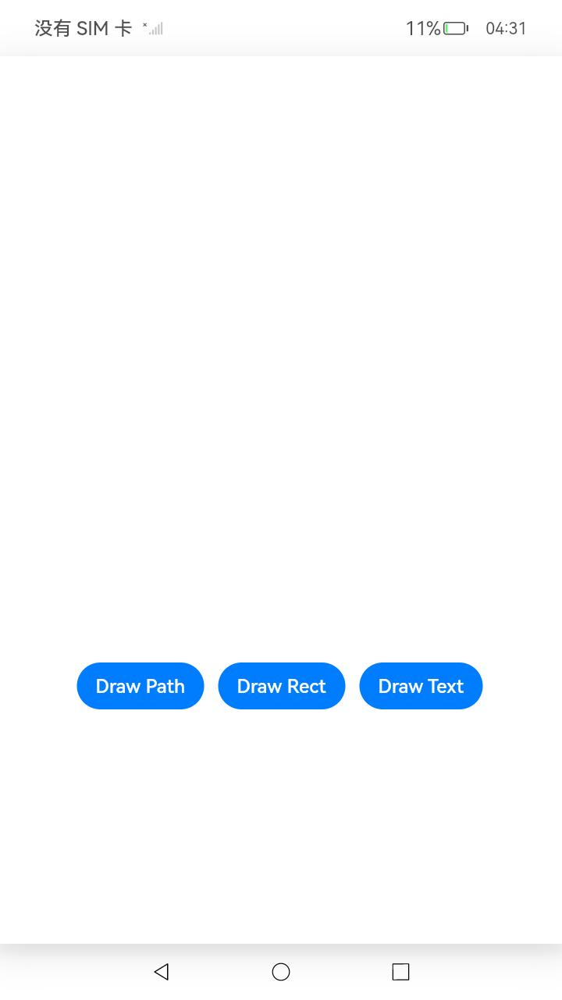
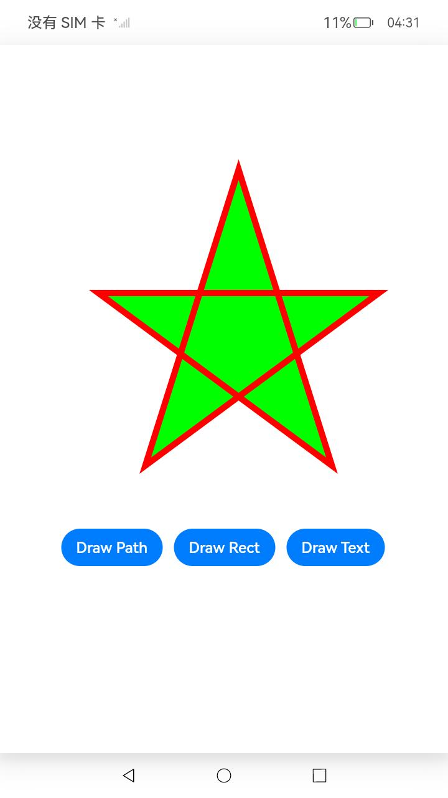
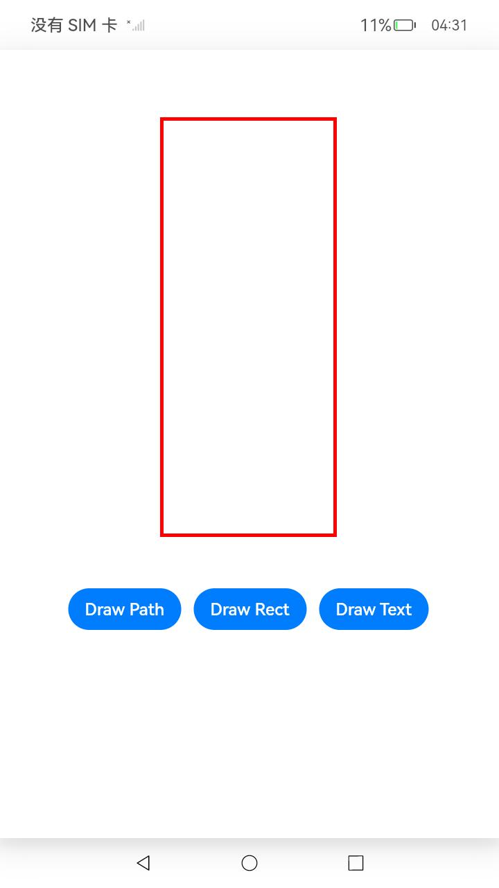
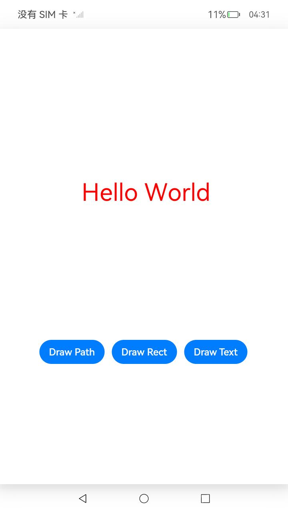

# NdkTsDrawing

### Introduction

This sample uses the [@ohos.graphics.drawing](https://gitcode.com/openharmony/docs/blob/master/en/application-dev/reference/apis-arkgraphics2d/js-apis-graphics-drawing.md) module to draw 2D graphics, text, image effects and geometry operations, and shows the drawing results on two rendering paths: `RenderNode` and `Canvas`.

The home page keeps three basic buttons (five-pointed star, rectangle and the "Hello World" text) and provides 24 group entries at the bottom of the page. Each group entry covers one drawing interface family: canvas shapes, state stack and layers, clipping, path building and query, Pen/Brush styles, Font/TextBlob/Typeface text layout, Matrix transformation, Rect/Region/RoundRect geometry, and the ColorFilter/ImageFilter/Shader/PathEffect/MaskFilter/ShadowLayer effects. The result of every group entry is drawn on an offscreen 240×240 canvas and then displayed through a `Canvas` component.

### Effect Preview

| Home page                            | Draw a star                                          | Draw a rectangle                                     | Draw a text                                          |
| ------------------------------------ | ---------------------------------------------------- | ---------------------------------------------------- | ---------------------------------------------------- |
|       |                |                |                |

### Usage Instructions

1. Install the compiled HAP package and launch the application.
2. Tap **Draw Path**. The page draws a five-pointed star with a `RenderNode`.
3. Tap **Draw Rect**. The page draws a rectangle on an offscreen canvas and displays it on the canvas.
4. Tap **Draw Text**. The page draws "Hello World" with a `RenderNode`.
5. Tap one of the group buttons at the bottom (`Rects`, `RoundRect`, `Circle`, `Arc`, `Points`, `Color`, `SaveRestore`, `Layer`, `Transform`, `Matrix`, `Clip`, `ClipReset`, `PathArc`, `PathBezier`, `PathConic`, `PathRelative`, `PathPrimitive`, `PathCombined`, `PathPolygon`, `PenBrush`, `TextBlob`, `Glyph`, `Effect`, `MatrixDraw`). The preview area at the top shows the drawing result of that interface group.

### Project Structure

```
├──entry/src/main
│  ├──ets                                    // ArkTS code
│  │  ├──entryability
│  │  │  └──EntryAbility.ets                 // Application entry
│  │  ├──drawing                             // drawing capability wrappers
│  │  │  ├──DrawingTypes.ets                 // Shared constants plus color and coordinate conversion helpers
│  │  │  ├──DrawingCanvasFactory.ets         // Offscreen PixelMap and Canvas factory
│  │  │  ├──DrawingCanvasBasic.ets           // Basic shapes, colors and region drawing
│  │  │  ├──DrawingCanvasState.ets           // save/restore, layers, transform and matrix drawing
│  │  │  ├──DrawingCanvasClip.ets            // Clipping and occlusion query
│  │  │  ├──DrawingPathShape.ets             // Path building: arc, Bezier, combined and SVG paths
│  │  │  ├──DrawingPathQuery.ets             // Path query, iteration, interpolation and comparison
│  │  │  ├──DrawingPenBrush.ets              // Pen/Brush stroke, fill and style effects
│  │  │  ├──DrawingFontText.ets              // Font, Glyph, TextBlob and Typeface
│  │  │  ├──DrawingMatrix.ets                // Matrix build, mapping, inversion and fitting
│  │  │  ├──DrawingEffects.ets               // ColorFilter/ImageFilter/Shader/PathEffect
│  │  │  └──DrawingGeometryUtils.ets         // Rect/Region/RoundRect/SamplingOptions helpers
│  │  └──pages
│  │     └──Index.ets                        // Home page and the group entries
│  ├──resources                              // Resources
│  └──module.json5
└──entry/src/ohosTest
   ├──ets/test                               // ohosTest cases (86 suites / 4,601 cases)
   │  ├──DrawingTestRunner.ets               // Shared test helpers (pixel reading, color counting)
   │  └──List.test.ets                       // Test entry
   └──ets/testrunner
      └──OpenHarmonyTestRunner.ets           // Test runner
```

### Implementation

The sample uses all three custom drawing approaches provided by drawing:

1. **RenderNode drawing**: the `MyRenderNode` and `TextRenderNode` subclasses define the drawing logic in `draw()`; the `MyNodeController` subclass creates a `FrameNode` through `NodeController` and mounts the render nodes on it. The five-pointed star and the text are drawn this way.
2. **Offscreen drawing**: `createOffscreenTarget()` creates an offscreen `Canvas` bound to a `PixelMap`. When the drawing is finished the bitmap is drawn onto the page. The rectangle and all group entries use this approach.
3. **Layered capabilities**: the interface families are split into 12 modules under `entry/src/main/ets/drawing`, and the page only dispatches a group index to the matching module, so that every family can be demonstrated and verified on its own.

Source code: the files under the [drawing](entry/src/main/ets/drawing) and [pages](entry/src/main/ets/pages) directories.

Interfaces involved:

| Module | Main interfaces | Description |
| -------- | -------- | -------- |
| DrawingCanvasFactory | `createOffscreenPixelMap`, `createOffscreenCanvas`, `createOffscreenTarget` | Creates an offscreen bitmap and the canvas bound to it. |
| DrawingCanvasBasic | `drawRect`, `drawRoundRect`, `drawCircle`, `drawOval`, `drawArc`, `drawPoints`, `drawLine`, `drawRegion`, `drawColor` | Draws basic shapes and the background color. |
| DrawingCanvasState | `save`, `restore`, `saveLayer`, `getSaveCount`, `translate`, `scale`, `rotate`, `skew`, `concatMatrix`, `setMatrix` | Manages the canvas state stack, layers and coordinate transforms. |
| DrawingCanvasClip | `clipRect`, `clipPath`, `clipRegion`, `clipRoundRect`, `quickReject` | Clips the canvas and checks whether a region is fully occluded. |
| DrawingPathShape | `moveTo`, `lineTo`, `quadTo`, `cubicTo`, `conicTo`, `arcTo`, `rArcTo`, `addPolygon`, `op`, `buildFromSvgString` | Builds basic, combined and SVG paths. |
| DrawingPathQuery | `getLength`, `getPositionAndTangent`, `getSegment`, `getMatrix`, `isRect`, `getBounds` | Queries the path length, position, tangent and segment, and reads or writes the path vertices. |
| DrawingPenBrush | `setColor`, `setStrokeWidth`, `setAntiAlias`, `setStrokeCap`, `setBlendMode`, `setShaderEffect`, `setPathEffect`, `setMaskFilter`, `setShadowLayer`, `setImageFilter`, `copy` | Sets the stroke and fill style, the color and the pen-level effects. |
| DrawingFontText | `measureText`, `getGlyphId`, `getWidths`, `getBounds`, `getOutline`, `makeFromString`, `TextBlob` interfaces, `Typeface` interfaces | Measures text, reads glyph information, builds text blobs and manages typefaces. |
| DrawingMatrix | `setRotation`, `setScale`, `setTranslation`, `setSkew`, `preConcat`, `postConcat`, `invert`, `mapPoints`, `mapRect`, `setPolyToPoly` | Builds a matrix, maps coordinates and inverts the matrix. |
| DrawingEffects | `ColorFilter`, `ImageFilter`, `ShaderEffect`, `PathEffect`, `MaskFilter`, `setShadowLayer` | Builds color matrix, blur, gradient and dashed effects and attaches them to a pen or a brush. |
| DrawingGeometryUtils | `Rect` helpers, `Region` construction and operations, `RoundRect.getCorner`, `SamplingOptions` | Rect containment and union, region intersection/union/difference, corner radius reading and sampling options. |
| DrawingTypes | `rgba`, `ltrb`, `point`, `toArgb`, `toPair` | Type conversion helpers for colors, rects and coordinates. |

For details about the interfaces, see [Drawing](https://gitcode.com/openharmony/docs/blob/master/en/application-dev/reference/apis-arkgraphics2d/js-apis-graphics-drawing.md).

### ohosTest Cases

The test entry is `entry/src/ohosTest/ets/test/List.test.ets`. It registers 86 suites with 4,601 cases. Except for the page tap cases, every case draws on an offscreen canvas and then reads the `PixelMap` pixels to assert the colored pixel count, the channel values, the coordinates and the sizes. The full case list and the execution records are described in [ohosTest.md](ohosTest.md).

Core scenario suites (13 suites / 326 cases):

| Suite | Cases | Coverage |
| -------- | -------- | -------- |
| DrawingCanvasBasicTest | 26 | Rects, round rects, circles and ovals, arcs, points and lines, color and region drawing. |
| DrawingCanvasStateTest | 18 | State stack, layers, translation/scale/rotation, matrix drawing. |
| DrawingCanvasClipTest | 26 | Rect, path, region and round rect clipping, plus occlusion query. |
| DrawingPenBrushTest | 30 | Pen width, cap, blend mode, brush gradient and pen copying. |
| DrawingMatrixTest | 28 | Matrix build, concatenation, inversion, coordinate mapping, rect fitting and poly-to-poly mapping. |
| DrawingPathShapeTest | 34 | Basic paths, arcs, Bezier, conic, relative paths, combined and SVG paths. |
| DrawingPathQueryTest | 30 | Path length, position and tangent, segment extraction, vertex iteration, interpolation and comparison. |
| DrawingFontTextTest | 30 | Text measurement, glyph ids and outlines, text blob drawing. |
| DrawingTextBlobTest | 12 | Text blob construction, bounds, id stability, positioned text and run buffers. |
| DrawingEffectTest | 30 | Color filter, image filter, shader, path effect, blur mask filter and shadow layer. |
| DrawingGeometryUtilsTest | 34 | Rect containment and union, region operations, corner radius, sampling options and resource colors. |
| DrawingTypefaceTest | 8 | System typeface loading, typeface replacement and variable typefaces. |
| DrawingIndexUiTest | 20 | Page button taps and group entry rendering. |
| Total | 326 | - |

Interface matrix suites (73 suites / 4,275 cases):

| Suite group | Suites | Cases | Coverage |
| -------- | -------- | -------- | -------- |
| CanvasApi* | 10 | 642 | Canvas drawing, save/restore, layers, clipping and pixel assertions per interface. |
| PathApi* | 9 | 506 | Path building, querying, iteration, interpolation and comparison per interface. |
| FontApi* | 5 | 300 | Font size, metrics, glyphs, outlines and text measurement. |
| TextBlobApiCore | 1 | 75 | Text blob construction, bounds and positioned text. |
| TypefaceApiCore | 1 | 75 | Typeface loading and glyph mapping. |
| MatrixApi* | 4 | 264 | Matrix build, concatenation, inversion, mapping and rect fitting. |
| RectApi* | 2 | 152 | Rect set, union, intersection, offset and containment. |
| PointApiCore | 1 | 10 | Point offset, negation and conversion. |
| PaintApi* | 3 | 202 | Pen and brush attributes, blending and effects. |
| BrushApi* | 2 | 120 | Brush color, shader, blend mode and copy. |
| RegionApi* | 2 | 136 | Region operations, boundary paths and fast queries. |
| PenApiDeep* | 3 | 150 | Pen effects, dash and path effects, stroke outlines. |
| MiscApiCore | 1 | 60 | Sampling options, resource colors and miscellaneous helpers. |
| FilterApi* | 3 | 202 | Color filter, image filter and shader composition. |
| Enum* | 14 | 647 | Enumeration values and their behavior, including blend mode, path op, path style, path iteration, sampling, stroke, shadow, font edge, font hint, text encoding, blur type, scale to fit and the value table. |
| Combo* | 6 | 360 | Combined scenarios: paint stack, blend and layer, path fill, text and paint, matrix and layer, transform chain. |
| State* | 3 | 200 | Canvas, paint and resource state machines. |
| IndexUi* | 3 | 174 | Page group entries, preview canvas and state transitions. |
| Total | 73 | 4,275 | - |

Build and run (the project can also be built from the Build menu of DevEco Studio):

```bash
# Build the test HAP
hvigorw --mode module -p module=entry@ohosTest -p product=default assembleHap --no-daemon

# Install the signed test HAP (signing must be configured first)
hdc install -r entry/build/default/outputs/ohosTest/entry-ohosTest-signed.hap

# Run all test suites through the Ability Assistant test entry, with the run configuration:
#   bundle name     com.samples.ndktsdrawing
#   module name     entry_test
#   unittest runner /ets/testrunner/OpenHarmonyTestRunner
#   timeout         900000 ms
```

To run a single suite, set the suite class parameter to the suite name, for example `DrawingCanvasBasicTest`; the suite name is the value in the first column of the tables above.

### Permissions

Not involved. The sample does not declare any permission in `module.json5`.

### Dependencies

No dependency on other samples. The sample uses `RenderNode` and `PixelMap` from the system to draw on the page and to keep the offscreen bitmap.

### Constraints & Limitations

1. This sample runs on standard systems only.
2. This sample uses the Stage model. It is compiled with the API version 26 SDK (`compileSdkVersion`, `targetSdkVersion` and `compatibleSdkVersion` are all `26.0.0`).
3. DevEco Studio 6.0 Release or later is required to build and run this sample.
4. Each group entry draws on a fixed 240×240 offscreen bitmap, so only the content inside that area is visible in the preview.

### Download

To download this project separately, run the following commands:

```
git init
git config core.sparsecheckout true
echo code/BasicFeature/Native/NdkTsDrawing/ > .git/info/sparse-checkout
git remote add origin https://gitcode.com/openharmony/applications_app_samples.git
git pull origin master
```
