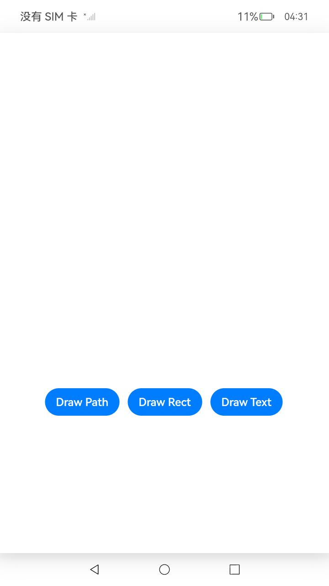
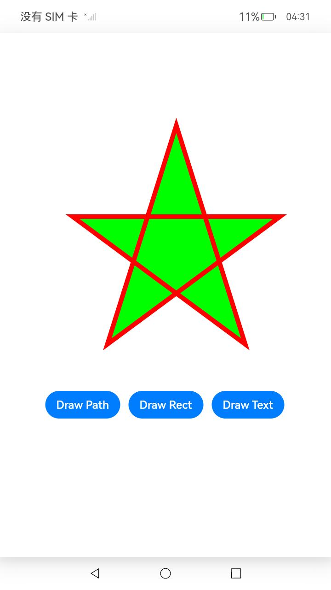
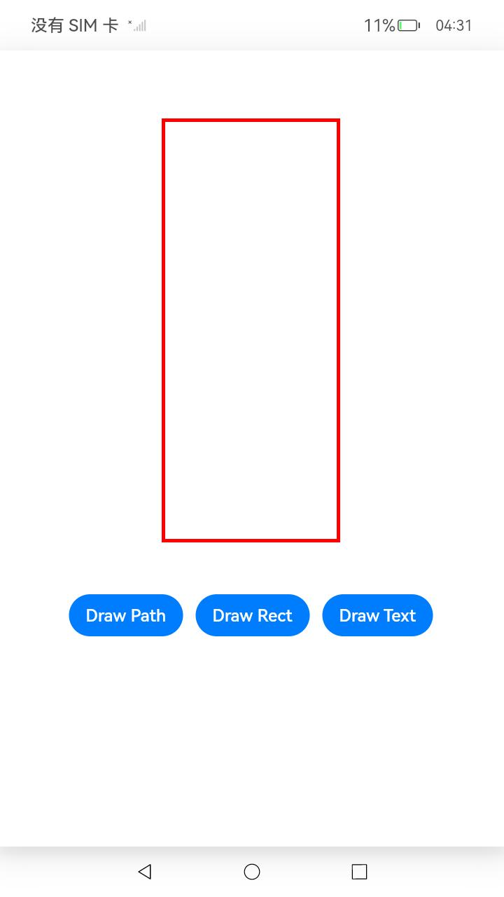
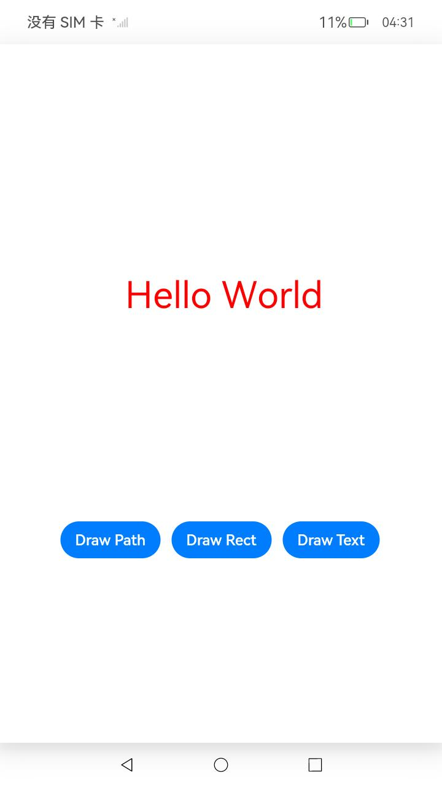

# NdkTsDrawing

### 介绍

本示例基于 [@ohos.graphics.drawing](https://gitcode.com/openharmony/docs/blob/master/zh-cn/application-dev/reference/apis-arkgraphics2d/js-apis-graphics-drawing.md) 模块完成 2D 图形、文字、图像效果与几何运算的绘制，并把绘制结果同时演示在 `RenderNode` 与 `Canvas` 两条渲染路径上。

示例保留三个基础按钮（五角星、矩形、"Hello World" 文字），并在页面底部提供 24 个分组入口，逐一覆盖 Canvas 绘图形状、状态栈与图层、裁剪、Path 构建与查询、Pen/Brush 样式、Font/TextBlob/Typeface 文字排版、Matrix 变换、Rect/Region/RoundRect 几何运算，以及 ColorFilter/ImageFilter/Shader/PathEffect/MaskFilter/ShadowLayer 等效果接口。分组入口的绘制结果统一输出到 240×240 的离屏画布上，再通过 `Canvas` 组件显示。

### 使用说明

1. 安装编译生成的 HAP 包，并打开应用。

2. 点击“Draw Path”按钮，页面将通过 `RenderNode` 绘制一个五角星；

3. 点击“Draw Rect”按钮，页面将离屏绘制一个矩形并显示到画布；

4. 点击“Draw Text”按钮，页面将通过 `RenderNode` 绘制“Hello World”；

5. 点击下方分组按钮（`Rects`、`RoundRect`、`Circle`、`Arc`、`Points`、`Color`、`SaveRestore`、`Layer`、`Transform`、`Matrix`、`Clip`、`ClipReset`、`PathArc`、`PathBezier`、`PathConic`、`PathRelative`、`PathPrimitive`、`PathCombined`、`PathPolygon`、`PenBrush`、`TextBlob`、`Glyph`、`Effect`、`MatrixDraw`），在上方预览区域显示该组接口的绘制结果。

### 效果预览

| 主页                                 | 绘制五角星                                            | 绘制矩形                                            | 绘制文字                                            |
| ------------------------------------ | ----------------------------------------------- | ------------------------------------ | ------------------------------------ |
|  |  |  |  |

### 工程目录

```
├──entry/src/main
│  ├──ets                                    // ets代码区
│  │  ├──entryability
│  │  │  └──EntryAbility.ets                 // 程序入口类
│  │  ├──drawing                             // drawing 能力封装
│  │  │  ├──DrawingTypes.ets                 // 公共常量与颜色、坐标转换工具
│  │  │  ├──DrawingCanvasFactory.ets         // 离屏 PixelMap 与 Canvas 工厂
│  │  │  ├──DrawingCanvasBasic.ets           // 基础图形、颜色与区域绘制
│  │  │  ├──DrawingCanvasState.ets           // save/restore、图层、变换与矩阵绘制
│  │  │  ├──DrawingCanvasClip.ets            // 裁剪与区域遮挡判定
│  │  │  ├──DrawingPathShape.ets             // Path 构建（圆弧、贝塞尔、组合、SVG）
│  │  │  ├──DrawingPathQuery.ets             // Path 查询、迭代、插值与比较
│  │  │  ├──DrawingPenBrush.ets              // Pen/Brush 描边填充与样式效果
│  │  │  ├──DrawingFontText.ets              // Font、Glyph、TextBlob、Typeface
│  │  │  ├──DrawingMatrix.ets                // Matrix 构建、映射、求逆与拟合
│  │  │  ├──DrawingEffects.ets               // ColorFilter/ImageFilter/Shader/PathEffect
│  │  │  └──DrawingGeometryUtils.ets         // Rect/Region/RoundRect/SamplingOptions
│  │  └──pages
│  │     └──Index.ets                        // 主界面与分组入口
│  ├──resources                              // 资源文件目录
│  └──module.json5
└──entry/src/ohosTest
   ├──ets/test                               // ohosTest 用例（86 个套件 / 4,601 条）
   │  ├──DrawingTestRunner.ets               // 用例公共工具（像素读取、着色计数）
   │  └──List.test.ets                       // 用例入口
   └──ets/testrunner
      └──OpenHarmonyTestRunner.ets           // 测试 runner
```

### 具体实现

drawing 提供三种自定义绘制方式，本示例均有使用：

1. **RenderNode 绘制**：创建 `RenderNode` 子类 `MyRenderNode`、`TextRenderNode` 并在 `draw()` 中定义绘图逻辑；通过 `NodeController` 子类 `MyNodeController` 创建 `FrameNode` 并挂载渲染节点，实现五角星与文字绘制。
2. **离屏绘制**：`createOffscreenTarget()` 创建绑定 `PixelMap` 的离屏 `Canvas`，绘制完成后把位图绘制到页面上，矩形与全部分组按钮均使用该方式。
3. **能力分层**：把接口族拆分到 `entry/src/main/ets/drawing` 下的 12 个模块，页面只负责按索引分派，便于逐类演示与逐类验证。

源码参考：[drawing 目录](entry/src/main/ets/drawing) 与 [pages 目录](entry/src/main/ets/pages) 下的文件。

涉及到的相关接口：

| 模块 | 主要接口 | 描述 |
| -------- | -------- | -------- |
| DrawingCanvasFactory | `createOffscreenPixelMap`、`createOffscreenCanvas`、`createOffscreenTarget` | 创建离屏位图与绑定该位图的画布。 |
| DrawingCanvasBasic | `drawRect`、`drawRoundRect`、`drawCircle`、`drawOval`、`drawArc`、`drawPoints`、`drawLine`、`drawRegion`、`drawColor` | 绘制基础图形与背景色。 |
| DrawingCanvasState | `save`、`restore`、`saveLayer`、`getSaveCount`、`translate`、`scale`、`rotate`、`skew`、`concatMatrix`、`setMatrix` | 管理画布状态栈、图层与坐标变换。 |
| DrawingCanvasClip | `clipRect`、`clipPath`、`clipRegion`、`clipRoundRect`、`quickReject` | 裁剪画布并判定区域是否被完全遮挡。 |
| DrawingPathShape | `moveTo`、`lineTo`、`quadTo`、`cubicTo`、`conicTo`、`arcTo`、`rArcTo`、`addPolygon`、`op`、`buildFromSvgString` | 构建基础路径、组合路径与 SVG 路径。 |
| DrawingPathQuery | `getLength`、`getPositionAndTangent`、`getSegment`、`getMatrix`、`isRect`、`getBounds` | 查询路径长度、位置、切线与子段，并读写路径顶点。 |
| DrawingPenBrush | `setColor`、`setStrokeWidth`、`setAntiAlias`、`setStrokeCap`、`setBlendMode`、`setShaderEffect`、`setPathEffect`、`setMaskFilter`、`setShadowLayer`、`setImageFilter`、`copy` | 设置描边与填充样式、颜色以及画笔级效果。 |
| DrawingFontText | `measureText`、`getGlyphId`、`getWidths`、`getBounds`、`getOutline`、`makeFromString`、`TextBlob` 相关接口、`Typeface` 相关接口 | 测量文字、获取字形信息、构建文字块并管理字型。 |
| DrawingMatrix | `setRotation`、`setScale`、`setTranslation`、`setSkew`、`preConcat`、`postConcat`、`invert`、`mapPoints`、`mapRect`、`setPolyToPoly` | 构建矩阵、映射坐标并求逆。 |
| DrawingEffects | `ColorFilter`、`ImageFilter`、`ShaderEffect`、`PathEffect`、`MaskFilter`、`setShadowLayer` | 构造颜色矩阵、模糊、渐变、虚线等效果并挂到画笔上。 |
| DrawingGeometryUtils | `Rect` 辅助方法、`Region` 构造与运算、`RoundRect.getCorner`、`SamplingOptions` | 矩形包含与合并、区域交并差、圆角半径读取与采样配置。 |
| DrawingTypes | `rgba`、`ltrb`、`point`、`toArgb`、`toPair` | 颜色、矩形与坐标的类型转换工具。 |

详细的接口说明请参考 [Drawing](https://gitcode.com/openharmony/docs/blob/master/zh-cn/application-dev/reference/apis-arkgraphics2d/js-apis-graphics-drawing.md)。

### ohosTest 用例

用例入口为 `entry/src/ohosTest/ets/test/List.test.ets`，共注册 86 个套件、4,601 条用例。除页面点击类用例外，其余用例均在离屏画布上真实绘制，再读取 `PixelMap` 像素做着色数、通道值、坐标与尺寸断言。完整用例清单与执行记录见 [ohosTest.md](ohosTest.md)。

核心场景套件（13 个套件 / 326 条用例）：

| 套件 | 用例数 | 覆盖内容 |
| -------- | -------- | -------- |
| DrawingCanvasBasicTest | 26 | 矩形、圆角矩形、圆与椭圆、圆弧、点线、颜色与区域绘制。 |
| DrawingCanvasStateTest | 18 | 状态栈、图层、平移缩放旋转、矩阵绘制。 |
| DrawingCanvasClipTest | 26 | 矩形、路径、区域、圆角矩形裁剪与遮挡判定。 |
| DrawingPenBrushTest | 30 | 画笔线宽、端点、混合模式、画刷渐变与画笔复制。 |
| DrawingMatrixTest | 28 | 矩阵构建、拼接、求逆、坐标映射、矩形拟合与多点多边形映射。 |
| DrawingPathShapeTest | 34 | 基础路径、圆弧、贝塞尔、圆锥曲线、相对路径、组合与 SVG 路径。 |
| DrawingPathQueryTest | 30 | 路径长度、位置切线、子段提取、顶点迭代、插值与比较。 |
| DrawingFontTextTest | 30 | 文字测量、字形编号与轮廓、文字块绘制。 |
| DrawingTextBlobTest | 12 | 文字块构建、边界、编号稳定性、位置文字与运行缓冲。 |
| DrawingEffectTest | 30 | 颜色滤镜、图像滤镜、着色器、路径效果、模糊遮罩与阴影层。 |
| DrawingGeometryUtilsTest | 34 | 矩形包含与合并、区域运算、圆角半径、采样选项与资源颜色。 |
| DrawingTypefaceTest | 8 | 系统字型加载、字型替换与变量字型。 |
| DrawingIndexUiTest | 20 | 页面按钮点击与分组入口渲染。 |
| 合计 | 326 | - |

接口矩阵套件（73 个套件 / 4,275 条用例）：

| 套件组 | 套件数 | 用例数 | 覆盖内容 |
| -------- | -------- | -------- | -------- |
| CanvasApi* | 10 | 642 | 画布绘制、状态保存恢复、图层、裁剪及逐接口像素断言。 |
| PathApi* | 9 | 506 | 路径构建、查询、迭代、插值与比较的逐接口用例。 |
| FontApi* | 5 | 300 | 字号、字体度量、字形、轮廓与文字测量。 |
| TextBlobApiCore | 1 | 75 | 文字块构建、边界与指定位置文字。 |
| TypefaceApiCore | 1 | 75 | 字型加载与字形映射。 |
| MatrixApi* | 4 | 264 | 矩阵构建、拼接、求逆、映射与矩形拟合。 |
| RectApi* | 2 | 152 | 矩形设置、合并、求交、偏移与包含判定。 |
| PointApiCore | 1 | 10 | 点偏移、取反与类型转换。 |
| PaintApi* | 3 | 202 | 画笔与画刷属性、混合与效果。 |
| BrushApi* | 2 | 120 | 画刷颜色、着色器、混合模式与复制。 |
| RegionApi* | 2 | 136 | 区域运算、边界路径与快速判定。 |
| PenApiDeep* | 3 | 150 | 画笔效果、虚线与路径效果、描边轮廓。 |
| MiscApiCore | 1 | 60 | 采样选项、资源颜色与杂项工具。 |
| FilterApi* | 3 | 202 | 颜色滤镜、图像滤镜与着色器组合。 |
| Enum* | 14 | 647 | 枚举取值与行为，含混合模式、路径运算、路径样式、路径迭代、采样、描边、阴影、字体边缘、字体微调、文本编码、模糊类型、缩放适配与取值表。 |
| Combo* | 6 | 360 | 组合场景：画笔状态栈、混合与图层、路径填充、文字与画笔、矩阵与图层、变换链。 |
| State* | 3 | 200 | 画布、画笔与资源状态机。 |
| IndexUi* | 3 | 174 | 页面分组入口、预览画布与状态流转。 |
| 合计 | 73 | 4,275 | - |

构建与运行（也可直接在 DevEco Studio 的 Build 菜单中构建）：

```bash
# 构建测试包
hvigorw --mode module -p module=entry@ohosTest -p product=default assembleHap --no-daemon

# 安装已签名的测试包（需先完成签名）
hdc install -r entry/build/default/outputs/ohosTest/entry-ohosTest-signed.hap

# 运行全部用例：调用 Ability Assistant 测试入口，运行配置如下
#   bundle 名     com.samples.ndktsdrawing
#   模块名        entry_test
#   unittest 入口 /ets/testrunner/OpenHarmonyTestRunner
#   超时          900000 ms
```

单独运行某个套件时，将套件类参数设为套件名（例如 `DrawingCanvasBasicTest`）；套件名即上表第一列。

### 相关权限

不涉及，本示例未在 `module.json5` 中声明任何权限。

### 依赖

不依赖其他 Sample。本示例使用系统的 `RenderNode` 与 `PixelMap` 完成页面绘制与离屏位图保存。

### 约束与限制

1. 本示例仅支持标准系统上运行。
2. 本示例为 Stage 模型，使用 API version 26 SDK 编译（`compileSdkVersion`、`targetSdkVersion`、`compatibleSdkVersion` 均为 `26.0.0`）。
3. 本示例需要使用 DevEco Studio 6.0 Release 及以上版本才可编译运行。
4. 每个分组入口绘制在固定的 240×240 离屏位图上，预览区只显示该范围内的内容。

### 下载

如需单独下载本工程，执行如下命令：

```
git init
git config core.sparsecheckout true
echo code/BasicFeature/Native/NdkTsDrawing/ > .git/info/sparse-checkout
git remote add origin https://gitcode.com/openharmony/applications_app_samples.git
git pull origin master
```
