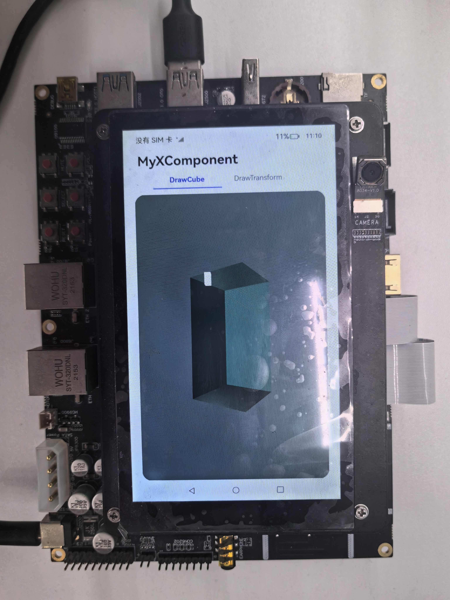
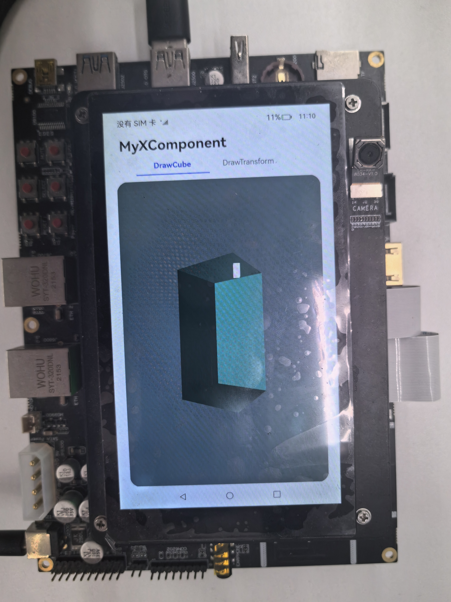
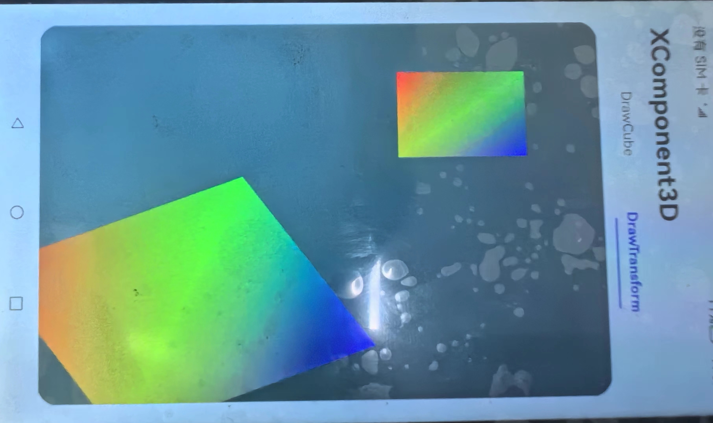
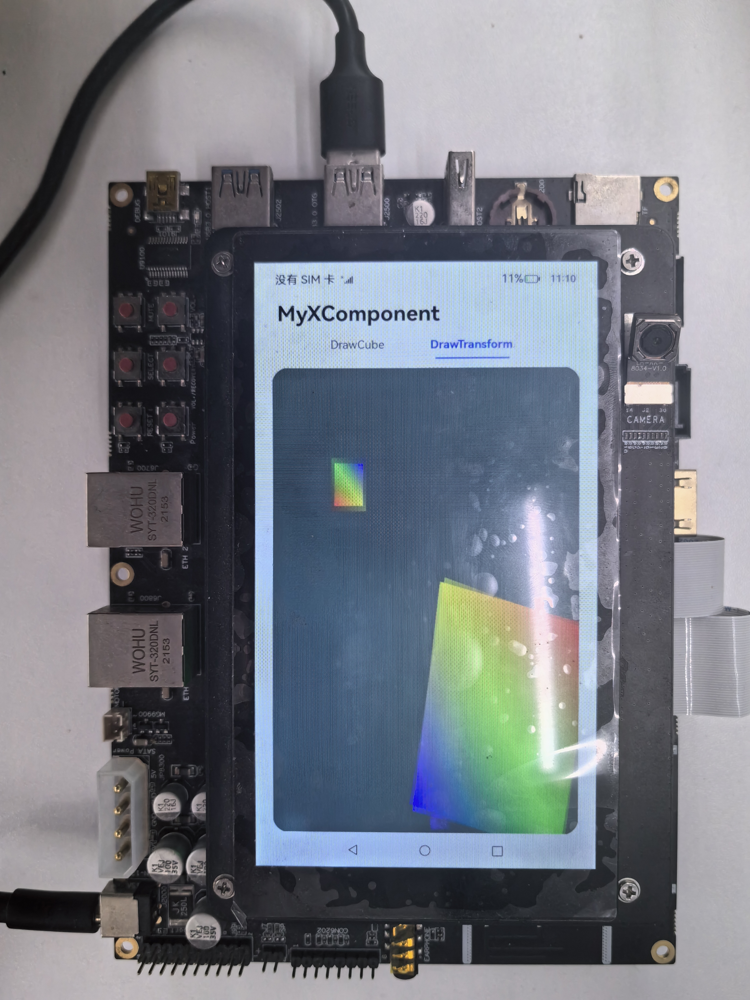

# XComponent3D

### Introduction

This sample creates an EGL/GLES environment from a XComponent component and the native APIs, and renders graphics with standard OpenGL ES. The ArkTS side calls the drawing interfaces exported by `libnativerender.so`. It uses the [XComponent](https://gitcode.com/openharmony/docs/blob/master/en/application-dev/reference/apis-arkui/arkui-ts/ts-basic-components-xcomponent.md) component and the native interfaces described in [Native XComponent](https://gitcode.com/openharmony/docs/blob/master/en/application-dev/napi/xcomponent-guidelines.md).

Two drawing scenes are implemented:

1. 2D graphics and animation: two rectangles are drawn every frame, one keeps rotating and the other keeps scaling;
2. 3D scene: two cubes are drawn every frame, one stays in the middle of the screen and the other revolves around it and acts as a light source, so the cube in the middle shows lighting that changes with the angle.

> **NOTE**
> The declarative ArkTS usage of XComponent no longer evolves. For the current recommended usage, see [XComponent](https://gitcode.com/openharmony/docs/blob/master/en/application-dev/reference/apis-arkui/arkui-ts/ts-basic-components-xcomponent.md).

### Effect Preview

| 3D scene one                                           | 3D scene two                                           | 2D scene one                                           | 2D scene two                                           |
|------------------------------------------------------|------------------------------------------------------|------------------------------------------------------|------------------------------------------------------|
|                         |                         |                         |                         |

### Usage Instructions

1. Install the compiled HAP package and launch the application. The home page shows the 3D scene by default.
2. Tap **DrawTransform** to switch to the 2D scene.
3. Tap **DrawCube** to switch back to the 3D scene.
4. The animation in both scenes is driven by a timer, so no extra operation is required.

### Project Structure

```
├──entry/src/main
│  ├──cpp                                     // C++ code
│  │  ├──CMakeLists.txt                       // CMake build and link configuration
│  │  ├──app_napi.cpp                         // XComponent lifecycle callbacks and napi drawing interface registration
│  │  ├──module.cpp                           // napi module registration entry
│  │  ├──napi_manager.cpp                     // Management of the registered XComponent instances
│  │  ├──napi_util.cpp                        // napi argument and return code helpers
│  │  ├──opengl_draw.cpp                      // Drawing entry: creates the EGL environment and drives the shapes
│  │  ├──pixel_probe.cpp                      // Clears a pbuffer with an independent EGL context and reads pixels back
│  │  ├──pixel_probe.h                        // Declarations of the pixel probe
│  │  ├──algorithm                            // Matrix, quaternion and vector math
│  │  │  ├──Algorithm.h                       // Perspective matrix and LookAt matrix
│  │  │  ├──Matrix4x4.h
│  │  │  ├──Matrix4x4.cpp                     // 4*4 matrix operations: rotation, translation, scale and multiplication
│  │  │  ├──Quaternion.h
│  │  │  ├──Quaternion.cpp                    // Quaternion used for rotation
│  │  │  ├──Vector3.h
│  │  │  └──Vector3.cpp                       // 3D vector operations
│  │  ├──include
│  │  │  ├──app_napi.h                        // Declarations of the XComponent lifecycle and napi drawing interfaces
│  │  │  ├──camera.h                          // Camera
│  │  │  ├──opengl_draw.h                     // Declarations of the drawing class
│  │  │  ├──shader.h                          // Shader compilation
│  │  │  └──util
│  │  │     ├──log.h                          // Logging utilities
│  │  │     ├──napi_manager.h                 // Declarations of the XComponent management
│  │  │     ├──napi_util.h                    // Declarations of the helpers
│  │  │     ├──native_common.h                // napi function registration entry
│  │  │     └──types.h                        // Constants
│  │  ├──shape
│  │  │  ├──base_shape.h                      // Base class of the drawable shapes
│  │  │  ├──cube.h
│  │  │  ├──cube.cpp                          // Cube drawing class derived from base_shape
│  │  │  ├──rectangle.h
│  │  │  └──rectangle.cpp                     // Rectangle drawing class derived from base_shape
│  │  └──types
│  │     └──libnativerender
│  │        ├──nativerender.d.ts              // Declarations of the native interfaces exposed to ArkTS
│  │        └──oh-package.json5
│  ├──ets
│  │  ├──entryability
│  │  │  └──EntryAbility.ts                   // Application entry
│  │  ├──pages
│  │  │  └──Index.ets                         // Home page, declares the XComponent component
│  │  └──util
│  │     └──Logger.ts                         // Logging wrapper
│  └──resources                               // Strings, colors and page configuration
└──entry/src/ohosTest                         // Automated test cases, see ohosTest.md
```

### Implementation

**XComponent declaration and drawing start**

The home page declares a XComponent in [Index.ets](entry/src/main/ets/pages/Index.ets): the id is xComponentId, the type selects the native rendering mode of XComponentType, the library is nativerender, and the width and height are set to 90% and 100%.

When the XComponent is ready, [app_napi.cpp](entry/src/main/cpp/app_napi.cpp) starts drawing in the XComponent ready callback: it first reads back the drawing-area width and height through `OH_NativeXComponent_GetXComponentSize`, and then passes them to the Init method of [opengl_draw.cpp](entry/src/main/cpp/opengl_draw.cpp), which creates the EglWindow, the EGL drawing window and the EGLContext, and initializes the default shape Cube.

**Animation driving and shape switching**

[Index.ets](entry/src/main/ets/pages/Index.ets) starts a 40 ms timer in onPageShow, and each tick calls the native `animate()` to update one frame. Tapping **DrawCube** or **DrawTransform** calls `changeShape(targetIndex)`, where index 0 means the cube and any other value means the rectangle.

**2D and 3D drawing**

- 2D: Init in [rectangle.cpp](entry/src/main/cpp/shape/rectangle.cpp) initializes the shaders, and Update draws two rectangles every frame, one rotating and the other scaling.
- 3D: Init in [cube.cpp](entry/src/main/cpp/shape/cube.cpp) initializes the shaders and the camera, and Update draws two cubes every frame. One cube stays in the middle of the screen and the other revolves around it and acts as a light source, so the cube in the middle shows lighting that changes with the angle. The perspective matrix, the LookAt matrix, the 4*4 matrix, the quaternion and the vector math are located in [algorithm](entry/src/main/cpp/algorithm/).

**Exported interfaces**

The interfaces exported from native to ArkTS are declared in [nativerender.d.ts](entry/src/main/cpp/types/libnativerender/nativerender.d.ts):

| Interface | Description |
| -------- | -------- |
| animate(): void | Drives one frame: takes the next frame of the current shape and refreshes the drawing area. |
| changeShape(shapeIndex: number): void | Switches the drawing shape by index, 0 for the cube and any other value for the rectangle. |
| getShapeIndex(): number | Reads back the shapeIndex received by the latest changeShape call. |
| GetXComponentSize_Width(): number | Reads back the cached drawing-area width, in px on real devices. |
| GetXComponentSize_Height(): number | Reads back the cached drawing-area height, in px on real devices. |
| GetXComponentOffset_x(): number | Reads back the cached x offset, which the current implementation returns as 0. |
| GetXComponentOffset_y(): number | Reads back the cached y offset, which the current implementation returns as 0. |
| GetContext(type: number): object | Obtains the lifecycle callback container: type 0 returns onCreate/onShow/onHide/onDestroy, type 1 returns onPageShow/onPageHide. |
| probe interfaces | Probes that call the native XComponent interfaces directly and return `{code, value, aux}`, where code 0 means success, -1 execution failure and -2 invalid argument. |
| probeRenderSolidPixel(red, green, blue, alpha) | Clears a 4*4 pbuffer to the given color with an independent EGL context and reads the pixels back, returning the RGBA of the `pixel` and `corner` sample points. |

### Test Results

The automated test cases are located in `entry/src/ohosTest`, covering 94 test suites and 4687 test cases. For the case details and the execution steps, see [ohosTest.md](ohosTest.md). On 2026-11-18 the suites were executed one by one on a real device with OpenHarmony-7.1.0.21 (API 26), using the `entry_test` module and `OpenHarmonyTestRunner`:

| Item | Value |
| -------- | -------- |
| Test suites | 94 |
| Test cases | 4687 |
| Pass | 4687 |
| Failure | 0 |
| Error | 0 |

Each suite is executed with `-s class <suite>`; a run without `-s class` is not used because the framework's overall timeout guard terminates it. Every failure reported by the baselines was traced to the test side, and no functional defect was found on the main side:

- The baseline before the first expansion (54 suites) reported 68 failed cases: mismatched error code domains, keyCode and action being -1 when no key event exists, non-enumerable properties of the GetContext result, alpha being 255 on clear which interfered with channel comparisons, and GetXComponentSize returning px while GetXComponentOffset always returns 0. After the cases were corrected, the test HAP was rebuilt, reinstalled and the full run reported zero failures.
- The baseline after the first expansion (71 suites / 3607 cases) reported 2 failed cases, both asserting that the `code` of the tilt interfaces equals the `code` of the event-source interface; the two interface families use different error semantics, so the assumption did not hold. After the assertions were relaxed to a per-family domain, the full run reported zero failures.
- The baseline after the second expansion (23 new suites / 1080 cases) reported 10 failed cases: an anchor assertion that did not hold over the whole input domain (the channel sum of the anchors is 96 to 224 while the assertion required a sum greater than 255) and an ordering assertion that did not hold for inverted frame-rate triples (`value <= aux` with `min > max`). Both were assertion issues inside the affected suites; after they were corrected the suites were updated and re-run.

After the final rebuild and reinstall, the 23 new suites passed 1080 of 1080 cases and the existing 71 suites passed 3607 of 3607 cases on the same build artefact.

### Permissions

Not involved. The sample declares no permission in module.json5.

### Dependencies

No dependency is involved.

### Constraints & Limitations

1. This sample runs on standard systems only. The supported device types are default and tablet.
2. This sample uses the Stage model. It is compiled with the API version 26.0.0 SDK, and the SDK version is 26.0.0.
3. DevEco Studio 26.0.0.821 or later is required to build and run this sample.
4. The sample has been built, installed and fully tested with automated cases on a real device running OpenHarmony-7.1.0.21 (API 26).
5. On real devices `OH_NativeXComponent_GetXComponentSize` returns the size in px and `OH_NativeXComponent_GetXComponentOffset` always returns 0 with the current implementation. The declarations in [nativerender.d.ts](entry/src/main/cpp/types/libnativerender/nativerender.d.ts) are documented accordingly, and assertions that rely on these two values must follow the real read-back results.

### Download

To download this project separately, run the following commands:

```
git init
git config core.sparsecheckout true
echo code/BasicFeature/Native/XComponent3D/ > .git/info/sparse-checkout
git remote add origin https://gitcode.com/openharmony/applications_app_samples.git
git pull origin master
```
