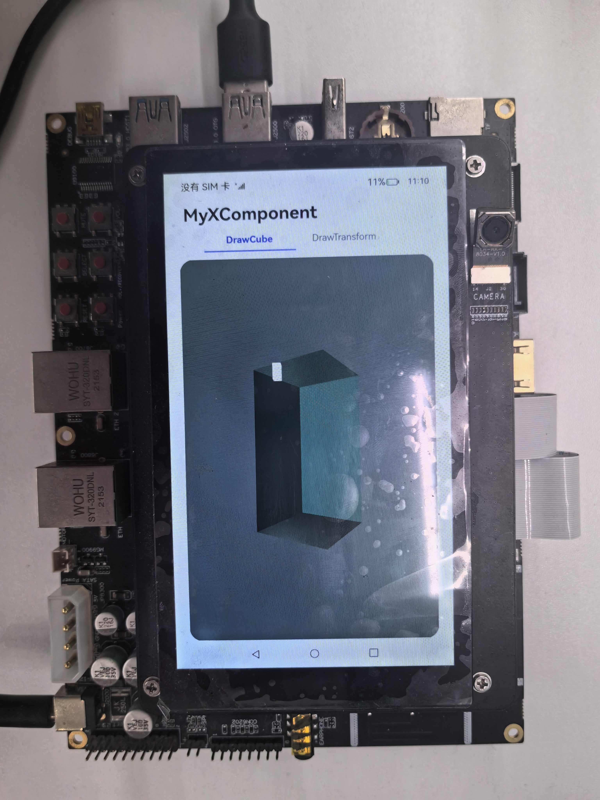
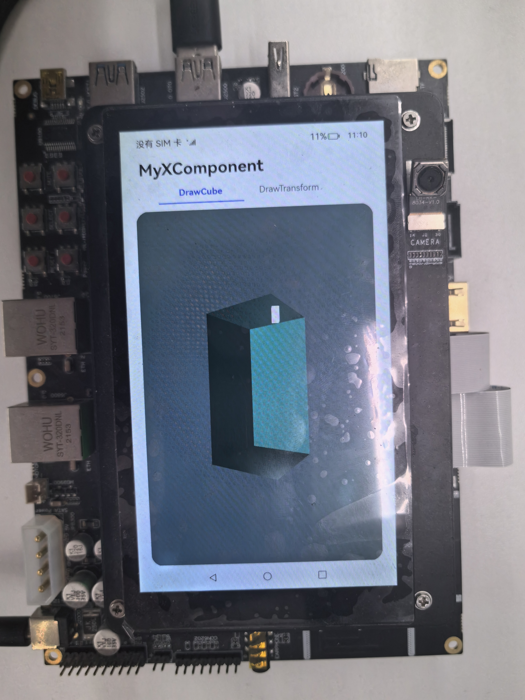
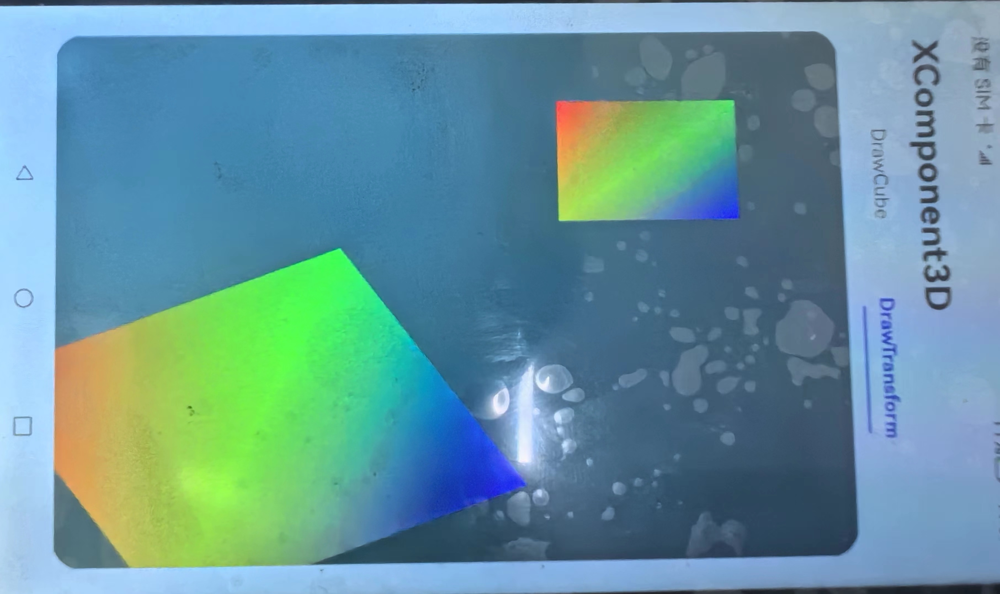
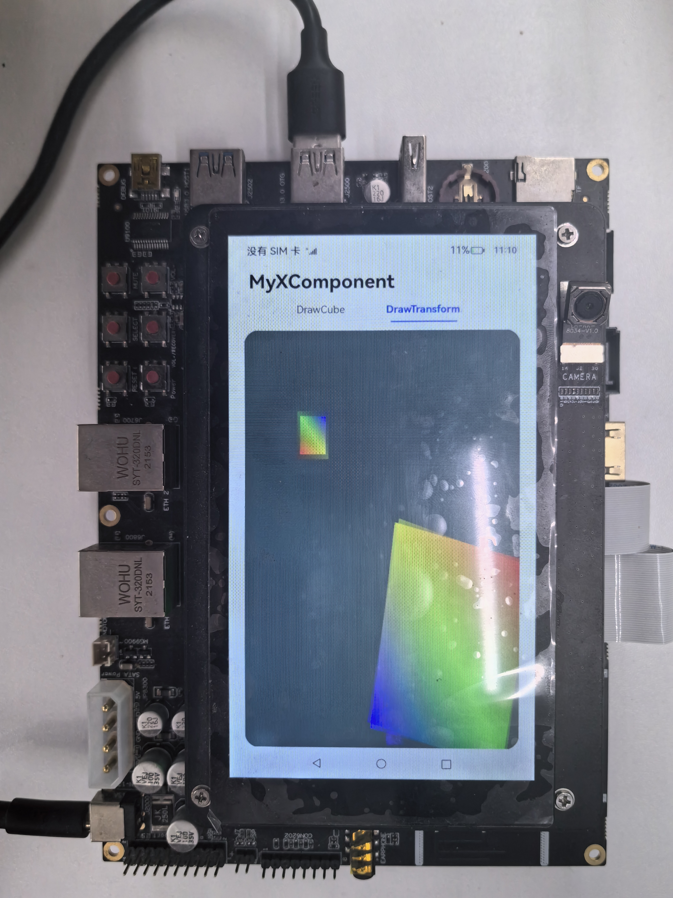

# XComponent3D

### 介绍

本示例基于 XComponent 组件与 Native API 创建 EGL/GLES 环境，使用标准的 OpenGL ES 完成图形渲染。ArkTS 侧通过 `libnativerender.so` 调用 native 导出的绘制接口，使用的接口包括 [XComponent](https://gitcode.com/openharmony/docs/blob/master/zh-cn/application-dev/reference/apis-arkui/arkui-ts/ts-basic-components-xcomponent.md) 组件与 [Native XComponent](https://gitcode.com/openharmony/docs/blob/master/zh-cn/application-dev/napi/xcomponent-guidelines.md) 提供的原生接口。

本示例实现两种绘制场景：

1. 2D 图形绘制与动画：每帧绘制两个矩形，一个持续旋转，另一个持续缩放；
2. 3D 场景绘制：每帧绘制两个立方体，一个固定于屏幕中间，另一个围绕中间的立方体做圆周运动，并作为光源在中间的立方体表面形成随角度变化的光照效果。

> **说明**
> XComponent 在 ArkTS 侧声明式接口上的用法已停止演进，当前推荐用法请参考 [XComponent](https://gitcode.com/openharmony/docs/blob/master/zh-cn/application-dev/reference/apis-arkui/arkui-ts/ts-basic-components-xcomponent.md)。

### 效果预览

| 3D 效果一                                              | 3D 效果二                                              | 2D 效果一                                              | 2D 效果二                                              |
|------------------------------------------------------|------------------------------------------------------|------------------------------------------------------|------------------------------------------------------|
|                         |                         |                         |                         |

### 使用说明

1. 安装编译生成的 HAP 包并打开应用，主页面默认展示 3D 绘制场景；
2. 点击 "DrawTransform" 切换到 2D 绘制场景；
3. 点击 "DrawCube" 切回 3D 绘制场景；
4. 两种场景的动画都由定时器持续驱动，无需额外操作。

### 工程目录

```
├──entry/src/main
│  ├──cpp                                     // C++ 代码区
│  │  ├──CMakeLists.txt                       // CMake 编译与链接配置
│  │  ├──app_napi.cpp                         // XComponent 生命周期回调与 napi 绘制接口注册
│  │  ├──module.cpp                           // napi 模块注册入口
│  │  ├──napi_manager.cpp                     // 注册进来的多个 XComponent 控件管理
│  │  ├──napi_util.cpp                        // napi 参数与返回码工具
│  │  ├──opengl_draw.cpp                      // 绘制入口，创建 EGL 环境并驱动形状绘制
│  │  ├──pixel_probe.cpp                      // 以独立 EGL 上下文清屏并回读像素
│  │  ├──pixel_probe.h                        // 像素回读的声明
│  │  ├──algorithm                            // 矩阵，四元数与向量运算
│  │  │  ├──Algorithm.h                       // 透视矩阵与 LookAt 矩阵
│  │  │  ├──Matrix4x4.h
│  │  │  ├──Matrix4x4.cpp                     // 4*4 矩阵运算，支持旋转，位移，缩放与乘法
│  │  │  ├──Quaternion.h
│  │  │  ├──Quaternion.cpp                    // 四元数，用于旋转
│  │  │  ├──Vector3.h
│  │  │  └──Vector3.cpp                       // 三维向量运算
│  │  ├──include
│  │  │  ├──app_napi.h                        // XComponent 生命周期与 napi 绘制接口声明
│  │  │  ├──camera.h                          // 相机
│  │  │  ├──opengl_draw.h                     // 绘制类声明
│  │  │  ├──shader.h                          // shader 编译类
│  │  │  └──util
│  │  │     ├──log.h                          // 日志工具类
│  │  │     ├──napi_manager.h                 // XComponent 控件管理声明
│  │  │     ├──napi_util.h                    // 工具类声明
│  │  │     ├──native_common.h                // napi 函数注册入口
│  │  │     └──types.h                        // 常量定义
│  │  ├──shape
│  │  │  ├──base_shape.h                      // 形状绘制基类
│  │  │  ├──cube.h
│  │  │  ├──cube.cpp                          // 立方体绘制类，继承 base_shape
│  │  │  ├──rectangle.h
│  │  │  └──rectangle.cpp                     // 矩形绘制类，继承 base_shape
│  │  └──types
│  │     └──libnativerender
│  │        ├──nativerender.d.ts              // native 侧暴露给 ArkTS 侧的接口声明
│  │        └──oh-package.json5
│  ├──ets
│  │  ├──entryability
│  │  │  └──EntryAbility.ts                   // 程序入口类
│  │  ├──pages
│  │  │  └──Index.ets                         // 主界面，声明 XComponent 组件
│  │  └──util
│  │     └──Logger.ts                         // 日志封装
│  └──resources                               // 字符串，颜色与页面配置
└──entry/src/ohosTest                         // 自动化测试用例，详见 ohosTest.md
```

### 具体实现

**XComponent 声明与绘制启动**

主页面在 [Index.ets](entry/src/main/ets/pages/Index.ets) 中声明 XComponent 组件：id 为 xComponentId，type 取 XComponentType 中原生渲染对应的成员，libraryname 为 nativerender，宽度 90%、高度 100%。

XComponent 初始化完成时，native 侧的 [app_napi.cpp](entry/src/main/cpp/app_napi.cpp) 在绘制区创建回调中启动绘制：先通过 `OH_NativeXComponent_GetXComponentSize` 取得绘制区的宽高，再交给 [opengl_draw.cpp](entry/src/main/cpp/opengl_draw.cpp) 的 Init 方法创建 EglWindow、EGL 绘制窗口与 EGLContext，并初始化默认形状 Cube。

**动画驱动与形状切换**

[Index.ets](entry/src/main/ets/pages/Index.ets) 在 onPageShow 中启动 40ms 定时器，每次触发调用 native 导出的 `animate()` 更新一帧；点击 "DrawCube" 或 "DrawTransform" 时调用 `changeShape(targetIndex)`，索引 0 表示立方体，其余值表示矩形。

**2D 与 3D 绘制**

- 2D：[rectangle.cpp](entry/src/main/cpp/shape/rectangle.cpp) 的 Init 完成 shader 初始化，Update 每帧绘制两个矩形，分别做旋转与缩放动画。
- 3D：[cube.cpp](entry/src/main/cpp/shape/cube.cpp) 的 Init 完成 shader 与相机的初始化，Update 每帧绘制两个立方体，一个固定于屏幕中间，另一个围绕它做圆周运动，并将运动中的立方体设置为光源，使中间的立方体呈现随角度变化的光照效果。透视矩阵，LookAt 矩阵，4*4 矩阵，四元数与向量运算位于 [algorithm](entry/src/main/cpp/algorithm/)。

**对外接口**

native 侧导出给 ArkTS 的接口声明在 [nativerender.d.ts](entry/src/main/cpp/types/libnativerender/nativerender.d.ts)，主要接口如下：

| 接口 | 描述 |
| -------- | -------- |
| animate(): void | 驱动一帧绘制，取当前形状的下一帧并刷新绘制区。 |
| changeShape(shapeIndex: number): void | 按索引切换绘制形状，0 为立方体，其余为矩形。 |
| getShapeIndex(): number | 回读最近一次 changeShape 收到的 shapeIndex。 |
| GetXComponentSize_Width(): number | 回读缓存的绘制区宽度，真机单位为 px。 |
| GetXComponentSize_Height(): number | 回读缓存的绘制区高度，真机单位为 px。 |
| GetXComponentOffset_x(): number | 回读缓存的 x 偏移，当前实现返回 0。 |
| GetXComponentOffset_y(): number | 回读缓存的 y 偏移，当前实现返回 0。 |
| GetContext(type: number): object | 取生命周期回调容器，type 为 0 时返回 onCreate/onShow/onHide/onDestroy，为 1 时返回 onPageShow/onPageHide。 |
| probe 系列 | 直连各个 native XComponent 接口的探针，统一返回 `{code, value, aux}`，返回码 0 成功，-1 执行失败，-2 参数错误。 |
| probeRenderSolidPixel(red, green, blue, alpha) | 以独立 EGL 上下文将 4*4 pbuffer 清成指定颜色并回读像素，返回 `pixel` 与 `corner` 两个采样点的 RGBA。 |

### 测试结果

自动化用例位于 `entry/src/ohosTest`，共 94 个测试套件，4687 条用例，用例明细与执行步骤见 [ohosTest.md](ohosTest.md)。2026-11-18 在 OpenHarmony-7.1.0.21（API 26）真机上以 `entry_test` 测试模块和 `OpenHarmonyTestRunner` 逐套件执行，结果如下：

| 项目 | 数值 |
| -------- | -------- |
| 测试套件 | 94 |
| 用例总数 | 4687 |
| 通过 | 4687 |
| 失败 | 0 |
| 错误 | 0 |

每个套件都以 `-s class <套件>` 单独执行；不指定 `-s class` 的整轮执行会被框架的整体超时保护终止，因此不采用。各轮基线报出的失败全部归因到用例侧，main 侧未发现功能缺陷：

- 第一轮基线（54 个套件）有 68 条用例失败：错误返回码域错配，无按键事件时 keyCode 与 action 为 -1，GetContext 返回对象的属性不可枚举，清屏时 alpha 恒为 255 干扰通道比对，GetXComponentSize 回读单位为 px 且 GetXComponentOffset 恒返回 0。修正用例后重建测试 HAP 并重新安装，整轮复跑为零失败。
- 第二轮基线（71 个套件 / 3607 条用例）有 2 条用例失败，均断言倾角接口的 `code` 与事件源接口相等；两者属于不同的接口族，判错口径不一致，用例假设不成立。改为按族域断言后复跑为零失败。
- 第三轮基线（新增 23 个套件 / 1080 条用例）有 10 条用例失败：一是锚点断言未对整段输入域成立（锚点三通道之和为 96 至 224，断言要求大于 255），二是排序断言对倒置的帧率三元组不成立（`min > max` 时断言 `value <= aux`）。两处都属于受影响套件内的断言问题，修正后更新并复跑了这些套件。

最终重建并重装后，新增的 23 个套件通过 1080 条，存量 71 个套件通过 3607 条，两者在同一构建产物上完成，合计 94 个套件 / 4687 条用例零失败。

### 相关权限

不涉及，本示例未在 module.json5 中声明任何权限。

### 依赖

不涉及。

### 约束与限制

1. 本示例仅支持在标准系统上运行，支持的设备类型为 default 与 tablet；
2. 本示例为 Stage 模型，使用 API version 26.0.0 版本 SDK 编译，SDK 版本号为 26.0.0；
3. 本示例需要使用 DevEco Studio 26.0.0.821 及以上版本才可编译运行；
4. 本示例已在 OpenHarmony-7.1.0.21（API 26）真机上完成构建，安装与全量自动化测试；
5. `OH_NativeXComponent_GetXComponentSize` 的实际回读单位为 px，`OH_NativeXComponent_GetXComponentOffset` 的当前实现恒返回 0；[nativerender.d.ts](entry/src/main/cpp/types/libnativerender/nativerender.d.ts) 中的声明已按真机行为标注，依赖这两个数值的断言需按真机实际回读结果处理。

### 下载

如需单独下载本工程，执行如下命令：

```
git init
git config core.sparsecheckout true
echo code/BasicFeature/Native/XComponent3D/ > .git/info/sparse-checkout
git remote add origin https://gitcode.com/openharmony/applications_app_samples.git
git pull origin master
```
