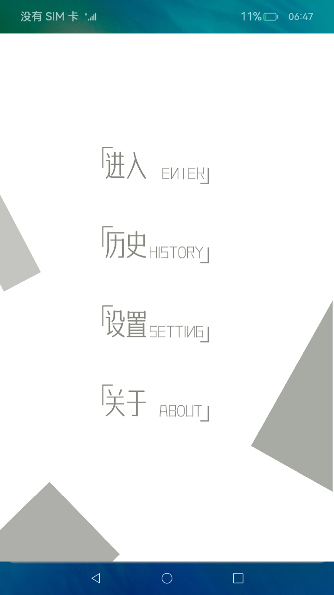
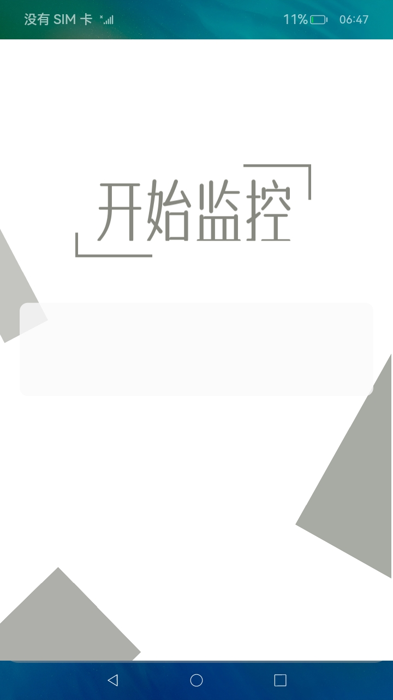
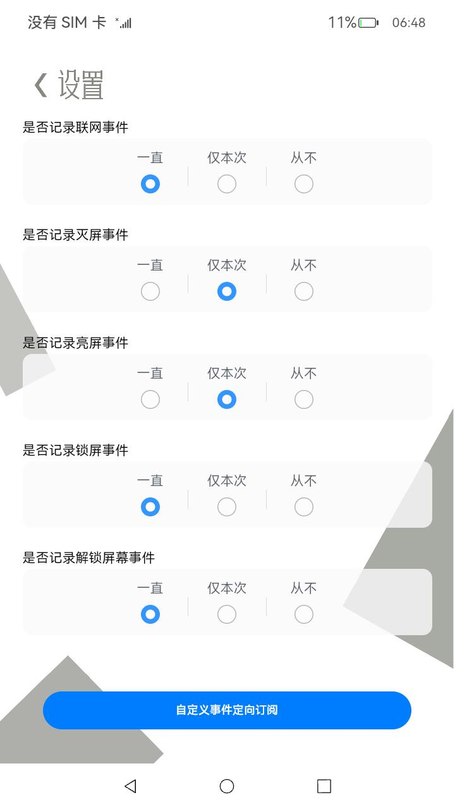
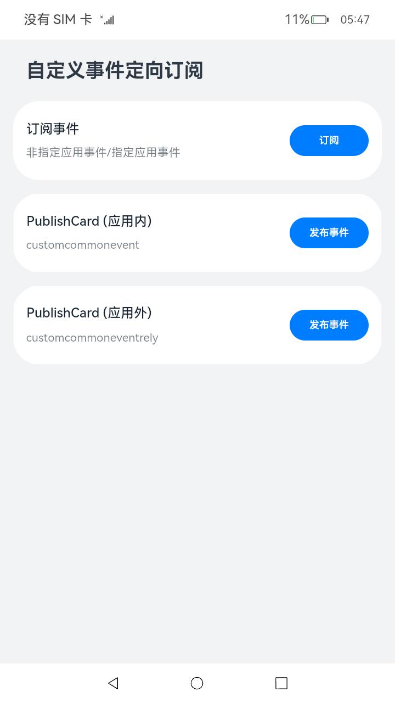

# Subscribe and Publish Common Events

### Introduction

This sample demonstrates common event capabilities by implementing an app that monitors part of the user behavior. It implements the following functions:

1. Subscribes to system common events to monitor user operations, including screen-on, screen-off, screen lock, screen unlock, and network connection changes.

2. Publishes a custom ordered common event when the user proactively stops monitoring, so that the monitoring session is persistently recorded.

3. Publishes a sticky event when the user sets the listening state of an event, records the list of events that are allowed to be listened to during the current app run, and changes the temporary "This time only" setting to "Never" when the app exits.

4. Provides a custom event subscription page, which depends on the [CardEvent](lib/CardEvent-1.0.0.hap) app. By subscribing to the event of a specified app, the user can listen to the events sent by the specified card.

The app uses [@ohos.commonEventManager](https://gitcode.com/openharmony/docs/blob/master/en/application-dev/reference/apis-basic-services-kit/js-apis-commonEventManager.md) to subscribe to and publish common events, [@ohos.data.preferences](https://gitcode.com/openharmony/docs/blob/master/en/application-dev/reference/apis-arkdata/js-apis-data-preferences.md) to persist monitoring records and event settings, and [@ohos.router](https://gitcode.com/openharmony/docs/blob/master/en/application-dev/reference/apis-arkui/js-apis-router.md) to switch pages.

### Display Effect

##### Subscribing to system common events and publishing sticky events

| Home | Monitoring page | Setting page | Custom event subscription page |
| ------------------------------------ | ---------------------------------- | -------------------------------------- | ----------------------------------- |
|  |  |  |  |

The screenshots are captured with the system language set to Chinese. The English UI is provided by the `en` resource directory.

**Usage**

1. Install the built HAP and the dependent HAP. The app icons shown on the home screen are as follows. Tap an icon to start the app.


2. The app displays the menu page, which provides **Enter**, **History**, **Setting**, and **About**.

3. Tap **Enter** to go to the monitoring page, and tap **Start monitoring**. The app starts to listen to system common events and counts the time. The button text changes to **Stop monitoring**. After you tap **Stop monitoring**, the page displays the duration of this session and the interruptions received during monitoring, and the **View details** button is displayed in the lower right corner. Tap **View details** to go to the detail page, which lists the interruptions received during monitoring. Currently, the app only listens to system common events that can be triggered by user operations, such as screen-on, screen-off, screen lock, screen unlock, and network connection changes. More events can be added as required.

4. Return to the menu page and tap **History** to view the monitoring records. At most 10 records are kept for each app run. When the number of records exceeds 10, the historical data is deleted.

5. Return to the menu page and tap **Setting** to configure the listening state of each system event. The app provides **Always**, **This time only**, and **Never**. **This time only** means that the specified system common event is listened to only during the current app run. After the app exits, the option is automatically changed to **Never**.

6. On the setting page, tap **Targeted subscription to custom events** to go to the subscription page.

- Tap **Subscribe** to subscribe to the events of the specified app and the events of non-specified apps at the same time.

- Tap the in-app card or the out-of-app card to send an event.

- If an in-app card sends an event, both the specified app event and the non-specified app event are received. If an out-of-app card sends an event, only the non-specified app event is received, and the specified app event is not received.

- Tap **Unsubscribe**, and the page prompts that the current event is unsubscribed.

7. Return to the menu page and tap **About** to view the app version and the description of this sample.

### Project Directory

**CustomCommonEvent**

```
entry/src/main/ets/
|---Application
|   |---MyAbilityStage.ts
|---component
|   |---Header.ets                           // Header component
|---entryformability
|   |---EntryFormAbility.ts                  // Form provider
|---feature
|   |---CardEventFeature.ts                  // Toast decision for the received card event
|   |---HistoryFeature.ts                    // History record reading and parsing
|   |---LaunchFeature.ts                     // Entry navigation and session persistence
|   |---MainFeature.ts                       // Monitoring state and event statistics
|   |---SettingFeature.ts                    // Listening state configuration
|---LauncherAbility
|   |---LauncherAbility.ts
|---MainAbility
|   |---MainAbility.ts
|---module
|   |---Consts.ts                            // Data definitions
|   |---Logger.ts                            // Log output
|   |---SurveillanceEventsManager.ts         // Common event module
|   |---Utils.ts                             // Time and format utilities
|---pages
|   |---About.ets                            // About page
|   |---Detail.ets                           // Detail page
|   |---History.ets                          // History page
|   |---jumpToCommonEvent.ets                // Custom event subscription page
|   |---Launch.ets                           // Menu page
|   |---Main.ets                             // Monitoring page
|   |---Setting.ets                          // Setting page
|---publishcard
|   |---pages
|   |   |---PublishCard.ets                  // Publishing card page
```

**Resource files**

```
entry/src/main/resources/
|---base                                     // Default resources (Chinese)
|   |---element
|   |   |---string.json                      // Strings
|   |   |---color.json                       // Colors
|   |   |---float.json                       // Sizes
|   |---media                                // App icons
|   |---profile                              // Page and form configuration
|   |---rawfile                              // Background, button, and title images
|---zh                                       // Chinese resources
|   |---element
|   |   |---string.json
|---en                                       // English resources
|   |---element
|   |   |---string.json
```

**CustomCommonEventRely**

```
entry/src/main/ets/
|---entryformability
|   |---EntryFormAbility.ts                  // Publishes events
|---pages
|   |---Index.ets
|---widget
|   |---pages
|   |   |---PublishCard.ets                  // Card that publishes events
```

### Implementation

* The entry module of this sample consists of the following modules:

  * Enter module
    * Uses the app context, the `createSubscriber` method to create a subscriber, and `getCurrentTime` to obtain the time elapsed since the Unix epoch, implementing the monitoring page for user operations.
    * Source code: [Consts.ts](entry/src/main/ets/module/Consts.ts), [LaunchFeature.ts](entry/src/main/ets/feature/LaunchFeature.ts), [LauncherAbility.ts](entry/src/main/ets/LauncherAbility/LauncherAbility.ts), [SurveillanceEventsManager.ts](entry/src/main/ets/module/SurveillanceEventsManager.ts)
    * APIs: [@ohos.app.ability.common](https://gitcode.com/openharmony/docs/blob/master/en/application-dev/reference/apis-ability-kit/js-apis-app-ability-common.md), [@ohos.commonEventManager](https://gitcode.com/openharmony/docs/blob/master/en/application-dev/reference/apis-basic-services-kit/js-apis-commonEventManager.md), [@ohos.data.preferences](https://gitcode.com/openharmony/docs/blob/master/en/application-dev/reference/apis-arkdata/js-apis-data-preferences.md), [@ohos.commonEvent](https://gitcode.com/openharmony/docs/blob/master/en/application-dev/reference/apis-basic-services-kit/js-apis-commonEvent.md), [@ohos.router](https://gitcode.com/openharmony/docs/blob/master/en/application-dev/reference/apis-arkui/js-apis-router.md), [@ohos.systemDateTime](https://gitcode.com/openharmony/docs/blob/master/en/application-dev/reference/apis-basic-services-kit/js-apis-system-date-time.md)

  * History module
    * Uses the app context and the `getPreferences` method to obtain a **Preferences** instance, and the `Header` component to implement the history page.
    * Source code: [Header.ets](entry/src/main/ets/component/Header.ets), [Consts.ts](entry/src/main/ets/module/Consts.ts), [HistoryFeature.ts](entry/src/main/ets/feature/HistoryFeature.ts)
    * APIs: [@ohos.app.ability.common](https://gitcode.com/openharmony/docs/blob/master/en/application-dev/reference/apis-ability-kit/js-apis-app-ability-common.md), [@ohos.data.preferences](https://gitcode.com/openharmony/docs/blob/master/en/application-dev/reference/apis-arkdata/js-apis-data-preferences.md)

  * Setting module
    * This module covers five events: the network connection event, the screen-off event, the screen-on event, the screen lock event, and the screen unlock event. Each event can be set to **Always**, **This time only**, or **Never**. It uses the app context, the `publish` method of `commonEvent` to publish events, and the `getPreferences` method to obtain a **Preferences** instance.
    * Source code: [Header.ets](entry/src/main/ets/component/Header.ets), [Consts.ts](entry/src/main/ets/module/Consts.ts), [SettingFeature.ts](entry/src/main/ets/feature/SettingFeature.ts), [SurveillanceEventsManager.ts](entry/src/main/ets/module/SurveillanceEventsManager.ts)
    * APIs: [@ohos.app.ability.common](https://gitcode.com/openharmony/docs/blob/master/en/application-dev/reference/apis-ability-kit/js-apis-app-ability-common.md), [@ohos.data.preferences](https://gitcode.com/openharmony/docs/blob/master/en/application-dev/reference/apis-arkdata/js-apis-data-preferences.md), [@ohos.commonEvent](https://gitcode.com/openharmony/docs/blob/master/en/application-dev/reference/apis-basic-services-kit/js-apis-commonEvent.md), [@ohos.router](https://gitcode.com/openharmony/docs/blob/master/en/application-dev/reference/apis-arkui/js-apis-router.md)

  * About module
    * This module describes the functions of the sample and the scenarios in which the app cannot be used.
    * Source code: [Header.ets](entry/src/main/ets/component/Header.ets), [Consts.ts](entry/src/main/ets/module/Consts.ts)

  * Subscription module in Setting
    * This module supports subscribing to custom events of a specified app. `CommonEventSubscribeInfo` provides the optional attribute `publisherBundleName`, which can be specified when the subscriber is created. When an event is published, the subscriber information is obtained and the `bundleName` of the publisher is compared with `publisherBundleName`. The subscriber is invoked only when the two values are the same, so that only the events published by the specified publisher are received.
    * Source code: [EntryFormAbility.ts](entry/src/main/ets/entryformability/EntryFormAbility.ts), [Main.ets](entry/src/main/ets/pages/Main.ets), [jumpToCommonEvent.ets](entry/src/main/ets/pages/jumpToCommonEvent.ets), [CardEventFeature.ts](entry/src/main/ets/feature/CardEventFeature.ts), [PublishCard.ets](entry/src/main/ets/publishcard/pages/PublishCard.ets)
    * APIs: [@ohos.commonEventManager](https://gitcode.com/openharmony/docs/blob/master/en/application-dev/reference/apis-basic-services-kit/js-apis-commonEventManager.md), [@ohos.hilog](https://gitcode.com/openharmony/docs/blob/master/en/application-dev/reference/apis-performance-analysis-kit/js-apis-hilog.md), [@ohos.app.form.formInfo](https://gitcode.com/openharmony/docs/blob/master/en/application-dev/reference/apis-form-kit/js-apis-app-form-formInfo.md), [@ohos.app.form.formBindingData](https://gitcode.com/openharmony/docs/blob/master/en/application-dev/reference/apis-form-kit/js-apis-app-form-formBindingData.md), [@ohos.app.form.FormExtensionAbility](https://gitcode.com/openharmony/docs/blob/master/en/application-dev/reference/apis-form-kit/js-apis-app-form-formExtensionAbility.md)

### Required Permissions

[ohos.permission.COMMONEVENT_STICKY](https://gitcode.com/openharmony/docs/blob/master/en/application-dev/security/AccessToken/permissions-for-all.md#ohospermissioncommonevent_sticky)

[ohos.permission.REQUIRE_FORM](https://gitcode.com/openharmony/docs/blob/master/en/application-dev/security/AccessToken/permissions-for-system-apps.md#ohospermissionrequire_form)

[ohos.permission.GET_BUNDLE_INFO_PRIVILEGED](https://gitcode.com/openharmony/docs/blob/master/en/application-dev/security/AccessToken/permissions-for-system-apps.md#ohospermissionget_bundle_info_privileged)

### Dependency

The sample depends on the [CustomCommonEventRely](../CustomCommonEventRely) app. The prebuilt HAP is provided in the [lib](lib) directory as `CardEvent-1.0.0.hap`.

### Constraints

1. This sample can only be run on standard-system devices, for example, RK3568.

2. This sample uses the Stage model. The `compileSdkVersion`, `targetSdkVersion`, and `compatibleSdkVersion` configured in `build-profile.json5` are 26.0.0.

3. This sample is built with the DevEco Studio 26.0.0.821 command-line tools (hvigor modelVersion 26.0.0).

4. [ohos.permission.REQUIRE_FORM](https://gitcode.com/openharmony/docs/blob/master/en/application-dev/security/AccessToken/permissions-for-system-apps.md#ohospermissionrequire_form) and [ohos.permission.GET_BUNDLE_INFO_PRIVILEGED](https://gitcode.com/openharmony/docs/blob/master/en/application-dev/security/AccessToken/permissions-for-system-apps.md#ohospermissionget_bundle_info_privileged) are system_basic permissions and require a high-level signature. The app also publishes sticky events, so it must be signed and installed as a system app.

5. The custom event subscription page requires the `CardEvent-1.0.0.hap` (or the [CustomCommonEventRely](../CustomCommonEventRely) app) to be installed. Otherwise, the card on the subscription page fails to be loaded.

### Download

To download this project separately, run the following commands:

```
git init
git config core.sparsecheckout true
echo code/BasicFeature/Notification/CustomCommonEvent/ > .git/info/sparse-checkout
git remote add origin https://gitcode.com/openharmony/applications_app_samples.git
git pull origin master
```
