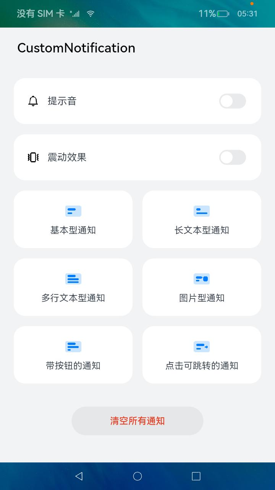
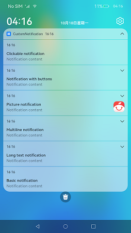
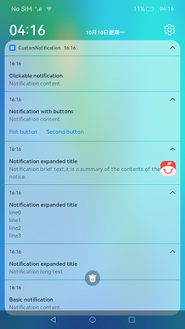

# Custom Notification

### Introduction

This sample shows how to initialize notification content and how to publish and cancel notifications as well as set the desktop badge. It uses [@ohos.notificationManager](https://gitcode.com/openharmony/docs/blob/master/en/application-dev/reference/apis-notification-kit/js-apis-notificationManager.md), [@ohos.app.ability.wantAgent](https://gitcode.com/openharmony/docs/blob/master/en/application-dev/reference/apis-ability-kit/js-apis-app-ability-wantAgent.md) and [@ohos.multimedia.image](https://gitcode.com/openharmony/docs/blob/master/en/application-dev/reference/apis-image-kit/arkts-apis-image.md). The notification types include basic text, long text, multiline text, picture, notification with buttons and clickable notification that jumps back to the app.

The notification capabilities are encapsulated in the `notification` HAR module: `NotificationContentUtil` builds the content of the basic text, long text, multiline text and picture notification types, `NotificationRequestUtil` assembles a complete notification request, `WantAgentUtil` creates WantAgent for ability jump and common event, `NotificationUtil` handles authorization, publishing, cancellation and the prompt tone/vibration switches, and `NotificationManagementUtil` maintains message groups, badges and the refresh of active notifications. `NotificationOperations` in the `entry` module combines these capabilities and exposes six publishing entries, and `Index.ets` switches between the notification list and the notification sending page with two tabs.

### Display Effect

|Notification sending page|Notification list|Notification panel|
|---|---|---|
||||

### Usage

1. Start the app. The notification list page is displayed by default. Touch the notification sending tab, the app calls requestEnableNotification to request the notification permission, and touch Allow in the dialog to continue.

2. On the notification sending page, touch the button of the required type to publish a notification. Swipe down from the status bar to view the published notifications.

3. Turn on the prompt tone or vibration switch before publishing. The notification slot intent for CONTENT_INFORMATION is assembled with the prompt tone (file:///system/etc/capture.ogg) and vibration values ([200]) according to the switches. Whether the device actually plays the tone or vibrates depends on its notification slot policy.

4. Switch to the notification list page to view the notifications grouped by type, and the number of notifications of each type is displayed on the right of the item. Touching an item cancels all notifications of that type and decreases the desktop badge.

5. Return to the home screen, the badge number of the app equals the number of notifications. The [Launcher](../../../SystemFeature/ApplicationModels/Launcher) must be installed and started to display the badge.

6. Touch **Clear all notifications** to cancel all notifications published by the app, and the groups and the badge count on the notification list page are cleared at the same time.

### Project Structure

```
entry/src/main/ets/
|---Application
|   |---MyAbilityStage.ets                  // AbilityStage of the app
|---MainAbility
|   |---MainAbility.ets                     // Main ability
|---components
|   |---NotificationList.ets                // Notification list page, shows notifications by type and cancels one type on click
|   |---NotificationPublish.ets             // Notification sending page, prompt tone/vibration switches, six publishing buttons and the clear button
|   |---TitleBar.ets                        // Title bar of the page
|---feature
|   |---NotificationOperations.ets          // Combines content, request and publishing interfaces, exposes six publishing entries
|---pages
|   |---Index.ets                           // Home page, switches between the notification list and the sending page
entry/src/ohosTest/ets/
|---test
|   |---List.test.ets                       // Registration entry of the 31 test suites
|   |---helper/UiFlow.ets                   // Common UI automation operations and observation helpers
|   |---*.test.ets                          // Test suites, see ohosTest.md for details
|---testability
|   |---TestAbility.ets                     // Ability used by tests
|---TestRunner
|   |---OpenHarmonyTestRunner.ts            // Test runner
|---util
|   |---ResourceUtil.ets                    // Reads resource strings in the current device language
notification/
|---index.ets                              // Exports six utility instances
|---src/main/ets/
|   |---notification
|   |   |---NotificationContentUtil.ets     // Builds the content of each notification type
|   |   |---NotificationManagementUtil.ets  // Message groups, badge setting and active notification refresh
|   |   |---NotificationRequestUtil.ets     // Builds a complete notification request from the content
|   |   |---NotificationUtil.ets            // Authorization, publishing, cancellation and the prompt tone/vibration state
|   |   |---WantAgentUtil.ets               // WantAgent for ability jump and common event
|   |---util
|   |   |---Logger.ets                      // Log utility
```

### Implementation

* Authorization, publishing, cancellation and the switch state are encapsulated in NotificationUtil, see [NotificationUtil.ets](notification/src/main/ets/notification/NotificationUtil.ets)
    * Requesting the notification permission: enableNotification() is called in aboutToAppear of [NotificationPublish.ets](entry/src/main/ets/components/NotificationPublish.ets), and it calls notification.requestEnableNotification() internally.
    * Publishing a notification: publishNotification() assembles a NotificationSlot intent according to the switches, calls removeAllSlots() and addSlot(SlotType.CONTENT_INFORMATION), then calls notification.publish() and finally asks NotificationManagementUtil to record the request.
    * Cancelling notifications: cancelAllNotifications() cancels all notifications of the app, and cancelNotificationById() cancels the notification of the specified id.
    * Switch state: promptTone(flag) and vibrationEffect(flag) keep the switch state, which decides whether the prompt tone and vibration values are assembled when publishing.
    * Observation points: getLastPublishedRequest(), getLastNotificationSlot() and getLastCancelledIds() expose the latest request, slot intent and cancelled ids for the UI and the automated test cases.

* Notification content is encapsulated in NotificationContentUtil, see [NotificationContentUtil.ets](notification/src/main/ets/notification/NotificationContentUtil.ets)
    * initBasicNotificationContent() builds the basic text content.
    * initNotificationLongTextContent() builds the long text content.
    * initNotificationMultiLineContent() builds the multiline text content.
    * initNotificationPictureContent() builds the picture content. The picture is read from $r('app.media.notification_icon') through resourceManager.getMedia(), and decoded into a PixelMap through image.createImageSource() and ImageSource.createPixelMap().
    * getContentTypeId() returns the content type id, which is also used as the group index on the notification list.

* Notification requests are assembled in NotificationRequestUtil, see [NotificationRequestUtil.ets](notification/src/main/ets/notification/NotificationRequestUtil.ets)
    * initBasicNotificationRequest(), initWantAgentNotificationRequest() and initButtonNotificationRequest() build a basic request, a request with WantAgent and a request with buttons respectively. Only the first two buttons are kept when more than two are provided.

* The jump capability is encapsulated in WantAgentUtil, see [WantAgentUtil.ets](notification/src/main/ets/notification/WantAgentUtil.ets)
    * createWantAgentForStartAbility() creates a WantAgent that starts an ability of the specified app.
    * createWantAgentForCommonEvent() creates a WantAgent that sends a common event.

* The notification list, badge and active notification refresh are encapsulated in NotificationManagementUtil, see [NotificationManagementUtil.ets](notification/src/main/ets/notification/NotificationManagementUtil.ets)
    * addNotification() increases the group, the count and the badge according to the content type after each publishing, and calls setBadgeNumber() to update the desktop badge.
    * getAllNotifications() returns the grouped notifications and the count of each type.
    * refreshFromActive() reads the active notifications again through getActiveNotifications() to calibrate the local groups.
    * cancelNotificationType(typeId) cancels all notifications of that type, clears its group and count, and decreases the desktop badge accordingly. An out-of-range type returns directly.
    * resetTypeNotificationState() clears all groups, counts and the badge.

* The publishing entries are combined in NotificationOperations, see [NotificationOperations.ets](entry/src/main/ets/feature/NotificationOperations.ets)
    * The constructor reads the title, text and additional text through resourceManager.getStringSync(), and each of the six entries overrides the title and then calls NotificationContentUtil, NotificationRequestUtil and NotificationUtil.publishNotification() in sequence.
    * The notification ids are fixed to 1 to 6, corresponding to the basic, long text, multiline text, picture, button and clickable notifications, so publishing the same type again updates the same notification.
    * The two buttons of the notification with buttons are bound to a common event WantAgent and a WantAgent that starts this app respectively.

* Pages and components, see [Index.ets](entry/src/main/ets/pages/Index.ets)
    * Index.ets uses Tabs to provide the notification list tab and the notification sending tab. The content of a tab is destroyed and rebuilt when switching, so the notification list reads the groups again on each entry.
    * NotificationPublish.ets provides the prompt tone switch (id promptTone), the vibration switch (id vibrationEffect), six publishing buttons (ids publishBasic, publishLongText, publishMultiLine, publishPicture, publishButtons and publishWantAgent) and the clear button (id cancelAll).
    * NotificationList.ets renders the groups indexed by countsByType, the item title comes from the string resource of the content type, the Badge on the right shows the number of notifications of that type, and the item id is notificationGroup plus the index.

* Automated tests, see [ohosTest.md](ohosTest.md)
    * 31 test suites and 565 test cases cover content building, request assembling, management utilities, the publishing chain, publishing entries, WantAgent, UI state and defect regression.
    * Common operations and observation are encapsulated in helper/UiFlow.ets, such as tapping by id, reading the checked state of a Toggle by id, counting the groups on the notification list and switching tabs to refresh the list snapshot.
    * The run command, environment requirements and the complete case table are described in ohosTest.md.

### Required Permissions

1. [ohos.permission.VIBRATE](https://gitcode.com/openharmony/docs/blob/master/en/application-dev/security/AccessToken/permissions-for-all.md#ohospermissionvibrate): allows the app to control vibration. The permission level is normal and the authorization mode is system_grant.

2. [ohos.permission.NOTIFICATION_CONTROLLER](https://gitcode.com/openharmony/docs/blob/master/en/application-dev/security/AccessToken/permissions-for-system-apps.md#ohospermissionnotification_controller): allows the app to manage and subscribe to notifications. The permission level is system_core, the authorization mode is system_grant and the ACL is enabled.

### Dependency

1. This sample does not depend on the code of other samples.

2. The desktop badge is displayed by the [Launcher](../../../SystemFeature/ApplicationModels/Launcher).

### Constraints

1. This sample can only run on standard-system devices. The supported device types are default and tablet.

2. This sample is implemented in the Stage model and uses OpenHarmony SDK 26.0.0. The compileSdkVersion, targetSdkVersion and compatibleSdkVersion are all 26.0.0.

3. DevEco Studio 26.0.0 or later is required to build this sample, since the modelVersion of hvigor is 26.0.0.

4. The permission ohos.permission.NOTIFICATION_CONTROLLER used by this sample is of the system_core level with the ACL enabled, so a high-level signature is required. For details, see [Configuring a High-Level Signature](https://gitcode.com/openharmony/docs/blob/master/en/application-dev/security/hapsigntool-overview.md). With a normal signature, the badge and notification management interfaces may fail.

### Download

If you need to download this project separately, run the following commands:

```
git init
git config core.sparsecheckout true
echo code/BasicFeature/Notification/CustomNotification/ > .git/info/sparse-checkout
git remote add origin https://gitcode.com/openharmony/applications_app_samples.git
git pull origin master
```
