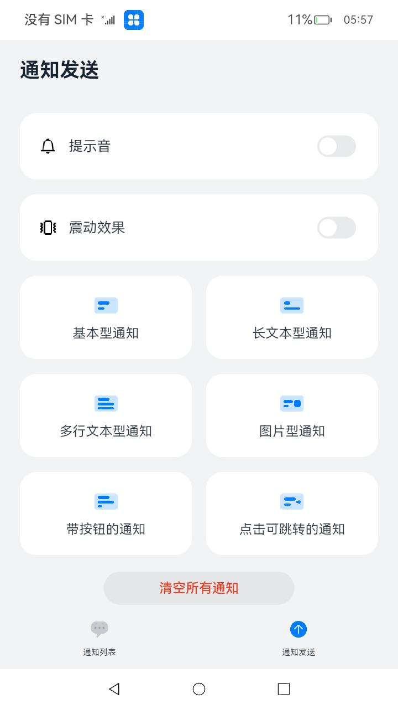
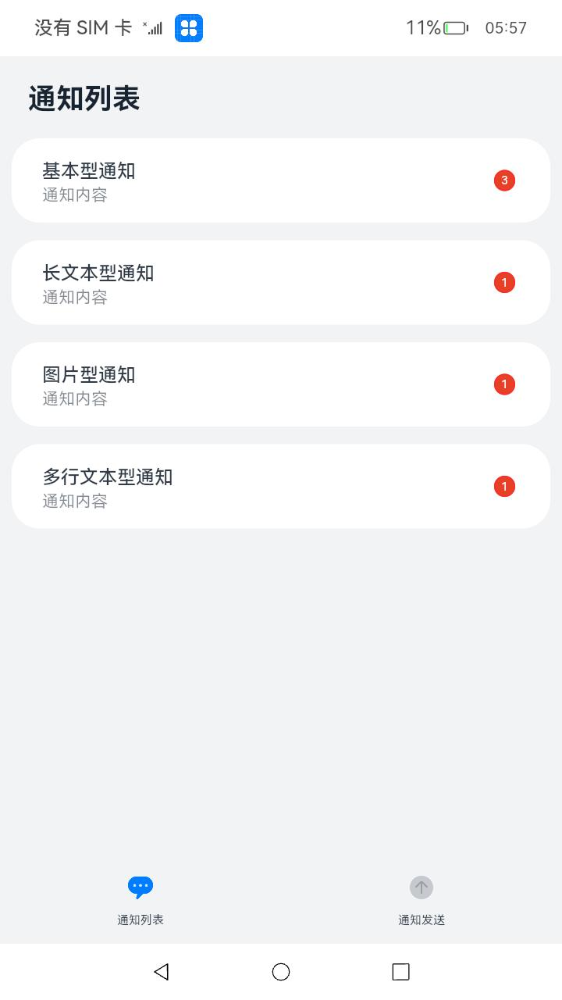
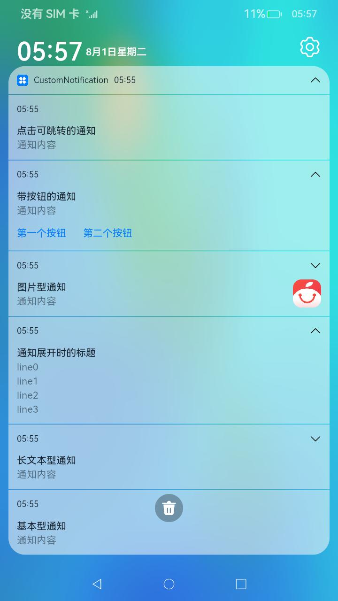

# 自定义通知

### 介绍

本示例主要展示通知内容的初始化以及通知的发布，取消和桌面角标设置，使用[@ohos.notificationManager](https://gitcode.com/openharmony/docs/blob/master/zh-cn/application-dev/reference/apis-notification-kit/js-apis-notificationManager.md)，[@ohos.app.ability.wantAgent](https://gitcode.com/openharmony/docs/blob/master/zh-cn/application-dev/reference/apis-ability-kit/js-apis-app-ability-wantAgent.md)和[@ohos.multimedia.image](https://gitcode.com/openharmony/docs/blob/master/zh-cn/application-dev/reference/apis-image-kit/arkts-apis-image.md)等接口。通知类型包括基本类型，长文本类型，多行文本类型，图片类型，带按钮的通知和点击可跳转到应用的通知。

工程将通知能力封装为 `notification` 模块（HAR）：`NotificationContentUtil` 装配基本，长文本，多行文本与图片 4 类通知内容，`NotificationRequestUtil` 组装完整通知请求，`WantAgentUtil` 创建跳转与公共事件的 WantAgent，`NotificationUtil` 负责授权，发布，取消与提示音/震动开关状态，`NotificationManagementUtil` 负责消息分组，角标与系统活动通知刷新。`entry` 模块的 `NotificationOperations` 组合上述能力对外提供 6 个发布入口，`Index.ets` 通过两个页签在通知列表与通知发送之间切换。

### 效果预览

| 通知发送页                                                                              | 通知列表页                                                                                  | 通知栏                                                                                                              |
|-------------------------------------------------------------------------------------|-----------------------------------------------------------------------------------------|-------------------------------------------------------------------------------------------------------------------|
|              |  |  |

### 使用说明

1.启动应用后默认进入「通知列表」页。点击底部「通知发送」页签，应用会调用 requestEnableNotification 申请通知授权，在弹窗中点击允许后开始操作；

2.在「通知发送」页点击对应类型的按钮发布通知，下拉状态栏可以在通知栏看到已发布的通知；

3.打开「提示音」或「震动效果」开关后再发布通知，发布时会按开关状态为 CONTENT_INFORMATION 槽位装配提示音（file:///system/etc/capture.ogg）与振动参数（[200]）的意图，系统侧是否实际响铃或振动取决于设备通知槽位策略；

4.切换到「通知列表」页，可以查看按类型分组的通知条目，条目右侧显示该类型的通知数量。点击某条目会取消该类型下的全部通知，并同步扣减桌面角标；

5.回到桌面，可以看到应用角标数量与通知数量一致（使用前需安装并启动[仿桌面应用](../../../SystemFeature/ApplicationModels/Launcher)）；

6.点击「清空所有通知」，取消本应用发布的全部通知，同时清空通知列表的分组与角标计数。

### 工程目录

```
entry/src/main/ets/
|---Application
|   |---MyAbilityStage.ets                  // 应用级 AbilityStage
|---MainAbility
|   |---MainAbility.ets                     // 入口 Ability
|---components
|   |---NotificationList.ets                // 通知列表页，按类型分组展示通知与数量，点击取消对应类型
|   |---NotificationPublish.ets             // 通知发送页，包含提示音/震动开关，6 个发布按钮与清空按钮
|   |---TitleBar.ets                        // 页面标题栏
|---feature
|   |---NotificationOperations.ets          // 组合内容，请求与发布接口，对外提供 6 个发布入口
|---pages
|   |---Index.ets                           // 首页，底部两个页签切换通知列表与通知发送
entry/src/ohosTest/ets/
|---test
|   |---List.test.ets                       // 31 个测试套件的注册入口
|   |---helper/UiFlow.ets                   // UI 自动化公共操作与观测封装
|   |---*.test.ets                          // 各测试套件，用例说明见 ohosTest.md
|---testability
|   |---TestAbility.ets                     // 测试用 Ability
|---TestRunner
|   |---OpenHarmonyTestRunner.ts            // 测试运行器
|---util
|   |---ResourceUtil.ets                    // 按设备语言读取资源字符串
notification/
|---index.ets                              // 对外导出 6 个工具类实例
|---src/main/ets/
|   |---notification
|   |   |---NotificationContentUtil.ets     // 封装各种通知的主体内容
|   |   |---NotificationManagementUtil.ets  // 封装消息列表，角标设置与系统活动通知刷新
|   |   |---NotificationRequestUtil.ets     // 接收通知的主体内容，返回完整的通知请求
|   |   |---NotificationUtil.ets            // 封装授权，发布，取消与提示音/震动开关状态
|   |   |---WantAgentUtil.ets               // 封装跳转应用与公共事件的 WantAgent
|   |---util
|   |   |---Logger.ets                      // 日志工具
```

### 具体实现

* 授权，发布，取消与开关状态的接口封装在 NotificationUtil，源码参考：[NotificationUtil.ets](notification/src/main/ets/notification/NotificationUtil.ets)
    * 申请通知授权：在[NotificationPublish.ets](entry/src/main/ets/components/NotificationPublish.ets)的 aboutToAppear 中调用 enableNotification()，内部调用 notification.requestEnableNotification() 向用户申请发送通知；
    * 发布通知：publishNotification() 按开关状态组装 NotificationSlot 意图，随后执行 removeAllSlots() 与 addSlot(SlotType.CONTENT_INFORMATION)，再调用 notification.publish()，最后通知 NotificationManagementUtil 记录本次发布；
    * 取消通知：cancelAllNotifications() 取消本应用的全部通知，cancelNotificationById() 取消指定 id 的通知；
    * 开关状态：promptTone(flag) 与 vibrationEffect(flag) 保存开关状态，发布时读取该状态决定是否装配提示音与振动参数；
    * 可观测点：getLastPublishedRequest()，getLastNotificationSlot() 与 getLastCancelledIds() 暴露最近一次发布的请求，槽位意图与取消的 id，供界面与自动化用例观测发布链路。

* 通知内容的装配封装在 NotificationContentUtil，源码参考：[NotificationContentUtil.ets](notification/src/main/ets/notification/NotificationContentUtil.ets)
    * initBasicNotificationContent() 装配基本类型内容；
    * initNotificationLongTextContent() 装配长文本类型内容；
    * initNotificationMultiLineContent() 装配多行文本类型内容；
    * initNotificationPictureContent() 装配图片类型内容，图片通过 resourceManager.getMedia() 读取 $r('app.media.notification_icon')，再经 image.createImageSource() 与 ImageSource.createPixelMap() 解码为 PixelMap；
    * getContentTypeId() 返回内容类型 id，同时作为消息列表的分组索引。

* 通知请求的组装封装在 NotificationRequestUtil，源码参考：[NotificationRequestUtil.ets](notification/src/main/ets/notification/NotificationRequestUtil.ets)
    * initBasicNotificationRequest()，initWantAgentNotificationRequest() 与 initButtonNotificationRequest() 分别组装基本，带 WantAgent 与带按钮的通知请求，按钮超过 2 个时只取前 2 个。

* 跳转能力封装在 WantAgentUtil，源码参考：[WantAgentUtil.ets](notification/src/main/ets/notification/WantAgentUtil.ets)
    * createWantAgentForStartAbility() 创建跳转到指定应用 Ability 的 WantAgent；
    * createWantAgentForCommonEvent() 创建发送公共事件的 WantAgent。

* 消息列表，角标与系统活动通知刷新封装在 NotificationManagementUtil，源码参考：[NotificationManagementUtil.ets](notification/src/main/ets/notification/NotificationManagementUtil.ets)
    * addNotification() 在每次发布后按内容类型累加分组，数量与角标，并调用 setBadgeNumber() 更新桌面角标；
    * getAllNotifications() 返回分组通知与各类型数量；
    * refreshFromActive() 通过 getActiveNotifications() 重新读取系统活动通知，用于校准本地分组；
    * cancelNotificationType(typeId) 取消该类型下的全部通知，清空该类型的分组与计数，并同步扣减桌面角标，越界类型直接返回；
    * resetTypeNotificationState() 清空全部分组，数量与角标。

* 发布入口组合在 NotificationOperations，源码参考：[NotificationOperations.ets](entry/src/main/ets/feature/NotificationOperations.ets)
    * 构造函数通过 resourceManager.getStringSync() 读取标题，正文与次要内容，6 个发布入口分别覆写标题后依次调用 NotificationContentUtil，NotificationRequestUtil 与 NotificationUtil.publishNotification()；
    * 各类通知的 id 固定为 1 至 6，依次对应基本，长文本，多行文本，图片，带按钮与点击跳转通知，同类型重复发布会更新同一条通知；
    * 带按钮通知的两个按钮分别绑定公共事件 WantAgent 与跳转本应用的 WantAgent。

* 页面与组件，源码参考：[Index.ets](entry/src/main/ets/pages/Index.ets)
    * Index.ets 使用 Tabs 提供「通知列表」与「通知发送」两个页签，切换时销毁并重建对应组件，通知列表因此在每次进入时重新读取一遍分组数据；
    * NotificationPublish.ets 提供提示音开关（id 为 promptTone），震动开关（id 为 vibrationEffect），6 个发布按钮（id 为 publishBasic，publishLongText，publishMultiLine，publishPicture，publishButtons，publishWantAgent）与清空按钮（id 为 cancelAll）；
    * NotificationList.ets 按 countsByType 索引渲染分组，条目标题取自内容类型对应的字符串资源，右侧 Badge 显示该类型的通知数量，条目 id 为 notificationGroup 加索引。

* 自动化测试，源码参考：[ohosTest.md](ohosTest.md)
    * 共 31 个测试套件，565 条用例，覆盖内容装配，请求组装，管理工具，发布链路，发布入口，WantAgent，UI 状态与缺陷回归；
    * 公共操作与观测封装在 helper/UiFlow.ets，例如按 id 点击，按 id 读取 Toggle 勾选态，统计通知列表分组数量以及切换页签刷新列表快照；
    * 运行命令，环境要求与完整用例说明见 ohosTest.md。

### 相关权限

1.[ohos.permission.VIBRATE](https://gitcode.com/openharmony/docs/blob/master/zh-cn/application-dev/security/AccessToken/permissions-for-all.md#ohospermissionvibrate)：允许应用控制马达振动，权限级别为 normal，授权方式为 system_grant；

2.[ohos.permission.NOTIFICATION_CONTROLLER](https://gitcode.com/openharmony/docs/blob/master/zh-cn/application-dev/security/AccessToken/permissions-for-system-apps.md#ohospermissionnotification_controller)：允许应用管理通知和订阅通知，权限级别为 system_core，授权方式为 system_grant，ACL 使能为 true。

### 依赖

1.本示例不依赖其余 Sample 的功能代码；

2.应用的角标依赖于仿桌面应用进行显示：[仿桌面应用](../../../SystemFeature/ApplicationModels/Launcher)。

### 约束与限制

1.本示例仅支持标准系统上运行，设备类型为 default 和 tablet；

2.本示例为 Stage 模型，OpenHarmony SDK 版本号为 26.0.0（compileSdkVersion，targetSdkVersion 与 compatibleSdkVersion 均为 26.0.0）；

3.本示例需要使用 DevEco Studio 26.0.0 及以上版本才可编译运行（工程 hvigor 的 modelVersion 为 26.0.0）；

4.本示例使用的 ohos.permission.NOTIFICATION_CONTROLLER 为 system_core 级别且 ACL 使能，需要配置高权限签名，可参考[特殊权限配置方法](https://gitcode.com/openharmony/docs/blob/master/zh-cn/application-dev/security/hapsigntool-overview.md)。使用普通签名时，角标与通知管理相关接口会调用失败。

### 下载

如需单独下载本工程，执行如下命令：

```
git init
git config core.sparsecheckout true
echo code/BasicFeature/Notification/CustomNotification/ > .git/info/sparse-checkout
git remote add origin https://gitcode.com/openharmony/applications_app_samples.git
git pull origin master
```
