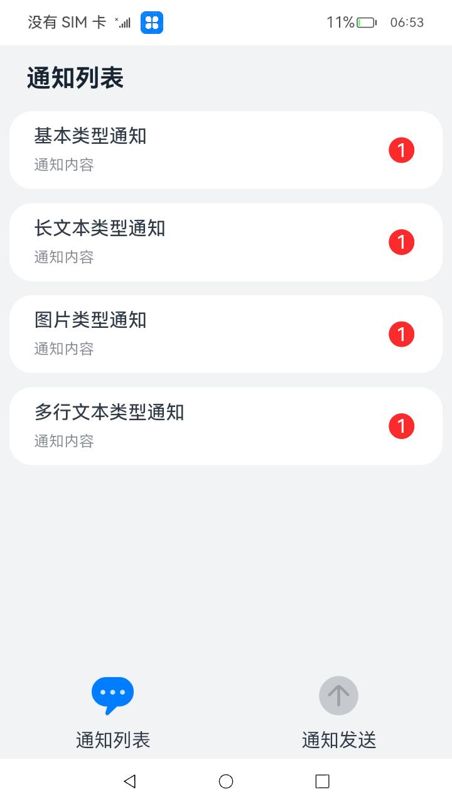
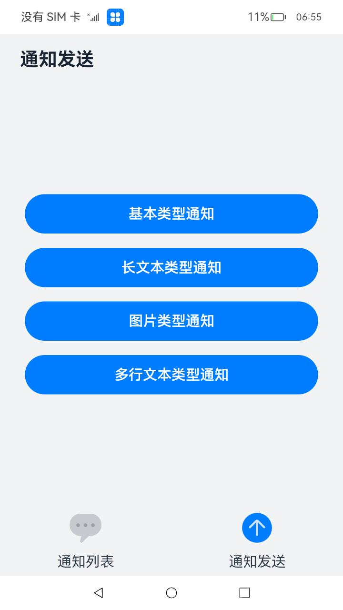
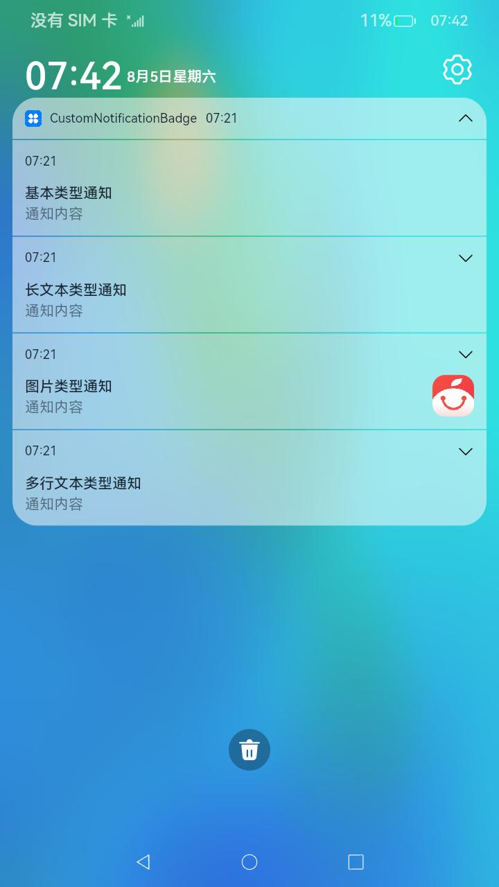
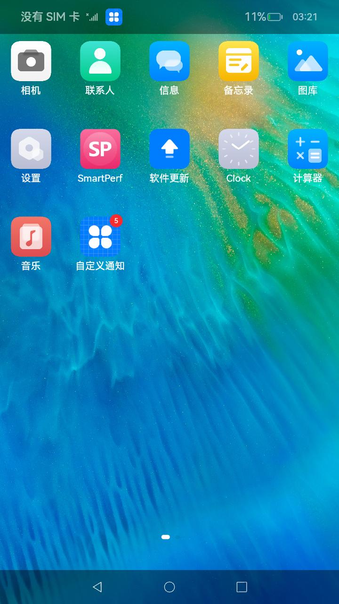

# Custom Notification Badge

### Introduction

This sample shows how to set the desktop badge of an application and how to publish, list and cancel notifications. It
uses [@ohos.notificationManager](https://gitcode.com/openharmony/docs/blob/master/en/application-dev/reference/apis-notification-kit/js-apis-notificationManager.md)
to request the notification permission, publish notifications and set the badge, and
[@ohos.multimedia.image](https://gitcode.com/openharmony/docs/blob/master/en/application-dev/reference/apis-image-kit/arkts-apis-image.md)
to decode the picture of the picture notification. Five notification content types are covered: basic text, long text,
multiline text, picture and conversation.

The notification capabilities are encapsulated in the `notification` HAR module: `NotificationContentUtil` builds the
content of each type, `NotificationRequestUtil` assembles a complete notification request, `NotificationUtil` handles
authorization, publishing and cancellation, and `NotificationManagementUtil` keeps the message groups, the counts of each
type and the desktop badge. `NotificationOperations` in the `entry` module combines these capabilities and exposes five
publishing entries, and `Index.ets` switches between the message list page and the notification sending page with two
tabs at the bottom.

### Display Effect

|Home page|Notification sending page|Notification list|Desktop badge|
|---|---|---|---|
|||||

### Usage

1. Start the app. The message list page is displayed by default.

2. Touch the notification sending tab at the bottom right. The app calls requestEnableNotification to request the
notification permission, and touch Allow in the dialog to continue.

3. On the notification sending page, touch the button of the required type (basic text, long text, picture or multiline
text) to publish a notification. Each touch publishes one notification. Swipe down from the status bar to view the
published notifications.

4. Touch the message tab at the bottom left to view the notifications grouped by type. The number of notifications of
each type is displayed on the right of the item. Touch an item to cancel all notifications of that type and to decrease
the desktop badge.

5. Return to the home screen, the badge number of the app equals the number of notifications. The
[Launcher](../../../SystemFeature/ApplicationModels/Launcher) must be installed and started to display the badge.

### Project Structure

```
entry/src/main/ets/
|---components
|   |---NotificationList.ets                 // Notification list, groups notifications by content type and cancels one type on tap
|   |---NotificationPublish.ets              // Notification sending page with four publishing buttons
|   |---TitleBar.ets                         // Title bar of the page
|---feature
|   |---NotificationOperations.ets           // Builds the content of each type and publishes notifications
|---entryability
|   |---EntryAbility.ts                      // Entry ability of the app
|---pages
|   |---Index.ets                            // Home page, switches between the message list and the sending page
entry/src/ohosTest/ets/
|---test
|   |---List.test.ets                        // Registration entry of the 23 test suites
|   |---helper/                              // Shared helpers: test context, state reset, PixelMap, resource strings, UI flow
|   |---*.test.ets                           // Test suites, see ohosTest.md for details
|---testability
|   |---TestAbility.ets                      // Ability that starts the Hypium test framework
|---testrunner
|   |---OpenHarmonyTestRunner.ts             // Test runner
notification/
|---index.ets                               // Exports the four utility instances and the logger
|---src/main/ets/
|   |---notification
|   |   |---NotificationContentUtil.ets      // Builds the content of each notification type
|   |   |---NotificationManagementUtil.ets   // Message groups, counts of each type and the desktop badge
|   |   |---NotificationRequestUtil.ets      // Builds a complete notification request from the content
|   |   |---NotificationUtil.ets             // Authorization, publishing and cancellation
|   |---util
|   |   |---Logger.ets                       // Log utility
```

### Implementation

* Authorization, publishing and cancellation are encapsulated in NotificationUtil, see
[NotificationUtil.ets](notification/src/main/ets/notification/NotificationUtil.ets)
    * enableNotification() calls notification.requestEnableNotification() and is invoked in aboutToAppear of
    [NotificationPublish.ets](entry/src/main/ets/components/NotificationPublish.ets).
    * publishNotification() assigns the auto-incremented id to the request, writes groupName when a group is passed,
    calls notification.publish() and finally asks NotificationManagementUtil to record the request, so the desktop badge
    grows with every published notification.
    * cancelNotificationById() and cancelAllNotifications() cancel one notification or all notifications of the app.

* Notification content is encapsulated in NotificationContentUtil, see
[NotificationContentUtil.ets](notification/src/main/ets/notification/NotificationContentUtil.ets)
    * initBasicNotificationContent(), initNotificationLongTextContent(), initNotificationMultiLineContent(),
    initNotificationPictureContent() and initNotificationConversationContent() build the five content types and set
    notificationContentType accordingly.
    * getContentTypeId() returns the content type id of a published notification, and falls back to the deprecated
    contentType field and then to the basic text type.

* Notification requests are assembled in NotificationRequestUtil, see
[NotificationRequestUtil.ets](notification/src/main/ets/notification/NotificationRequestUtil.ets)
    * initBasicNotificationRequest() builds a request with the CONTENT_INFORMATION slot type, the default id 1 and the
    given content.

* Message groups, counts and the badge are encapsulated in NotificationManagementUtil, see
[NotificationManagementUtil.ets](notification/src/main/ets/notification/NotificationManagementUtil.ets)
    * The constructor resets the local state and reads the active notifications through getActiveNotifications() to
    rebuild the groups and the badge.
    * getAllNotifications() returns the grouped notifications and the count of each type for the message list.
    * cancelNotificationType(typeId) cancels all notifications of that type through notification.cancel(), and
    setBadgeNumber() and getBadgeNumber() set and read the desktop badge.
    * resetLocalState() clears the groups, the counts and the badge without touching the notifications already published,
    which keeps the UI and the automated test cases isolated from each other.

* The publishing entries are combined in NotificationOperations, see
[NotificationOperations.ets](entry/src/main/ets/feature/NotificationOperations.ets)
    * The constructor reads the text and the additional text through resourceManager.getStringSync(), and the `build*`
    methods override the title with the string resource of the type and return the built content.
    * publishBasicNotification(), publishLongTextNotification(), publishMultiLineNotification() and
    publishPictureNotification() build the content, assemble the request and publish it. The picture notification reads
    app.media.notification_icon through resourceManager.getMediaContent() and decodes it into a PixelMap through
    image.createImageSource() and ImageSource.createPixelMap().
    * publishConversationNotification() publishes the conversation notification with the group name CONVERSATION, so
    that it is counted in the same group. There is no UI entry for this type, and it is covered by the unit test cases
    only.

* Pages and components, see [Index.ets](entry/src/main/ets/pages/Index.ets)
    * Index.ets uses Tabs to provide the message list tab and the notification sending tab. A tab is destroyed and
    rebuilt on switching, so the message list reads the groups again on each entry.
    * NotificationList.ets renders one item for each non-empty group, the item title comes from the string resource of
    the content type, the Badge on the right shows the number of notifications of that type, and the item id is
    notificationGroup plus the index. Tapping an item cancels the type and decreases the badge.
    * NotificationPublish.ets provides four publishing buttons with the ids publishBasic, publishLongText, publishPicture
    and publishMultiLine, and TitleBar.ets provides the title bar with the id titleBar.

* Automated tests, see [ohosTest.md](ohosTest.md)
    * 23 test suites and 1,044 test cases cover content building, request assembling, management utilities, the
    publishing chain, publishing entries, logging, UI state and defect regression.
    * Common operations and observation are encapsulated in the helpers under test/helper, such as the test context,
    the state reset, the test PixelMap, the resource strings read in the current device language and the UI flow
    operations.
    * The run command, the environment requirements and the complete case table are described in ohosTest.md.

### Required Permissions

None.

The app does not declare any permission in module.json5. The notification capability is controlled by the user
authorization dialog: when the notification sending page is opened, requestEnableNotification() is called and the
notifications can be published after Allow is touched.

### Dependency

1. This sample does not depend on the code of other samples.

2. The desktop badge is displayed by the [Launcher](../../../SystemFeature/ApplicationModels/Launcher), which must be
installed and started to observe the badge.

### Constraints

1. This sample can only run on standard-system devices. The supported device type is default.

2. This sample is implemented in the Stage model and uses OpenHarmony SDK 26.0.0. The compileSdkVersion,
targetSdkVersion and compatibleSdkVersion are all 26.0.0.

3. DevEco Studio 26.0.0 or later is required to build this sample, since the modelVersion of hvigor is 26.0.0.

4. The badge number is displayed by the Launcher on the home screen, so the badge cannot be observed when the Launcher
is not installed or not started.

### Download

If you need to download this project separately, run the following commands:

```
git init
git config core.sparsecheckout true
echo code/BasicFeature/Notification/CustomNotificationBadge/ > .git/info/sparse-checkout
git remote add origin https://gitcode.com/openharmony/applications_app_samples.git
git pull origin master
```
