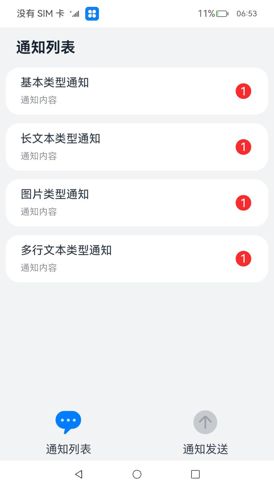
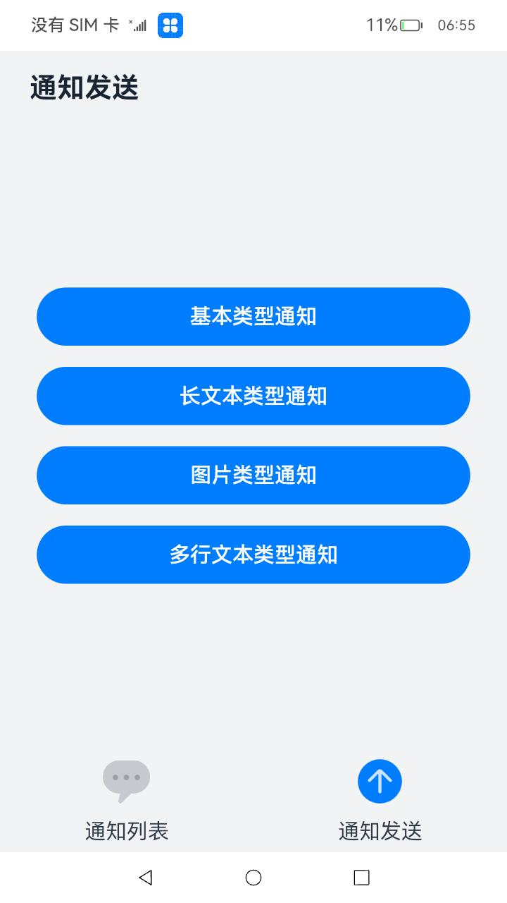
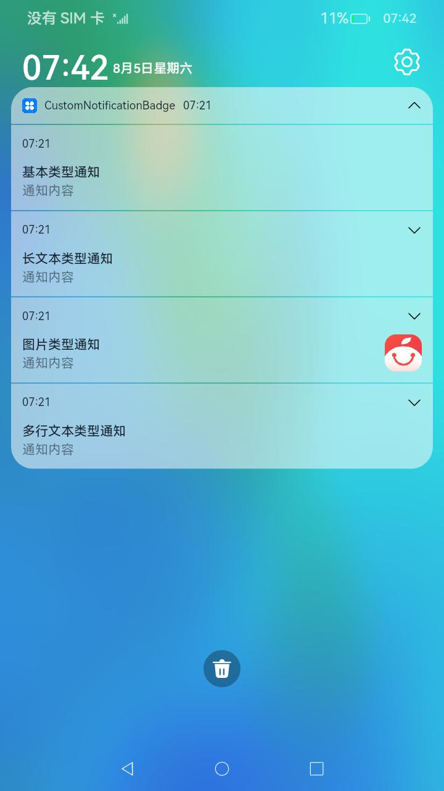

# 自定义通知角标

### 介绍

本示例主要展示了设定应用的桌面图标角标的功能，使用
[@ohos.notificationManager](https://gitcode.com/openharmony/docs/blob/master/zh-cn/application-dev/reference/apis-notification-kit/js-apis-notificationManager.md)
接口申请通知授权、发布通知、设置角标，使用
[@ohos.multimedia.image](https://gitcode.com/openharmony/docs/blob/master/zh-cn/application-dev/reference/apis-image-kit/arkts-apis-image.md)
接口解码图片类型通知的图片。覆盖基本文本、长文本、多行文本、图片和会话 5 种通知内容类型。

通知能力封装在 `notification` 模块（HAR）中：`NotificationContentUtil` 装配各类通知内容，`NotificationRequestUtil`
组装完整的通知请求，`NotificationUtil` 负责授权、发布与取消，`NotificationManagementUtil` 维护消息分组、各类型数量与
桌面角标。`entry` 模块的 `NotificationOperations` 组合上述能力，对外提供 5 个发布入口，`Index.ets` 通过底部两个页签
在消息列表与通知发送页面之间切换。

### 效果预览

| 主页                                                                   | 通知发送页                                                                             | 通知列表页                                                                                      | 桌面角标                                                                   |
|-----------------------------------------------------------------------|-----------------------------------------------------------------------------------|---------------------------------------------------------------------------------------------|------------------------------------------------------------------------|
|  |  |  |  |

### 使用说明

1. 启动应用后默认进入消息列表页。

2. 点击底部右侧的「通知发送」页签，应用会调用 requestEnableNotification 申请通知授权，在弹窗中点击允许后开始操作。

3. 在「通知发送」页点击对应类型的按钮（基本类型、长文本、图片、多行文本）发布通知，点击几次发布几条，下拉状态栏
   可以查看已发布的通知。

4. 点击底部左侧的「消息列表」页签，可以查看按类型分组的通知，条目右侧显示该类型的通知数量。点击某条目会取消该类型
   下的全部通知，并同步扣减桌面角标。

5. 回到桌面，可以看到应用角标数量与通知数量一致。使用前需安装并启动
   [仿桌面应用](../../../SystemFeature/ApplicationModels/Launcher)。

### 工程目录

```
entry/src/main/ets/
|---components
|   |---NotificationList.ets                 // 通知列表控件，按通知类型分组并支持点击取消某一类型
|   |---NotificationPublish.ets              // 通知发送控件，提供 4 个发布按钮
|   |---TitleBar.ets                         // 页面标题栏
|---feature
|   |---NotificationOperations.ets           // 对外提供各类通知内容的构造与发布接口
|---entryability
|   |---EntryAbility.ts                      // 应用入口 Ability
|---pages
|   |---Index.ets                            // 首页，在消息列表与通知发送页面之间切换
entry/src/ohosTest/ets/
|---test
|   |---List.test.ets                        // 23 个测试套件的注册入口
|   |---helper/                              // 公共封装：测试上下文、状态复位、PixelMap、资源串读取、UI 流程
|   |---*.test.ets                           // 测试套件，详见 ohosTest.md
|---testability
|   |---TestAbility.ets                      // 启动 Hypium 测试框架的 Ability
|---testrunner
|   |---OpenHarmonyTestRunner.ts             // 测试用例执行入口
notification/
|---index.ets                               // 导出 4 个工具实例与日志工具
|---src/main/ets/
|   |---notification
|   |   |---NotificationContentUtil.ets      // 封装各种通知的主体内容
|   |   |---NotificationManagementUtil.ets   // 封装消息分组、各类型数量与角标设置的接口
|   |   |---NotificationRequestUtil.ets      // 接收通知的主体内容，返回完整的通知请求
|   |   |---NotificationUtil.ets             // 封装允许发布通知、发布通知、取消通知的接口
|   |---util
|   |   |---Logger.ets                       // 日志工具
```

### 具体实现

* 允许发送通知、发布通知与取消通知的能力封装在 NotificationUtil，源码参考：
  [NotificationUtil.ets](notification/src/main/ets/notification/NotificationUtil.ets)
    * 允许发送通知：enableNotification() 调用 notification.requestEnableNotification()，在
      [NotificationPublish.ets](entry/src/main/ets/components/NotificationPublish.ets) 的 aboutToAppear 中触发；
    * 发布通知：publishNotification() 为请求写入自增的 id，传入分组时写入 groupName，调用 notification.publish()
      发布后通知 NotificationManagementUtil 记录该请求，因此每发布一条通知角标随之增加；
    * 取消通知：cancelNotificationById() 按 id 取消单条通知，cancelAllNotifications() 取消应用的全部通知。

* 通知内容的装配封装在 NotificationContentUtil，源码参考：
  [NotificationContentUtil.ets](notification/src/main/ets/notification/NotificationContentUtil.ets)
    * initBasicNotificationContent()、initNotificationLongTextContent()、initNotificationMultiLineContent()、
      initNotificationPictureContent() 与 initNotificationConversationContent() 分别装配 5 种内容类型，
      并设置对应的 notificationContentType；
    * getContentTypeId() 返回已发布通知的内容类型 id，依次回退到已废弃的 contentType 字段和基本文本类型。

* 通知请求的组装封装在 NotificationRequestUtil，源码参考：
  [NotificationRequestUtil.ets](notification/src/main/ets/notification/NotificationRequestUtil.ets)
    * initBasicNotificationRequest() 组装带有 CONTENT_INFORMATION 槽位类型、默认 id 为 1 的通知请求。

* 消息分组、各类型数量与角标封装在 NotificationManagementUtil，源码参考：
  [NotificationManagementUtil.ets](notification/src/main/ets/notification/NotificationManagementUtil.ets)
    * 构造函数先复位本地状态，再通过 getActiveNotifications() 读取应用当前的活动通知，重建分组与角标；
    * getAllNotifications() 返回分组通知与各类型数量，供消息列表使用；
    * cancelNotificationType(typeId) 通过 notification.cancel() 取消该类型下的全部通知，setBadgeNumber() 与
      getBadgeNumber() 设置与读取桌面角标；
    * resetLocalState() 清空分组、数量与角标且不影响系统已发布的通知，使页面与自动化用例互不干扰。

* 发布入口组合在 NotificationOperations，源码参考：
  [NotificationOperations.ets](entry/src/main/ets/feature/NotificationOperations.ets)
    * 构造函数通过 resourceManager.getStringSync() 读取正文与次要内容，各 `build*` 方法按类型覆盖标题并返回构造结果；
    * publishBasicNotification()、publishLongTextNotification()、publishMultiLineNotification() 与
      publishPictureNotification() 依次构造内容、组装请求并发布。图片类型通知通过 resourceManager.getMediaContent()
      读取 app.media.notification_icon，再经 image.createImageSource() 与 ImageSource.createPixelMap() 解码为 PixelMap；
    * publishConversationNotification() 以 CONVERSATION 作为分组名发布会话类型通知，使其计入同一分组。该类型没有
      页面入口，仅由单元测试用例覆盖。

* 页面与组件，源码参考：[Index.ets](entry/src/main/ets/pages/Index.ets)
    * Index.ets 使用 Tabs 提供「消息列表」与「通知发送」两个页签，切换时对应组件销毁重建，消息列表因此在每次进入时
      重新读取一次分组数据；
    * NotificationList.ets 按分组渲染非空条目，条目标题取自内容类型对应的字符串资源，右侧 Badge 显示该类型的通知
      数量，条目 id 为 notificationGroup 加索引；点击条目会取消该类型通知并扣减角标；
    * NotificationPublish.ets 提供 4 个发布按钮，id 分别为 publishBasic、publishLongText、publishPicture 与
      publishMultiLine；TitleBar.ets 提供 id 为 titleBar 的标题栏。

* 自动化测试，源码参考：[ohosTest.md](ohosTest.md)
    * 23 个测试套件、1,044 条用例，覆盖内容装配、请求组装、管理工具、发布链路、发布入口、日志、UI 状态与缺陷回归；
    * 公共操作与观测封装在 test/helper 下，包括测试上下文、状态复位、测试 PixelMap、按设备语言读取资源串以及
      UI 流程操作；
    * 执行命令、环境要求与完整用例表见 ohosTest.md。

### 相关权限

无。

应用未在 module.json5 中声明权限。通知能力受用户授权弹窗控制：进入通知发送页面时调用 requestEnableNotification()，
在弹窗中点击允许后才能发布通知。

### 依赖

1. 本示例不依赖其余 Sample 的功能代码。

2. 应用的角标依赖于仿桌面应用进行显示：[仿桌面应用](../../../SystemFeature/ApplicationModels/Launcher)，需安装并
   启动后才能看到角标。

### 约束与限制

1. 本示例仅支持标准系统上运行，设备类型为 default。

2. 本示例为 Stage 模型，OpenHarmony SDK 版本号为 26.0.0（compileSdkVersion、targetSdkVersion 与
   compatibleSdkVersion 均为 26.0.0）。

3. 本示例需要使用 DevEco Studio 26.0.0 及以上版本才可编译运行（工程 hvigor 的 modelVersion 为 26.0.0）。

4. 角标数量由仿桌面应用显示在桌面图标上，未安装或未启动仿桌面应用时无法观察角标。

### 下载

如需单独下载本工程，执行如下命令：

```
git init
git config core.sparsecheckout true
echo code/BasicFeature/Notification/CustomNotificationBadge/ > .git/info/sparse-checkout
git remote add origin https://gitcode.com/openharmony/applications_app_samples.git
git pull origin master
```
