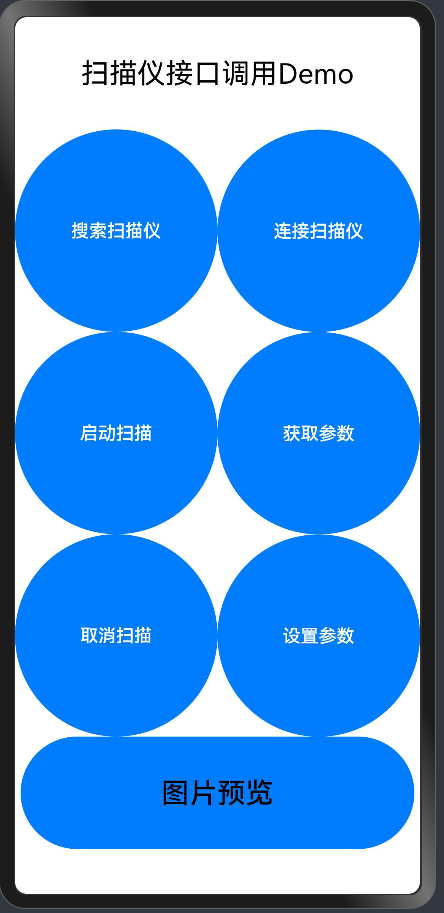

# Scanner Application Demo

### Introduction

This sample uses the [@ohos.scan](https://gitcode.com/openharmony/docs/blob/master/zh-cn/application-dev/reference/apis-basic-services-kit/js-apis-scan.md) API (Basic Services Kit, system capability SystemCapability.Print.PrintFramework) to invoke the scan service of the [print framework](https://gitcode.com/openharmony/print_print_fwk). The scan service loads the scanner driver to discover and connect scanners, get and set scanner parameters, start and cancel scans, get the scan progress, and preview scanned images. The sample is developed with ArkTS and the stage model. The scan APIs are encapsulated in [scan.ets](entry/src/main/ets/scan/scan.ets), with testable pure-logic models in the [scan/model](entry/src/main/ets/scan/model) directory. The project also provides 46 suites with 2,666 ohosTest automated test cases; see [ohosTest.md](ohosTest.md) for details.

### Screenshot

|Scanner home page|
|--------------------------------|
||

### Usage

1. This sample is used to verify the capabilities of the scan framework APIs. The scanner driver is developed based on [sane-backends](https://gitcode.com/openharmony-sig/third_party_backends). Before running the sample, connect a scanner and install the corresponding driver.
2. After the application is started, the home page automatically invokes the scan initialization API.
3. Touch the Searching Scanner button to search for scanners. Once a scanner is found, its id is recorded through the callback.
4. Touch the open Scanner button to connect to the scanner.
5. Touch the get options button to obtain all option descriptions and current values of the scanner, and touch the set option button to set scanner parameters.
6. Touch the Start Scan button to start a scan. After the scan is complete, touch the picture preview button to preview the scanned image.
7. Touch the Cancel Scan button to cancel the current scan task.

### Project Directory

```
ScanNapiInterfaceDemo
├── AppScope/app.json5                              // Application information configuration file
├── entry/src/main
│   ├── ets
│   │   ├── entryability/EntryAbility.ets           // Entry ability
│   │   ├── entrybackupability/EntryBackupAbility.ets // Backup and restore extension ability
│   │   ├── pages/Index.ets                         // Application home page
│   │   └── scan
│   │       ├── scan.ets                            // Scan API encapsulation
│   │       ├── log.ts                              // Logging utility
│   │       ├── model                               // Testable pure-logic models
│   │       └── utils/SampleLogger.ets              // Sample logging utility
│   └── module.json5
├── entry/src/ohosTest                              // Automated tests
│   ├── ets/test                                   // 46 test suites
│   └── ets/test/List.test.ets                      // Test suite registration
├── ohosTest.md                                    // Test case description
└── sceenshots/scandemo.png                         // Screenshot
```

### Implementation

* The scan APIs are encapsulated in the Scan class of [scan.ets](entry/src/main/ets/scan/scan.ets), which provides init, exit, startScannerDiscovery, openScanner, closeScanner, startScan, cancelScan, getScannerParameter, getScannerCurrentSetting, setScannerParameter, getScanProgress, and device event listening methods. The page invokes the scan service through this encapsulation. API reference: [@ohos.scan](https://gitcode.com/openharmony/docs/blob/master/zh-cn/application-dev/reference/apis-basic-services-kit/js-apis-scan.md).

* Searching for scanners: In [Index.ets](entry/src/main/ets/pages/Index.ets), touching the Searching Scanner button first registers the device discovery callback through scan.on('scanDeviceFound') and then calls startScannerDiscovery to start the search. After a scanner is found, the callback returns the device information and records the scannerId.

* Connecting to a scanner: Touching the open Scanner button calls openScanner with the scanner id to connect. When the page exits, closeScanner is called to disconnect.

* Getting and setting scanner parameters: Touching the get options button calls getScannerParameter to obtain all option descriptions, and then calls getScannerCurrentSetting for each option to obtain its current value. Touching the set option button calls setScannerParameter to set the specified option.

* Starting and canceling a scan: Touching the Start Scan button calls startScan to start the scan task and periodically calls getScanProgress to query the progress. When the progress reaches 100, an image source is created through pictureFd to generate the preview image. Touching the Cancel Scan button calls cancelScan to cancel the task.

* Image preview: Touching the picture preview button opens a dialog to display the scanned image.

* Testable logic models: Pure logic such as parameter constraints, the state machine, option UI models, progress aggregation, device directory, image naming, unit conversion, device filtering, and value parsing is placed in the [scan/model](entry/src/main/ets/scan/model) directory for reuse by pages and ohosTest cases.

### Tests

This project provides 46 suites with 2,666 ohosTest automated test cases, covering error code mapping of the scan APIs, parameter constraints, the state machine, parameter UI models, progress aggregation, device synchronization, image naming, unit conversion, and the page main flow. All cases have passed on a real device in batches; see [ohosTest.md](ohosTest.md) for details.

### Permissions

[ohos.permission.PRINT](https://gitcode.com/openharmony/docs/blob/master/zh-cn/application-dev/security/AccessToken/permissions-for-all.md#ohospermissionprint) (normal level, authorized by the system)

[ohos.permission.MANAGE_PRINT_JOB](https://gitcode.com/openharmony/docs/blob/master/zh-cn/application-dev/security/AccessToken/permissions-for-system-apps.md#ohospermissionmanage_print_job) (system_basic level; high-privilege signing is required. For details, see [Applying for High-privilege Permissions](https://gitcode.com/openharmony/docs/blob/master/zh-cn/application-dev/security/hapsigntool-overview.md))

### Dependencies

1. This sample does not depend on other samples.
2. The scanner driver developed based on [sane-backends](https://gitcode.com/openharmony-sig/third_party_backends) and a scanner device of the corresponding vendor and model.

### Constraints

1. This sample uses the stage model and runs on standard-system devices of the default and tablet types.
2. The compileSdkVersion, targetSdkVersion, and compatibleSdkVersion of this sample are all 26.0.0 (with the runtimeOS of OpenHarmony). DevEco Studio that supports the API 26.0.0 SDK is required to compile and run the sample.
3. The first batch of scan APIs is supported since API version 20.
4. To run this sample, connect a scanner and download the corresponding driver.
5. ohos.permission.MANAGE_PRINT_JOB is a system_basic-level permission. High-privilege signing must be completed as described in the high-privilege permission application guide.

### Download

To download the project separately, run the following commands:

```
git init
git config core.sparsecheckout true
echo code/BasicFeature/Print/ScanNapiInterfaceDemo/ > .git/info/sparse-checkout
git remote add origin https://gitcode.com/openharmony/applications_app_samples.git
git pull origin master
```
