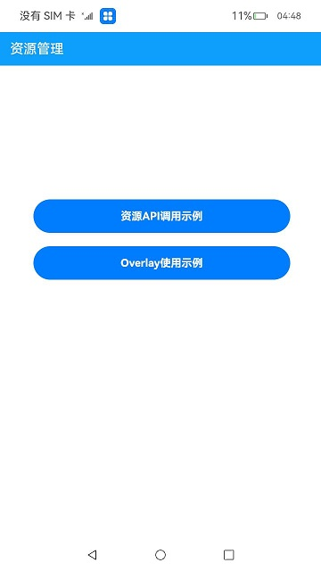
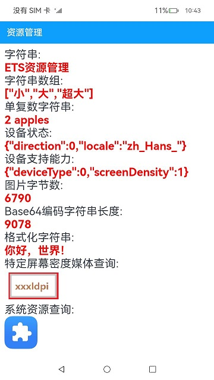
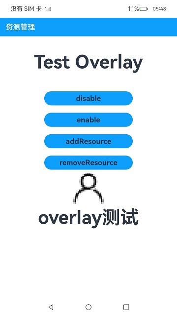
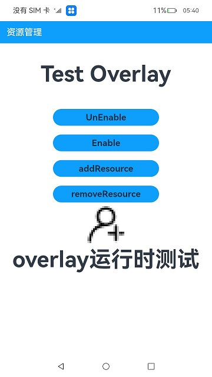

# eTS Resource Management

### Introduction

This sample obtains the `resourceManager` from the `AbilityContext` class of
[@ohos.app.ability.common](https://gitcode.com/openharmony/docs/blob/master/en/application-dev/reference/apis-ability-kit/js-apis-app-ability-common.md),
and uses the APIs in
[@ohos.resourceManager.d.ts](https://gitcode.com/openharmony/docs/blob/master/en/application-dev/reference/apis-localization-kit/js-apis-resource-manager.md)
to demonstrate basic features such as formatted string query, media resource query by the specified screen density and
system resource access, as well as the static and runtime resource overlay features.

### Preview

|Home page|
|---|
||

#### Usage

This page lists the calls of the resource management APIs and the overlay features:

1. Tap the **Resource API sample** button to open the resource API page.

2. Tap the **Overlay sample** button to open the overlay page.

#### Resource API sample

|Resource APIs|
|---|
||

#### Usage

This page displays the calls of the resource management APIs and the results returned by each API.

#### Static overlay

|Static overlay|
|---|
||

#### Usage

This page demonstrates the static overlay feature:

1. The static overlay is enabled by default, and the string and icon of the static overlay are displayed.

2. Tap **Disable** to disable it. After the application is restarted, the string and icon of the application are
   displayed.

3. Tap **Enable** to enable it. After the application is restarted, the string and icon of the static overlay are
   displayed again.

Source: [Overlay sample](entry/src/main/ets/pages/Overlay.ets)

#### Runtime overlay

|Runtime overlay|
|---|
||

#### Usage

This page demonstrates the runtime overlay feature:

1. Tap **addResource** to apply the runtime overlay. The string and icon of the runtime overlay then replace the
   previous ones.

2. Tap **removeResource** to remove the runtime overlay. The string and icon before the coverage are restored.

### Project Structure

```
entry/src/main/ets/
|---entryability                        // application entry
|---pages
|   |---Index.ets                       // home page
|   |---BasicResources.ets              // basic resource page
|   |---Overlay.ets                     // overlay page
|---utils
|   |---ResourceUtils.ets               // stateless helpers: density, bytes, Base64, plural
|   |---RouteTable.ets                  // page registry and page url resolution
|---service
|   |---ResourceAccessService.ets       // resourceManager access wrapper
|   |---OverlayController.ets           // overlay action decision and state machine
libraryOverlay                          // static overlay module (project root)
libraryRuntimeOverlay                   // runtime overlay module (project root)
```

### Implementation

#### Resource API sample

1. Obtain the context with `getContext()`, get the resource manager from `context.resourceManager`, and then call the
resource management APIs to obtain the corresponding resources, for example:
* string resource: `resourceManager.getStringValue()`
* string array resource: `resourceManager.getStringArrayValue()`
* media resource: `resourceManager.getMediaContent()`
* formatted string resource: `resourceManager.getStringSync()`
* media resource of the specified screen density: `resourceManager.getMediaContentBase64()`

2. Import `resourceManager`, get the system resource manager with `resourceManager.getSystemResourceManager()`, and
then obtain system resources.

3. The page delegates the reads to `ResourceAccessService`, which wraps the `resourceManager` calls. The density
normalization, byte size formatting, Base64 length calculation, plural branch decision and resource key sanitizing are
implemented as static methods of `ResourceUtils`.

Source: [Resource API sample](entry/src/main/ets/pages/BasicResources.ets) and
[resource utils](entry/src/main/ets/utils/ResourceUtils.ets)

#### Home page routing

`Index.ets` uses `RouteTable` to validate and resolve page urls: an unregistered url falls back to the home page,
and the resource API page is opened with the `resources` event name declared in the table.

Source: [home page](entry/src/main/ets/pages/Index.ets) and [route table](entry/src/main/ets/utils/RouteTable.ets)

#### Overlay

1. The static overlay covers the target resources by loading the resources of the overlay module. The `module.json5` of
the overlay module declares `"targetModuleName": "entry"` to cover the resources of `entry`. It is enabled by default
and can be enabled or disabled through bundle manager APIs.

Steps: after installing the HAP of `entry`, push the HSP built from the `libraryOverlay` module to `/data/test`
and install it with the `bm install` command.

```shell
hdc shell mount -o remount,rw /
hdc install ./entry-default-signed.hap
hdc shell mkdir /data/test
hdc file send ./libraryOverlay-default-signed.hsp /data/test
hdc shell bm install -p "/data/test/libraryOverlay-default-signed.hsp"
pause
```

2. The runtime overlay covers resources while the application is running. The application calls `addResource` to apply
the coverage and `removeResource` to remove it. The change is not persisted.

Steps: after installing the HAP of `entry`, push the HSP built from the `libraryRuntimeOverlay` module to the
installation directory of the application.

```shell
hdc shell mount -o remount,rw /
hdc install ./entry-default-signed.hap
hdc file send ./libraryRuntimeOverlay-default-signed.hsp /data/app/el1/bundle/public/ohos.samples.resourcemanager
pause
```

3. The page uses `OverlayController` to decide the button action, maintain the overlay state transitions and select the
resource key of the message. `Overlay.ets` only refreshes the UI with the decision.

Source: [Overlay sample](entry/src/main/ets/pages/Overlay.ets) and
[overlay controller](entry/src/main/ets/service/OverlayController.ets)

### Permissions

None.

### Dependencies

None.

### Constraints

1. This sample can only be run on standard-system devices.

2. This sample requires the API 26 SDK only, SDK version (API Version 26.0.0), image version (7.1.0.21).

3. This sample requires DevEco Studio 26 or later.

### Testing

The project provides `ohosTest` automation cases: 56 test suites and 3628 cases, including 128 UiTest-driven UI
cases under `ui/` and 60 cases that read the real resources of the module under test. All suites have been executed
in batches by `describe` on an API 26 device and passed. See [ohosTest.md](ohosTest.md) for the execution steps and
the test artifact path.

### Download

To download this project alone, run the following commands:

```
git init
git config core.sparsecheckout true
echo code/BasicFeature/Resource/ResourceManager/ > .git/info/sparse-checkout
git remote add origin https://gitcode.com/openharmony/applications_app_samples.git
git pull origin master
```
