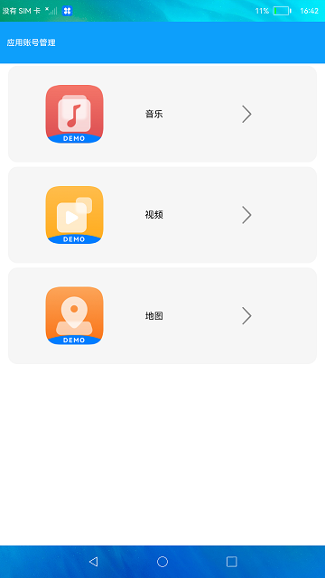
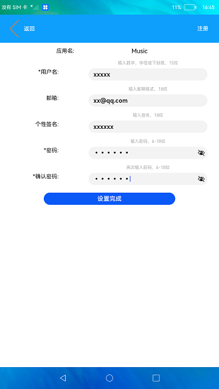
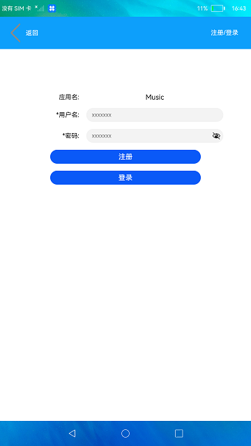
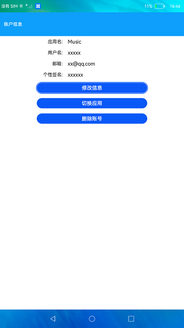

# Application Account Management

### Introduction

This sample uses [@ohos.account.appAccount](https://gitcode.com/openharmony/docs/blob/master/en/application-dev/reference/apis-basic-services-kit/js-apis-appAccount.md) to manage application accounts, [@ohos.data.preferences](https://gitcode.com/openharmony/docs/blob/master/en/application-dev/reference/apis-arkdata/js-apis-data-preferences.md) to persist passwords and login flags, and [@ohos.router](https://gitcode.com/openharmony/docs/blob/master/en/application-dev/reference/apis-arkui/js-apis-router.md) for page routing. It implements account registration, login, information modification, app switching, and account deletion for three demo apps: Music, Video, and Map.

An application account is named as "username_appName", so the same username has independent accounts in the three demo apps. The validation rules of the register/login/modify forms are encapsulated in AccountValidator. The pages support responsive layout: when the available width reaches 840 vp, the UI switches to a two-column layout with an app list sidebar and a content area.

### Preview

| Home page | Register page | Login page | Account info page |
| ---- | ---- | ---- | ---- |
|  |  |  |  |

### Usage

1. After the app starts, the home page displays three demo apps: Music, Video, and Map. Touch an app to go to its register/login page.
2. If you do not have an account of the app yet, touch Register to go to the register page. Set the username, email, signature, password, and confirm password (fields marked with * are mandatory), and touch Setup is complete. A dialog prompts that registration is successful, and the login page is displayed.
3. On the login page, enter the registered username and password, and touch Login. The account info page is displayed.
4. On the account info page, touch Modify info to go to the modify page. Update the email, signature, and password, and the account info page is displayed after success.
5. On the account info page, touch Switch app and confirm to return to the home page and select another app.
6. On the account info page, touch Delete account and confirm. All information of the account is deleted, and the login page is displayed.

### Project Directory

```
entry/src/main/ets/
|---common
|   |---AccountInfo.ets                    // Account info display and buttons for Modify info/Switch app/Delete account
|   |---BaseDataSource.ets                 // Base data source for LazyForEach
|   |---BundleInfo.ets                     // App list on the home page (Music/Video/Map)
|   |---LoginInfo.ets                      // Login form
|   |---ModifyInfo.ets                     // Modify info form
|   |---NavigationBar.ets                  // Top navigation bar
|   |---RegisterInfo.ets                   // Register form
|---entryability
|   |---EntryAbility.ts                    // Application entry, loads the home page
|---model
|   |---AccountData.ts                     // Reads and writes passwords and login flags with preferences
|   |---AccountErrorCode.ts                // Maps and describes appAccount error codes
|   |---AccountKeyBuilder.ts               // Builds account names/credential types/associated data keys
|   |---AccountModel.ts                    // Encapsulates appAccount APIs
|   |---AccountValidator.ts                // Validates the register/login/modify forms
|   |---BundleCatalog.ets                   // Demo app catalog (Music/Video/Map)
|   |---LayoutPolicy.ts                    // Responsive layout policy and route parameter fallback
|   |---Logger.ts                          // Logging utility
|---pages
|   |---Index.ets                          // Home page
|   |---Login.ets                          // Login page
|   |---Register.ets                       // Register page
|   |---Account.ets                        // Account info page
|   |---Modify.ets                         // Modify info page
```

### Implementation

* The appAccount APIs are encapsulated in AccountModel. For details, see [AccountModel.ts](entry/src/main/ets/model/AccountModel.ts).
  * An AppAccountManager instance is created with createAppAccountManager(). The class encapsulates APIs for adding/deleting accounts and reading/writing credentials, extra info, and associated data, with unified error handling and logging.
  * Register: After the form is validated in [RegisterInfo.ets](entry/src/main/ets/common/RegisterInfo.ets), AccountModel.addAccount() is called to create the application account, setAccountCredential() saves the email and signature, and setAssociatedData() saves the password.
  * Login: The username and password are validated in [LoginInfo.ets](entry/src/main/ets/common/LoginInfo.ets). After login succeeds, getAccountCredential() reads the email and signature, and the account info page is displayed.
  * Modify info: setAccountCredential() updates the email and signature in [ModifyInfo.ets](entry/src/main/ets/common/ModifyInfo.ets).
  * Delete account: AccountModel.deleteAccount() deletes the application account in [AccountInfo.ets](entry/src/main/ets/common/AccountInfo.ets).
  * API reference: [@ohos.account.appAccount](https://gitcode.com/openharmony/docs/blob/master/en/application-dev/reference/apis-basic-services-kit/js-apis-appAccount.md)
* Passwords and login flags are persisted with preferences, encapsulated in AccountData. For details, see [AccountData.ts](entry/src/main/ets/model/AccountData.ts).
  * putStorageValue() saves the password during registration and modification, getStorageValue() validates it during login, and deleteStorageValue() removes it when the account is deleted.
  * API reference: [@ohos.data.preferences](https://gitcode.com/openharmony/docs/blob/master/en/application-dev/reference/apis-arkdata/js-apis-data-preferences.md)
* The validation rules of the register/login/modify forms are encapsulated in AccountValidator. For details, see [AccountValidator.ts](entry/src/main/ets/model/AccountValidator.ts).
  * Register validation checks that the username is not empty and not registered, the email format, the password length, and the consistency of the two password entries. Modify validation checks the email format, the new password length, that the new password differs from the old one, and the consistency of the two password entries. Login validation checks that the username and password are not empty and match.
  * Account names, credential types, and associated data keys are built as "field_appName" in [AccountKeyBuilder.ts](entry/src/main/ets/model/AccountKeyBuilder.ts).
* Page routing is implemented with @ohos.router. The Music/Video/Map entries on the home page are defined in [BundleCatalog.ets](entry/src/main/ets/model/BundleCatalog.ets). Touching an entry opens [Login.ets](entry/src/main/ets/pages/Login.ets). Each page switches between the single-column and two-column layouts based on isWideLayout() in [LayoutPolicy.ts](entry/src/main/ets/model/LayoutPolicy.ts).
  * API reference: [@ohos.router](https://gitcode.com/openharmony/docs/blob/master/en/application-dev/reference/apis-arkui/js-apis-router.md)

### Tests

Automated test cases are in entry/src/ohosTest/ets/test, with 30 test suites and 1076 cases, all of which have passed on a real standard-system device. For test design details and device test constraints, see [ohosTest.md](ohosTest.md).

### Required Permissions

None.

### Dependencies

None.

### Constraints

1. This sample can only be run on standard-system devices. It has been verified on a real standard-system device.
2. This sample uses the Stage model and supports API 26 SDK (26.0.0). The compileSdkVersion, targetSdkVersion, and compatibleSdkVersion are all 26.0.0.
3. This sample can be compiled and run only with DevEco Studio 26.0.0 Release or later.

### Download

To download this sample project, run the following commands:

```
git init
git config core.sparsecheckout true
echo code/BasicFeature/Security/AppAccountManager/ > .git/info/sparse-checkout
git remote add origin https://gitcode.com/openharmony/applications_app_samples.git
git pull origin master
```
