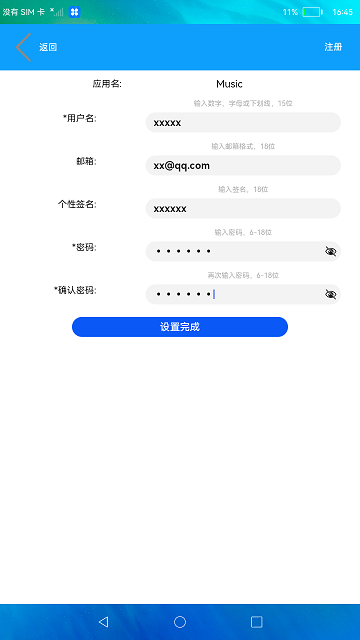
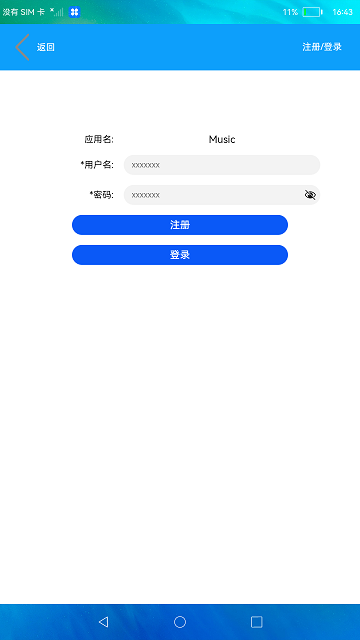

# 应用账号管理

### 介绍

本示例使用 [@ohos.account.appAccount](https://gitcode.com/openharmony/docs/blob/master/zh-cn/application-dev/reference/apis-basic-services-kit/js-apis-appAccount.md) 提供的 AppAccountManager 管理应用账号，使用 [@ohos.data.preferences](https://gitcode.com/openharmony/docs/blob/master/zh-cn/application-dev/reference/apis-arkdata/js-apis-data-preferences.md) 持久化密码与登录标记，使用 [@ohos.router](https://gitcode.com/openharmony/docs/blob/master/zh-cn/application-dev/reference/apis-arkui/js-apis-router.md) 实现页面路由，对音乐/视频等三个示例应用实现了账号注册/登录/信息修改/切换应用与删除账号功能。

应用账号名按“用户名_应用名”拼装，同一用户名在三个示例应用下的账号互相独立；注册/登录/修改表单的校验规则统一封装在 AccountValidator 中；页面支持响应式布局，可用宽度达到 840vp 时切换为“应用列表侧边栏+内容区”的双栏布局。

### 效果预览

| 主页 | 注册页面 | 登录页面 | 账户信息页面 |
| ---- | ---- | ---- | ---- |
|  |  |  |  |

### 使用说明

1. 启动应用后进入主页，主页展示音乐/视频等三个示例应用，点击任一应用进入对应的注册/登录页.
2. 若还未注册该应用的账号，点击注册按钮进入注册页，设置用户名/邮箱/个性签名/密码/确认密码（带*号的为必填项），点击设置完成后提示注册成功并返回登录页.
3. 在登录页输入已注册的用户名与密码，点击登录后进入账户信息页.
4. 在账户信息页点击修改信息按钮，进入修改页重新设置邮箱/个性签名与密码，成功后返回账户信息页.
5. 在账户信息页点击切换应用按钮并确认，返回主页重新选择应用.
6. 在账户信息页点击删除账号按钮并确认，删除该账号的所有相关信息并返回登录页.

### 工程目录

```
entry/src/main/ets/
|---common
|   |---AccountInfo.ets                    // 账户信息展示及修改信息/切换应用/删除账号按钮
|   |---BaseDataSource.ets                 // LazyForEach 数据源基类
|   |---BundleInfo.ets                     // 主页应用列表（音乐/视频等）
|   |---LoginInfo.ets                      // 登录表单
|   |---ModifyInfo.ets                     // 修改信息表单
|   |---NavigationBar.ets                  // 顶部导航栏
|   |---RegisterInfo.ets                   // 注册表单
|---entryability
|   |---EntryAbility.ts                    // 应用入口，加载主页
|---model
|   |---AccountData.ts                     // preferences 密码与登录标记存取
|   |---AccountErrorCode.ts                // appAccount 业务错误码映射与描述
|   |---AccountKeyBuilder.ts               // 账号名/凭据类型/关联数据键拼装
|   |---AccountModel.ts                    // appAccount 接口封装
|   |---AccountValidator.ts                // 注册/登录/修改表单校验
|   |---BundleCatalog.ets                   // 示例应用目录（音乐/视频等）
|   |---LayoutPolicy.ts                    // 响应式布局判定与路由参数回落
|   |---Logger.ts                          // 日志工具
|---pages
|   |---Index.ets                          // 主页
|   |---Login.ets                          // 登录页面
|   |---Register.ets                       // 注册页面
|   |---Account.ets                        // 账户信息页面
|   |---Modify.ets                         // 修改信息页面
```

### 具体实现

* 应用账号管理接口封装在 AccountModel，源码参考：[AccountModel.ts](entry/src/main/ets/model/AccountModel.ts)
  * 使用 createAppAccountManager() 创建 AppAccountManager 实例，封装添加/删除账号与读写凭据/附加信息/关联数据等接口，并统一处理错误码与日志；
  * 注册账号：在 [RegisterInfo.ets](entry/src/main/ets/common/RegisterInfo.ets) 中校验通过后，调用 AccountModel.addAccount() 创建应用账号，再调用 setAccountCredential() 保存邮箱与个性签名，调用 setAssociatedData() 保存密码；
  * 登录：在 [LoginInfo.ets](entry/src/main/ets/common/LoginInfo.ets) 中校验用户名与密码，登录成功后调用 getAccountCredential() 读取邮箱与个性签名并跳转账户信息页；
  * 修改信息：在 [ModifyInfo.ets](entry/src/main/ets/common/ModifyInfo.ets) 中调用 setAccountCredential() 更新邮箱与个性签名；
  * 删除账号：在 [AccountInfo.ets](entry/src/main/ets/common/AccountInfo.ets) 中调用 AccountModel.deleteAccount() 删除应用账号；
  * 接口参考：[@ohos.account.appAccount](https://gitcode.com/openharmony/docs/blob/master/zh-cn/application-dev/reference/apis-basic-services-kit/js-apis-appAccount.md)
* 密码与登录标记使用 preferences 持久化，封装在 AccountData，源码参考：[AccountData.ts](entry/src/main/ets/model/AccountData.ts)
  * 注册与修改密码时通过 putStorageValue() 保存，登录时通过 getStorageValue() 校验，删除账号时通过 deleteStorageValue() 清理；
  * 接口参考：[@ohos.data.preferences](https://gitcode.com/openharmony/docs/blob/master/zh-cn/application-dev/reference/apis-arkdata/js-apis-data-preferences.md)
* 注册/登录/修改表单的校验规则统一封装在 AccountValidator，源码参考：[AccountValidator.ts](entry/src/main/ets/model/AccountValidator.ts)
  * 注册校验用户名为空与账号已存在、邮箱格式、密码长度与两次输入一致；修改校验邮箱格式、新密码长度、新旧密码不同与两次输入一致；登录校验用户名与密码为空及匹配；
  * 账号名/凭据类型/关联数据键按“字段_应用名”拼装，见 [AccountKeyBuilder.ts](entry/src/main/ets/model/AccountKeyBuilder.ts)
* 页面路由使用 @ohos.router 实现；主页展示的音乐/视频等条目定义在 [BundleCatalog.ets](entry/src/main/ets/model/BundleCatalog.ets)，点击条目跳转 [Login.ets](entry/src/main/ets/pages/Login.ets)；各页面根据 [LayoutPolicy.ts](entry/src/main/ets/model/LayoutPolicy.ts) 的 isWideLayout() 在单栏与双栏布局之间切换；
  * 接口参考：[@ohos.router](https://gitcode.com/openharmony/docs/blob/master/zh-cn/application-dev/reference/apis-arkui/js-apis-router.md)

### 测试

自动化用例位于 entry/src/ohosTest/ets/test，共 30 个测试套件 1076 条用例，已在标准系统真机上全部执行通过。用例设计说明与真机实测约束见 [ohosTest.md](ohosTest.md)。

### 相关权限

不涉及。

### 依赖

不涉及。

### 约束与限制

1. 本示例仅支持标准系统上运行，已在标准系统真机上验证安装与运行；
2. 本示例为 Stage 模型，支持 API 26 版本 SDK（26.0.0），compileSdkVersion / targetSdkVersion / compatibleSdkVersion 均为 26.0.0；
3. 本示例需要使用 DevEco Studio 26.0.0 Release 及以上版本才可编译运行；

### 下载

如需单独下载本工程，执行如下命令：

```
git init
git config core.sparsecheckout true
echo code/BasicFeature/Security/AppAccountManager/ > .git/info/sparse-checkout
git remote add origin https://gitcode.com/openharmony/applications_app_samples.git
git pull origin master
```
