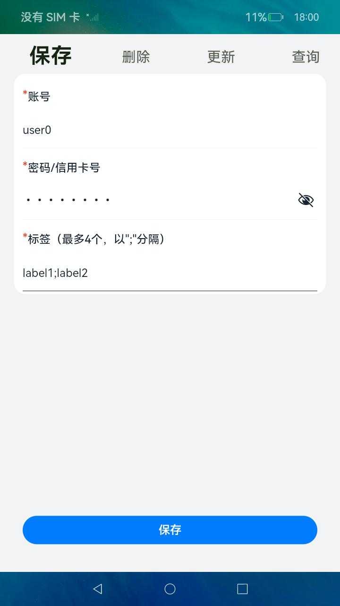
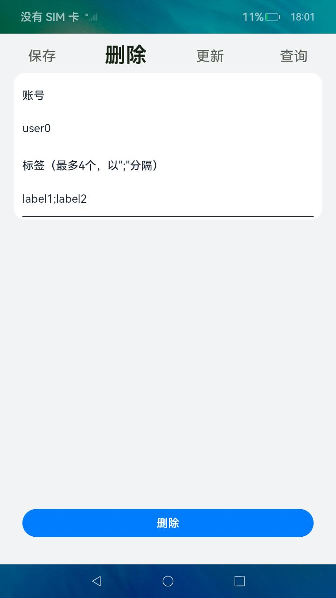
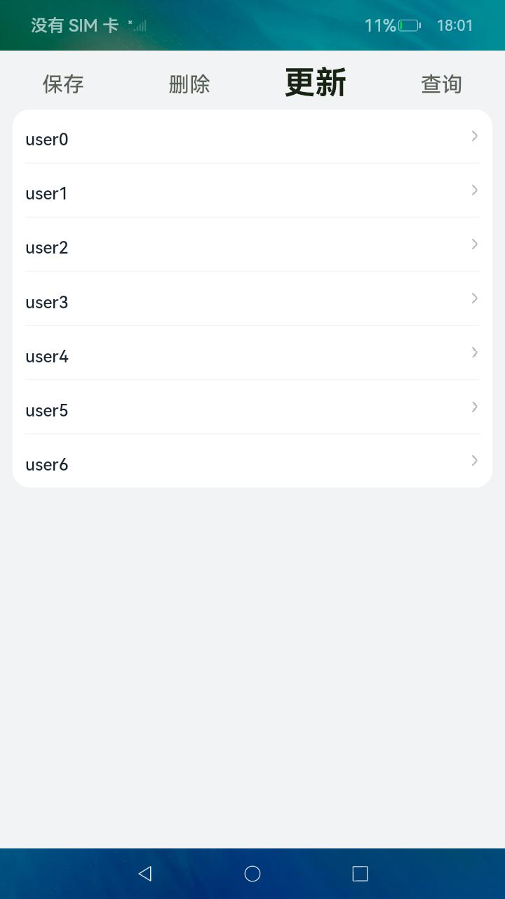
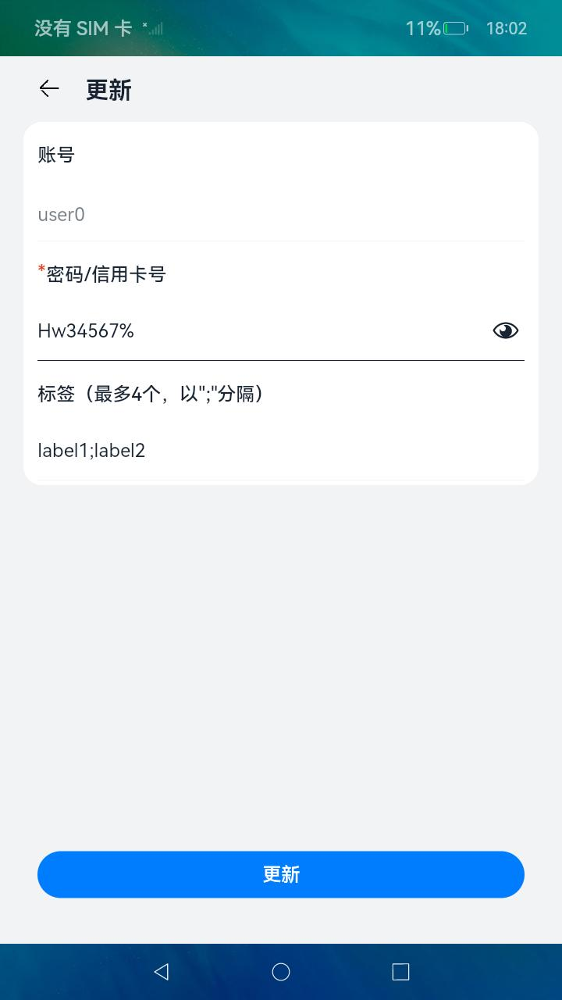
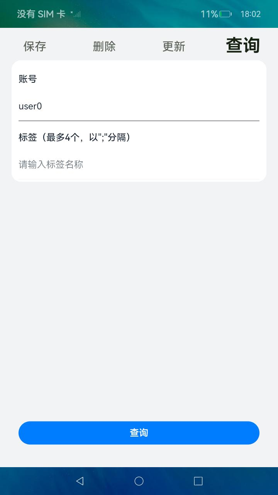
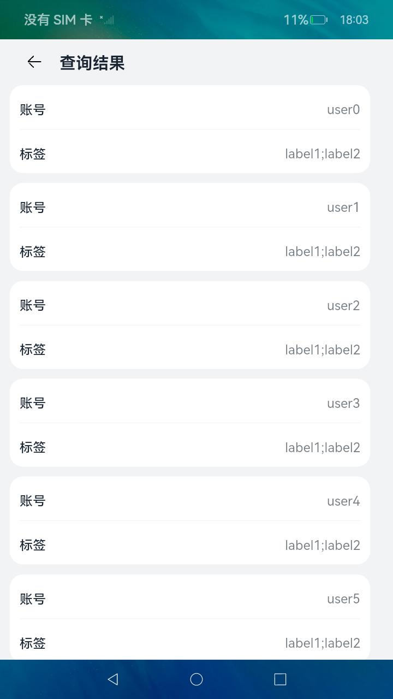
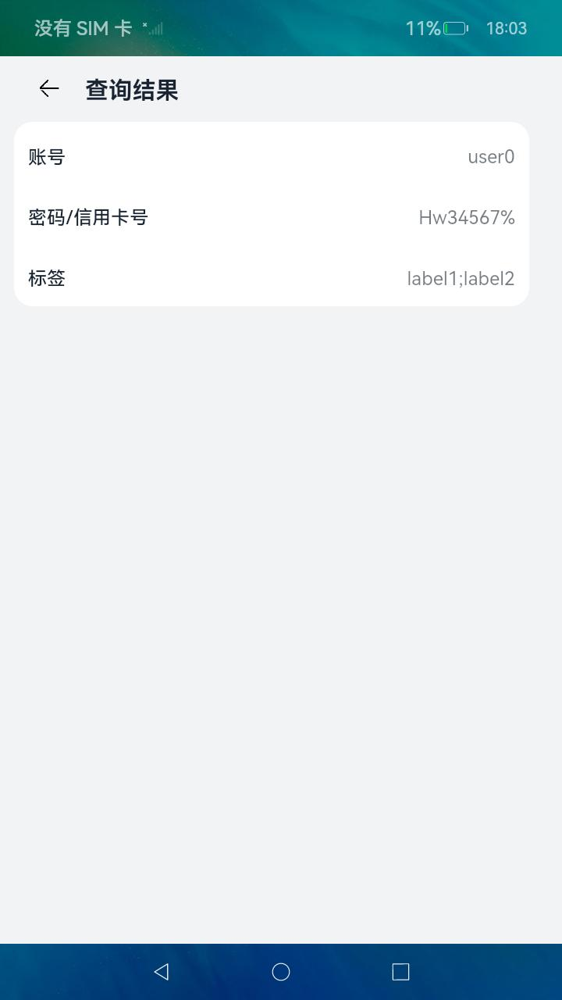

# Asset Store Kit

## Introduction

This sample uses the APIs provided by [@kit.AssetStoreKit](https://gitcode.com/openharmony/docs/tree/master/en/application-dev/security/AssetStoreKit) to save, update, query, and delete sensitive data.

The following scenarios are implemented:

1. The user saves passwords or credit card numbers with this app.

2. The user updates the passwords or credit card numbers managed by this app.

3. The user queries the passwords or credit card numbers managed by this app.

4. The user deletes the passwords or credit card numbers managed by this app.

## Preview

| **Save page** | **Delete page** | **Update list page** | **Update edit page** |
|---------|----------|------------|----------|
|||||
| **Query page** | **Batch query result page** | **Single query result page** |
||||

Usage instructions:

* Save sensitive data:
  * Enter the account, password, and label. You can enter multiple labels, up to 4.
  * Tap **Save**.

* Delete sensitive data in either of the following ways:
  * Batch delete: enter nothing or enter one or more labels, and tap **Delete**.
  * Single delete: enter the account and label (optional), and tap **Delete**.
* Update sensitive data:
  * Tap **Update** in the title bar to go to the update page.
  * In the account list, tap the account to be updated.
  * Enter the lock screen password to access the edit page.
  * Enter the new password and label, and tap **Update**.
* Query sensitive data in either of the following ways:
  * Batch query: enter nothing or enter one or more labels, and tap **Query**. The saved information list is displayed, excluding "password/credit card number".
  * Single query: enter the account and label (optional), tap **Query**, and enter the lock screen password. The details of the account are displayed, including "password/credit card number".

## Project Directory

```
entry/src/main/ets/
|---entryAbility
|   |---EntryAbility.ts
|---model
|   |---AssetModel.ets                     // Asset model file
|---pages
|   |---Index.ets                          // Main page
|   |---QueryResultPage.ets                // Query result page
|   |---UpdatePage.ets                     // Update page
```

## Implementation

This app consists of four main pages: Save, Delete, Update, and Query. The pages are switched through the **TabBuilder** component.

* **Save page**: parses the account, password, and label entered by the user and passes them to the `add` API provided by @kit.AssetStoreKit to store short sensitive data in the Asset Store Service.

* **Delete page**: parses the account and label entered by the user and passes them to the `remove` API provided by @kit.AssetStoreKit to delete the short sensitive data that meets the conditions.

* **Update page**:

    1. Calls the `query` API provided by @kit.AssetStoreKit to query all accounts stored in the asset.

    2. Calls the `preQuery` API provided by @kit.AssetStoreKit and passes the returned challenge to the `on` API provided by @kit.UserAuthenticationKit.

    3. After the user enters the lock screen password, passes the AuthToken returned by the `onResult` API to the `query` API provided by @kit.AssetStoreKit to query the plaintext of the old sensitive data.

    4. Parses the account and label entered by the user and passes them to the `update` API provided by @kit.AssetStoreKit to update the sensitive data stored in the Asset Store Service.

    5. Calls the `postQuery` API provided by @kit.AssetStoreKit to release resources when exiting the update page.

* **Query page**:

    When the user does not enter an account:

    Parses the label entered by the user and passes it to the `query` API provided by @kit.AssetStoreKit to query the account and label stored in the Asset Store Service.

    When the user enters an account:

    1. Calls the `preQuery` API provided by @kit.AssetStoreKit and passes the returned challenge to the `on` API provided by @kit.UserAuthenticationKit.

    2. After the user enters the lock screen password, passes the AuthToken returned by the `onResult` API together with the account and label entered by the user to the `query` API provided by @kit.AssetStoreKit to query the plaintext of the sensitive data.

    3. Calls the `postQuery` API provided by @kit.AssetStoreKit to release resources.

## Permissions

[ohos.permission.ACCESS_BIOMETRIC](https://gitcode.com/openharmony/docs/blob/master/en/application-dev/security/AccessToken/permissions-for-all.md#ohospermissionaccess_biometric)

[ohos.permission.STORE_PERSISTENT_DATA](https://gitcode.com/openharmony/docs/blob/master/en/application-dev/security/AccessToken/permissions-for-all.md#ohospermissionstore_persistent_data)

## Dependency

Not involved.

## Constraints

1. This sample can only be run on standard-system devices.

2. This sample has been adapted to the API version 26 SDK.

3. This sample requires DevEco Studio 26 or higher to compile and run.

4. A lock screen password must be set on the device before this sample is used. The update page and the single query result page require the lock screen password to be entered.

## Download

To download this project separately, run the following commands:

```
git init
git config core.sparsecheckout true
echo code/BasicFeature/Security/Asset/ > .git/info/sparse-checkout
git remote add origin https://gitcode.com/openharmony/applications_app_samples.git
git pull origin master
```
