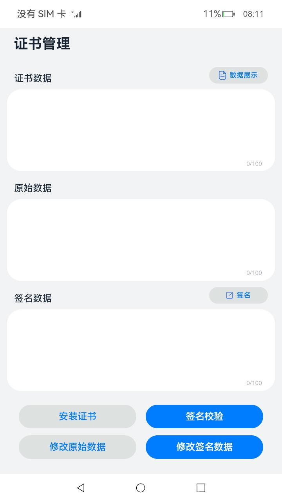
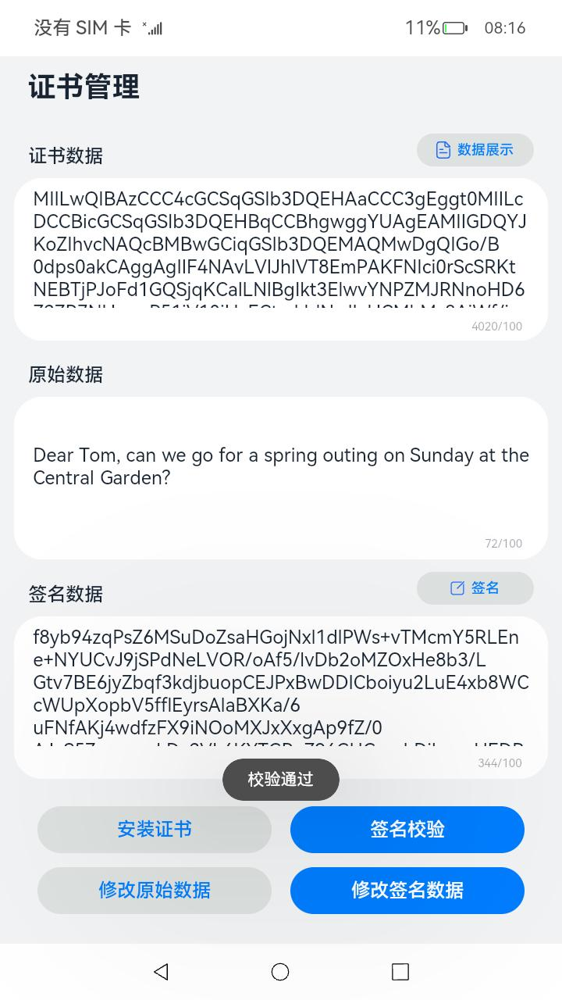
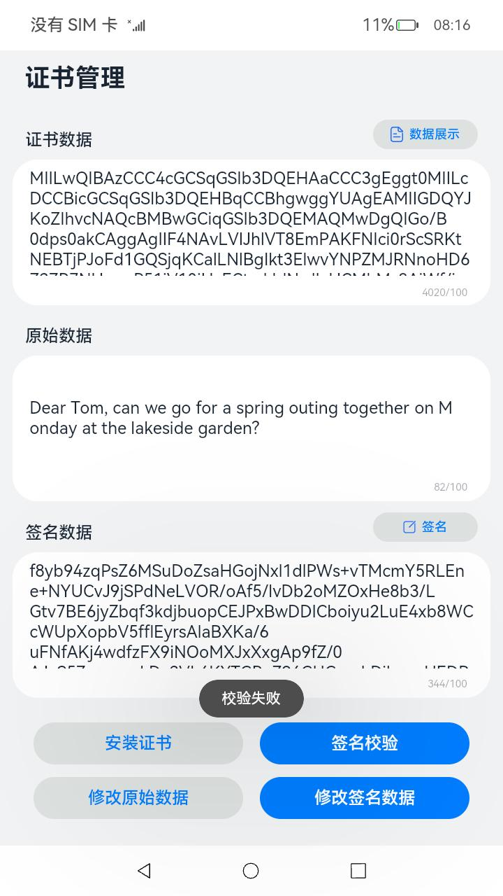

# CertManager

### Introduction

This sample shows how [@kit.DeviceCertificateKit](https://gitcode.com/openharmony/docs/blob/master/en/application-dev/reference/apis-device-certificate-kit/js-apis-certManager.md) works to implement certificate installation, signing, and signature verification. The implementation scenarios are as follows:

1. Signature verification with correct original data and signature data: Simulate that the server obtains the public key through the client certificate, verifies the signature data, and confirms the client identity and the integrity of the original data. The verification succeeds.

2. Signature verification with incorrect original data or signature data: Simulate that an attacker tampers with the original data or signature data. When the server verifies the signature, the attacker identity is untrustworthy or the original data is incomplete, so the verification fails.

### Preview

|Home|Verify Success|Verify Fail|
|:----------------------------------:|:------------------------------------------:|:---------------------------------------:|
|  |  |  |

### Usage

1. Click **Install Certificate**. A toast is displayed, indicating **Install Success**.

2. Click **Display Data**. The certificate data and original data are displayed in the text boxes.

3. Click **Sign**. The signature data is displayed in the signature text box, and a toast is displayed, indicating **Sign Success**.

4. Click **Modify Origin Data**. The modified original data is displayed together with the correct signature data. Click **Sign Verify**. A toast is displayed, indicating **Verify Fail**.

5. Click **Modify Signature Data**. The modified signature data is displayed together with the correct original data. Click **Sign Verify**. A toast is displayed, indicating **Verify Fail**.

6. Click **Sign Verify**. A toast is displayed, indicating **Verify Success**.

### Project Directory

```
entry/src/main/ets/
|---entryability
|   |---EntryAbility.ts                                       // Entry class
|---model
|   |---Data.ts                                               // Certificate and signature test data
|   |---Model.ts                                              // Certificate installation, signing, and signature verification
|   |---Logger.ts                                             // Logging utility
|---pages
|   |---Index.ets                                             // Home page
entry/src/ohosTest/ets/
|---TestRunner
|   |---OpenHarmonyTestRunner.ts                               // Test runner
|---test
|   |---*.test.ets                                            // Test cases. For details, see ohosTest.md
|---testability                                               // Test helper page and ability
```

### Implementation

* The functions of certificate installation, signing, and signature verification are encapsulated in the CertManagerModel class of [Model.ts](entry/src/main/ets/model/Model.ts). The home page [Index.ets](entry/src/main/ets/pages/Index.ets) invokes the corresponding methods through buttons. The certificate and signature test data is defined in [Data.ts](entry/src/main/ets/model/Data.ts).
    * Install a private credential: Call [certificateManager.installPrivateCertificate](https://gitcode.com/openharmony/docs/blob/master/en/application-dev/reference/apis-device-certificate-kit/js-apis-certManager.md#certificatemanagerinstallprivatecertificate) with the preset PKCS12 private key data in Data.ts, the keystore password, and the alias to install the certificate and obtain cmResult.
    * Display data: The dataDisplay method encodes the certificate data with Base64 through util.Base64Helper and returns it together with the original data for display.
    * Sign data: Call [certificateManager.init](https://gitcode.com/openharmony/docs/blob/master/en/application-dev/reference/apis-device-certificate-kit/js-apis-certManager.md#certificatemanagerinit) to initialize signing with CMSignatureSpec (PSS padding, SHA1 digest, and SIGN purpose), call [certificateManager.update](https://gitcode.com/openharmony/docs/blob/master/en/application-dev/reference/apis-device-certificate-kit/js-apis-certManager.md#certificatemanagerupdate) to fill in the source data, and call [certificateManager.finish](https://gitcode.com/openharmony/docs/blob/master/en/application-dev/reference/apis-device-certificate-kit/js-apis-certManager.md#certificatemanagerfinish) to complete signing and obtain the signature result.
    * Verify data: Initialize signature verification with the VERIFY purpose, fill in the source data via certificateManager.update, and call certificateManager.finish with the signature data to complete verification. If no exception is thrown, the verification succeeds.
    * Modify original data or signature data: The modifyOriginData and modifySignatureData methods replace the original data or signature data with the preset tampered content in Data.ts and display the result.

### Required Permissions

[ohos.permission.ACCESS_CERT_MANAGER](https://gitcode.com/openharmony/docs/blob/master/en/application-dev/security/AccessToken/permissions-for-all.md#ohospermissionaccess_cert_manager): Allows the app to install private credentials and use the credentials for signing and signature verification.

### Dependency

N/A.

### Constraints

1. This sample can only be run on standard-system devices, with device types of default and tablet.

2. This sample is developed based on the Stage model and adapted to the API version 26 SDK (SDK version: 26.0.0).

3. This sample requires DevEco Studio 26 or later to compile and run.

### Download

To download the sample project only, run the following commands:

```
git init
git config core.sparsecheckout true
echo code/BasicFeature/Security/CertManager/ > .git/info/sparse-checkout
git remote add origin https://gitcode.com/openharmony/applications_app_samples.git
git pull origin master
```
